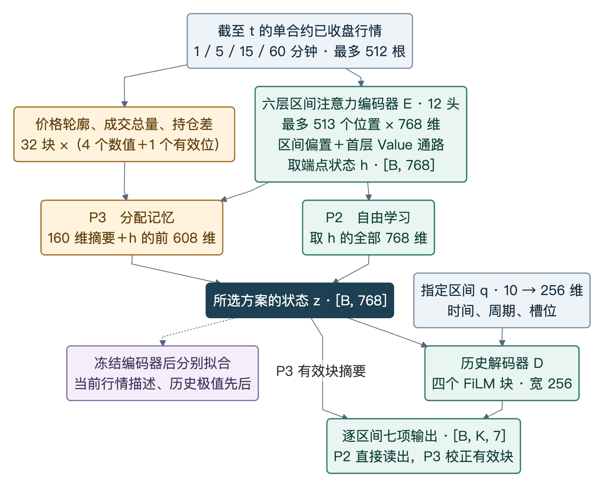
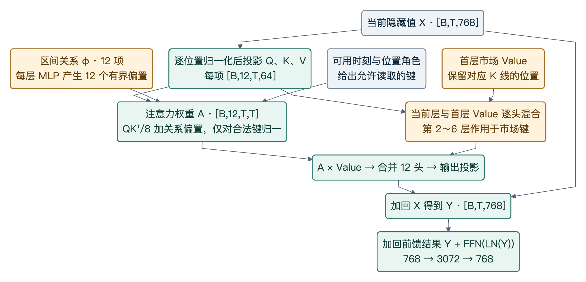
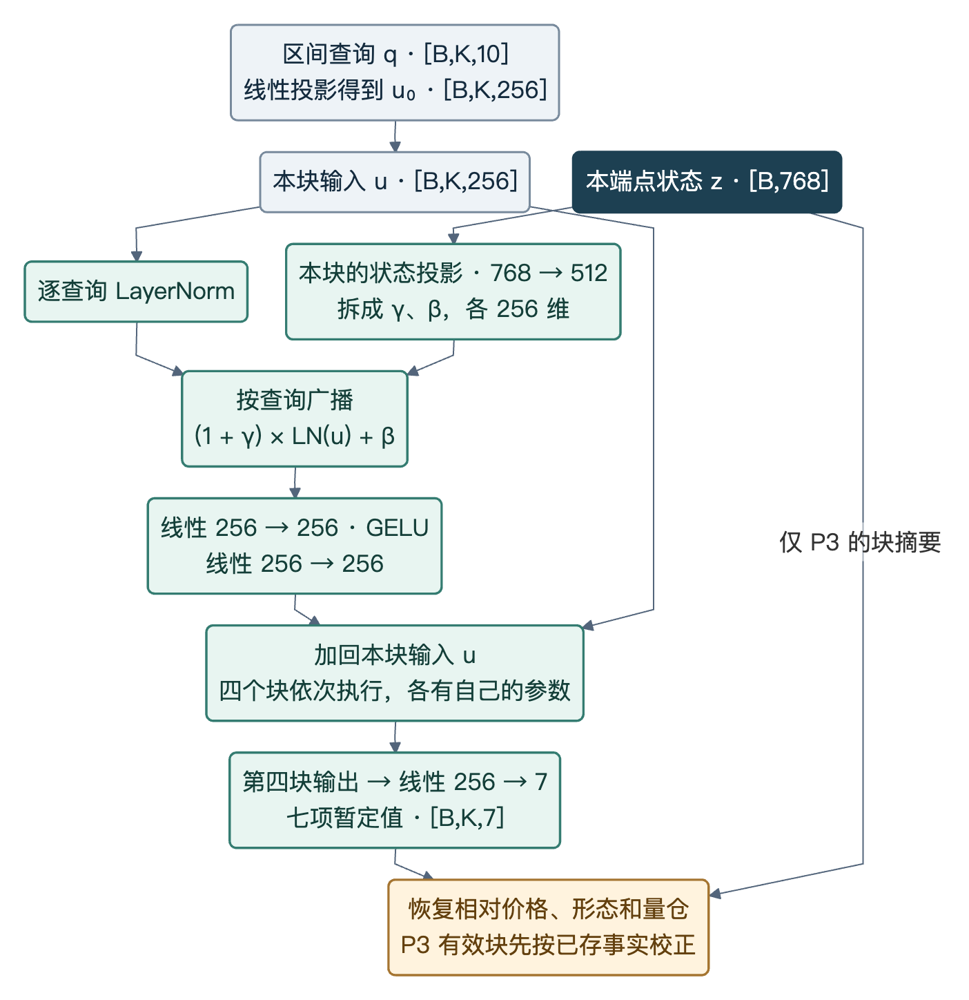

# Babel 首批 P2 与 P3 模型架构和代码核验

在一根分钟 K 线收盘的时刻 `t`，我们希望保存一份 3,072 字节的状态。稍后只取这份状态、指定的历史区间和允许的价格锚点，就能读回一根已观察的 K 线。只取状态，也能描述截至当时的行情。**P2 把 768 个坐标全部交给网络学习。P3 用 160 个坐标存可核实的价量摘要，把另外 608 个留给网络。** 首批比较这两种记忆分配及其配套读法。两套模型独立训练，同一种子下形状与作用相同的参数成对初始化，输入、主干结构和三任务配方一致。这是 2026 年 11 月 27 日的首批设计，正式实验说明记录采用的本文 Git 版本。[首批要作的选择](BABEL_ROADMAP.md#first-batch-decision) · [机器可读架构](BABEL_ROADMAP.json)

**就架构而言，已经可以着手实现和做首批预检。** 总图上的每条路径都有明确的输入、输出和梯度去向。能否保住最近几根的价格细节、单位算力能处理多少合约，要分别用留出行情和目标设备实测。初读可顺着下面的单个收盘时刻走到两个输出。对照代码时直接定位到[参数核算](#parameter-audit)、[实现验收](#implementation-checks)或[可复算的小例子](#arithmetic-fixtures)。



<a name="tensor-walk"></a>

## 从一次收盘读懂全程的张量

例如在 10:10 收盘后，问同一月份合约“10:00 至 10:05 的五分钟栏开、高、低、收各是多少”，再问“截至 10:10，最近 64 个交易分钟回撤多大”。编码器 `E` 只需为这份完整历史计算一次状态。第一个问题向历史解码器 `D` 提供区间地址，第二个问题从描述网络 `A` 的输出取对应分量。下一根分钟线收盘时，用新的可见历史生成下一份状态。早先某个内部市场位置的向量没有经过该端点自己的完整观察窗和汇聚过程。

下表取 `B=2` 个独立端点，各读 `K=3` 个历史区间。`L` 是批内排布的市场槽位数，必要时补齐，最多 512。加上一个端点位置后 `T=L+1`，下表展示满长 `T=513`。`B` 与一次优化更新累计的任务样本数各有含义。

| 计算位置 | 此例的张量形状 | 实现时检查哪一根轴 |
|---|---|---|
| 四个周期的市场输入 | 数值及标记 `[2,512,28]`，时间上下文 `[2,512,8]`，周期编号 `[2,512]` | 一行对应一根已闭合的区间栏或一个带标记的空槽 |
| 三路映射相加，追加端点 | `[2,512,768] → [2,513,768]` | 只在位置轴追加一个可学习向量 |
| 六层编码器，每一层 | 各自的 Q、K、V 为 `[2,12,513,64]`，注意力权重 `[2,12,513,513]`，层输出 `[2,513,768]` | 最后两根注意力轴依次是查询、键。每个端点只读自己的行情 |
| 取端点位置、最后归一化 | `[2,513,768] → h[2,768]` | 从每个样本取端点行。`h` 是端点向量 |
| 两种状态 | P2 直接取 `h`。P3 将 `[2,32,5] → [2,160]`，拼上 `[2,608]`。两者都得 `z[2,768]` | 拼接沿特征轴，每个端点 768 个 FP32 数 |
| 按区间读历史 | 地址 `[2,3,10] → [2,3,256]`，经过四个调制块，最后 `[2,3,7]` | 每个查询七项，回到对应的端点、区间和周期 |
| 描述当前行情 | 完整输入的状态 `[2,768] → [2,128] → [2,18]` | 每个端点一次输出三个期限、每个期限六项 |

两个样本可对应不同合约、不同时间，表中 `K` 仅表示查询条数。测试故意选 `B≠K`，能发现调制参数错误地沿样本轴广播。后续公式中带下标的 `Kⱼ` 表示注意力的键。

<a name="inputs"></a>

## 输入怎样保留价位与时间

从同一月份合约的原始分钟开、高、低、收（OHLC）、成交量和起末持仓，聚合已闭合的 1、5、15、60 分钟栏。各档最多取 256、128、64、64 个名义槽。来源分钟记录的是开栏时间，只有区间闭合才可读取。在 10:07 可以读 10:06 至 10:07 的分钟栏，10:05 至 10:10 这根五分钟栏要等到 10:10。各周期有重叠，缺失保留在日历原位。用同源聚合保证同一个物理区间的开收取首末、高低取极值、成交量求和、持仓取起末边界。[数据口径与资格报告](../../experiments/20261127_history_qualification_v1/reports/completed_months_20261127/qualification.md)

| 市场位置的输入 | 字段与变换 |
|---|---|
| 价量数值 9 项 | 跳空 `log(O/C_prev)`、实体 `log(C/O)`、上影 `log(H/max(O,C))`、下影 `log(min(O,C)/L)`，成交量、起持仓、末持仓各取 `log1p`，净持仓变化取经训练期尺度缩放的 `asinh`，最后一项为 `log σ_past`。这里公式中的 `L` 指当根最低价 |
| 质量标记 19 项 | 每个数值各有一个可见位和一个人工遮挡依赖位，另有一个波动尺度后备位。未知数值填零且可见位为零。真实零成交保留可见位。完整输入的人工遮挡位为零 |
| 时间上下文 8 项 | 距端点收盘的交易分钟与自然分钟、区间交易与自然时长，四项各取 `log1p`。再加覆盖率、预热覆盖率、时段时刻的正弦和余弦 |
| 周期身份 | 1、5、15、60 分钟各取 `Embedding(4,768)` 的一行。合约身份用于定位数据。模型使用共同的周期表 |

价格变化先按当根之前、同周期的 64 个连续合格收盘收益求 RMS 波动尺度，再用训练期的字段和周期尺度变换。64 个收益要有 65 个边界收盘。下限与冷启动后备值都由训练部分确定。价格尺度和标记随变换后的字段保留。每个用于显式摘要的字段都要从两套方案共同可见的数值按声明精度反算，再对原行情核验。EMA、RSI、MACD 沿用路线的指标对照安排。编码器的首批输入固定为上表字段。[特征、预热与指标的职责](BABEL_ROADMAP.md#input-views)

令 `x` 为 28 项数值及标记，`u` 为 8 项时间上下文，`p` 为周期编号。进入主干的市场位置是 `Linear(28,768)(x) + Linear(64,768)(GELU(Linear(8,64)(u))) + period[p]`，三项结果均为 `[B,L,768]`。这使同一周期不同时段可以使用相同参数，同时保留交易距离与自然时间距离的区别。行号只决定存放位置。时间、可见性和区间自身决定谁能读谁。

<a name="interval-encoder"></a>

## 六层编码器如何选择区间并读取价量



**先选区间。** 设一层的输入为 `X[B,T,768]`。按每个位置的最后 768 维做 LayerNorm，分别投影查询、键、值，再将 `768=12×64` 拆头。对每对位置 `(i,j)` 计算区间关系 `φᵢⱼ`。每层有自己的 `12→32→12` 关系网络，隐藏层为 GELU。张量 `φ[B,T,T,12]` 的最后一维按下表排列。

| 项数 | 从查询 i 看键 j |
|---:|---|
| 2 | 结束时刻的交易分钟差、自然分钟差。若先算完整矩阵，对每种时间差取 `sign(Δ) log1p(abs(Δ))` |
| 3 | `log1p(dᵢ)`、`log1p(dⱼ)`、`log((1+dᵢ)/(1+dⱼ))`，`d` 为交易时长 |
| 3 | 两区间在交易时间上的交并比、i 包含 j、j 包含 i |
| 4 | i 和 j 的覆盖率、i 和 j 是否为端点位置 |

输出 `2 tanh(MLP(φ))` 后，把头轴移到第二维，得到偏置 `b[B,12,T,T]`。可用性掩码按 `[B,1,T,T]` 广播，允许的边记 0，禁止的边记负无穷。对每个合法查询，在键轴上计算 `Wᵢⱼ = softmaxⱼ(Qᵢ·Kⱼ/8 + bᵢⱼ + Mᵢⱼ)`。分母的 8 来自 `√64`。固定内容分数时，两个合法键的权重比因几何偏置乘上 `exp(bᵢⱼ−bᵢₖ)`。偏置的末次线性投影权重和偏置均从零起步，初始权重比因子为 1。

**合法边由真实可用时刻决定。** 市场查询能读所有不晚于自身的有效市场键，包括同刻闭合的一分钟和五分钟栏。端点只作全窗汇聚，市场行无法读端点。端点可读截至 `t` 的有效市场键和自己。端点以 `t` 为时间锚，自身时长和覆盖填零，涉及它的时长比、交并比及双向包含填零。真实对端保留自己的时长和覆盖。端点当键时关系偏置恒为零，合法的自身内容分数照常计算。填充键被屏蔽。没有合法键的填充查询跳过或安全置零，避免对全负无穷行直接做 softmax。

**再带回内容。** 第一层的 `V₁` 来自本次输入的逐位置投影，在跨栏混合前取得。从第二至第六层，每层每头一个标量 `α=σ(a)`，其中 `a` 初值为零。对市场键取 `Vmix=(1−α)Vℓ+αV₁`，端点键用本层 `Vℓ`。`α` 广播为 `[1,12,1,1]`。这样深层用已经形成的上下文选栏，还可以直接读到该栏的底层特征。完整视图和遮挡视图各自产生自己的 `V₁`，保留通往第一层值投影的梯度。[首层值残差的原始研究](https://aclanthology.org/2025.acl-long.1375/)

```text
每头输出 = W @ Vmix                            [B,12,T,64]
Y = X + Wout(合并各头输出)                      [B,T,768]
F = GELU(Linear(768,3072)(LayerNorm(Y)))         [B,T,3072]
下一层输入 = Y + Linear(3072,768)(F)             [B,T,768]
端点向量 h = 最终 LayerNorm(第六层输出的端点行)     [B,768]
```

每层包含注意力前和前馈前两个独立的 LayerNorm。主干 `ε=10⁻⁵`，dropout 为零。排查某一层的输出时，先查合法边，再查偏置和混合后的值，最后查残差。即使一个软偏置很大，也不能打开一条被禁止的边。

<a name="public-state"></a>

## 相同的 768 个坐标怎样分配

P2 直接交付最终归一化后的 `h[B,768]`。P3 先按周期取 16、8、4、4 个块位，共 32 个，每块按日历排 16 根栏。只枚举**严格早于端点**的名义槽，块按从近到远排列，块内按从早到晚排列。若某周期最近过去的一根编号为 `r=0`，则块内位置 `j=15−(r mod 16)`。按 1、5、15、60 分钟顺序展平时，各周期块号从 0、16、24、28 起。两套方案的原始观察窗都包含恰在 `t` 闭合的栏。给 32 个块预留位置，并不表示每次都有 32 个有效块。

一个有效块必须由同一合约、同口径的 16 根已观察栏构成，价量字段可从本次共同可见输入还原，内部 15 条前收联系可核实。若某周期在 `t` 恰有收盘，令 `Iₛ=1`，否则取零。该周期完整的严格过去块至多有 `floor((Cₛ−Iₛ)/16)` 个，`Cₛ` 是该周期窗长。历史充足时，四个周期同时闭合的端点最多有 28 块，只有分钟线闭合时最多有 31 块。缺段、遮挡或计量口径未核实还会减少实数。[块的来源和资格](BABEL_ROADMAP.md#summary-evidence)

每块存放下列五个 FP32 数，顺序对保存和恢复都有效。设 `aⱼ=log(Cⱼ/C_t)`，`U=[u₁,u₂]` 是 `[16,2]` 的固定矩阵。`u₁` 前 8 项为 −1、后 8 项为 +1，整列除以 4。`u₂` 的符号依次为四负、八正、四负，亦除以 4。两列正交、单位长度、各自的和为零。

| 块内坐标 | 保存的事实 |
|---|---|
| 0、1 | `c = Uᵀa` 的两项。第一项对比前后半块，第二项对比中段与两端。两列的和为零，可以令块首对数收盘为零，用可见的 15 次跳空与实体累计出局部路径，得到同样的 `c` |
| 2 | `log1p(S)`，`S` 为 16 根的实际成交量之和 |
| 3 | `asinh(ΔI/s)`，`ΔI` 为最后一根末持仓减第一根起持仓。`s` 用训练期同周期有效块的非零绝对持仓差中位数，下限一手。全零时取一手 |
| 4 | 有效位。有效块为 1，无效块的五个数全置零。有效的平价、零成交、净持仓不变块可写成 `[0,0,0,0,1]` |

```text
P2    z = h                                                        [B,768]
P3    fixed = reshape(块事实, [B,160])
      z = concat(fixed, h[..., :608], axis=最后一维)                  [B,768]
```

P3 的事实和有效位是固定量，学习坐标保留到 E 的梯度。代码若对拼接后的整个 z 调用 detach，三种任务都会失去这条编码器路径。P3 有两种读取同一状态的方式。确定性校正直接用序列化的原坐标。学习头用一份计算副本，按训练期同周期有效块均值和标准差缩放四个数值（标准差下限 `10⁻⁶`），无效项复置零，有效位原样保留。若训练期某周期没有有效块，关闭该期的显式事实和校正，仍计合格单栏。打包后的 `z` 保留这些有物理意义的坐标。向量以外只允许两组同等取得的当前收盘、合约、端点、日历及声明的覆盖与尺度信息，另计其字节和成本。历史市场向量、逐块答案和 K/V 缓存均不在公开接口内。

<a name="query-decoder"></a>

## 一个状态如何回答每根 K 线的价格



给历史解码器的查询 `q[B,K,10]` 只描述“想读哪个区间”。前四项是结束时刻距 `t` 的交易及自然分钟、区间的交易及自然时长，各取 `log1p`。接着是四维周期独热编码。最后两项是 `sin(2πj/16), cos(2πj/16)`。当前闭合查询专用 `(0,0)`。在开头的连续交易例中，10:10 问 10:00 至 10:05 的五分钟栏，四项时间量都为 `log(6)`，周期编码为 `(0,1,0,0)`，最近过去槽的 `j=15`。同一端点可用完全不同的地址读取别的栏。

**四个 FiLM 块串联，最后只有一个七通道输出层。** FiLM 让同一段历史为不同地址产生不同答案。`z′` 是前述供学习头使用的状态。先取 `u₀=Linear(10,256)(q)`。每块拥有独立参数，该块的参数在全部查询和周期之间共享。[FiLM 的条件仿射调制](https://arxiv.org/abs/1709.07871)

```text
每个块 r = 0,1,2,3
  Linearᵣ(768,512)(z′)                         [B,512]
  沿最后一维对半拆，插入查询轴 → γᵣ、βᵣ         各 [B,1,256]
  sᵣ = (1+γᵣ) ⊙ LNᵣ(uᵣ) + βᵣ                   [B,K,256]
  uᵣ₊₁ = uᵣ + Linear₂ᵣ(GELU(Linear₁ᵣ(sᵣ)))    [B,K,256]
七项暂定读数 = Linear(256,7)(u₄)                 [B,K,7]
```

块内两层线性变换均为 `256→256`，带偏置。LN 逐查询沿 256 维归一化。四个状态条件投影用非零随机权重初始化，使历史损失在第一次反传就有路径到达学习状态。只有一个状态可读时，对一个键做 softmax 会恒得 1。FiLM 则让状态直接改变每个查询的 256 个通道。这里的 `K` 可以是单个区间，也可以是一组查询。

### 从七个数恢复报价

七个学习坐标依次是相对收盘 `a`、实体 `b`、上影 `u`、下影 `d`、对数成交量、对数起持仓、对数末持仓。撤销目标的训练期尺度后，价量按下式还原。上下影和三个 `log1p` 量应可取零且非负。发布版本需固定具体的非负映射和指数的安全范围。

```text
C = C_t × exp(a)                    O = C × exp(−b)
H = max(O,C) × exp(u)               L = min(O,C) × exp(−d)
V、OI_start、OI_end = expm1(对应输出)
```

例如 `C_t=100`，某根历史栏的 `a=b=log(102/100)`、`u=log(103/102)`、`d=log(100/99)`。按 `(O,H,L,C)` 顺序应读回 `(100,103,99,102)`。恰在 `t` 闭合的栏固定 `a=0`，已给出的收盘只作锚点，其余报价仍评分。合法跨段跳空保留真实价比。早期一段与当前价缺少可核实的价比连接时，其绝对报价属于估计。已观察段内的涨跌和形态仍可单独检验。首批默认接口只给当前收盘，缺口前另存段锚属于另有预算的方案。[原价与段锚](BABEL_ROADMAP.md#historical-price-anchors)

### P3 在有效块上恢复三种约束

P2 直接返回每个合法查询的读数。P3 对有效的过去查询，先按日历找出所属块，同一解码器读齐固定的 16 个地址。若一批请求涉及 `G` 个不同的“端点、周期、块”，其临时张量为 `[G,16,7]`。同块可以合并计算。校正后按原请求取回 `[B,K,7]`，无效块和当前栏直接读出。

| 物理量 | 固定读法与可检验的性质 |
|---|---|
| 相对收盘 | 对 16 个暂定对数收盘 `p` 作 `p̂=p+U(c−Uᵀp)`。因此 `Uᵀp̂=c`。在精确系数和块内等权平方误差下，校正前后误差平方和之差恰为 `‖Uᵀ(p−a)‖²`。其余 14 个方向仍须网络保留。用校正后的收盘重新计算开、高、低 |
| 成交量 | 从状态反解总量 `S`。在手数上取 `v̂ⱼ=max(vⱼ−τ,0)`，选 `τ` 使总和等于 `S`。`S=0` 时全零。例中暂定量以 `(4,2,1)` 开头、其余为零，给定总量 4，应得 `(3,1,0,…)` |
| 起末持仓 | 对块首起持仓和块末末持仓的暂定值 `p₀,p₁`，取 `x=max(0,−ΔI,(p₀+p₁−ΔI)/2)`，写回 `x,x+ΔI`。例中 `p₀=p₁=1, ΔI=−3`，应得 `(3,0)`。其他持仓位置保留暂定读数 |

一个容易误判的结果是，校正后某个块的收盘更接近真实值，相邻涨跌却更差。因此同一次 P3 解码要保留校正前后两份读数，分别算收盘和相邻差分误差，再看正交于 `U` 的剩余误差。FP32 保存带来的系数误差也要实测。额外展开的兄弟槽只参与校正，训练损失只统计本来登记的查询与差分。[价格误差如何拆分](BABEL_ROADMAP.md#price-gain-attribution)

<a name="joint-training"></a>

## 三种题如何共同训练同一个状态

每个方案、每个种子各有一套 `E、D、A`。`A` 是独立的当前描述头，结构为 `768→128→18`，隐藏层用 GELU。它从完整状态直接回答近 16、64、256 个交易分钟里的净对数涨跌、路径效率、已实现波动、最大对数回撤、成交总量及净持仓变化。路径效率取净位移绝对值除以全部路程，全平取零。波动取收益平方和开方。回撤包含窗口起始收盘。量与仓分别在 `log1p` 和按期限缩放的 `asinh` 坐标监督。每个期限要有起始前收和合法的量仓边界。首批接口采用期限在外、字段在内的排列。期限编号 `h=0,1,2` 对应 16、64、256 分钟，字段编号 `f=0…5` 按上述顺序，输出下标为 `6h+f`。开头那个 64 分钟最大回撤问题读取下标 **9**，再撤销训练期目标变换。训练标签、A、A′ 和交付时的逆变换都使用这一排列。

| 同一更新内的任务 | 端点与输出 | 损失抵达的模块 |
|---|---|---|
| 完整历史回读，32 份 | 完整视图经 E 得 `[32,768]`。每端点有放回抽 64 个过去查询，另读全部合法当前栏和所需相邻栏。D 给各查询七项 | E、D |
| 遮挡历史填空，16 份 | 最近 256 个分钟名义槽中，选择两段互不重叠、各 8 根连续分钟且严格早于 `t` 的合格片段。遮后经 E 得 `[16,768]`。D 对每端点的 16 个隐藏分钟计分 | E、同一个 D |
| 当前描述，16 份 | 完整视图经 E 得 `[16,768]`，A 给 `[16,18]`。只在 18 项均合格时出这类题 | E、A |

总损失 `L_clean + 0.25 L_mask + 0.10 L_desc`，每项先在自己的任务内取平均。三种题从第一步起共用**同一个参数版本**。若拆微批，三类每个样本的系数分别为 `1/32、0.25/16、0.10/16`。三路都算完才对 E、D、A 分别裁剪一次，做一次 AdamW 更新和一次学习率调度。完整回读中，过去与当前占 0.90/0.10。过去的价格路径、形态、量仓组按 0.60/0.20/0.20。抽样损失的分母来自完整合法查询支持，重复抽到的位置按次数计。若第 i 个查询抽中概率为 wᵢ，字段 f 的合法位为 mᵢf，则先算全表 `Z_f=Σwᵢmᵢf`。当 Z_f>0，每次抽中合法项计 `ℓᵢf/Z_f`，其余计零，再除以抽样次数。Z_f=0 的字段在该端点摘除，在同层有支持的项目中重新归一。这样 P3 展开整块也不会改变该块的监督权重。两套模型分别训练，同题、同配额、成对初始化。未来预测梯度为零。[分项权重与抽样公式](BABEL_ROADMAP.md#joint-update)

**遮挡必须始于原分钟。** 先遮原值，再沿依赖关系重算分钟和粗周期字段、下一根的前收跳空、滚动尺度、可见位和后备标记。日历中被遮的分钟仍有时间地址，人工遮挡与批内补齐分别标记。若高低可能由隐藏分钟决定，父栏的相应极值也受影响。P3 重算本视图的有效块与摘要，首层 Value 同样来自这份视图。隐藏值只出现在损失一侧。在固定遮挡和可见行情的两份输入中，单独改动被藏起的价量，编码器输入、P3 打包前的摘要和解码地址都应相同。遮挡后仍可使用截至 `t` 的其他合法观察。[遮挡的依赖范围](BABEL_ROADMAP.md#masked-multitask)

训练完成后冻结 E，重新拟合同规格、独立初始化的描述头 `A′`，用它在留出行情上的误差评价 18 项已教内容。交付通过验收的 `E、D、A′` 和所需固定变换。另用冻结的状态读取训练时未教过的顺序，即最近 37 个分钟收盘中最高、最低谁先出现。如果两条历史的 18 项描述和 P3 的 160 个固定数逐项相同，而最高、最低出现的先后相反，那么只读固定数的算法必然给出相同答案。若冻结 P3 后的读头只看状态，且能在这类留出配对上稳定地分清两条路径，区别就必须来自那 608 个学习坐标。这类配对的独立市场时段目前有限。[冻结读头与独立用途](BABEL_ROADMAP.md#frozen-uses)

<a name="parameter-audit"></a>

## 参数核算与显存边界

下表是**单个方案、单个种子、联合训练阶段**的解析参考。线性层均计偏置，LayerNorm 均计缩放与偏移，Q/K/V 可合并存在一个矩阵。周期表、端点向量和逐头门控均计入。P3 的正交基、尺度与投影是常量或无参数运算，`A′` 在冻结后另行拟合。

| 参数归属 | 可以逐项核对的组成 | 参数数 |
|---|---|---:|
| E 的输入和端点 | `28→768`、`8→64→768`、4 行周期表、1 个端点向量 | 76,608 |
| E 的普通主干 | 每层 Q/K/V/输出 4 个投影、两层前馈、两个仿射 LN，每层 7,087,872，共六层 | 42,527,232 |
| E 的区间偏置及混合门 | 六个 `12→32→12` 各 812 项，加后五层每层 12 个门 | 4,932 |
| E 的最终归一化 | 端点宽度 768 的仿射 LN | 1,536 |
| **编码器 E 合计** | 含上述四行 | **42,610,308** |
| 历史解码器 D | 查询投影 2,816，四个调制块各 525,824，输出层 1,799 | **2,107,911** |
| 描述网络 A | `768→128→18` | **100,754** |
| **一个完整的训练模型 E+D+A** | P2、P3 在这些实现约定下各自为此数 | **44,818,973** |

实现时用整数周期编号和布尔可用性掩码。送入第一层线性投影前，将数值与质量标记转换到约定的输入类型。注意力等中间计算的精度在运行卡固定，公开状态须明确转为 FP32。最终核对每个可学习张量的实际形状与归属，再按 E、D、A 分别求和。总数相同也可能接错线路。满窗时每层每个端点有 `12×513²=3,158,028` 个逻辑注意力分数。如果把成对关系网络的 32 维隐藏值全部展开为 FP32，**单层每个实际并算的端点**仅这一项就需 `513²×32×4=33,685,632` 字节，约 32.13 MiB。有效批次 64 可以梯度累积。若实现按查询行分块，每一行仍须看见它的全部合法键。要以稠密小例核对前向与梯度，实测反向持有或重算的成本。P3 完整块解码另计展开倍率。真实峰值显存、吞吐与每分钟刷新时延在 AutoDL 的同批预检中测量。

<a name="implementation-checks"></a>

## 用什么证据验收模型代码

下面每一项都可以对正式版本的真实入口执行。挂钩读取中间量即可，不要求实现采用特定的类名。调整初始化、精度、并行方式时仍使用相同的样例。除位标记、索引和同输入的序列化字节，浮点比较使用按后端与物理尺度事前锁定的容差。末节的参考数已在本地用合成数组复算，真实模型的字段读取、自动微分和设备执行留到首个实现验证。

| 在哪里施加变化 | 代码应给出什么结果 | 出错先查哪里 |
|---|---|---|
| 两个端点、每端点三个查询。只改变第二个端点的输入。另将市场行连同时间、掩码和关系矩阵的两根位置轴一起重排 | 第一个端点所有输出保持一致。重排后市场输出按原序还原，端点 `h`、按日历打包的摘要和同地址读数相同 | batch 与查询轴混用、行号位置编码、掩码只换了一根轴、按数组行号分块 |
| 输入含同刻闭合的 1/5 分钟栏、一个填充槽和端点。固定内容分数为零，使用末节给定的值 | 合法键数 `[1,3,3,0,4]`，读回 `[3,7,7,0,10.25]`。只改未来记录或尚未闭合的粗栏，给当前端点的实际输入和状态保持一致 | 三角行号掩码、softmax 轴、空行 NaN、端点键误用首层 V |
| 对非退化的合成输入分开观察关系网络前后两层，以及首层值投影的梯度 | 初始 `b=0`、各门 `α=0.5`。首次反传可更新关系末次投影，因其权重初值为零，此时关系隐藏层经这条路的梯度为零。隔离深层 V₁ 支路时，梯度能回到首层值投影 | 偏置末层初始化、误把整条关系支路清零或切断首层 V 的梯度 |
| 两份含相同可见记录的样例，固定所遮分钟与支持，只改隐藏片段的价格、成交和持仓 | 可见输入、遮挡依赖位、后备尺度、首层 V、P3 摘要、查询与解码元信息一致，隐藏真值和损失允许不同。完整视图也检查共同可见输入逐位相同 ⇒ 160 个序列化坐标逐位相同 | 从完整缓存读父栏极值、前收、滚动尺度或分块事实，或用更高精度原行情给 P3 额外信息 |
| 一个四项摘要皆零的有效块、一个缺槽块、一个当前栏。将 `h` 填成各列可辨识的数，再打包、保存、读回 | P3 两块最后的标记分别为 1、0。前 160 位逐块可回读，尾部恰为 `h[..., :608]`。每份状态 3,072 字节。无效块与当前栏走直接解码，恢复后用相同锚点复现结果 | 全局 LN、沿 batch 切 `h`、丢失有效位、把缩放副本拿去物理校正或在状态外偷偷缓存事实 |
| 取两个不同状态、同一组地址，再取同一状态、同块槽位 `[13,2,13]`，按单查、乱序、重复读出 | FiLM 每层 `γ,β` 只沿查询轴广播。在末节的有效块例中三次结果为 `[9,6,9]`。每个槽独立请求也给同值。固定状态并清除编码器临时市场数据后仍能解码 | 状态条件投影全零、按可变查询批做归一化、只对请求子集投影、读头暗中访问市场缓存 |
| 检查一个有效块的投影、成交总量、持仓边界，再对暂定收盘作小扰动 | 价格系数、成交非负且和为给定总量、首末持仓差分别满足保存精度。内积损失对暂定价格 `p` 的梯度为 `(I−UUᵀ)g`，`g` 是对校正后价格的上游梯度。`g=u₁` 时为零，正交方向原样通过。成交及持仓在光滑区与数值差分比对，边界用零量、边界切换样例逐项核值 | 投影轴、指数逆变换、错误单位、整块或未保护的 608 个学习坐标被一并切断 |
| 在同一组参数上分别反传三项损失，再反传加权总损失。比较裁剪前梯度，再比较整批和分微批的一次更新 | E 的梯度等于三项加权和。D 只收回读和填空，A 只收当前描述。非退化样例上，D 和 A 各有路径回到 P3 的学习坐标。优化器及学习率调度各走一步 | 微批额外除以批数、按任务逐次更新或裁剪、损失分母随展开槽数改变、错用冻结后的 `A′` |

P3 有一个细节值得单查。若只经 `z` 反传，最终 LN **之后**的 `h[...,608:]` 没有直接梯度。最终 LN 的均值和方差用到了全部 768 个输入，因此 LN **之前**的同一尾段一般仍可有梯度。这两个挂钩位置对代码有不同的期望。

**已经具备的行情证据。** 月份合约资格核对已在 1,188 个真实收盘端点独立反推 679,654 次历史栏报价，这验证了输入侧从价比回到原价的计算。严格口径下，全套 18 项目前只有白银、黄金和原油出现数值完整的样本，其量仓物理口径还需按日期核实。能否从 768 维状态恢复相同的报价，是首批模型实际要测的误差。[原价独立复算](../../experiments/20261127_history_qualification_v1/reports/completed_months_20261127/independent_review.json) · [各用途的样本范围](BABEL_ROADMAP.md#next-deliverable)

**进入首轮长训的依据。** 先在本实验的独立版本用上述样例核对完整、遮挡两条真实前向和反向，再在目标 CUDA 后端跑一次合格的实际微批，核对有限值、混训更新、峰值成本以及保存、恢复和失败导出。在候选成绩出现前，运行卡还须锁合约时段与量仓口径、各任务的共同样本、报价与描述误差上限、数值映射、精度及资源预算。达到这些条件，才有依据执行已登记的 P2/P3 比较。首批据此能回答一个具体选择。两套都达到事前的报价、描述和成本使用线时，只有摘要方案也达到替换判据才选 P3。只一套达标，就按独立确认的用途选该套。有充分证据表明两套都未达标，就记录丢失的行情内容并结束这份配方。[实验版本与发布](../../experiments/README.md) · [使用精度和停止线](BABEL_ROADMAP.md#delivery-criteria)

<a name="arithmetic-fixtures"></a>

## 可复算的小例子

在项目根目录运行 `.venv/bin/python -m doctest -v docs/babel/BABEL_MODEL_ARCHITECTURE.md` 即可复算下列输入与期望值。只需 NumPy。将来测试模型时，把真实入口或挂钩的输出同这里给出的期望比较。例中手工指定的值只用来隔离算子。

**时间掩码和首层 Value。** 行列顺序为 10:04 闭合的分钟栏、10:05 同刻闭合的分钟和五分钟栏、填充槽、10:05 端点。取一个头的一个值通道，令合法边的内容分和偏置均为零，使它们等权。最终端点应读到 `(3+7+11+20)/4=10.25`。填充的大值和端点自身的首层值都没有贡献。

```pycon
>>> import numpy as np
>>> legal = np.array([[1,0,0,0,0], [1,1,1,0,0], [1,1,1,0,0],
...                   [0,0,0,0,0], [1,1,1,0,1]], dtype=bool)
>>> legal.sum(axis=1).tolist()
[1, 3, 3, 0, 4]
>>> weights = legal / np.maximum(legal.sum(axis=1, keepdims=True), 1)
>>> first = np.array([4., 8., 12., 900., 999.])
>>> current = np.array([2., 6., 10., 800., 20.])
>>> is_market = np.array([True, True, True, False, False])
>>> mixed = np.where(is_market, (first + current) / 2, current)
>>> expected = [3., 7., 7., 0., 10.25]
>>> np.testing.assert_allclose(weights @ mixed, expected, rtol=0, atol=8*np.finfo(float).eps*20)

```

**FiLM 广播和完整块价格校正。** 取归一化查询的一个通道。两个端点对同一组三个查询使用不同的缩放与偏移。再取 16 根真实对数收盘均为零、暂定误差依次为 0 至 15 的合成块，单位可统一乘一个小系数。平方和展示为什么要分别检查收盘与相邻变化。

```pycon
>>> normalized = np.array([0., 1., -1.])[None, :, None]
>>> gain = np.array([1., 2.])[:, None, None]
>>> shift = np.array([10., 20.])[:, None, None]
>>> (((1 + gain) * normalized + shift)[:, :, 0]).tolist()
[[10.0, 12.0, 8.0], [20.0, 23.0, 17.0]]
>>> U = np.array([[-1]*8 + [1]*8, [-1]*4 + [1]*8 + [-1]*4]).T / 4
>>> np.testing.assert_array_equal(U.T @ U, np.eye(2))
>>> p = np.arange(16, dtype=float)
>>> corrected = p - U @ (U.T @ p)
>>> corrected[[13, 2, 13]].tolist()
[9.0, 6.0, 9.0]
>>> def sse(x):
...     return int(x @ x)
>>> sse(p), sse(corrected), sse(np.diff(p)), sse(np.diff(corrected))
(1240, 984, 15, 63)
>>> np.testing.assert_array_equal(U.T @ corrected, [0., 0.])
>>> jacobian = np.eye(16) - U @ U.T
>>> free_direction = np.eye(16)[0] - np.eye(16)[1]
>>> np.testing.assert_array_equal(jacobian @ U[:, 0], np.zeros(16))
>>> np.testing.assert_array_equal(jacobian @ free_direction, free_direction)

```

**跨样本打包。** 两个端点的学习坐标按行编号。第一个端点最近一块合法且四项摘要全零，第二个端点的相同块无效，检查各自的有效位和第二个样本的学习切片边界。

```pycon
>>> hidden = np.arange(2*768, dtype=np.float32).reshape(2, 768)
>>> facts = np.zeros((2, 32, 5), dtype=np.float32)
>>> facts[0, 0, 4] = 1
>>> packed = np.concatenate([facts.reshape(2, 160), hidden[..., :608]], axis=-1)
>>> packed.shape, packed.dtype.name, packed[0].nbytes
((2, 768), 'float32', 3072)
>>> packed[:, 4].tolist(), packed[1, [160, 767]].tolist()
([1.0, 0.0], [768.0, 1375.0])

```

**报价、量仓和混训梯度。** 取正文给定的原价、总量和持仓差。最后一例给三个标量参数分别代表 E、D、A，三项已在任务内取平均的梯度按行排列，可在裁剪前检查合并结果。

```pycon
>>> a, b, u, d = np.log([102/100, 102/100, 103/102, 100/99])
>>> close = 100*np.exp(a)
>>> opening = close*np.exp(-b)
>>> quotes = [opening, max(opening, close)*np.exp(u), min(opening, close)*np.exp(-d), close]
>>> np.testing.assert_allclose(quotes, [100, 103, 99, 102], rtol=1e-12)
>>> volume = np.array([4, 2, 1] + [0]*13)
>>> np.testing.assert_array_equal(np.maximum(volume - 1, 0), [3, 1] + [0]*14)
>>> delta = -3
>>> first_oi = max(0, -delta, (1+1-delta)/2)
>>> first_oi, first_oi+delta
(3, 0)
>>> task_grad = np.array([[2,3,0], [-4,1,0], [5,0,7]])
>>> np.testing.assert_allclose(np.array([1., .25, .10]) @ task_grad, [1.5, 3.25, .7])

```

**正式宽度的参数计数。** `affine` 计入偏置。数字可直接与首个实现按模块列出的可学习参数对照。

```pycon
>>> def affine(d_in, d_out):
...     return (d_in + 1) * d_out
>>> n = 768
>>> stem = affine(28, n) + affine(8, 64) + affine(64, n) + 4*n + n
>>> backbone_layer = 4*affine(n, n) + affine(n, 3072) + affine(3072, n) + 4*n
>>> relation = 6*(affine(12, 32) + affine(32, 12)) + 5*12
>>> E = stem + 6*backbone_layer + relation + 2*n
>>> film = affine(n, 512) + 2*affine(256, 256) + 2*256
>>> D = affine(10, 256) + 4*film + affine(256, 7)
>>> A = affine(n, 128) + affine(128, 18)
>>> E, D, A, E+D+A
(42610308, 2107911, 100754, 44818973)

```
