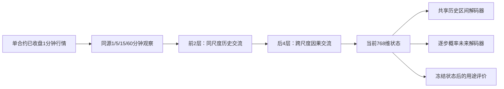

# Babel 路线图：用新分钟数据学习可复用的行情状态

更新：2026-11-25。**这是唯一的当前方案正文，从目标到实施顺序可连续阅读，不需要先读旧实验。** 当前处于方案设计阶段：数据基础审计已做，新模型尚未实现或训练，以下架构和数值均为提案，没有新的模型成绩。

旧路线与旧结论已移入[历史归档](archive/BABEL_ROADMAP_BEFORE_REWRITE_20261125.md)，原报告和数据审计证据保留。归档中的“当前”“下一步”和旧命令不属于执行队列。机器读取的[BABEL_ROADMAP.json](BABEL_ROADMAP.json)同样只描述当前方案，并指向历史快照。

## 1. 我们要做什么，为什么要重新设计

我们要让每根**已收盘**K线拥有一个状态向量，也就是embedding。它应当压缩截至这一刻的一段行情：价格怎样走到这里，近期形态如何，成交和持仓怎样变化。同一个状态以后可以交给不同任务使用，例如描述当前趋势与波动，或者逐步生成未来价格的可能路径。

成功不等于100%复制所有影线，也不等于只学会几条均线规则。我们要分别回答三个问题：**过去的重要内容还读得出来吗？换一个合理的小任务还能用吗？对未来的不确定性有没有增量信息？** 最后一个问题可以失败，不因此抹掉前两个问题的成果；但历史重建成功也不能代替未来或交易检验。

原有研究已经证明某些状态能够回读有限历史，也暴露了近远内容失衡、读头兼容性、训练预算混杂和模型资产丢失等问题。现在有更细、更长、更多品种的数据，应该重新定义模型真正看见的世界，而不是先恢复旧训练链，再逐个改旧超参数。

本方案的核心选择是：**同一份分钟行情形成多个时间尺度；先组织各尺度的内容，再交换长短背景；导出一个状态，同时用历史内容和概率未来检验它。** 这是一套待验证的整体设计，不是已证明最优的新架构。

| 保持不变的目标 | 可以重新选择的实现 |
|---|---|
| 每根已收盘bar只使用当时可得信息 | 窗口长度、分辨率、层数、头数、状态维数 |
| 保存有用价格形态和成交/持仓信息 | 特征表达、归一化、编码与解码结构 |
| 同一状态支持多种后续用途 | 历史损失、概率监督、读头与优化方法 |
| 结果可靠、实验能够结束、模型能够恢复 | 同批对照的具体组织和资源配置 |

旧Macro权重已经丢失，旧报告仍在。新训练将建立新模型身份，不称找回原权重；旧13阶段恢复和旧输入四臂均不是当前前置任务。

## 2. 数据：这次究竟多了什么，怎样使用才成立

### 2.1 已经确认的事实与仍未确认的范围

数据目录是`/Users/bardan/private/tqdata_2015`，首轮主体使用`month_contracts/bars`中的真实单合约。11月24日完整盘点得到：44个品种、2382份文件、46,224,030条分钟记录，实际覆盖2016-01-04至2026-11-19。11月25日前次仅复查了文件数量和大小；本次文档整理没有重新扫描原始行情，也不声称下载同步已结束。[原始审计摘要](data_audit_20261124/summary.json)

| 数据条件 | 为什么影响模型设计 | 当前处理 |
|---|---|---|
| 有同源1分钟数据 | 可以看到粗K线内部的先后变化，也能准确核对多周期汇总关系 | 近期保留分钟粒度，较远历史用同源粗视图 |
| 年份、品种增多 | 可以减少反复曝光少量旧窗口，检查不同市场阶段 | 按品种、合约、时间组抽样与评价，不把每分钟当独立样本 |
| 文件是单合约 | 能区分真实交易变化和换月拼接跳空 | 不跨合约构造同一段模型历史，完整合约生命周期进入主键 |
| 月份文件只覆盖主力窗口及换月附近 | 数据选择可能借用了事后主力身份，不等于完整交易宇宙 | 核查选择规则和当时可得性；结论限定于合格合约窗口 |
| 715,590条零成交、平价、持仓不变记录 | 可能是真实不活跃，也可能包含源端填充 | 保留质量标签，取得依据后分类；不自动删除或插值 |
| main有拼接且发现3条负成交；index只到齐6品种 | 直接混用会改变价格与成交含义 | 首轮不依赖main/index，不因此阻塞单合约主体 |

基础审计没有发现月份文件的OHLC几何、重复时间、倒序或负量仓问题，但**基础数值合法不等于可训练资格已经全部通过**。历史交易日历、夜盘归属、量仓口径变化、缺段与静止行情仍需要核对。[质量问题与限制](data_audit_20261124/quality_notes.json)

### 2.2 为什么采用同源多周期，而不是各周期各看128根

128根1分钟与128根60分钟描述的是不同时间范围。新方案先问“需要看多近、多远”，再为不同范围分配观察精度。它类似看地图：当前位置看街道，远处看区域轮廓；远处被省略的街道不能宣称仍完整记住。

初始提案是：

| 已闭合视图 | 最多bar数 | 设计目的 |
|---|---:|---|
| 1分钟 | 256 | 保留最近逐根变化，不提前压成固定4根片段 |
| 5分钟 | 128 | 观察中短区间的形态与成交持仓变化 |
| 15分钟 | 64 | 观察更长的结构 |
| 60分钟 | 64 | 提供较远背景 |

共有最多512个市场观察，彼此有重叠，不是512个独立事件。最长视图是64个已闭合60分钟格子；实际交易时长、自然时间和预热范围由日历与缺段决定，不固定称“若干天”。30分钟可由同源数据生成，但首批不为列全周期再加一条高度重叠视图；F04跨分辨率方向仍保留。

同一物理区间的粗细视图共享内容，粗视图却丢掉内部顺序。例如“先涨后跌”和“先跌后涨”可能得到相似的粗K线。因此应对齐共同内容，允许细视图保留额外信息，**不要求两个完整embedding逐维相等**。首批通过同源数据、共享编码器和物理区间目标联系尺度，暂不额外叠加跨周期一致性损失。

### 2.3 聚合、时间与数据边界

每个观察都记录合约、区间起止、实际覆盖和最早可用时刻。源时间戳表示bar开始；该bar结束以后才能进入状态。高周期bar尚未收完时不能提前读取其最终高低收和成交。

聚合规则为：开盘取首值，最高取最大，最低取最小，收盘取末值，成交量求和，持仓取区间起点和终点，持仓不能求和。按历史交易时段定义格子，不是每5/15/60行机械切块；休市与缺失分别判断，不能用填平线补满。区间完整性的判据要随快照冻结，A/B/C使用相同的合格范围。

交易所、品种、完整合约生命周期和时间构成主键，尤其不能把不同年份重复的短合约代码拼起来。所有预热、滚动统计和以后缓存的真实依赖都进入数据分区检查。没有逐笔方向、盘口和可靠开平仓标识时，不把某个潜在维度命名为“主动买入”或“多头开仓”。

### 2.4 价格和量仓怎样标准化，为什么这样做

绝对价格、成交量在不同品种间跨度很大，直接比较会让模型把数值大小当成形态。另一方面，把每个窗口都强行缩成相同波动，又会丢掉“平静还是剧烈”的信息。建议把**相对变化和它的尺度一起保留**。

基础数值输入共9个通道，另有时间、分辨率和质量mask：

| 输入 | 建议表达 | 保留的意义 |
|---|---|---|
| 开盘相对上一收盘 | `log(O / C_prev)` | 真实跳空，不用连续主力去伪造平滑 |
| 实体 | `log(C / O)` | 当前bar内部方向与幅度 |
| 上影、下影 | `log(H / max(O,C))`、`log(min(O,C) / L)` | 非负形态量；已发生的信息，不要求未来可准确预测 |
| 成交量 | `log(1 + V)` | 缩小数值跨度而保留活跃变化 |
| 起末持仓 | `log(1 + OI_start)`、`log(1 + OI_end)` | 区分存量与变化，未知值不能当真实零 |
| 持仓净变化 | `asinh((OI_end − OI_start) / s_ΔOI)` | 保留增减方向，尺度仅由训练部分拟合 |
| 历史波动尺度 | `log σ_past` | 让模型知道被标准化前变化有多大 |

价格变化先除以因果波动尺度，再使用训练集固定的字段/周期尺度。波动尺度的初始提案是**当前bar之前、同周期64根有效收益的RMS**，带训练集确定的下限；不足时使用训练集fallback和冷启动标记，不向未来借数据。这个预热实际可能超出表里的512个观察，必须计入输入支持和成本。

历史目标不使用每个待重建窗口重新拟合的未来统计；相对价格以当前已知收盘为参考，损失字段尺度固定于训练部分。预测则把收益尺度固定在预测起点，不沿真实未来路径重新估计。

**旧经验的借鉴：** 保留单合约、尺度可追溯、预热显式、缺失不当零。**新数据下的重想：** 同源分钟视图、物理区间、原始价量核心通道成为主体；不默认继承旧28维、EMA组合或PCA教师。指标以后可以成为有明确信息理由的对照，不能先把模型目标缩成复刻指标。

## 3. 架构：模型怎样把多段历史整理成一个状态

### 3.1 状态是什么，数学上想达到什么

记`H_t`为截至时刻t真正可见的多尺度观察及预处理依赖，编码器计算`z_t = E(H_t)`。当前bar的状态也可以作为这段历史的序列表示；它不是“只有这一根K线的特征”。相邻时刻的状态通常共享大量历史，但新观察、窗口移出与尺度闭合都会改变它。

理想目标是用有限状态保存两类内容：一类让历史重要信息可以读出，另一类让未来分布的判断尽可能少损失信息。可写成“历史失真 + 预测评分 + 实际表示/计算成本”的权衡。**这是一种设计目标，不能由768维或一个loss证明状态已经充分、可逆或服从真实市场的Markov规律。** 历史中不可预测的细节仍可以值得保留，两类目标需要实际比较取舍。

公开记录暂定包含`z_t`、当前参考价格`C_t`、已知预测尺度`σ_t`、合约/时间/有效覆盖标记。768维FP32向量本身是3072字节，元信息、共享模型和运行缓存另计。当前价格本来已知，不能算作成功重建一个点；恢复绝对价格也不能宣称全部只来自这768个数。所有对照得到相同辅助信息。

### 3.2 为什么先分尺度整理，再交换信息

普通注意力从第一层就允许不同尺度相互读取。优点是灵活，风险是分钟细节、粗bar汇总和重复覆盖很早混在一起。候选方案提出一个可检验的结构假设：先让同尺度内容形成局部表达，再用长短背景解释彼此，可能更容易保住细节并组织远期信息。

骨干暂定提案为6层Pre-LN Transformer，宽度768、12个头、每头64维、前馈宽度3072。768是有历史参照的明确状态成本；6层给两段处理各自的计算空间；12头允许安排多个时间跨度。**这些理由解释选型，但不证明它们优于4层、8头或其他尺寸。** 首批固定尺寸，先比较信息组织与监督，不同时做深度、宽度网格。

512个市场观察之外有1个当前状态位置，所以注意力成本按最多513个位置计。市场观察只能读取相对于自己可用时刻的历史；当前状态可以读取截至t的有效市场信息与自身，市场观察不能反向读这个末端状态。这防止后者携带的较晚信息倒灌到较早位置。

三组都只导出当前`z_t`。内部某个较早token不具备相同的滚动上下文，不能直接称为那一时刻完整的bar embedding。要得到某个时刻的公开状态，按那一时刻自己的`H_t`重新编码。首轮有限窗口重算优先保证定义正确，暂不宣称只保留768个数就可以无限在线更新。

### 3.3 注意力里的时间与尺度先验，有什么数学依据

以下固定指数方案是暂定的可解释先验，不是已经锁定的市场规律；第3.7～3.8节明确本次架构复审与待选择的关系偏置。候选后4层把内容匹配分数`s_i`与一个预先规定的时间/尺度权重`π_i`结合：

`a_i = softmax(s_i / τ + log π_i)`

通俗地说：先给各尺度一个阅读机会，再让内容决定实际关注哪里。每个有效尺度的先验总量相同，尺度内按交易时间距离指数衰减，避免某尺度仅因token更多就占据更多初始权重。12个头的跨度提案为32、128、512、2048、8192交易分钟与不衰减，各2头；温度τ暂定1。

对同一查询可见的尺度集合S和某头跨度T，具体为：

`π_i = (1 / |S|) × exp(−age_i / T) / Σ[j与i同尺度] exp(−age_j / T)`

只在允许的因果连接上计算，使用log域避免数值下溢。市场查询按自身可用时刻计算age，末端状态按t计算。状态自身不是市场尺度，保留普通自连接；上述先验用于允许的市场键。实现前需固定自连接的相对logit基准，并纳入共同数值预检。

这个形式可由“最大化内容匹配收益，同时惩罚实际权重偏离先验的KL距离”得到。它提供明确可解释的归纳偏好；**并不是从市场定律推出的最优注意力，也不能消除多视图重复信息。** 普通注意力对照会检验这整套组织是否有价值。[相对位置偏置参考：ALiBi](https://arxiv.org/abs/2108.12409)

### 3.4 历史解码器：同一状态回答同一套问题

历史解码器接收`z_t`和一个物理区间查询q，例如“结束于当前之前20个交易分钟、持续5分钟的那根已完成bar”。q只从已登记且可见的合法区间中选取，说明问哪里、跨度多大；不包含答案。它不再为回看5根、80根、128根分别训练不同的专用解码器。

提案是一个4层、宽256的共享残差MLP，状态通过各层的缩放/偏移调制查询表示，即FiLM条件化。这样可以明确区分“状态保存的内容”和“问题的位置”，也方便控制读头容量。不默认把768拆成4个192维槽；旧槽并非天然有物理意义，新读头也尚未证明更好。

每次输出7个量：相对收盘、实体、上下影、log成交、log起持仓和log末持仓。由这些量组合出合法OHLC；影线非负、价格为正，成交持仓非负。相邻收益和持仓变化必须由预测值推导，不借真实邻点帮助解码。几何合法只保证输出像一根K线，不保证数值正确。

读头不能另读原始历史、全部encoder token或运行缓存。只评价输入确实声明观察到的完整区间；远期只有60分钟观察时，不能要求或宣称记住其中全部1分钟顺序。当前已知收盘不计重建成绩，当前实体、影线、成交、持仓仍训练与评价。

### 3.5 未来解码器：逐根生成可能走势，不假装知道唯一答案

历史解码回答已经发生的事；未来解码估计尚未发生的条件分布。首轮用2层、隐藏宽256的GRU逐步输出收益分布，状态既初始化它，也在每一步提供条件。选择较小的GRU，是为了明确提供自回归通路与受控成本，不是断言GRU比Transformer更擅长金融预测。

下一步采用Student-t分布，输出位置、正尺度和大于2的自由度；后者保证方差存在，并允许比高斯更厚的尾部。这是可检验的分布假设，并不保证所有尾部或多峰结构都能拟合。首轮生成未来60个交易分钟收益，累加得到可能价格路径。

训练时用真实的前一步收益学习下一步条件分布；自由预测时用自己采样的收益继续生成。两者必须分别评价，不能在自由运行中偷偷用真实未来重置。编码器始终只读`H_t`。不预测的未来量仓不能用真值塞回encoder；GRU内部状态u也不自动等于真实未来行情重新编码所得的`E(H_(t+h))`。

**旧经验的借鉴：** 公开bar状态与内部位置分清、避免解码旁路、历史重建与未来递推分开。**新数据下的重想：** 同源多尺度输入、物理时间查询、尺度先验与概率路径成为完整设计的一部分。首批不再围绕旧query兼容性或旧确定性状态外推改小参数。

### 3.6 从视觉模型借鉴什么：观察结构，而不是模仿图片外观

视觉Transformer值得借鉴的是把空间局部性、相对位置和多尺度关系交给架构处理。ViT使用图像patch，Swin使用分层窗口及窗口之间交流；这不等于它们严格模拟人眼。[ViT](https://arxiv.org/abs/2010.11929)、[Swin](https://arxiv.org/abs/2103.14030)

行情的可观察输入是带单位和时间顺序的价格/成交/持仓序列，真实市场机制则只被部分观察；768维是我们选择的表示空间，不是已经知道几何规则的物理空间。因而不能因为“高维”就假定某个流形、距离或守恒定律，更不能把OHLCV各字段当成图像中可互换的相邻像素。

| 视觉中的结构 | 行情中可利用的对应关系 | 不应硬套的部分 |
|---|---|---|
| 像素局部邻近 | 时间相邻的变化、同一bar内部价格几何 | O/H/L/C/V不是同单位空间坐标；高低点在bar内的先后未知 |
| 图像的不同分辨率 | 同一真实分钟路径的5/15/60分钟汇总及区间包含关系 | 粗K线丢掉内部顺序；不能让粗细完整状态逐维相等 |
| 位置与尺度关系 | 交易时间距离、区间长度、重叠、尺度比、已知价格相对位置 | 时间反转、上涨下跌互换或任意时间拉伸并非默认等价 |
| 图像平移后物体仍相同 | 正价格共同乘常数后，log相对变化保持 | 真实tick、波动、成交与合约约束会影响实际意义，不能丢掉尺度元信息 |

我的设计推论是：继续用连续数值的bar/区间token，而不是先画K线图或离散成词表。OHLC几何应联合编码，成交与持仓可以使用类型明确的小输入映射再融合成同一个bar表示；分支只表达量纲/类型，不预先命名为买盘、卖盘或开平仓。是否采用分组映射仍须同信息、容量和成本核对，不默认增加整套独立主干。

PatchTST证明时间片段化是有用的研究方向，iTransformer则把注意力施加在变量上；两者提供不同的组织选择，没有证明我们的9个价格/量仓通道应照搬任何一种。尤其OHLC具有确定几何联系，不宜机械地完全拆成互不交流的单变量序列。[PatchTST](https://arxiv.org/abs/2211.14730)、[iTransformer](https://arxiv.org/abs/2310.06625)

### 3.7 attention可以怎样更贴近行情

一个值得优先考虑的结构是**关系感知的因果注意力**。内容匹配仍由Q/K完成，再提供可观测的关系描述：时间相隔多久、两个区间谁包含谁、重叠多少、分辨率相差多少。候选表达为：

`score_ij = q_i·k_j / sqrt(d) + b_h(φ_ij) + causal_mask_ij`

这里φ只用当时可得的区间/尺度关系，b可以是有界的可学习函数或预定核。固定指数先验是其中一种更强的人工约束；可学习关系允许数据决定某段过去是否重要，不能预先假定“越近一定越重要”。bias学到的权重也不具有市场因果解释。

价格关系是另一项有价值但尚未入首批的候选：例如`log(C_i/C_j)`相对查询时刻已知尺度归一、已知价格区间的重叠。它可能帮助比较不同时间的相似位置，但**相近价格不必更相关**，突破、跳空和流动性变化都可能使关系反转。不能手工强制同价吸引，也不能借未来极值定义支撑/阻力。若引入这类关系，各组必须获得相同的原始价格与归一信息，否则收益混入了新增输入信息。

多尺度之间的mask按实际可用时刻构造，不按把1分钟排在5分钟之前的任意数组顺序。相同收盘时刻、已完成的多个视图可以相互读取；未收完的粗bar不能进入。有限端点重算和连续KV缓存也不能混称：滚动丢弃旧bar、重新归一或间接感受野变化时，缓存结果未必等于重新编码窗口。

**区别于旧分尺度pool：** 旧实验是在同一128根历史隐藏状态上增加16/32/64/128范围的汇聚，有限配方没有稳定增量；这里讨论的是同源不同物理区间的输入组织及关系，不是给原模块改名。但这只是实质不同的新假设，不足以预先宣称有效。[旧汇聚结论](../BABEL_CAUSAL_POOL768_REVIEW.md)

### 3.8 decoder-only的取舍：真正需要决定的是信息通路

要分清三件事：①是否使用因果自注意力；②训练是否预测下一个事件；③生成时是否逐步反馈自己的输出。它们相关但不等同。TimesFM和Lag-Llama提供因果主干及时间序列预测的直接例子；Google于2026-08-31发布的TimesFM-3说明中，时间注意力与变量注意力交替，而未来可用掩码位置一次解出。因此不能从decoder-only名字推断必定逐根生成，更不能推断必须将价格离散成词。[TimesFM论文](https://arxiv.org/html/2310.10688v3)、[Lag-Llama](https://arxiv.org/html/2310.08278v3)、[TimesFM-3官方说明](https://research.google/blog/timesfm-3-a-zero-shot-foundation-model-for-multivariate-forecasting/)

我们早期代码已经有“因果自注意力→每个位置预测下一bar分布”的设计。虽然使用PyTorch的`TransformerEncoder`类名，其带三角mask的自注意力信息通路与这里讨论的decoder式主干相近；不等于完整复现LLaMA。另一个512维AR实验是冻结状态后重建已经发生的历史，两者不是同一问题。代码存在不证明该早期方案获得了合格预测收益；旧有限报告也不能判死整个decoder-only家族。[早期AR设计](../BABEL_AR.md)、[历史AR解码](../BABEL_AR_RECONSTRUCTION.md)、[既有工作范围](../BABEL_STATE_ROLLOUT768_PLAN.md)

**更关键的区别是状态瓶颈。** 普通decoder-only即使由最后一个隐藏向量输出下一步，继续生成时仍可读取各层的历史K/V，或重新计算历史；整段缓存才是运行记忆的一部分。最后向量不自动成为可独立恢复全部历史的状态。[KV缓存机制](https://huggingface.co/docs/transformers/en/cache_explanation)

| 选择 | 未来头能读取什么历史 | 能回答什么、有什么代价 |
|---|---|---|
| 全历史decoder-only预测器 | 全部历史内部token/KV | 是直接预测参照；预测好不自动证明一个z足够，缓存与成本必须计入 |
| 因果主干＋显式单状态瓶颈 | 仅z与声明的价格/尺度元信息；后续只反馈已生成收益 | 直接检验我们要交付的embedding；压缩可能付出预测与重建代价 |
| 递归状态或SSM混合 | 声明的固定/多尺度运行状态 | 适合在线更新研究，但要另验遗忘、重置、历史范围与真实状态总量 |

**本轮优先建议第二种。** 用结构感知的因果Transformer整理过去；状态z必须同时支持历史区间读取和概率未来。未来头可以是轻量因果Transformer或GRU，名称不改变信息约束。当前GRU仅为受控成本的暂定头，不是已证实最佳；不会因NLP成功就再加一轮解码器大搜索。全历史直接预测器按已计划的同信息基线职责保留，不自动新增一条大型预训练支线。

单状态未来分布的合同为`p(r_(t+1:t+H) | z_t, metadata) = Π_k p(r_(t+k) | z_t, metadata, r_(t+1:t+k−1))`。训练用真实此前收益作条件，自由运行只用自己的生成结果；两者都不向头提供原历史KV。若只由一个状态能做到的效果明显逊于同信息直接预测器，应报告压缩代价，而不是把缓存偷偷还给候选后宣布embedding成功。

下一步先固定三项：**token如何表示合法区间、B使用哪一种时间/尺度关系、公开状态的严格信息边界**。第6节A/B/C的两个科学问题和双种子预算框架保留，但B的“前2层/后4层＋固定指数先验”仅是待比较设计选择，不先执行再补一版。可学习关系/类型映射若被选入，必须重新计算并说明A/B实际参数和算力匹配；原“全部参数形状相同”的声明只覆盖原固定先验草案。价格关系、更换未来头和递归记忆均未自动进入首批。

本轮没有修改模型代码、数据或训练结果。新的判断是明确token几何与状态瓶颈的优先级，以及decoder-only的适用边界；不是宣布已找到新最优结构。原六层/768/12头继续作为资源提案，不因本轮讨论宣称它们获得新证据。

## 4. 训练：每一步究竟在教模型什么

### 4.1 每根bar与窗口内位置，分别怎样得到监督

这里有两层位置，必须分清：**状态端点t**决定模型此刻看到哪段历史；**历史查询q**决定从这个状态问过去哪个区间。

所有合格的已收盘端点都进入训练目标，通过品种、合约、时间组分层抽样；每个被选中的t都准备自己完整的多尺度历史与预热。再从它可回答的位置、尺度和字段中抽查询，不能拿长窗口开头的短前缀代替完整状态。

这意味着“每根bar都可以接受训练”，不等于每一步必须把所有端点与所有历史答案同时算一遍。查询概率与加权要对应预定的全位置目标，记录实际覆盖；A/B/C使用相同端点和查询序列。验证则在固定合格端点上检查所有声明的位置。显式每步全位置仍是保留的采样/计算假设，不把旧工作误说成只训练过最后一根。

### 4.2 历史损失为何包含这几项

初始提案为：

`L_history = 0.6 L_price + 0.2 L_shape + 0.2 L_activity`

| 项目 | 计算内容 | 为什么需要 |
|---|---|---|
| 价格内容 | 相对收盘路径与相邻变化各一半 | 只看路径可能保住大轮廓却抹掉局部变化；只看变化又可能累积漂移 |
| K线形态 | 实体、上影、下影的误差平均 | 保存已经发生的局部形态，允许有损，不因影线难预测就从历史需求删除 |
| 成交/持仓内容 | 成交、持仓水平、净变化的分组误差 | 保留价格之外的交易活跃与存量变化；不强加开平仓因果解释 |

各字段用训练集固定尺度的SmoothL1；最终还报告未标准化的物理误差。各视图先独立计算，再对有效视图平均，避免256根的分钟视图只因数量大吞掉其他视图。每个视图内部把年龄1～16、17～64、>64分组，当前age0另列；不存在的组不补零。age0与历史组的最终合并权重须在运行卡中锁定，当前提案还不是可运行损失实现。

0.6/0.2/0.2表达当前优先级，不是实际梯度占比或已证明最优。过去的教训是：总loss降低可能掩盖最近内容退化，系数大小也不能直接说明某任务主导了更新。因此要记录真实分项梯度、更新方向和裁剪，而不是看到取舍就自动归罪于容量或某个权重。

### 4.3 预测监督怎样参与，为什么不直接全部混在一起

未来损失是有效未来步的平均负对数似然：模型给真实下一步过低概率，就受到更大惩罚。它学习条件分布，不要求每次输出恰好等于未来唯一价格。预测尺度只取起点已知历史；缺失未来与合约断点严格mask。

首先比较两种学习方式：

- **历史学习：** 编码器只受到历史损失；未来头仍训练，但读取停止梯度的状态。这样可以检查只记历史的embedding能否支持预测。
- **联合学习：** 编码器还受到未来损失，λ提案在前10%更新内升到0.1，随后固定。这样检查预测目标是否帮助状态关注有用信息，同时检验是否牺牲历史内容。

所有组的未来头都按未乘λ的同一目标训练；λ只控制额外回传编码器的梯度。编码器/历史头与未来头分开计算优化梯度和裁剪，防止未来头仅通过全局梯度范数间接改变“历史学习”对照。这里需要实现时专门核对，不能只看代码里出现了`detach`就宣布公平。

主训练后还会冻结所有编码器，用相同的新读头重新拟合用途。这一步区分“共同训练的预测头更适配”和“状态本身更容易被复用”。

### 4.4 优化、选模与资源

从头初始化全部新模型及优化器，不借旧权重续训。AdamW提案：峰值学习率2e-4，betas为(0.9,0.95)，weight decay为0.01，clip norm为1，前5%更新预热后余弦下降。统一数值预检通过才用BF16，关键坐标、概率计算和评价保留足够精度。

正式比较固定共同更新数N、有效batch、端点曝光与调参机会；主结果使用last-N，best只按事前固定验证规则作次要报告。不因为某组loss还在下降就单独延长。实际GPU时间、显存和吞吐分别报告，同更新不能称同算力。

N、有效batch、GPU小时、磁盘上限以及用途读头预算尚未确定，因此当前不能启动。一次发布应包含数据资格检查、共同训练、评价、断点恢复和备份；预检不能偷偷成为某一组额外训练。

**旧经验的借鉴：** 完整上下文、逐位置职责、梯度实际通路、同起点同预算、固定选模与停止。**新数据下的重想：** 端点来自新合格分钟集合，损失按物理内容重建，并在同批实验中明确检验概率监督；不继承原Q、旧训练轮数或旧活动权重结论。

## 5. 评价：怎样知道它真的有用，怎样算这一阶段结束

### 5.1 数据先隔离，不能用shuffle掩盖泄漏

分区提案为训练2016～2023、验证2024、开发研究2025至旧时间边界；最终时间留出为2026-09-12 03:00之后的合格样本。完整输入、预热、历史答案和未来60步都必须符合分区规则。分界附近按真实依赖清除跨界样本，不能只按端点日期切分。

训练集合内部可以shuffle，shuffle本身不是泄漏；把相邻重叠窗口随机分进训练和测试才会破坏隔离。最终留出不能参与统计拟合、无监督预训练、模型选择或阈值调整。真实在线允许使用更早的已知历史，可另报该场景结果，但不能混称严格隔离成绩。

另外预留IF、SA、lh、sn、OI作为跨品种提案，训练及统计拟合不使用，先按覆盖资格核对，不按模型分数换名单。品种之间仍有共同市场冲击，不能把它们当完全独立世界。原研究反复使用过的品种/时期只算开发证据。新增分钟多不代表独立样本多，区间估计需按时间块和合约组处理共同相关性。

### 5.2 历史保留：既看整体，也看最近和失败场景

用同一物理价格坐标比较A/B/C，报告价格基点误差、MAE/MSE、实体/影线、成交/持仓各项；分别查看当前、最近16分钟、各视图近中远，以及P95、低波动、跳空、不活跃等困难组。

必要参照包括零变化、相同输入范围的下采样插值和训练集PCA，披露其维度、元信息、共享模型及存储代价。不能给某个基线额外分钟顺序，再把优势归因于算法；也不能只给候选最有利的对照。

给用户看固定普通样本、压力样本、误差分布和逐时回放，而不是挑几张好看的图。误差下降多少必须说相对谁；MSE下降20%不能翻译成“还原率80%”。

### 5.3 当前状态与复用：冻结后还能读出什么

编码器冻结，用统一预算的线性读头和小MLP读取事前定义的方向、波动、活跃度等描述，并与直接历史统计及同信息原始输入比较。标签定义在看候选分数前固定，不能临时选模型最擅长的规则。

这些标签是可操作的行情描述，不是客观唯一的“真实牛熊状态”。能读出某条规则只证明有限用途；固定线性头读差也不能直接断言信息已经丢失。若用户只需要几项可直接计算的指标，必须承认直接计算可能更简单，embedding的复用优势需要另有证据。

### 5.4 未来：评价概率质量，也评价越推越远会怎样

所有冻结状态都得到相同容量、初始化与训练预算的概率AR读头和直接多步分位数读头。与零收益/历史波动经验分布、简单AR/波动模型、同输入直接预测器比较，查看1、5、15、60交易分钟：

| 指标 | 通俗含义 |
|---|---|
| CRPS | 整个预测分布与真实结果有多接近，不只检查一个均值 |
| NLL | 给真实发生结果分配了多少概率；条件评分与自由运行分开 |
| 区间覆盖与宽度 | 说有某种把握的范围是否可信，是否只是把范围画得很宽 |
| 方向概率、累计收益/回撤分布 | 方向与完整路径风险的描述是否比简单参照更可靠 |
| 不同外推长度的skill | 相对简单参照的增益能保持到哪里，哪里开始无优势 |

自由运行不读真实未来、不重置隐状态、不重新锚定真实价格；另报每分钟收到真实新bar后的刷新预测。这两种使用方式不能混在一条成绩里。去掉z或在匹配条件内错配z，可以检查未来头是否几乎只靠前一步收益而忽略embedding；错配测试是诊断，不单独证明全部信息价值。

概率改善不直接等于交易收益。费用、滑点、换月、可成交性与时间向前交易检验属于后续用途阶段；首批不按模拟利润挑编码器。[概率评分原则](https://sites.stat.washington.edu/raftery/Research/PDF/Gneiting2007jasa.pdf)

### 5.5 验收线与“到此为止”的条件

以下数值仍是**待锁定提案**，在看新模型成绩前根据独立样本支持、物理误差意义和预算一次性确定：

| 决定 | 主收益提案 | 不能被平均分抵消的保护 |
|---|---|---|
| 是否保留分层组织B | 对A综合价格内容MSE至少改善5% | 最近16分钟价格及当前实体退化不超过5%；核心成交/持仓和困难尾部不超过10% |
| 是否保留联合监督C | 对B的新冻结概率读头CRPS至少改善3%，并优于简单概率基线 | 对B守住内容底线；若要替换普通参照A，还必须对A守住同样底线，不能只战胜一个更差的B就晋升 |

收益和保护需要按相关时间/合约块估计的不确定性支持。置信区间太宽就叫证据不足；没有显著差异不等于两组等价。5%、3%、10%并非市场定律，尚不构成已授权运行判据。还需锁定主指标怎样跨字段/品种汇总、读头选择和多比较顺序。

一个阶段可以交付：**有明确能力和失败范围的状态模型、可复现评价、可恢复完整资产**。若预测未过，仍可交付经验证的历史研究状态；若整个复杂方案没有增益，就关闭这份配方，不等待100%重建或所有候选都试完。独立留出不足时只能称研究级成果。

**旧经验的借鉴：** 相同题目和读出机会、逐位置与尾部报告、研究集不冒充盲测、实现通过不等于科学通过。**新数据下的重想：** 同源多分辨率的物理内容、未来多步概率、跨年份和新增品种共同构成评价，不再由单个重建分数决定全部方向。

## 6. 第一批实验：一次回答两个核心决定

**以下保留两个科学问题及三方案双种子的提案框架；具体B偏置/类型映射需先按第3.8节固定。表中分层配置是原固定先验草案，不是可执行协议，不同时运行旧B和新B。**

| 方案 | 架构 | 编码器接收的训练信号 | 回答的问题 |
|---|---|---|---|
| A：普通基准 | 同源512观察，6层普通可用时间因果注意力 | 历史损失；未来头读取停止梯度的状态 | 新任务下，普通同容量方案能做到什么 |
| B：分层状态 | 前2层同尺度，后4层跨尺度及时间/尺度先验 | 与A相同 | B对A：这套信息组织是否值得保留 |
| C：联合状态 | 与B完全相同 | 历史损失，加明确比例的概率未来梯度 | C对B：预测监督能否改善状态，并保住历史 |

三方案分别用种子42、43，共6个主训练worker。来源数据、端点、查询、标签mask、参数形状、同种子初始化、N更新与选择机会配对。参数形状相同目前只覆盖固定先验草案；如采用新增可学习关系，须重新锁定公平控制和成本。A/B改变连接和先验这一整套组织，不能从胜负拆称某个偏置单独有效；本矩阵没有普通编码加联合监督，不能声称已估计完整结构与目标交互。

主训练完成后，统一进行冻结用途评价。该评价属于同批有界预算，不为每个负结果再开一串新读头。各方案可以在资源允许时并行，必须共享同一已确认的数据和协议；冻结用途要等各自编码器完成。

整批来源是新数据、新随机权重、新优化器。实际N、batch、读头预算和GPU/磁盘上限仍待资源确认，当前授权训练数为0。若资源容不下矩阵，开训前明确缩小范围及因此不能回答的问题，不能偷偷削弱某一个对照。

| 主要结果 | 下一决定 |
|---|---|
| B优于A且保护通过，C无可靠概率增益或伤害历史 | 保留B，结束本联合监督配方；预测能力仍未证明 |
| C概率与内容门槛均过，包括对A的晋升保护 | C作为候选进入预定独立确认，不等历史无损重建 |
| B/C没有可分辨增益或成本不值 | 保留普通参照，结束这套复杂配方；差异不足时如实保留不确定性 |
| 只有有代价的局部优势 | 归档取舍，仅在事前允许该代价的用途里保留候选 |
| 整体不如清楚的简单表示或直接预测参照 | 结束本批，依据已保存证据做一次有界诊断；不自动扩模型或重开旧实验 |
| 数据、训练或评价实现有错 | 保存现场，列影响范围，优先重评可重评部分；只有污染训练才重训相关臂及依赖后代 |

## 7. 借鉴与保留：旧经验怎么进入，新数学方法何时进入

### 7.1 真正继承的经验，不是照搬旧配置

| 已有教训及证据入口 | 本方案具体怎样吸收 | 不据此下的结论 |
|---|---|---|
| [上下文/目标同时改变导致归因越界](../BABEL_RECOVERY_CONTEXT_REVIEW.json) | 三组统一输入依赖、目标和归一，整套变更只作整套解释 | 不宣布只要扩历史就有效或无效 |
| [全位置覆盖结果受其他监督影响](../BABEL_STATE_COVERAGE768_REVIEW.json) | 所有合格端点有完整上下文，查询抽样职责明确 | 不把组合收益全归给全位置，不谎称过去只训练末端 |
| [多尺度损失改善远段却伤最近内容](archive/BABEL_ROADMAP_BEFORE_REWRITE_20261125.md#20-f01f03继续学习embedding先检验主目标的尺度分配2026-10-12) | 物理误差、最近16分钟与字段底线单列 | 不把小波/频域变换视为免费新信息 |
| [反馈保护仍未守住内容](../BABEL_CONTENT_GUARD768_REVIEW.json) | 记录真实梯度、裁剪和内容保护 | 不认定换动态权重就能保证不退化 |
| [patch4与local4均有近端损害](../BABEL_INPUT_PATCH768_REVIEW.json) | 近期分钟逐根保留，普通同容量对照同期训练 | 不判死所有片段化或将问题唯一归于token少 |
| [固定读头差不等于状态信息丢失](../BABEL_RECOVERY_INTERFACE_REVIEW.json) | 统一共享解码器，另给冻结用途相同重新拟合机会 | 不把读头兼容或线性分数当全部信息量 |
| [深度与预算需要分开解释](../BABEL_DEPTH768_REVIEW.md) | 固定本轮尺寸、共同更新，另报真实成本 | 不称4层最优，也不因6层更多就保证有效 |
| 完整权重没有离机备份，旧AutoDL清理后丢失 | 每阶段导出完整资产并验证恢复、离机哈希回执 | 不把Git和轻量报告当模型备份 |

原V01～V12/V14纠错已按当时范围结案，V13独立验收仍开放；新科学负结果不会自动重开这些修复。详细处置与全部固定ID在归档中保留，不用新结论覆盖旧失败。

### 7.2 保留而不自动排队的研究方向

| 方向与原编号 | 什么时候值得进入 | 为什么首批不一起加 |
|---|---|---|
| 重叠共同历史与状态增量，F03 | 新系统出现同一已观察内容随时间保留不稳，且现有输出支持定位 | 已有一致性配方有取舍，不再只压两个向量距离 |
| 跨分辨率共同内容监督，F04 | 能声明共同物理内容和细尺度额外信息，辅助目标不抹掉后者 | 首批先检验同源多尺度组织，暂不混入额外监督 |
| 路径signature/logsignature，F04/F05/F10 | 粗视图丢掉的分钟顺序对声明任务确有价值 | 要与获得同样分钟路径的学习汇聚比较，不能给它额外信息再归功于数学变换 |
| 递归状态空间或Neural CDE，F02/F07 | 有限窗口重算成本或记忆更新缺口成为实际约束 | 需核对插值因果性、缓存总量、遗忘和冷启动；不预设真实市场动力学 |
| 预测真实未来embedding，F07/F08 | 有新证据说明状态距离与新增价格信息有关，定义完整未来真值 | 当前概率头u不是未来真实z；旧确定性外推无优势的结论保留 |
| EMA/PCA教师、渐进监督、影线配方，F12 | 新数据上存在明确内容缺口，教师提供可区分作用 | 旧有限实验不证明这些目标应默认进入新损失 |
| PCGrad/GradNorm或新优化器，F01 | 实际更新诊断支持可辨别的冲突/尺度问题 | 不将多种优化变化与新架构一起混入主比较 |
| 原输入结构×初始化适配四臂，F05 | 新模型确实出现该适配歧义，旧因子能改变决定 | 保留未完成假设，但它不是新数据设计的前置任务 |

路径签名的数学吸引力在于：在相同坐标和插值下，路径片段摘要可以通过Chen关系组合；低阶项包含变化顺序。4维路径的三阶signature有85个含常数坐标，logsignature有30个独立Lie坐标。有限截断有损，粗OHLC也丢失分钟路径，不能因此声称跨分辨率完全等价、可逆加密或识别开平仓。[路径签名入门](https://arxiv.org/html/1603.03788v1)、[Deep Signature Transforms](https://arxiv.org/html/1905.08494v2)

状态空间/CDE提供“新观察驱动状态更新”的数学语言，但没有从我们的OHLCV推出守恒定律。不能为了数学外观强加Hamiltonian或确定性低维动力学。[Deep Kalman Filters](https://arxiv.org/abs/1511.05121)、[Neural CDE](https://arxiv.org/abs/2005.08926)

Perceiver提供输入压缩和查询读出的结构参考，旧研究已经讨论过；本方案不是它的复现，大latent数组也不等于一个768维公开状态。[Perceiver IO](https://arxiv.org/abs/2107.14795)。这些是参考机制与条件备选，尚无Babel效果或原创性声明。

## 8. 从现在到阶段成果：当前顺序与交付物

| 顺序 | 工作与任务ID | 交付和结束条件 | 当前状态 |
|---|---|---|---|
| 1. 锁定数据与题目 | F01/F02/F04/F10/V13 | 固定原始快照、日历/口径/质量、观察与标签支持、独立组清单；不合格范围明确隔离 | 基础审计完成，训练资格尚未锁定 |
| 2. 锁定架构与同批运行卡 | F01/F02/F04/F05/F08/F11 | 先按3.8确定token、关系偏置和状态信息边界，再在本方案内确定N/batch/读头预算/GPU与磁盘上限；确定查询编码、状态自连接基准、age0权重、主指标汇总和数值验收线 | 设计提案完成，以上执行细节开放 |
| 3. 实施与真实预检 | F01/F05/F06～F11 | 用户明确要求实施后，一次准备A/B/C、数据检查、统一评价、恢复及失败导出；真实首批前反向和干净恢复验证 | 未开始；不运行旧入口 |
| 4. 完成一批比较 | F05/F08/F11 | 固定预算结束，按第6节决定保留、收束、取舍或证据不足 | 未开始；无新模型成绩 |
| 5. 确认与交付 | F11/V13 | 候选完成预定留出、失效边界和成本评价；完整模型离机备份且可恢复 | 未开始；不要求100%还原 |

第2步中的损失合并、查询输入和自连接基准是把已有设计落实为精确运行卡的必要细节，不是又开三轮科学实验。它们必须在看模型分数前固定，不能边跑边补。若真实资源不足，先登记范围变化；当前没有用户确认的新GPU规格，不能给精确时长。

每阶段备份包含权重、架构、输入/统计、代码与Git身份、环境、数据清单、优化器/scheduler/RNG/采样进度和评价样例。先校验清单，再在AutoDL干净进程恢复，最后确认完整包已经存到本地或独立存储并核对哈希。只有实例内的download文件不算离机备份。以后成功、失败、停止的报告均导出到`/root/autodl-tmp/download`；当前没有可运行命令。

## 9. 执行原则、任务索引与本次复查

一批实验必须改变一个明确决定。先写成功、失败、取舍、证据不足的分叉，再开训；每个核心假设默认一批比较，只有能改变决定的新证据才安排一次有界定位。错误按依赖影响修复，评价错误优先重评，污染训练才重训；修好不以新分数胜旧模型为条件。成功按预定确认交付，不无限续训到所有分项完美。完整规则见[实验工作流程](BABEL_EXPERIMENT_WORKFLOW.md)。

向用户汇报固定说明：**为什么做、实际做了什么、结果与证据、影响原来什么判断、下一步及是否需要操作**。先解释普通含义，再附编号；首次说明“活动”就是成交/持仓变化。没有运行就没有新模型成绩，不凭实验数或文档数报进度百分比。

| 编号 | 在当前方案中的职责 | 处置 |
|---|---|---|
| F01 | 训练目标、完整历史和位置覆盖 | 进入设计，未开训 |
| F02/F04 | 历史跨度、多分辨率观察及共同内容 | 组织设计进入；递归记忆/额外一致性条件保留 |
| F03 | 重叠历史与状态增量 | 旧配方收束，方向保留，不在首批 |
| F05 | 编码组织、尺寸与公平控制 | A/B设计；尺寸暂固定；原四臂保留不排队 |
| F06/F07/F09 | 真实更新、自由概率路径及不确定性 | 进入评价设计；真实未来z学习仍条件保留 |
| F08 | 未来目标是否改善编码器 | B/C设计，未开训 |
| F10 | 价量/持仓联合表示 | 进入输入与内容目标；具体订单行为需更细数据 |
| F11/V13 | 复用、阶段退出、资产与独立确认 | 进入验收与交付设计，尚未通过 |
| F12 | 指标、教师与渐进监督 | 保留，不在首批 |
| V01～V12/V14 | 原历史错误与结论修复 | 按已归档范围关闭，不恢复旧修复队列 |

需求N01～N09保持：因果状态、信息压缩、bar/序列关系、数据可追溯、用途复用、未来外推、可证伪研究、可恢复交付、逐轮复查。详细机器记录见JSON，完整历史处置见[归档JSON](archive/BABEL_ROADMAP_BEFORE_REWRITE_20261125.json)。

正文整理及本次架构复审均不是新科学实验；3.6～3.8记录原始研究和已有代码范围，当前重新审视架构信息通路。为使方案可执行，明确补出两个不能含糊的约束：①C晋升也要对普通A保护历史，避免只赢较差B；②age0合并、查询编码和状态自连接尚未固定，必须在实施前进入运行卡。没有改变已运行实验或既有结果。

| 复查方面 | 已有证据和本轮状态 | 仍需完成 |
|---|---|---|
| 最终目的 | pass_for_scope：当前正文从新数据重新定义状态、历史内容、用途和概率未来，逐项解释旧经验与新选择 | 无新能力/交易价值声明 |
| 模型架构 | open：3.6～3.8复查视觉结构类比、decoder-only与缓存、显式单状态瓶颈；F05优先级明确 | B的关系偏置/类型映射选择、匹配控制、查询编码、自连接和真实mask/资源检验 |
| 损失训练 | open：全端点职责、历史分项、未来梯度和共同优化机会已明确 | age0最终权重、采样概率、N/batch/读头预算与实际数值资格 |
| 验证策略 | open：分区、保护、用途重拟合、简单参照、结果分叉与C对A保护明确 | 独立样本支持、主指标汇总/多比较和数值验收线锁定 |
| 数据 | open：引用原审计，未将同步中数据冒称最终快照 | 日历、选择时点、量仓口径、缺失/平线及训练资格 |
| 工程 | pass_for_scope：只整理当前文档和归档，训练源码与审计证据不改 | CUDA实现、真实恢复与离机模型交付尚未发生 |

**用户现在无需运行任何命令。下一步在数据资格工作之外，先固定3.8的架构信息通路，再锁运行卡；普通“继续”不自动授权写训练代码。**
