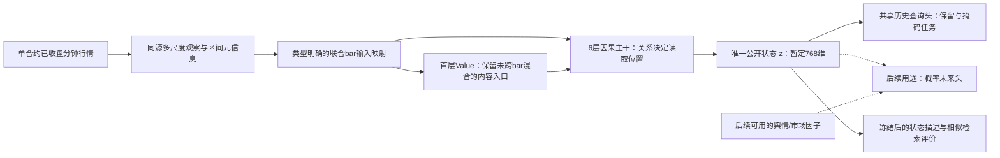

# Babel 路线图：用新分钟数据学习可复用的行情状态

更新：2026-11-26。**这是唯一的当前方案正文，从目标到实施顺序可连续阅读，不需要先读旧实验。** 当前处于方案设计阶段：数据基础审计已做，新模型尚未实现或训练，以下架构和数值均为提案，没有新的模型成绩。

固定工作目录为`/Users/bardan/Documents/Codex/来自旧电脑-20261031/obson`，与用户PyCharm一致；当前分支为`codex/babel-next`。本分支跟踪文件只携带当前方案、必要经验、分钟数据审计和独立实验基础设施。旧路线、源码和结果保留于[固定历史提交](https://github.com/BardanYu2025/obson/blob/e060ca98f660579f0784c9f72a2ead6f31f13502/docs/babel/BABEL_ROADMAP.md)，不在新分支形成执行队列。迁移身份见[BRANCH_BASELINE.json](BRANCH_BASELINE.json)。

**每轮实验一个独立版本目录。** 模型、训练/评价脚本、配置、依赖、测试和说明必须在同一目录；发布或首次运行后冻结，后续改动与修bug新建版本。禁止跨实验导入可变研究代码。详情见[实验目录原则](../../experiments/README.md)。本轮把已讨论的多周期编码、两项混合训练、冻结解码器对照与评价合为一套方案；首批仍为结构×历史掩码2×2、两个编码器种子。未来预测条件保留，授权CUDA仍为0。

## 0. 首批完整方案：多周期编码、混合训练、解码器对照与阶段交付

**本轮F01/F02/F04/F05/F10/F11只整理方案。** 目标不变：每个合格的1分钟收盘时刻t，产生只看已发生行情的768维状态，保存重要历史并供当前描述复用。同一时刻闭合的粗周期bar可使用这个共同状态；查询决定读哪个区间。未来概率预测、外部因子融合不进入首批编码器训练。

这套方案按以下顺序完成，不把解码器对照变成重复预训练：

| 顺序 | 做什么 | 结束时必须得到什么 |
|---|---|---|
| 第一步 | 样本资格合同与资格包，见0.5 | 数据快照、分区端点、训练统计/掩码依赖、可检查样本；当前只有合同，尚未生成新包 |
| 第二步 | 冻结共同运行卡和独立版本 | 数据/参数/评价/更新数/资源/停止/备份齐全，工程预检通过；需另获实施授权 |
| 第三步 | 四组×两个种子，从头训练 | 8个编码器及各自共同训练的历史头，固定last-N为主结果 |
| 第四步 | 冻结这8个编码器，只拟合读头 | 两档历史头和两种当前描述头的配对结果，避免读头不足被误认成编码失败 |
| 第五步 | 一次选定、独立确认与归档 | 保留哪个版本、能力范围和失败项，以及完整模型的离机恢复回执 |

下列架构与数值是明确的默认提案，不是已验证最优或已冻结运行配置。数据资格、硬件预算和数值验收线的未决项集中在0.9节；它们不授权写代码、开训或恢复旧模型链。

### 0.1 一张连接图与模块清单

| 部分 | 本轮具体默认设计 | 为什么这样连接 |
|---|---|---|
| 观察输入 | 1分钟256根、5分钟128根、15/60分钟各64根，最多512个市场token；不足处有独立padding mask | 近期保留逐分钟变化，较远保留粗尺度背景；各臂看到同一历史 |
| 数值映射 | 第2.4节9个数值＋逐字段9个可见标记＋9个人工遮挡依赖标记＋1个尺度fallback标记，经Linear(28,768) | 区分零值、自然缺失与人工遮挡；这里28是9个核心数值与标记的合计，不是旧28维特征方案 |
| 时间与尺度映射 | 8个时间/覆盖量经MLP(8,64,768)，加4种周期的768维embedding，再与数值映射相加 | 让普通和候选主干都知道观察的位置、跨度和质量，避免候选靠额外信息获胜 |
| 共同主干 | 6层Pre-LN，宽768，12头×64维，FFN 768→3072→768，GELU；dropout默认0、LayerNorm epsilon=1e-5 | 先给出可比较的完整主干；层数和头数不预先绑定趋势等语义 |
| 状态出口 | 加1个可学习末端状态位置，共最多513个位置；取其最后一层输出再LayerNorm，得到一个z | 历史答案必须经过同一个768维出口；内部早期token不是各自完整历史的公开bar状态 |
| 历史头 | 查询8维→256维；4个FiLM条件残差块；256→7个输出 | 同一个状态、同一套头回答不同历史区间，不为回看5/80/128根各建专用头 |

时间/覆盖8量是：区间结束距t的交易分钟与自然分钟、区间交易与自然时长，四者取log1p；实际覆盖比例、有效预热比例；已知时段内时刻的sin/cos。交易分钟按冻结历史日历计算，不按未来实际出现了多少行计数。覆盖/预热标记只陈述可得支持；不能藏入被遮挡的价格或量仓。合约身份保留在样本索引，首轮不增加可学习的合约ID查表。未知数值置零必须伴随不可见标记；人工依赖标记也覆盖使用fallback重算的字段，不把替代值冒充原值。

市场token只能读取自身可用时刻以前的市场token，相同闭合时刻可以跨尺度交流，不能读取末端状态；末端状态可以读取截至t的全部合法观察和自身。padding不参与有效注意力，空行须有数值安全处理。每个新t按自己的输入重算z，首轮不承诺KV缓存与滚动重算等价。

**512行的摆放顺序与行情时间顺序分开。** 这512项是带时间区间的多尺度观察，不是同一周期连续512根。时间意义来自每项绑定的时间/时长/周期、按可用时刻建立的mask，以及候选的区间关系；当前不添加依赖拼接行号的绝对位置embedding。原Transformer也需显式提供位置信息，[原论文3.5节](https://arxiv.org/html/1706.03762v7#S3.SS5)讨论了这一点。工程上可按可用时刻、周期、稳定身份排序便于检查，但排序本身不能代替时间mask；按周期拼接后直接使用行号下三角mask，会混淆跨周期先后。即使按时间排序，同一闭合时刻允许互读的规则也不能由普通下三角完整表达。

预处理先在各单合约真实时间线上计算前收/滚动尺度；之后若仅重排已构造的市场token，数值、时间、质量与Value来源一起移动，并同步置换mask/关系矩阵的行列、保持末端状态身份，确定性数学模型的市场输出应相应重排，最终z应不变（实际浮点允许合理误差）。这是同一行情换存放顺序；只把不同时间的行情值互换、时间位置不动则改变了历史，不具有上述不变性。后续实现须验证完整记录置换不变性、未来键屏蔽及同闭合时刻连接；对不同真实时序的区分能力另作能力诊断，不能要求有损z对任何不同路径都必不同。本轮只是明确已有信息通路，不改矩阵、损失或预算。

候选B/D在相同主干上增加两条通路，参照A/C没有它们：①每层每头增加`b=2·tanh(MLP(φ))`关系分数，MLP为12→32→12，末层零初始化；φ包含交易/自然结束时间差、双方交易时长、时长比、交易区间IoU、两向包含关系、双方覆盖率及两端状态类型标记，共12量。时间差/时长用log1p，时长比用`log((1+d_i)/(1+d_j))`。状态无物理区间，时长/IoU/包含置0，状态类型单独标明；状态作为key时关系bias固定0。②第2～6层市场Value使用`(1−α)V_l+αV_1`，α为逐层逐头sigmoid标量，初始0.5；状态自身使用当前层Value。所有通路遵守同一可用性和遮挡mask。新增有效参数、成对关系计算和缓存成本实测披露，不能称严格等参或等算力。

历史头采用条件缩放/偏移的思路，借鉴[FiLM](https://arxiv.org/abs/1709.07871)；本文的残差块和行情目标是待验证设计，不继承其视觉任务成绩。历史查询8量是：结束距t的交易/自然分钟、区间交易/自然时长（均log1p），加4维周期one-hot。头内每块按`h←h+W₂ GELU(W₁[(1+γ(z))⊙LN(h)+β(z)])`读取状态；W₁/W₂为256→256，`(γ,β)=Linear(768,512)`，各块独立，多个查询共享同一个z。条件投影采用非零随机初始化并检查编码器梯度，不能把所有状态通路初始化为零后误以为编码器已受训。7个输出及合法OHLC组合见3.4节。头只接收z、查询和声明的参考坐标，不读取原bar、全部token或KV。

维度总览（B是批量，K是查询数）：市场输入`[B,512,28]→[B,512,768]`，与时间/周期映射相加；加状态位置后为`[B,513,768]`。六层保持外部尺寸，注意力内部为`[B,12,513,64]`，FFN临时扩到3072再回768。末端得到`z=[B,768]`；历史查询`[B,K,8]→[B,K,256]→四个FiLM块→[B,K,7]`。decoder只读z与查询，已知参考收盘仅用于坐标还原。

### 0.2 多任务确实混着做：两种训练题目，共用一套模型

| 题目 | 输入和答案 | 要促进什么 | 首批职责 |
|---|---|---|---|
| T1：保存已看到的历史 | 完整H_t→z；查询已发生区间，读回其真实价量 | 保存实际路径、局部形态与量仓，而不只输出平滑轮廓 | 四组编码器与历史头都训练 |
| T2：补读被遮挡的历史 | 清理遮挡依赖后的H_t→另一个z；回答被遮住的过去区间 | 利用上下文冗余，检验能否改善内容组织与复用 | 四组头都训练；只有C/D将此项梯度传回编码器 |
| 当前状态复用检查 | 训练结束后冻结z，新线性/小MLP读头读取过去方向、波动等 | 检查同一表示换任务能否容易使用 | 属于冻结评价，不是第三个预训练任务 |
| 未来概率预测 | 后续才考虑z与外部因子共同使用 | 检验未来用途 | 本批没有未来头或未来损失 |

T1/T2不是先后训练两个模型，而是同一编码器E和同一历史头D在一次更新中处理两个输入版本；两个z不强迫相等。价格、形态、量仓是每个题目内部的内容分组，不是三套独立编码器。T2借鉴历史完形填空，但不能唯一恢复没看到的随机尖峰，因此必须单独保护T1的真实内容保留，不能用填空成绩代替保真。

**默认损失：** `L = L_clean + 0.25 L_mask`；未来权重固定0。`L_clean = 0.9 L_past + 0.1 L_current`。过去内容用`0.6价格 + 0.2形态 + 0.2量仓`；当前已知收盘不计分，当前内容用`0.5形态 + 0.5量仓`。这里“当前”只包括结束时刻恰好为t的已闭合区间；最新粗bar若更早闭合，仍属于过去。价格内路径/真实相邻差分各半，形态内实体/上下影平均，量仓内log成交/log起持仓/log末持仓/派生净变化平均；仅对预先登记有效项归一。各项使用训练部分固定尺度后的SmoothL1(beta=1)。这是默认取舍，不等于真实梯度占比或最优权重。

过去查询先对有效视图等权，再按**交易分钟年龄**1～16、17～64、>64分配0.40/0.35/0.25，不存在的年龄组在该视图内重新归一，组内合法位置等概率。每个端点默认抽64个过去查询，直接按上述权重分布抽取后普通平均，不再重复乘权；当前合法区间全部查询，最多4个。相邻差分额外请求同周期真正相邻的合法区间，必须用两份预测相减，不借真实邻价；邻区间不可用的项在抽样前标记。评价按固定端点完整查询所有声明区间，不只评价训练抽中的位置。

端点默认按“合格品种等权→该品种合约等权→合约内非空年月组等权→组内端点均匀”抽样；四组共享同一序列。这个ρ不是全部原始分钟等权，须记录各组曝光及重复率，同时另报自然频率下的评价，不能混用两种总体。

### 0.3 掩码具体怎么做，如何避免从另一周期偷看答案

默认在最近256个1分钟观察中抽**两段互不重叠、各8个连续交易分钟**，均在同一合格连续交易段内且不包含当前t；每段候选起点等概率，拒绝重叠后对合法段对均匀抽样。为保证所有组题目相同，首批共同训练清单要求存在这样的合法段对，并报告因此排除的端点和市场范围。缺失/冷启动场景另按资格评价，不把训练范围冒称覆盖全部行情。

两段里的16个原始分钟是遮挡目标，T2只查询这些过去的1分钟区间，字段组权重仍为0.6/0.2/0.2；目标间等权，其相邻差分也必须由预测构成。本批不声称已经比较了远期粗bar遮挡或最优遮挡比例。16/256只是原始分钟遮挡比例，**不是全部多尺度字段的有效遮挡比例**。

输入清理按真实字段依赖闭包执行：受影响的高低点、聚合成交、起末持仓、前收比值以及派生质量标记均不能透露隐藏值；聚合开/收分别追到首/末分钟，不把未受影响字段无条件全删。滚动波动若依赖隐藏收益，改用训练集固定fallback并重新计算仍可见字段的坐标、显式标记；不能保留原样本波动当答案旁路。价格参考C_t保持可见，目标不能覆盖它。目标真值只进损失，clean与masked的字段可见性、尺度和有效覆盖分别登记。

必须通过的反事实检查是：只修改被隐藏的原始价量、保持可见记录不动，**masked编码输入及其可读侧信息不应变化**；标签可以变化。还要记录闭包后各尺度剩余字段与覆盖，防止实际任务变成几乎全空。最低可用覆盖须由第一步资格包的缺失统计事前锁定，不能看模型分数才修改mask。

### 0.4 一次参数更新到底发生什么

1. 按共同ρ抽一批端点，取各自完整多尺度历史和预热；不是用一个长窗口里的短前缀冒充多个完整状态。默认有效batch为64个端点。
2. 使用已冻结的训练统计，产生同一端点的clean与masked版本、查询和真值；两次前向共用E和D。
3. 计算上述两项。C/D让两项共同更新E；A/B在masked z进入D前截断梯度，只有clean更新E。四组D都由同权重的clean与mask更新。因此本对照测的是**额外掩码编码梯度**，不是从未见过掩码的整个系统与见过掩码系统的比较。
4. 显存不足时按共同有效batch累计梯度，整个更新只执行一次AdamW；按样本权重正确除以累计规模。E和D分别按norm=1裁剪，记录各任务梯度和真实更新。当前提案无dropout，诊断须固定随机流，不能用不同随机前向冒充梯度核对。
5. 峰值学习率2e-4、betas=(0.9,0.95)、weight decay=0.01；偏置与归一参数不衰减，矩阵权重及学习embedding衰减，关系混合标量不衰减。前5%更新线性预热后余弦降到峰值的10%。scheduler按优化器更新计数，验证不更新统计或权重。

同种子共有张量配对初始化，数据/查询/mask与模型初始化使用分开的随机流；候选多几个参数不能改变后续共有张量和抽样序列。保持第6节A/B/C/D、种子42/43、共8个主run提案；这是任务数，不要求8张GPU同时跑。N更新、微批、精度、GPU小时/磁盘上限及冻结读头预算在资源资格后统一冻结；**尚无运行入口，不提供旧脚本充当新启动命令。** 首批从头训练，无旧checkpoint依赖。

### 0.5 第一步：把“哪些行情能进入训练”做成可核对的合同

**第一项是F02/F04/F10样本资格，为F01/F05服务。** 11月24日基础审计继续引用；本轮没有重扫数据，不声称文件已同步完或新资格包已存在。现在先把下列合同定清，明确进入实施后才生成实物。

| 计划交付的文件/材料 | 必须回答的问题 | 通过标准 |
|---|---|---|
| `snapshot_manifest.json`＋口径/排除账 | 到底用了哪些文件、哪版历史日历、哪些合约生命周期和量仓单位 | 每份来源有SHA；仍在变化或口径未核实的范围隔离并计数，不静默混用 |
| `endpoint_inventory`（按分区） | 每个t看见哪些bar、预热和历史答案，是否有合法mask段对 | 四组样本身份一致；完整依赖不跨分区；不使用未来标签资格筛选；缺段/冷启动范围单列 |
| `statistics.json`＋查询/遮挡协议 | 归一、下限、fallback、查询权重和遮挡究竟依赖谁 | 只拟合训练部分；原分钟聚合算术可复核；修改隐藏真值不改变masked输入；闭包后有效覆盖达事前资格线 |
| 固定样本页与资格结论 | 人能否看懂分钟→粗bar→输入→查询目标；哪些样本不能用 | 覆盖普通、休市边界、缺段、静止/零成交、冷启动；每项明确接受/隔离/缺证据，不用漂亮样例替代检查 |

首先固定快照和可用范围，再分区/清除交叉支持，然后拟合训练统计、生成查询与mask资格，最后核对样本。不能先用全部年份拟合尺度再切分。遮挡最低可见覆盖及分组最低支持，应依据该资格包事前写进运行卡，不看模型输赢来决定。

第一步有三种明确出口：①范围合格，进入共同运行卡；②部分范围缺证，隔离后按限定研究范围继续，重新冻结相同四臂输入；③核心时间/口径无法建立，列明缺失依据并停止依赖它的实施。不会为同一缺口无限追加“再审一次”，也不把基础合法等同于可训练资格。

这一步不产出神经模型成绩。数据资格、真实资源预检与正式训练各自按独立版本冻结；若需要修改已执行版本，创建后继版本，不原地重封。数据资产可按SHA只读引用，模型/特征/损失/评价源码不跨实验导入。

### 0.6 一批四组编码器，分别回答什么

| 方案 | 编码结构 | 直接更新编码器的任务 | 共同条件 |
|---|---|---|---|
| A | 普通因果Transformer | clean历史保留 | 同样多周期输入、6层/768维/12头、同训练头 |
| B | 关系bias＋首层Value通路 | clean历史保留 | 与A同输入、曝光、优化和读头机会 |
| C | 普通因果Transformer | clean＋0.25mask | 与A相比只增加masked编码梯度 |
| D | 与B相同 | clean＋0.25mask | 与B相比只增加masked编码梯度 |

每组编码器种子42/43，共8个主训练run。四组历史头都接收同权重clean/masked任务，A/B只在masked z进入头前detach；C/D按共同标量回传。主结果固定last-N，共同验证规则的best仅作补充，不因某臂仍下降而延长它。

B−A、D−C检验整套关系/Value结构；C−A、D−B检验额外mask编码监督，交互只作有条件解释。**四组全部使用多周期，因此这一批不回答“多周期是否优于单周期”，也不分别证明关系bias和Value各自有效。** 512项是带区间元信息的共同观察，不将同一行情重复覆盖称为更多独立样本。

保留该起点的理由是同源字段可以共享编码、早期合法跨尺度交流，且未先将各尺度压成小向量；风险是重复覆盖、数量与尺度差异以及单z出口容量。四路编码、编码期多状态、额外跨周期一致性、Fourier查询和新优化器保留讨论，均不自动加进本批。

### 0.7 编码器冻结以后：解码器对照与当前描述

**历史解码分三栏报告，禁止挑每个模型最有利的一栏混比：**

| 读头 | 怎么得到 | 看它为了回答什么 |
|---|---|---|
| D0：原4×256 FiLM头 | 与编码器共同训练，直接保留 | 这套完整训练系统实际能重建到什么程度 |
| D256：新4×256 FiLM头 | 冻结clean z，从随机初始化拟合 | 换成共同的新头后是否仍然可读 |
| D512：新4×512 FiLM头 | 同一批冻结clean z，从随机初始化拟合 | 增加读头容量后，同一表示能否读出更多；本批固定为表示内容主读头 |

D256/D512不更新编码器、不接受原始行情、全部token/KV或真实邻点。它们使用相同L_clean、查询/数据/尺度、更新数N_H和选择机会；同宽度在各编码器间使用相同初始权重。默认读头种子统一为314，不为每个表示选更好的种子；这是一档读头随机性，不能声称已充分测量初始化方差。主结果取last-N_H，best仅补充。两档参数与算力不同需分别报告。

8个冻结状态×2种历史头＝**16次只训练头的拟合**；不会变成16次完整预训练。D512只是预先固定的较宽读取配方，不保证必优于D256。读头变宽后成绩改善只说明部分误差来自读取/拟合限制；都不好不能单凭此断言z已丢失信息。若编码器排序反转，明确写“结论依赖读头”，不得按每臂最好头拼排名。

当前描述使用同一冻结z、同一组过去标签：在16/64/256个合格交易分钟范围上读取净方向变化、路径效率、已实现波动、最大回撤、成交总量及持仓净变化，共18个连续量，具体定义见5.3。这不是额外预训练目标，不把规则可读当成唯一真实市场状态。主描述头为`768→128→18`的GELU MLP，`768→18`线性头作为容易读取程度的补充，两者均从头拟合、无编码梯度。

8个状态×2种描述头＝16次拟合；另对固定PCA表示和同信息原始输入各拟合两种头，共4次。于是当前方案有**8次编码器训练＋36次轻量读头拟合（16历史＋20描述）**，另计统计基线与纯评价成本。所有拟合都须进入预算，不将“轻量”说成免费。标签直接计算只作为可操作定义和直接使用参照，不要求模型战胜其自身真值计算。

所有新头默认AdamW峰值lr=1e-3、betas=(0.9,0.95)、weight decay=.01、norm裁剪1、5%预热后余弦降到峰值10%，有效batch默认64；沿用矩阵/偏置/归一的衰减分组。不同表示的输入标准化只用训练缓存拟合；当前描述目标尺度也仅来自训练部分。N_H、描述头N_U及资源上限在资格后统一冻结，不以候选分数逐臂调参。原D0仍按其原始接口评价，不能悄悄塞入新标准化。

### 0.8 评价、选择和结束：同一张成绩表

| 栏目 | 固定主读数 | 必须同时报告的限制 |
|---|---|---|
| 训练系统保真 | D0的clean完整历史分项 | 不与其他臂的D512混成排名 |
| 表示内容R | D512：固定训练尺度下，过去收盘路径/相邻变化MSE各半，沿既定视图/年龄权重汇总 | D256、当前实体、最近16分钟、量仓、P95、各周期均单列；已知当前收盘不计分 |
| 当前描述U | 128宽MLP：18个训练尺度归一目标的平均MSE | 线性头、每类/每期限、自然单位误差及简单参照；首批仅检查近期256分钟描述 |
| 工程使用 | 编码时延、显存、吞吐、全部状态/侧信息大小、恢复/备份 | 单z不隐含免费KV或额外历史；无实盘收益宣称 |

评价用固定端点的全部合法查询，不仅检查训练抽中的64个位置。描述使用共同的合格子清单：缺少完整256分钟或边界前收支持时不伪造18项标签，排除范围公开。两种任务可以有不同合格清单，但各候选在同一任务内必须使用相同清单。

训练2016～2023、验证2024、开发比较2025至旧边界、时间留出2026-09-12 03:00之后；跨品种IF/SA/lh/sn/OI按覆盖资格预留。所有完整输入、预热和目标依赖计入分区。验证用于规定的数值/选模程序；开发集用于四组比较和一次选定；最终留出只在模型、头、协议和候选身份锁定后确认，不能用来挑头宽度、延长训练或调阈值。

第一批按5.5节的两层门槛结束：先满足历史/当前描述的可用质量，再判断复杂候选是否较A有增益。已有5%内容收益、近期/当前实体最多5%退化、量仓/困难尾部最多10%退化作为预定提案保留；本轮补当前描述总体最多5%退化、各类最多10%的保护提案。门槛不互相补偿，实际绝对可用误差仍须在看模型分数前结合资格样例固定。

开发比较先检查底线，再按R选择；无可分辨收益时优先保留A，而不是从小数点差异选复杂结构。只有满足R收益与U保护、两个编码器种子方向一致且相关组证据支持时，才称候选内容改进。U改善但R没有主收益时报告用途取舍，不按另一个临时主指标宣称通用升级。两种子和大量重叠窗口不是充分独立样本。

| 结束时出现什么 | 已规定的下一动作 |
|---|---|
| 候选满足质量、相对收益和内容/用途保护，留出支持 | 固化该候选与明确选定的头，进入完整离机交付 |
| A满足质量，复杂候选没有稳定增益 | 交付A的限定能力，关闭本关系/Value或mask配方的升级主张 |
| 同一z换头明显改善或模型排名改变 | 归档读头依赖，最多一次能改变决定的有界定位；不重跑整条模型链 |
| 所有方案未达可用质量 | 本配方停止升级；按数据、编码、读头或优化证据定位一项可区分缺口，不自动加层续训 |
| 独立时间/品种支持不足 | 交付可恢复研究候选并标证据不足，V13不关闭；不反复调同一留出凑通过 |
| 实现/数据错误 | 保存现场并界定影响；评价错误先重评，训练污染才重训受影响臂及必要对照 |

### 0.9 哪些已经定，哪些在开训前必须补齐

已明确：目标与当前用途、多周期及形状、共享编码/解码信息通路、两任务/梯度、四臂和种子、训练抽样与全位置评价、三栏历史读头、当前18项描述、配对机会和阶段出口。**本轮没有新数据或神经结果，不宣称运行卡已经冻结。**

| 剩余项 | 由什么决定 | 缺它时怎么处理 |
|---|---|---|
| 数据快照/日历/口径与合法端点 | 第一步资格包 | 隔离未确认范围，核心条件不成立则不实施依赖任务 |
| mask闭包后的最低可见覆盖、各组支持及绝对误差容忍 | 训练部分统计、无模型样例和预声明使用要求 | 在任何候选分数出现前冻结；不得按赢家改线 |
| N/N_H/N_U、共同缓存/评价端点数、微批/精度、GPU小时与磁盘 | 数据规模、实际硬件吞吐/峰值与预检预算 | 先完成共同资源卡；不能猜时长或让某臂单独延长 |
| 相关块长度、独立确认能力、成本上限 | 完整支持跨度、时间/合约相关组和使用场景 | 同日跨品种共同波动纳入；独立支持不足只报研究证据 |

资源表应包含`8个主run＋16个历史头＋20个描述头＋特征提取/基线/导出/恢复`，按实测每步时间估总量并计入安全余量。冻结读头用共同的训练缓存端点清单，行数上限M_train及各评价清单在看分数前固定；每个编码器每条clean状态提取一次，所有头复用，不给某个臂更多缓存样本。FP32的8份z仅向量就占`8×M×768×4`字节，标签、元信息、原始/PCA缓存与checkpoint另计，不能漏算磁盘。低精度/梯度累计必须成对统一；进程数与实际显存匹配，不把8个run理解成同时运行8进程。总预算先于模型分数固定，常规“loss还在降”不触发扩额。

当前下一动作是按0.5已写明的合同，核对快照、日历和口径的来源依据；用户明确实施后才创建独立实验代码并生成资格包。正式版绑定推送提交和release，真实预检也使用冻结版本，预检更新不混入正式初始化。每阶段完整权重、优化器/RNG/统计、源码/环境/数据身份和评价样例导出到`/root/autodl-tmp/download`，在AutoDL干净恢复并取得离机SHA回执后才算防丢交付。当前不提供新训练命令。

## 1. 我们要做什么，为什么要重新设计

我们要让每根**已收盘**K线拥有一个状态向量，也就是embedding。它应当压缩截至这一刻的一段行情：价格怎样走到这里，近期形态如何，成交和持仓怎样变化。同一个状态以后可以交给不同任务使用，例如描述当前趋势与波动，或者逐步生成未来价格的可能路径。

成功不等于100%复制所有影线，也不等于只学会几条均线规则。**当前阶段以历史重要内容保留、当前行情描述和冻结后的复用为主线。** 概率未来是后续用途，纯K线预测改善不是编码器晋升或交付条件；历史重建成功也不能代替未来或交易检验。

原有研究已经证明某些状态能够回读有限历史，也暴露了近远内容失衡、读头兼容性、训练预算混杂和模型资产丢失等问题。现在有更细、更长、更多品种的数据，应该重新定义模型真正看见的世界，而不是先恢复旧训练链，再逐个改旧超参数。

本方案的核心选择是：**同一份分钟行情形成多个时间尺度；比较普通主干与关系/Value候选；以历史保留为基础，检验额外历史掩码监督能否改善内容组织与复用。** 未来预测头及外部因子融合暂不进入首批训练。第6节保留四臂对照的组织，但修改训练因子；不是把原来“掩码＋未来”草案换个名称继续执行。

| 保持不变的目标 | 可以重新选择的实现 |
|---|---|
| 每根已收盘bar只使用当时可得信息 | 窗口长度、分辨率、层数、头数、状态维数 |
| 保存有用价格形态和成交/持仓信息 | 特征表达、归一化、编码与解码结构 |
| 同一状态支持多种后续用途 | 历史损失、概率监督、读头与优化方法 |
| 结果可靠、实验能够结束、模型能够恢复 | 同批对照的具体组织和资源配置 |

旧Macro权重已经丢失，旧报告仍在。新训练将建立新模型身份，不称找回原权重；旧13阶段恢复和旧输入四臂均不是当前前置任务。

### 1.1 用户澄清后的优先级与两层职责

相同127根K线不唯一决定下一根；这与有限观察、尚未提供的市场背景以及新到信息相容，不足以证明行情完全不可预测或差异全是不可约随机。相同OHLC也未必代表量仓、长历史与元信息相同。若冻结的确定性编码器收到的**全部声明输入**都相同，它应产生同一个z；不要求它凭空区分未输入的新闻或环境。

第一层`z_t=E(H_t)`负责忠实整理当时可见的行情内容。当前描述头可读方向、路径效率、波动、回撤和量仓变化，使用只依赖t前数据的定义；它们是行情描述，不是对“真实市场隐状态”的唯一识别，更不等于下一根方向或开仓结论。

第二层以后可估计`p(Y_future | z_t, M_t, F_t)`，F_t是当时可得的舆情、跨市场或其他因子，M_t是声明的价格/尺度元信息。先冻结基础状态，在独立用途版本中验证融合；是否回传编码器另立假设，不覆盖已交付表示。外部数据必须记录实际发布时间、到达延迟和版本，不能按事件发生日期回填后来才知道的内容；缺失因子也不能当真实零值。

**这有信息论理由。** 单独预测Y所需的信息，不一定等于未来与外部F共同使用时所需的信息。理想压缩代价变为`E KL(p(Y|H,M,F)||p(Y|Z,M,F)) = I(Y;H|Z,M,F)`。只优化不带F的预测，无法保证这个条件信息也保住。独立等概率二元H和F、Y=H异或F就是反例：单看H对Y没有信息，两者结合却能决定Y。常量Z单独预测并未变差，丢掉H后却失去组合能力。这是数学示例，不是市场规律或当前数据证据。[多来源信息与协同](https://arxiv.org/abs/1004.2515)

因此，首批先尽量保留多种可观察内容，不按纯K线未来分数筛掉信息。近似重建仍不能保证所有尚未知晓的外部组合都可用；未知用途没有万能充分状态。以后融合要比较`z单独`、`F单独`、`z+F`及同信息`原历史+F`，判断增益来自哪里。当前不新增因子数据采集或融合训练队列，F06/F07/F08/F09保留为条件后续。

## 2. 数据：这次究竟多了什么，怎样使用才成立

### 2.1 已经确认的事实与仍未确认的范围

数据目录是`/Users/bardan/private/tqdata_2015`，首轮主体使用`month_contracts/bars`中的真实单合约。11月24日完整盘点得到：44个品种、2382份文件、46,224,030条分钟记录，实际覆盖2016-01-04至2026-11-19。11月25日前次仅复查了文件数量和大小；本次文档整理没有重新扫描原始行情，也不声称下载同步已结束。[原始审计摘要](../../experiments/20261124_minute_audit_v1/reports/20261124/summary.json)

| 数据条件 | 为什么影响模型设计 | 当前处理 |
|---|---|---|
| 有同源1分钟数据 | 可以看到粗K线内部的先后变化，也能准确核对多周期汇总关系 | 近期保留分钟粒度，较远历史用同源粗视图 |
| 年份、品种增多 | 可以减少反复曝光少量旧窗口，检查不同市场阶段 | 按品种、合约、时间组抽样与评价，不把每分钟当独立样本 |
| 文件是单合约 | 能区分真实交易变化和换月拼接跳空 | 不跨合约构造同一段模型历史，完整合约生命周期进入主键 |
| 月份文件只覆盖主力窗口及换月附近 | 数据选择可能借用了事后主力身份，不等于完整交易宇宙 | 核查选择规则和当时可得性；结论限定于合格合约窗口 |
| 715,590条零成交、平价、持仓不变记录 | 可能是真实不活跃，也可能包含源端填充 | 保留质量标签，取得依据后分类；不自动删除或插值 |
| main有拼接且发现3条负成交；index只到齐6品种 | 直接混用会改变价格与成交含义 | 首轮不依赖main/index，不因此阻塞单合约主体 |

基础审计没有发现月份文件的OHLC几何、重复时间、倒序或负量仓问题，但**基础数值合法不等于可训练资格已经全部通过**。历史交易日历、夜盘归属、量仓口径变化、缺段与静止行情仍需要核对。[质量问题与限制](../../experiments/20261124_minute_audit_v1/reports/20261124/quality_notes.json)

### 2.2 为什么采用同源多周期，而不是各周期各看128根

128根1分钟与128根60分钟描述的是不同时间范围。新方案先问“需要看多近、多远”，再为不同范围分配观察精度。它类似看地图：当前位置看街道，远处看区域轮廓；远处被省略的街道不能宣称仍完整记住。

初始提案是：

| 已闭合视图 | 最多bar数 | 设计目的 |
|---|---:|---|
| 1分钟 | 256 | 保留最近逐根变化，不提前压成固定4根片段 |
| 5分钟 | 128 | 观察中短区间的形态与成交持仓变化 |
| 15分钟 | 64 | 观察更长的结构 |
| 60分钟 | 64 | 提供较远背景 |

共有最多512个市场观察，彼此有重叠，不是512个独立事件。最长视图是64个已闭合60分钟格子；实际交易时长、自然时间和预热范围由日历与缺段决定，不固定称“若干天”。30分钟可由同源数据生成，但首批不为列全周期再加一条高度重叠视图；F04跨分辨率方向仍保留。

同一物理区间的粗细视图共享内容，粗视图却丢掉内部顺序。例如“先涨后跌”和“先跌后涨”可能得到相似的粗K线。因此应对齐共同内容，允许细视图保留额外信息，**不要求两个完整embedding逐维相等**。首批通过同源数据、共享编码器和物理区间目标联系尺度，暂不额外叠加跨周期一致性损失。

### 2.3 聚合、时间与数据边界

每个观察都记录合约、区间起止、实际覆盖和最早可用时刻。源时间戳表示bar开始；该bar结束以后才能进入状态。高周期bar尚未收完时不能提前读取其最终高低收和成交。

聚合规则为：开盘取首值，最高取最大，最低取最小，收盘取末值，成交量求和，持仓取区间起点和终点，持仓不能求和。按历史交易时段定义格子，不是每5/15/60行机械切块；休市与缺失分别判断，不能用填平线补满。区间完整性的判据要随快照冻结，各臂使用相同的合格范围。

交易所、品种、完整合约生命周期和时间构成主键，尤其不能把不同年份重复的短合约代码拼起来。所有预热、滚动统计和以后缓存的真实依赖都进入数据分区检查。没有逐笔方向、盘口和可靠开平仓标识时，不把某个潜在维度命名为“主动买入”或“多头开仓”。

### 2.4 价格和量仓怎样标准化，为什么这样做

绝对价格、成交量在不同品种间跨度很大，直接比较会让模型把数值大小当成形态。另一方面，把每个窗口都强行缩成相同波动，又会丢掉“平静还是剧烈”的信息。建议把**相对变化和它的尺度一起保留**。

基础数值输入共9个通道，另有时间、分辨率和质量mask：

| 输入 | 建议表达 | 保留的意义 |
|---|---|---|
| 开盘相对上一收盘 | `log(O / C_prev)` | 真实跳空，不用连续主力去伪造平滑 |
| 实体 | `log(C / O)` | 当前bar内部方向与幅度 |
| 上影、下影 | `log(H / max(O,C))`、`log(min(O,C) / L)` | 非负形态量；已发生的信息，不要求未来可准确预测 |
| 成交量 | `log(1 + V)` | 缩小数值跨度而保留活跃变化 |
| 起末持仓 | `log(1 + OI_start)`、`log(1 + OI_end)` | 区分存量与变化，未知值不能当真实零 |
| 持仓净变化 | `asinh((OI_end − OI_start) / s_ΔOI)` | 保留增减方向，尺度仅由训练部分拟合 |
| 历史波动尺度 | `log σ_past` | 让模型知道被标准化前变化有多大 |

价格变化先除以因果波动尺度，再使用训练集固定的字段/周期尺度。波动尺度的初始提案是**当前bar之前、同周期64根有效收益的RMS**，带训练集确定的下限；不足时使用训练集fallback和冷启动标记，不向未来借数据。这个预热实际可能超出表里的512个观察，必须计入输入支持和成本。

历史目标不使用每个待重建窗口重新拟合的未来统计；相对价格以当前已知收盘为参考，损失字段尺度固定于训练部分。预测则把收益尺度固定在预测起点，不沿真实未来路径重新估计。

**旧经验的借鉴：** 保留单合约、尺度可追溯、预热显式、缺失不当零。**新数据下的重想：** 同源分钟视图、物理区间、原始价量核心通道成为主体；不默认继承旧28维、EMA组合或PCA教师。指标以后可以成为有明确信息理由的对照，不能先把模型目标缩成复刻指标。

### 2.5 数据怎样组织成每根bar的训练样本

采用四层组织，原始文件、加工结果和样本身份分开。下面是待实现的数据合同，不表示这些新缓存已经生成。

| 层次 | 保存什么 | 解决什么问题 |
|---|---|---|
| 原始快照 | 原分钟文件、说明、文件SHA与大小、合约和来源清单 | 同步中新文件不能悄悄改变正在训练的数据；新快照另给身份 |
| 合格分钟事实表 | 按完整单合约生命周期排序的OHLCV、起末持仓、区间时间、交易日/时段与质量标记 | 区分真实零成交、休市、缺失和来源冲突；不把换月拼接当涨跌 |
| 同源多尺度表 | 由合格分钟生成的1/5/15/60分钟观察、原分钟索引、覆盖与可用时刻 | 粗细观察描述同一份市场记录；可追查每个值从哪些分钟而来 |
| 端点样本索引 | 合约+t、各尺度切片、预热依赖、分区与合法历史查询；未来用途另登记标签范围 | 每个t有自己的完整输入；首批不因缺少后续60分钟而丢弃合格历史样本 |

样本身份绑定数据快照和处理协议。大数据可以按哈希只读引用，实验自己的处理代码、尺度文件、抽样清单和依赖必须归本实验版本；不能调用外部数据目录里会变化的加载脚本。相同字节的重复记录可登记后去重；同主键异值先隔离核查，不按“最后下载的一份”静默覆盖。不混入旧`tqdata`、主连或指数来填补单合约缺口。

**一个样本围绕一个已收盘时刻t。** 例如截至10:07的状态，只能读截至10:07已经完成的分钟bar；若5分钟格子是10:05～10:10，就不能读取它10:10才确定的最终值。10:05之后已完成的分钟仍可由1分钟视图进入。所有多周期格子由同一份历史时段规则生成，跨休市、缺分钟和时段末不足整格的处理必须锁定，不能把不足60分钟的尾段假装完整60分钟。

源`datetime`是bar开始时刻；官方字段定义也区分区间成交量和起末持仓。[TqSdk字段说明](https://doc.shinnytech.com/tqsdk/latest/usage/mddatas.html)。离线可用时刻以闭合时刻建模，若没有真实到达时间，须注明这是理想闭合假设，不声称已验证实盘延迟与历史修订影响。

首批同一个t有干净历史与遮挡历史两种输入；未来路径标签不进入本轮数据资格或训练。以后做预测才另登记t之后的监督范围，并继续禁止未来进入编码输入。遮挡必须清理粗周期汇总、上一收盘、滚动统计及其他派生字段中的答案，不能只遮一列而从另一个周期读回去。精确遮挡依赖仍按4.5节锁定。

训练在合格端点中按品种、合约与时间组抽样，让单个长寿、活跃合约不凭样本多主导更新；具体配额和有效曝光在运行卡固定，不按未来涨幅或“形态好看”筛样本。四臂使用相同样本与查询序列。评价使用固定端点和近中远/尺度/字段清单，同时报告组间及尾部差异，不把大量重叠窗口当独立证据。

先按第5.1节分区，再仅用训练部分拟合尺度、下限、fallback及任何PCA/统计基线；完整输入、预热和标签范围都计入边界清除。训练区内打乱批次可以，重叠窗口随机分到训练和验证不可以。保留零成交与缺失的不同标记；无法确认口径的范围先标为未合格，不能靠标准化掩盖。

### 2.6 技术指标放在哪里：原始内容是主体，指标是可检验的帮助

**首轮不依赖EMA、MACD、RSI作为必需输入或主要学习答案。** 输入以原始价量的相对表达为主体，学习目标仍是保存行情内容并检验复用和概率未来。下列三类不能混为一谈：

| 类别 | 首轮职责 | 理由与边界 |
|---|---|---|
| 相对价格、历史波动尺度、log量仓等基础变换 | 必需的数据坐标与数值处理；波动大小另保留 | 缩小品种量级差异，同时保留形态、幅度和活跃信息；它们也有人工选择，不能称完全无人工特征 |
| EMA/RSI等技术指标 | 可作为直接计算的简单比较方法；首轮不增加指标输入支线 | 若模型只是复刻指标，直接算指标就能完成相应用途，不能算通用状态成功 |
| 指标输入、辅助监督或教师 | F12条件保留，当前不排队 | 仅在现有诊断能指出具体缺口时，做同原始信息、同预算的配对比较；不能凭常用就不断堆指标 |

若一个指标完全由相同历史H计算，`I=f(H)`，它不增加H以外的新观察，但可能让有限模型更容易学到某类关系。因此“不作为首轮依赖”不等于“指标无用”。若EMA的预热来自H以外，或指标借用了其他合约/市场，它确实扩大了信息范围，必须给对照相同可得历史并计入支持边界；不能把更多历史带来的收益全归因于公式。

历史波动标准化同样是人工统计，本方案明确保留其用途与依赖。固定字段尺度只从训练部分拟合；不能对每个完整合约寿命使用包含后来行情的均值/方差。跨品种留出的尺度规则要有训练来源的通用fallback，不在留出品种上重拟合。若以后加入任何指标，遮挡任务必须同步清理其依赖，否则容易从指标泄露被遮挡答案。

当前不先用均线平滑后删除原始起伏，也不把每次上下影变化自动认作噪声。哪些内容值得保留由历史分项误差和后续用途检验；损失里的合理取舍不等于在数据源头抹掉信息。已知时间与时段只是观察条件，不要求模型预测休市间隔。

### 2.7 进入实施前还差什么

本轮只复核现有审计、交付说明和一个月份文件的列结构，没有重扫全量。交付说明明确提示部分2020年前成交量可能有单双边口径差异；这是待核实的来源声明，尚不是确认的逐品种历史转换表，不能一律除以2。还需冻结快照、核对历史交易时段和可用范围、确定静止/缺失处置与历史口径，才能签发首批训练资格。

这些是同一批数据资格与运行卡的工作，不额外增加指标消融、模型worker或旧恢复步骤。相对于旧研究，本轮保留单合约、因果统计、完整上下文和同样本比较的经验；基于新数据新增的是分钟事实表、同源多尺度及其依赖追踪。当前计数仍引用11月24日快照，不声称同步已经完成。

## 3. 架构：模型怎样把多段历史整理成一个状态

### 3.1 状态是什么，数学上想达到什么

记`H_t`为截至时刻t真正可见的多尺度观察及预处理依赖，编码器计算`z_t = E(H_t)`。当前bar的状态也可以作为这段历史的序列表示；它不是“只有这一根K线的特征”。相邻时刻的状态通常共享大量历史，但新观察、窗口移出与尺度闭合都会改变它。

当前目标是在有限状态和可承受成本下保存重要历史，并让当前描述和新用途容易读取。以后预测再单独检查这种压缩是否损失有关信息。**不能由768维或一个loss证明状态已经充分、可逆或服从真实市场的Markov规律。** 历史中暂时不显示独立预测能力的内容仍可能值得保留，尤其以后可能与外部背景共同使用。

公开记录暂定包含`z_t`、当前参考价格`C_t`、已知预测尺度`σ_t`、合约/时间/有效覆盖标记。768维FP32向量本身是3072字节，元信息、共享模型和运行缓存另计。当前价格本来已知，不能算作成功重建一个点；恢复绝对价格也不能宣称全部只来自这768个数。所有对照得到相同辅助信息。

**重建能力不自动确定相似度。** 若`D(E(H))`能重建，把编码改成`E′(H)=A E(H)`、解码改成`D′(z)=D(A⁻¹z)`，任何可逆A都保持相同输出，但非正交A通常改变余弦距离。比如(1,1)与(1,−1)原本正交，把第一维放大10倍后余弦约0.98，重建却可以完全不变。这是代数上的不可识别性，不是本项目已经测出的故障；有容量/正则约束的具体网络也未必能精确实现任意重参数化。

因此要区分**保存内容的z**与**用来比较某种内容的距离**。同样上涨但波动相差十倍，可以形态相似、风险不同；价格路径相似但成交持仓不同，也不应只有一个“总体相似”。我们的z更接近带上下文的token表示，而不是固定词表查表：同一根外形相似的K线，在不同历史里应允许状态不同。

首选可核验的内容距离：固定同一组合法物理查询Q、字段尺度及对角元素非负的权重矩阵W，令`f_Q(z)`为历史头读出的相对价格/形态或量仓内容，计算`d_Q² = (f_Q(z_i)−f_Q(z_j))ᵀ W (f_Q(z_i)−f_Q(z_j))`。它在编码/解码等价重参数化下不变；局部对应`G(z)=J_f(z)ᵀ W J_f(z)`，表示哪些状态变化会改变可读内容。G可能奇异，d只是查询相关的伪度量，不是已发现市场流形。查询、参考坐标和共同覆盖必须一致；忽略绝对价格时明说其不变性。

这也给出检索向量的路线：需要快速余弦检索时，再把该内容几何学习到一个小投影`u_k=g_k(z)`，按形态/风险/量仓用途分别验证。投影只读z；不强迫整个z丢掉投影不关心的信息。当前先评价已有解码内容距离与原始统计/PCA/原始z余弦，不默认新增对比损失或额外训练worker。由重建头定义距离不等于距离正确，必须用未参与拟合的真实区间内容检验。

以下是后续预测用途的数学边界，不是首批编码器训练目标：Z由H确定、M为双方同样可得的侧信息、Y为预定未来目标，在条件分布和期望良好定义时，压缩的理想对数评分代价为：

`Δ* = E[KL(p(Y|H,M) || p(Y|Z,M))] = I(Y;H|Z,M) ≥ 0`。

仅当相关条件熵有限时再写成`H(Y|Z,M)−H(Y|H,M)`，避免连续变量的无穷相减。`Δ*=0`表示对这个Y和分布，Z与M足以保存H的预测信息，不表示能预测确定未来，也不表示对任何用途充分。**压缩不能创造原历史没有的信息**；有限数据上更好，只能来自更合适的表达、正则与优化等，需要实验区分。

有限预测头还有额外误差。任意头q满足`E[-log q(Y|Z,M)] = E[-log p(Y|Z,M)] + E[KL(p(Y|Z,M)||q(Y|Z,M))]`，需各项良好定义。因此实测头之间的NLL差混合了表示损失、近似与优化误差，不能当成互信息测量。历史重建差也混合编码与解码误差；这正是冻结状态后仍要给同预算新读头的理由。

768维实数不是有限信息率约束；确定性连续编码的互信息可能无穷。实际FP32状态才有至多768×32=24576 bit的固定长度存储上限，侧信息和共享模型另计。当前没有随机编码、码率项或量化训练，故只借鉴“压缩与失真权衡”，不称已实现信息瓶颈最优解或达到率失真界。[Deep VIB](https://arxiv.org/abs/1612.00410)

内容距离也有条件：固定Q、W及侧信息/坐标约定时，**开平方后的d_Q**才是伪度量，平方距离不满足一般三角不等式；若每对样本随意更换共同可见查询，连伪度量也不能保证。局部`JᵀWJ`仅在固定侧信息与可微点成立；它不是自动可逆的市场几何。

### 3.2 模块各自负责什么，连接为什么这样设计

此前草案的问题是：给出了层数、头数和时间常数，却没有充分区分“结构保证的信息通路”和“训练以后才可能出现的能力”。本轮建议保留一条因果主干，撤下前2层强制同尺度、后4层固定指数偏置的默认配置，改为**区间关系注意力＋底层Value内容通路**这一完整候选。旧配置只保留为未执行草案，不同时排另一组实验。

| 模块 | 能由结构明确的职责 | 如何检验，不能预先声称什么 |
|---|---|---|
| 联合bar映射 | 同一bar的OHLC几何、量仓、时间/质量字段同时可用；两种骨干使用相同映射 | 不把9个通道当可互换像素；不声称某维就是买盘/趋势 |
| 区间关系Q/K | 内容匹配同时知道两个观察的时间距离、持续长度、重叠与尺度关系 | 与收到同样元信息的普通注意力比较；关系权重大不等于经济因果作用 |
| 底层Value通路 | 每层可在当前因果mask内继续读取首层、尚未跨bar混合的内容 | 看近期内容、量仓、尾部及成本；通路存在不保证内容最终进了z |
| 单状态汇聚 | 所有历史输出和未来条件都经过同一个公开z | 禁止头读取原bar、全部token或KV；去掉/错配z检查旁路 |
| 共享历史头与后续用途头 | 首批用共享头读取干净/遮挡历史，冻结后新头读取当前描述；概率头条件后续 | 不把头更强误称状态更好；不以纯K线预测筛选本轮表示 |

主干仍暂定6层Pre-LN、宽768、12头、每头64维、FFN3072，所有层可按可用时刻跨尺度交流。数值是资源提案，不给某个头指定“趋势”“头肩顶”等未经识别的语义。多头允许不同匹配，不能保证自动分工；先不加入卷积、SSM、频域和独立长短编码器形成大拼盘。

最多512个市场观察加1个状态位置。市场观察按自身可用时刻读取历史；当前状态读截至t的观察和自身，市场观察不能反读末端状态。共同闭合时刻的跨尺度信息可以合法交流，但均不能读取尚未完成的bar。内部早期位置不是完整滚动bar状态，公开z仍须按每个t自己的H_t重算；无限流式更新与KV等价性没有被证明。

### 3.3 关系与内容怎样在一个注意力块中连接

候选以如下通路表达，最终数值与匹配成本仍须进入运行卡：

`A_l = softmax(Q_l K_lᵀ / sqrt(d) + b_l(φ_ij) + M_ij)`

`Ṽ_l,j = (1−α_l,h) V_l,j + α_l,h V_1,j`

`x′ = x + W_O concat_h(A_l,h Ṽ_l,h)`，随后接普通Pre-LN前馈残差。

φ只包含双方当时可得的区间关系；b是有界小函数，例如`c·tanh(MLP(φ))`，M禁止未来及无效连接。α是层/头标量的有界可学习混合，初始0.5为暂定设计；第一层本身不重复混合。首层V来自联合bar输入的投影，保留token身份，没有跨bar上下文。状态自身的键使用当前层V，内容残差只连接市场token。该通路受同一因果mask约束，不能绕过mask或遮挡任务的输入清理。

普通参照使用相同输入、同一主干尺寸与公共状态接口，但没有关系分数b与底层V通路。新增关系函数和混合标量的有效参数、运行缓存、FLOPs须如实报告，不虚称完全等参；主干共有参数按种子配对初始化。若收益小到可能仅由新增容量解释，结论限于整套配方，不靠死参数补齐制造公平假象。

这项候选的假设是：**关系负责“到哪里读”，Value负责“带回什么”，隐藏残差负责“保留已有表达”**。后层还可读初始内容，可能缓解反复混合后细节不易读取的问题，但这不是信息保留定理。[Value Residual Learning](https://aclanthology.org/2025.acl-long.1375/)

固定指数先验已撤下默认位置，因为具体时间常数与每尺度等质量尚无当前任务证据。其`softmax(score+log prior)`可解释为内容匹配与KL先验的权衡，这个数学解释仍成立，但不能据此把人工时间常数当市场定律。可学习关系同样只是归纳偏好，不消除粗细重复覆盖，不证明架构优越。

严格地说，在某一行合法键集合上、给定正先验π和分数s，`softmax(s+logπ)`恰好求解`argmax_p {Σ_j p_j s_j − KL(p||π)}`。这是读取权重的熵正则优化解释，**不是贝叶斯后验或经济因果模型的证明**。当前首批仍采用每个合法token等基础权重，即π均匀；b属于学习分数，两臂共享相同视图数与可用范围。

这也揭示多尺度重复的限制：某条等分数观察复制m次，其总softmax质量相当于增加`log m`分数；两个等分数观察原各占1/2，把其中一个复制为3份就占3/4。真实粗细bar不完全相同，此例证明的是该机制**不具有重复观察不变性**。关系bias不自动消除重复计数。当前不临时加覆盖权重分支，运行卡须声明token计数测度、检查重叠/尺度注意力质量，不能把“多视图”直接解释成更多独立证据。

Value凸混合只保证固定输入下`||Ṽ|| ≤ (1−α)||V_l|| + α||V_1||`。它增加了读取首层内容的通路，但注意力加权、输出投影和末端汇聚仍可丢信息；不同层V的坐标还要通过学习相容。该不等式不限制Q/K导数、残差深度或端到端Jacobian，不能据此声称全网稳定、可逆或永不遗忘。我们的有界凸混合是受论文启发的候选，不把它当原论文所有配置的等价复现。

### 3.4 历史解码器：同一状态回答同一套问题

历史解码器接收`z_t`和一个物理区间查询q，例如“结束于当前之前20个交易分钟、持续5分钟的那根已完成bar”。q只从已登记且可见的合法区间中选取，说明问哪里、跨度多大；不包含答案。它不再为回看5根、80根、128根分别训练不同的专用解码器。

提案是一个4层、宽256的共享残差MLP，状态通过各层的缩放/偏移调制查询表示，即FiLM条件化。这样可以明确区分“状态保存的内容”和“问题的位置”，也方便控制读头容量。不默认把768拆成4个192维槽；旧槽并非天然有物理意义，新读头也尚未证明更好。

每次输出7个量：相对收盘、实体、上下影、log成交、log起持仓和log末持仓。由这些量组合出合法OHLC；影线非负、价格为正，成交持仓非负。相邻收益和持仓变化必须由预测值推导，不借真实邻点帮助解码。几何合法只保证输出像一根K线，不保证数值正确。

例如输出`a=log(C_q/C_t)`、`b=log(C_q/O_q)`及`u,d≥0`，便有`C_q=C_t exp(a)`、`O_q=C_q exp(−b)`、`H_q=max(O_q,C_q)exp(u)`、`L_q=min(O_q,C_q)exp(−d)`。这能证明正价格与OHLC大小关系；不能证明最小tick合法或识别bar内部高低点先后。数值实现还须处理零量仓、指数溢出及精度，而非只检查符号公式。

读头不能另读原始历史、全部encoder token或运行缓存。只评价输入确实声明观察到的完整区间；远期只有60分钟观察时，不能要求或宣称记住其中全部1分钟顺序。当前已知收盘不计重建成绩，当前实体、影线、成交、持仓仍训练与评价。

当前4×256 FiLM头按纸面结构约2,107,399个参数，不是一次线性投影，也未证明足够。逐query读取使同一z/q不依赖其他同时查询的点；共享z/参数与差分损失仍联系不同位置。单key的cross-attention读取项softmax恒1，换名称并不自动增加按位置读取能力；查询间self-attention则需要固定查询集合或验证查询批次不影响答案。固定D0/D256/D512和主读数的完整对照统一见0.7，不临时加新头或把旧解码槽改名复跑。

### 3.5 后续用途保留：未来解码器，不在首批训练

历史解码回答已经发生的事；未来解码估计尚未发生的条件分布。本节原候选保留为后续用途草案，首批不实例化、训练或评选概率头。候选是2层、隐藏宽256的GRU逐步输出收益分布，状态既初始化它，也在每一步提供条件；以后结合F_t时需另锁融合接口与对照。选择较小GRU是为了明确递推通路与受控成本，不是断言它更擅长金融预测。

保留的分布候选对标准化单步**对数收益**使用Student-t，输出位置μ、正尺度s和大于2的自由度ν；给定当前条件时方差为`s²ν/(ν−2)`，s不是标准差。ν>2保证该单步条件方差有限，不能单凭它推断整个自由路径的全部矩都有限。这是连续厚尾近似，并不保证拟合多峰、最小tick或涨跌停。原60个交易分钟生成范围保留为后续提案，未加入当前预算。

**本轮补上的限制：** 无截断Student-t的正尾是多项式衰减，因而`E[exp(R)]`对非退化Student-t对数收益R发散。不能把价格路径采样均值称为有限理论平均价格，也不采用要求有限价格一阶矩的价格CRPS。当前保留收益Student-t候选，以单步/累计对数收益评分，价格展示用分位数和覆盖；样本不能为好看而静默截断。若以后需要价格均值或有界分布，必须另定概率族与归一化，不能只裁输出。[Student-t定义](https://www.itl.nist.gov/div898/handbook/eda/section3/eda3664.htm)

训练时用真实的前一步收益学习下一步条件分布；自由预测时用自己采样的收益继续生成。两者必须分别评价，不能在自由运行中偷偷用真实未来重置。编码器始终只读`H_t`。不预测的未来量仓不能用真值塞回encoder；GRU内部状态u也不自动等于真实未来行情重新编码所得的`E(H_(t+h))`。

**旧经验的借鉴：** 公开bar状态与内部位置分清、避免解码旁路、历史重建与未来递推分开。**新数据下的重想：** 同源多尺度输入、物理时间查询、关系与内容通路及概率路径成为完整设计的一部分。首批不再围绕旧query兼容性或旧确定性状态外推改小参数。

### 3.6 从视觉模型借鉴什么：观察结构，而不是模仿图片外观

视觉Transformer值得借鉴的是把空间局部性、相对位置和多尺度关系交给架构处理。ViT使用图像patch，Swin使用分层窗口及窗口之间交流；这不等于它们严格模拟人眼。[ViT](https://arxiv.org/abs/2010.11929)、[Swin](https://arxiv.org/abs/2103.14030)

行情的可观察输入是带单位和时间顺序的价格/成交/持仓序列，真实市场机制则只被部分观察；768维是我们选择的表示空间，不是已经知道几何规则的物理空间。因而不能因为“高维”就假定某个流形、距离或守恒定律，更不能把OHLCV各字段当成图像中可互换的相邻像素。

| 视觉中的结构 | 行情中可利用的对应关系 | 不应硬套的部分 |
|---|---|---|
| 像素局部邻近 | 时间相邻的变化、同一bar内部价格几何 | O/H/L/C/V不是同单位空间坐标；高低点在bar内的先后未知 |
| 图像的不同分辨率 | 同一真实分钟路径的5/15/60分钟汇总及区间包含关系 | 粗K线丢掉内部顺序；不能让粗细完整状态逐维相等 |
| 位置与尺度关系 | 交易时间距离、区间长度、重叠、尺度比、已知价格相对位置 | 时间反转、上涨下跌互换或任意时间拉伸并非默认等价 |
| 图像平移后物体仍相同 | 正价格共同乘常数后，log相对变化保持 | 真实tick、波动、成交与合约约束会影响实际意义，不能丢掉尺度元信息 |

我的设计推论是：继续用连续数值的bar/区间token，而不是先画K线图或离散成词表。OHLC几何应联合编码，成交与持仓可以使用类型明确的小输入映射再融合成同一个bar表示；分支只表达量纲/类型，不预先命名为买盘、卖盘或开平仓。是否采用分组映射仍须同信息、容量和成本核对，不默认增加整套独立主干。

PatchTST证明时间片段化是有用的研究方向，iTransformer则把注意力施加在变量上；两者提供不同的组织选择，没有证明我们的9个价格/量仓通道应照搬任何一种。尤其OHLC具有确定几何联系，不宜机械地完全拆成互不交流的单变量序列。[PatchTST](https://arxiv.org/abs/2211.14730)、[iTransformer](https://arxiv.org/abs/2310.06625)

### 3.7 attention可以怎样更贴近行情

一个值得优先考虑的结构是**关系感知的因果注意力**。内容匹配仍由Q/K完成，再提供可观测的关系描述：时间相隔多久、两个区间谁包含谁、重叠多少、分辨率相差多少。候选表达为：

`score_ij = q_i·k_j / sqrt(d) + b_h(φ_ij) + causal_mask_ij`

这里φ只用当时可得的区间/尺度关系，b可以是有界的可学习函数或预定核。固定指数先验是其中一种更强的人工约束；可学习关系允许数据决定某段过去是否重要，不能预先假定“越近一定越重要”。bias学到的权重也不具有市场因果解释。

价格关系是另一项有价值但尚未入首批的候选：例如`log(C_i/C_j)`相对查询时刻已知尺度归一、已知价格区间的重叠。它可能帮助比较不同时间的相似位置，但**相近价格不必更相关**，突破、跳空和流动性变化都可能使关系反转。不能手工强制同价吸引，也不能借未来极值定义支撑/阻力。若引入这类关系，各组必须获得相同的原始价格与归一信息，否则收益混入了新增输入信息。

多尺度之间的mask按实际可用时刻构造，不按把1分钟排在5分钟之前的任意数组顺序。相同收盘时刻、已完成的多个视图可以相互读取；未收完的粗bar不能进入。有限端点重算和连续KV缓存也不能混称：滚动丢弃旧bar、重新归一或间接感受野变化时，缓存结果未必等于重新编码窗口。

**区别于旧分尺度pool：** 旧实验是在同一128根历史隐藏状态上增加16/32/64/128范围的汇聚，有限配方没有稳定增量；这里讨论的是同源不同物理区间的输入组织及关系，不是给原模块改名。但这只是实质不同的新假设，不足以预先宣称有效。[旧汇聚结论](https://github.com/BardanYu2025/obson/blob/e060ca98f660579f0784c9f72a2ead6f31f13502/docs/BABEL_CAUSAL_POOL768_REVIEW.md)

### 3.8 decoder-only的取舍：真正需要决定的是信息通路

要分清三件事：①是否使用因果自注意力；②训练是否预测下一个事件；③生成时是否逐步反馈自己的输出。它们相关但不等同。TimesFM和Lag-Llama提供因果主干及时间序列预测的直接例子；Google于2026-08-31发布的TimesFM-3说明中，时间注意力与变量注意力交替，而未来可用掩码位置一次解出。因此不能从decoder-only名字推断必定逐根生成，更不能推断必须将价格离散成词。[TimesFM论文](https://arxiv.org/html/2310.10688v3)、[Lag-Llama](https://arxiv.org/html/2310.08278v3)、[TimesFM-3官方说明](https://research.google/blog/timesfm-3-a-zero-shot-foundation-model-for-multivariate-forecasting/)

我们早期代码已经有“因果自注意力→每个位置预测下一bar分布”的设计。虽然使用PyTorch的`TransformerEncoder`类名，其带三角mask的自注意力信息通路与这里讨论的decoder式主干相近；不等于完整复现LLaMA。另一个512维AR实验是冻结状态后重建已经发生的历史，两者不是同一问题。代码存在不证明该早期方案获得了合格预测收益；旧有限报告也不能判死整个decoder-only家族。[早期AR设计](https://github.com/BardanYu2025/obson/blob/e060ca98f660579f0784c9f72a2ead6f31f13502/docs/BABEL_AR.md)、[历史AR解码](https://github.com/BardanYu2025/obson/blob/e060ca98f660579f0784c9f72a2ead6f31f13502/docs/BABEL_AR_RECONSTRUCTION.md)、[既有工作范围](https://github.com/BardanYu2025/obson/blob/e060ca98f660579f0784c9f72a2ead6f31f13502/docs/BABEL_STATE_ROLLOUT768_PLAN.md)

**更关键的区别是状态瓶颈。** 普通decoder-only即使由最后一个隐藏向量输出下一步，继续生成时仍可读取各层的历史K/V，或重新计算历史；整段缓存才是运行记忆的一部分。最后向量不自动成为可独立恢复全部历史的状态。[KV缓存机制](https://huggingface.co/docs/transformers/en/cache_explanation)

| 选择 | 未来头能读取什么历史 | 能回答什么、有什么代价 |
|---|---|---|
| 全历史decoder-only预测器 | 全部历史内部token/KV | 是直接预测参照；预测好不自动证明一个z足够，缓存与成本必须计入 |
| 因果主干＋显式单状态瓶颈 | 仅z与声明的价格/尺度元信息；后续只反馈已生成收益 | 直接检验我们要交付的embedding；压缩可能付出预测与重建代价 |
| 递归状态或SSM混合 | 声明的固定/多尺度运行状态 | 适合在线更新研究，但要另验遗忘、重置、历史范围与真实状态总量 |

**本轮优先建议第二种的状态接口。** 当前先验证历史读取和当前描述；未来头可在后续独立用途版本中使用轻量因果Transformer或GRU，名称不改变信息约束。GRU只是受控成本草案，不是当前组件或已证实最佳。全历史直接预测器保留为后续同信息比较，不进入首批或新增大型预训练支线。

单状态未来分布的合同为`p(r_(t+1:t+H) | z_t, metadata) = Π_k p(r_(t+k) | z_t, metadata, r_(t+1:t+k−1))`。训练用真实此前收益作条件，自由运行只用自己的生成结果；两者都不向头提供原历史KV。若只由一个状态能做到的效果明显逊于同信息直接预测器，应报告压缩代价，而不是把缓存偷偷还给候选后宣布embedding成功。

下一步固定token合法区间、关系函数与Value通路、公开状态边界及第4节历史掩码依赖。第6节当前矩阵为结构×历史掩码编码梯度；未来联合、价格关系、换未来头和递归记忆均未进入首批。

### 3.9 “残差注意力”不是一种方法，选型必须对应缺口

| 方法 | 改了哪条通路 | 对本项目的判断 |
|---|---|---|
| 普通残差 | `x + F(x)`保留隐藏状态通路 | 两种骨干共同基础；不因此保证精确细节一直存在 |
| RealFormer（2021） | 跨层累加softmax之前的注意力分数 | 延续读取关系，不是专门保留Value内容；暂不与内容残差叠加 |
| Value Residual / ResFormer（2025） | 深层Value可再次使用首层Value | 与“细节经过多层混合仍可读取”的问题最直接，作为候选通路进入当前结构提案 |
| Gated Attention（2025） | 对注意力读回结果施加query相关sigmoid门 | 可调节写入强度；与α的跨层内容混合不同，先保留，避免同时改变两种门控 |
| Differential Transformer（2024/2025） | 两套softmax注意力图作差 | 可抵消共同关注成分，但不能把抵消项认定为金融噪声；可能也损失真实内容 |
| mHC（2025末/2026） | 约束多路残差流之间的混合 | 关注深网信号传播与稳定性，不是市场状态流形；当前6层没有优先引入的证据 |

[RealFormer](https://aclanthology.org/2021.findings-acl.81/)、[Value Residual](https://aclanthology.org/2025.acl-long.1375/)、[Gated Attention](https://arxiv.org/abs/2505.06708)、[Differential Transformer](https://arxiv.org/abs/2410.05258)、[mHC](https://arxiv.org/abs/2512.24880)。这些论文的证据来自各自任务，本项目尚未复现，不能把语言模型收益转换为交易收益。

旧实验的`long + gate·short`是在两个冻结编码结果末端融合；本轮是同一主干内部逐层Value内容路径，两者有实质区别，也不能据此声称旧门控没有研究过。[旧融合协议](https://github.com/BardanYu2025/obson/blob/e060ca98f660579f0784c9f72a2ead6f31f13502/docs/BABEL_RESIDUAL_FUSION.md)。若以后测试RealFormer，只能传有限未mask分数再按当层合法边应用mask，不能跨连接变化累计负无穷；重复注入时间先验也需单独处理。注意力热图、门值或有效秩仅是诊断，不能给某模块贴上已识别市场机制的标签。

### 3.10 本轮数学审查：成立条件、设计修订与优越性边界

结论是：**当前方案有可解释、可检验的数学基础，但没有“这套架构必然优于普通Transformer”的定理或本项目证据。** 真正需要补的是目标/采样/梯度/评分之间的严格对应，而不是再添一个复杂模块。

整体问题按当前优先级写成：在因果输入、公开状态容量和算力约束下，权衡`(历史内容失真D、当前描述/复用风险R_current、运行成本C)`，并要求近期/形态/量仓底线通过。未来风险R_future保留为后续用途，不参与首批选模。标量loss是一种任务偏好，不是自然法则，也不证明非凸问题的所有最优取舍。内容保护目前是验收约束，不是已经由拉格朗日乘子保证满足的训练约束。

价格坐标有一项可明确的对称性：所有正价格及参考价同乘k>0，log价格比不变，按收益计算的波动尺度不变；在其余输入与价格单位元信息一致变换时，解码绝对OHLC应同乘k。这可以作为单位变换检查。它不代表上下涨跌互换、时间反转或任意时间拉伸后市场机制相同，也不消除最小tick与交易约束。

| 审查对象 | 能成立的结论 | 不能推出的结论／本轮处理 |
|---|---|---|
| 因果状态 | 固定参数和统计后，输入及其依赖只来自t前，合法mask逐层保持可见性 | 不从注意力三角形单独断言无泄漏；样本选择、预热、侧信息、遮挡均须检查 |
| 压缩与预测 | 以条件KL定义理想预测信息损失，有限头误差另计 | 不称768维是充分状态或最优信息瓶颈；不用重建好推断未来好 |
| 多尺度注意力 | softmax是给定分数与基础测度下的熵正则读取 | 复制token可改变总权重；当前测度为每token均匀，不假称重复不变 |
| 底层Value通路 | 固定V下有凸混合范数界和明确短通路 | 不保证全网稳定、无损或层数越多越好；仍为整体结构候选 |
| 历史损失与抽样 | 路径/差分有明确误差频率偏好；按w/p抽样可估计同一目标 | SmoothL1不全局等于二次型；抽样、归一与梯度权重不能各说各话 |
| 联合优化 | 联合组使用同一加权标量求导；对照显式截断辅助编码梯度 | 修订原来头/编码器两套任务权重；不称截断对照也是普通全梯度联合最小化 |
| 条件后续的概率未来 | 联合NLL遵守链式法则；边际与路径评分各有职责 | 保留Student-t矩、Jacobian与路径ES要求，但不进入当前晋升 |
| 相似度与架构优势 | 固定内容映射的开方距离是伪度量；收益需成对对照和内容/成本约束 | 不把原始z余弦、注意力热图或数学名词当通用语义与优越性证明 |

因果性可给出一个有条件的归纳证明：令`F_t`为t时刻可得的信息，固定训练所得参数/尺度。输入token j及其原始依赖必须对`F_(a_j)`可测；某层只允许j读取`a_k≤a_j`的有效键，且不能读取末端状态，则该层输出仍对`F_(a_j)`可测。逐层成立后，末端状态只读`a_j≤t`，所以`z_t`对`F_t`可测。共同闭合的跨尺度读写在分层前向图中不构成时间泄漏。证明的前提包括特征、选择与侧信息本身合法；它不能替代真实数据依赖核查或推断经济因果。

历史掩码还需与这个证明分开：编码只依赖t前，仍可能从另一周期抄到被遮答案。遮挡模式按冻结随机协议产生，不依据隐藏真值挑选而不披露；派生依赖清理后才能称真正的缺失内容推断。干净保留与缺失推断的最优解也不同：在平方损失下后者趋向条件均值，不能要求它还原条件上不可辨别的尖峰。

本轮对前述代数做了小型数值核对：重复token质量1/2→3/4；128点`I+DᵀD`特征值范围约1～4.9994；w/p期望与目标同为5.9；两种路径分布的边际CRPS相同但ES不同；原分块任务加权的交叉导数不相等。只是公式与反例检查，**不是神经模型、真实数据或优势验证**。路径signature的4维三阶85/30维计数也核对无误，条件保留方向不新增排队。

数学复审的条件继续有效：4.3保留联合组共同任务权重，4.6保留采样风险；3.5/5.4概率公式移为后续用途要求。用户澄清后，当前2×2的训练因子仅为历史掩码，不再含未来；六层/768维/12头、两种子和零授权CUDA不变，不重开旧修复队列。实施仍需明确授权。

## 4. 训练：每一步究竟在教模型什么

### 4.1 每根bar与窗口内位置，分别怎样得到监督

这里有两层位置，必须分清：**状态端点t**决定模型此刻看到哪段历史；**历史查询q**决定从这个状态问过去哪个区间。

所有合格的已收盘端点都进入训练目标，通过品种、合约、时间组分层抽样；每个被选中的t都准备自己完整的多尺度历史与预热。再从它可回答的位置、尺度和字段中抽查询，不能拿长窗口开头的短前缀代替完整状态。

这意味着“每根bar都可以接受训练”，不等于每一步必须把所有端点与所有历史答案同时算一遍。查询概率与加权要对应预定的全位置目标，记录实际覆盖；各臂使用相同端点和查询序列。验证则在固定合格端点上检查所有声明的位置。显式每步全位置仍是保留的采样/计算假设，不把旧工作误说成只训练过最后一根。

### 4.2 历史损失为何包含这几项

初始提案为：

`L_history = 0.6 L_price + 0.2 L_shape + 0.2 L_activity`

| 项目 | 计算内容 | 为什么需要 |
|---|---|---|
| 价格内容 | 相对收盘路径与相邻变化各一半 | 只看路径可能保住大轮廓却抹掉局部变化；只看变化又可能累积漂移 |
| K线形态 | 实体、上影、下影的误差平均 | 保存已经发生的局部形态，允许有损，不因影线难预测就从历史需求删除 |
| 成交/持仓内容 | 成交、持仓水平、净变化的分组误差 | 保留价格之外的交易活跃与存量变化；不强加开平仓因果解释 |

第0.2节给出具体默认值：SmoothL1 beta=1，过去按有效视图等权，再以交易分钟年龄1～16/17～64/>64分配0.40/0.35/0.25，不存在的组重新归一。干净损失为0.9过去＋0.1当前，当前只计形态/量仓并各半。上式描述过去项，不再把当前已知收盘算进价格成绩；仍报告未标准化物理误差。默认数值尚须进入冻结运行卡，目前没有实现。

0.6/0.2/0.2表达当前优先级，不是实际梯度占比或已证明最优。过去的教训是：总loss降低可能掩盖最近内容退化，系数大小也不能直接说明某任务主导了更新。因此要记录真实分项梯度、更新方向和裁剪，而不是看到取舍就自动归罪于容量或某个权重。

### 4.3 首批混合历史任务，未来训练条件保留

**用户明确历史/当前状态优先后，本轮替换尚未执行的三任务草案。** 共享编码器只比较“历史保留”与“历史保留＋历史掩码推断”。首批不计算概率未来损失、不训练未来头，未来编码梯度恒为0；F08保留为后续条件假设。

`L_joint_current = L_history(E(H_t)) + λ_M L_mask(E(H_t masked))`。

每个端点可产生干净历史与遮挡历史两种输入；共享权重，分别前向。一个更新中按固定任务/查询抽样计算并合并编码器梯度，再更新一次。也可用有记录的子批累计降低显存；不同任务抽样即使期望梯度相同，在Adam与裁剪下也不代表训练轨迹相同，四臂须使用同一调度。联合项从训练开始参与，允许统一学习率预热；不再默认前10%才逐步开未来权重的旧草案。

λ_M默认0.25，遮挡默认两段各8个历史分钟，详见0.2～0.4节。它们是明确提案，尚未发布冻结；只能在共同资格阶段根据数据可见覆盖、梯度/资源风险登记修订，不能看候选胜负再调到通过。λ_P本轮固定为0且不生成该计算分支。系数不是实际更新贡献，记录分项梯度、实际更新、裁剪和近期保护。继续用AdamW共同基准。

历史与掩码共用同一物理查询头，保留上轮数学修订：同一掩码任务λ_M同时作用于编码器与头。四臂的头使用相同λ_M、样本和更新机会；C/D对上述标量正常求导，A/B仅截断掩码路径进入编码器的梯度。A/B共享头仍接收干净与遮挡目标，因此“历史型”指编码器直接监督，不暗称头完全不受掩码适配。首批没有概率头或未来标签的间接训练通路。

原草案的分块不同加权是可以定义的更新算法，但通常不对应单一标量的普通欧氏梯度：对玩具损失`l=(θψ−y)²/2`，若`g_θ=λ∂_θl`而`g_ψ=∂_ψl`，交叉导数一般不相等。这个单任务例子仍可解释为块预条件梯度，不能据此说原算法数学上无效或新算法必优；只是不能仅给出`L_E`就说清全部优化。此次改为联合组共同标量、对照组显式截断，减少未验证的更新约定；没有已执行run需要重算。编码器和头仍分别按共同规则裁剪，记录实际更新；头权重相同不保证不同表示上的训练难度相同。

掩码推断需要利用冗余结构，可能倾向平滑；干净历史保留则要求记住已经看到的真实尖峰。两者并不天然一致，因此联合目标的优越性必须受最近实体、影线、量仓与尾部的保护检验。冻结编码器后再给所有组同预算的新用途头，区分头部共同适配与状态复用。

### 4.4 优化、选模与资源

从头初始化全部新模型及优化器，不借旧权重续训。AdamW提案：峰值学习率2e-4，betas为(0.9,0.95)，weight decay为0.01，clip norm为1，前5%更新预热后余弦下降。统一数值预检通过才用BF16，关键坐标、概率计算和评价保留足够精度。

AdamW的依据是把参数衰减与自适应梯度步骤分开，不是保证本非凸模型收敛到全局最优。普通梯度夹角也不能完整代表Adam、裁剪和衰减后的冲突；同时记录各分项梯度与实际`Δθ`的内积，作为小步一阶变化诊断，有限步长仍有高阶余项，更不等于验证集必然改善。[AdamW原论文](https://arxiv.org/abs/1711.05101)

正式比较固定共同更新数N、有效batch、端点曝光与调参机会；主结果使用last-N，best只按事前固定验证规则作次要报告。不因为某组loss还在下降就单独延长。实际GPU时间、显存和吞吐分别报告，同更新不能称同算力。

有效batch默认64个端点；N、实际微批/精度、GPU小时、磁盘上限以及冻结用途读头预算仍待资源资格确定，因此当前不能启动。一次发布应包含数据资格检查、共同训练、评价、断点恢复和备份；预检不能偷偷成为某一组额外训练。

**旧经验的借鉴：** 完整上下文、逐位置职责、梯度实际通路、同起点同预算、固定选模与停止。**新数据下的重想：** 端点来自新合格分钟集合，监督按已观察物理内容组织；首批检验历史掩码是否改善可复用状态，不继承旧Q/训练轮数/活动权重，也不以概率未来筛掉历史信息。

### 4.5 BERT式完形填空怎样改成合法的行情任务

借鉴BERT的“遮掉部分内容再推断”，不照搬双向可见性或假定连续价格是词表。[BERT](https://arxiv.org/abs/1810.04805)。遮挡只能发生在t以前的历史：用第120根补第100根，对第128根的状态是合法历史推断；不能据此声称第100根自己的公开状态当时读过第120根。部署编码器各位置仍按原可用时刻因果计算，历史头只读末端z与合法查询。

最关键的检查是**先在原始分钟依赖上遮挡，再产生派生视图**。遮住某分钟后，其5/15/60分钟汇总、邻bar的前收比值、滚动波动与其他派生字段都可能带出答案。需按字段依赖隐藏受影响值或由可见部分生成明确标记的另一种特征；不能拿不完整汇总冒充完整OHLC。训练固定统计可用，含被遮值的样本统计不可用。跨周期Value通路也只能接收清理后的输入。

首批遮挡目标限于过去且不含当前公开价格锚点；与目标有代数联系的侧信息/尺度也进入依赖检查，必要时改用可见历史fallback并显式标记。目标真值可以保存为损失标签，不能进入输入或恢复尺度。0.3节已给出两段各8分钟、字段依赖闭包及16个目标等权的默认方案；最小可见覆盖须由样本资格包事前锁定，发布前验证真实依赖，不能先按输入矩阵随机置零就开跑。

不同时给相同完整状态施加“所有掩码视图都逐维相等”的损失。缺失不可预测的尖峰时，合理条件估计也不可能还原唯一真值；掩码误差与干净历史保真分开评分。VICReg等防塌缩约束也不能自动赋予共同内容语义，旧研究已有忽略查询仍满足辅助指标的反例，不能换个名称重做。[旧语义审查](https://github.com/BardanYu2025/obson/blob/e060ca98f660579f0784c9f72a2ead6f31f13502/docs/BABEL_SHARED_HISTORY_DESIGN_AUDIT.md)、[VICReg](https://arxiv.org/abs/2105.04906)

### 4.6 数学上怎样保证“抽着训练”仍然训练原题目

先固定端点分布ρ与每个端点的合法查询权重w。w包含视图、年龄、字段和有效覆盖的分配，和为1；当前价锚点等不计分项权重为0。完整风险为`L=E_(t~ρ)[Σ_q w_tq ℓ_tq]`。端点采用分组均衡后，目标就是该分布下的平均风险，不能再称所有原始分钟等权；两种汇总可分别评价，不能混用。

若从`p_tq>0`抽K个查询，估计量`(1/K)Σ_k (w_tqk/p_tqk)ℓ_tqk`对该查询和无偏；若直接按w抽样，普通平均即可，再乘一次w会重复加权。有效位置清单和权重分母须在抽样前确定，不能依随机抽到多少有效项临时重定义目标。有限计算允许抽样，**无偏并不保证一次覆盖全部位置，也不保证Adam训练轨迹等于全量计算**。

价格路径和相邻变化两项也有具体含义：在同一规则网格、二次误差及固定尺度下，令e为路径误差，D为真实相邻位置的一阶差分矩阵，则`L=a||e||²+b||De||²=eᵀ(aI+bDᵀD)e`，a,b>0。前者约束整体偏移，后者加强对交替起伏误差的惩罚；`aI+bDᵀD`的特征值位于[a,a+4b]。周期网格下频率权重为`a+4b sin²(ω/2)`。**这只是说明损失偏好，不证明真实行情应当平滑。** SmoothL1仅在局部二次区间有对应解释，尾部不是这份二次型。

固定字段尺度会改变有效a/b，纸面各半不等于梯度各半。相邻差分必须查询并预测同周期真正相邻的两个合法区间，不能把随机抽到的两个远位置当邻点，也不能借真实邻值构成预测差分。不同周期的离散差分不能冒称相同时间导数。价格、实体和量仓派生差分有冗余，是有意分配任务重要性，不是增加独立观测或相乘独立似然。

这些公式把位置采样、权重和目标定义连起来；0.2～0.4节已补w、ρ、age0、SmoothL1阈值和λ的具体默认值，仍须通过资格核对后冻结发布。主线不增加梯度手术、随机信息瓶颈或新教师来填补数学表述。

## 5. 评价：怎样知道它真的有用，怎样算这一阶段结束

### 5.1 数据先隔离，不能用shuffle掩盖泄漏

分区提案为训练2016～2023、验证2024、开发研究2025至旧时间边界；最终时间留出为2026-09-12 03:00之后的合格样本。首批按完整输入、预热和历史答案检查分区，不要求后面另有60根标签；以后预测用途再按真实未来标签跨度另建合格清单。分界附近按对应任务的真实依赖清除跨界样本，不能只按端点日期切分。

训练集合内部可以shuffle，shuffle本身不是泄漏；把相邻重叠窗口随机分进训练和测试才会破坏隔离。最终留出不能参与统计拟合、无监督预训练、模型选择或阈值调整。真实在线允许使用更早的已知历史，可另报该场景结果，但不能混称严格隔离成绩。

另外预留IF、SA、lh、sn、OI作为跨品种提案，训练及统计拟合不使用，先按覆盖资格核对，不按模型分数换名单。品种之间仍有共同市场冲击，不能把它们当完全独立世界。原研究反复使用过的品种/时期只算开发证据。新增分钟多不代表独立样本多，区间估计需按时间块和合约组处理共同相关性。

### 5.2 历史保留：同一组位置，三个读头结果分别报告

历史内容主读数固定为D512，不按每个候选最好头更换。记每个合法过去查询的相对收盘误差为e_a、真正相邻收益误差为e_r，除以各自训练集固定字段/周期尺度后，`R=E_ρ Σ_q w_tq·(e_a²+e_r²)/2`；没有合法邻点时按预先登记的有效项归一，查询权重见0.2。R使用MSE而非训练SmoothL1；二者职责不同，不将训练loss直接作为唯一成绩。评价遍历全部合法查询，ρ/w既报告研究的均衡总体，也另报自然频率总体，不混成同一分数。

同一张表保留D0、D256、D512；当前已知收盘不计重建，当前实体/上下影/量仓仍单列。报告基点误差、MAE/MSE、量仓物理误差，各视图近中远、最近16交易分钟、每端点误差的P95及低波动、跳空、不活跃等压力组。P95的对象固定为端点级相应误差，不能一会儿用单bar、一会儿用整个数据集误差。

必要参照为零变化、同信息下采样插值、仅训练部分拟合的PCA768，以及A。PCA与原始输入基线采用事前固定槽位/字段/有效标记和可追溯坐标；没有观察到的远期分钟顺序不能额外提供给某个基线。缺失填充仅用训练统计，字段尺度、PCA基底、投影/几何修正和query到槽位的映射都在看模型分数前锁定。额外时间表/质量侧信息及存储也计入成本，768个系数不自动等于与z严格相同的全部字节预算。

图表使用资格阶段固定的普通和压力样例、完整误差分布及逐时回放；不按候选误差挑好看图片。误差下降20%不等于还原率80%。换头改善、更多观察改善与编码器改善分别解释。

### 5.3 当前描述：六类过去量、三个期限、同预算新读头

在共同合格的1分钟序列上，令`r_i=log(C_i/C_(i−1))`，期限h取16/64/256个交易分钟，包含必要边界前收；休市按日历跨越，异常缺分钟不靠拼接凑足h。边界前收、起始持仓等都计入真实支持。三期限各回答六项，共18个连续目标：

| 内容 | 确定的目标定义 | 能说明什么 |
|---|---|---|
| 净方向变化 | `Σ r_i` | 已发生的净涨跌，非下一根方向 |
| 路径效率 | `abs(Σr_i)/Σabs(r_i)`，分母0时取0 | 净移动相对来回起伏的比例，非唯一趋势标签 |
| 已实现波动 | `sqrt(Σr_i²)` | 该段过去变化幅度，不作年化或未来波动预测 |
| 最大回撤 | `max_(i≤j)(logC_i−logC_j)`，含段起点与i=j | 已发生的峰谷损失，非未来风险保证 |
| 成交总量 | `log1p(Σ V_i)` | 该段可比口径的成交活跃量 |
| 持仓净变化 | `asinh((OI_end(t)−OI_start(first))/s_h)`，s_h训练拟合 | 已发生存量净变化，不解释为具体多空开平仓 |

当前描述头只读取冻结z。目标标准化使用训练部分固定尺度，拟合损失为18项均衡SmoothL1(beta=1)，主分数U是128宽MLP的18项均衡MSE，同时报告自然单位误差、每类/每期限及线性头结果。只用共同满足标签支持的端点，排除与主重建清单的差异公开。这一用途范围是近期256交易分钟，更长背景的保留由历史回读检查，不宣称已验证全部长期趋势。

8个神经状态各有线性和`768→128→18`两个新头；共同PCA768及同信息原始输入也各有线性和128宽MLP，合计20次描述头拟合。原始输入头的输入维数/参数更多需披露，不称严格等参；所有组使用相同标签清单、标准化来源、种子314、N_U更新和选择机会。标签的直接计算与训练均值输出为非神经参照，不重复训练8份PCA或原始输入基线。

这些描述不是客观唯一的牛熊状态；直接计算标签就是定义本身，不能要求embedding击败零误差的真值计算。它检查压缩后换小头是否容易使用，不证明所有后续任务充分。历史头能力另按0.7对照，不能由某个线性头或某个FiLM头读差就断言信息丢失。

### 5.4 后续预测用途的评价保留，当前不作晋升门槛

本节保留经过数学审查的后续评价要求，当前不安排这些头的拟合或用分数选择embedding。后续立项时，候选状态应获得相同容量、初始化与预算的概率AR/直接分位数头，与简单预测器及同信息直接历史模型比较；加入F_t时还需1.1节的融合对照。原1、5、15、60交易分钟范围待该用途版本锁定：

| 指标 | 通俗含义 |
|---|---|
| CRPS | 各预定期限的单步/累计对数收益分布质量；它是边际评分，不独自检验路径联动 |
| NLL | 连续收益密度的对数评分；真实前缀条件项之和恰是整条实现路径的联合NLL |
| 路径energy score | 对同一固定坐标的整条收益向量评分，补充边际CRPS；有限样本下仍须检查检验力 |
| 区间覆盖与宽度 | 说有某种把握的范围是否可信，是否只是把范围画得很宽 |
| 方向概率、累计收益/回撤分布 | 方向与完整路径风险的描述是否比简单参照更可靠 |
| 不同外推长度的skill | 相对简单参照的增益能保持到哪里，哪里开始无优势 |

自由运行不读真实未来、不重置隐状态、不重新锚定真实价格；另报每分钟收到真实新bar后的刷新预测。这两种使用方式不能混在一条成绩里。去掉z或在匹配条件内错配z，可以检查未来头是否几乎只靠前一步收益而忽略embedding；错配测试是诊断，不单独证明全部信息价值。

概率改善不直接等于交易收益。费用、滑点、换月、可成交性与时间向前交易检验属于后续用途阶段；首批不按模拟利润挑编码器。[概率评分原则](https://sites.stat.washington.edu/raftery/Research/PDF/Gneiting2007jasa.pdf)

评分约定补充：对实现路径y，`−log q(y_1:H|z,M)=−Σ_k log q(y_k|z,M,y_<k)`是链式分解。用真实前缀**计算这个联合评分**是合法的，不等于自由生成时获得未来输入；不能把随机生成的前缀代入后仍称同一实现路径的精确NLL。固定期限的边际密度需要积分，不能把某一个条件Student-t当成多步边际分布。

若收益标准化为`u=r/σ_t`且σ_t>0在预测起点固定，单步`NLL_r=NLL_u+logσ_t`，H步加H次；`CRPS_r=σ_t CRPS_u`。同样本共同尺度下NLL差可抵消常数，但绝对密度、跨样本加权和物理CRPS不能省略变换。未来价格只展示分位数/覆盖，收益或累计对数收益承担评分，见3.5节。

路径评分采用损失方向`ES=E||X−y||−(1/2)E||X−X′||`，X/X′为独立生成路径，欧氏坐标和正尺度固定于训练部分。需要有限一阶矩；蒙特卡洛样本数与误差须共同固定。它的严格适当性是总体分布性质，不保证有限测试足以识别所有时间依赖；保留回撤/波动等路径诊断。逐点边际相同而相关性相反的两种生成器，CRPS可以完全相同，这正是补这一项的原因。

### 5.5 预先决定怎样选、怎样停止，不用未来预测阻塞历史状态交付

首批有两层判据，必须同时呈现：**是否具有可用的历史/当前描述质量**，以及**较复杂候选是否值得替换共同A**。前者不要求A击败自身，后者需要增益。当前R由D512计算、U由128宽描述头计算；D0/D256/线性结果和所有字段底线不能隐藏。预测NLL/CRPS、下一根准确率及利润不参与本次选择。

| 判据 | 目前明确的提案 | 开训前还必须固定的部分 |
|---|---|---|
| 可用质量 | 用物理价格误差、近期形态/量仓误差、六类当前描述误差与固定图例定义能力范围 | 按使用要求和无模型资格样例固定绝对容忍值，不能把5%相对增益当绝对可用；未签发则不启动正式比较 |
| 内容增益 | 候选R相对A降低至少5%，两个编码器种子方向一致，并有相关组证据支持 | 分组汇总、区间构造及独立支持资格；分母近零时不用不稳定百分比凑通过 |
| 内容保护 | 最近16分钟价格和当前实体误差各不恶化超过5%；核心量仓和预定困难尾部各不超过10% | 每项的字段/端点/组统计与零分母处理；不能用总分收益抵消底线失败 |
| 用途保护 | U相对A不恶化超过5%，六类描述各不超过10% | 同尺度目标误差、组支持和不确定性；不是要求拟合一个最容易的指标 |
| 工程接受 | 同一接口可保存/恢复，实际资源和全部状态大小在上限内 | 实际GPU/磁盘/延迟上限以及完整离机回执 |

这些数值是方案默认，非数学定理或用户已确认的交易容忍。数据资格阶段可以基于真实口径/可用范围修订并登记原因，必须在任何候选分数出现前冻结。数据或实盘要求尚未可定时如实保留阻塞条件，不用看分数后改门槛解决。

开发集对预定B−A、D−C、C−A、D−B全量报告，不能挑最好的一对当原假设。先排除违反保护的候选，再按R选择；没有可分辨增益时保留A。候选之间差异不能分辨时按预定实际推理成本、再按固定B/C/D顺序打破平局，只用于选定而非证明优越。候选身份、头与所有接受线在最终留出解封前固定；最后只确认已选候选、A及固定简单基线的主问题，不继续用留出优化配方。

对同一时间段的跨品种行情共同重采样/分组，按完整输入及预热跨度决定相关块，记录合约/时间组支持和必要的块长敏感性；不得对重叠分钟做iid bootstrap，也不能假定不同品种独立。具体块长、所需独立支持和置信规则在资格后锁定。两个编码器种子只作最低稳定性检查；读头一个种子也不足以估计初始化分布。开发比较不自动成为最终独立显著性结论。

阶段出口按0.8：满足预定质量与证据就交付限定范围的版本；复杂方案无益则关闭本配方，合格A可以交付；全未达标则结束本次升级主张并定位一项可区分缺口。读头排名反转允许最多一次事前有上限且能改变决定的定位，不无限重训。独立支持不足可归档研究候选与失败边界，但V13仍开放，不宣布独立接受完成。原CRPS改善3%仅为后续用途草案。

### 5.6 embedding除了重建还能做什么，如何避免自我证明

| 用途 | 具体可交付的东西 | 必须过的检验 |
|---|---|---|
| 历史形态检索 | 找出路径形态相似且标明风险/量仓差异的已发生片段 | 排除重叠近邻捷径；对真实内容误差、原始统计/PCA检索与原始z余弦比较 |
| 当前状态描述 | 用小读头输出已发生的方向、波动、活跃变化 | 跨时间/品种固定预算，与直接计算规则比较，不声称唯一真实牛熊标签 |
| 状态变化/异常 | 提醒当前内容与近期分布发生多大变化 | 控制波动尺度、窗口移出、粗bar闭合及质量缺口，变化不等于转折信号 |
| 小样本复用 | 同一个冻结z适配事前留出的新用途 | 同信息简单表示和原始输入对照；测试标签不参与预训练目标设计 |
| 后续概率未来条件 | z与当时可得外部因子结合，给出可能走势与不确定性 | 当前不评价；以后比较z、因子、二者融合与同信息原历史，历史相似不等于未来相同 |

检索不只展示好看的邻居。固定查询与检索库时间/合约边界，剔除重叠输入支持与近时间重复，锁定相似性的物理定义和权重；用真实内容距离衡量检索排序、覆盖和失败组。形态相似/波动相反等受控扰动只检查所声明的不变性，不充当真实留出。未来结果不得参与历史相似定义后又用来证明预测增益。

## 6. 第一批实验：一次回答两个核心决定

**现行矩阵沿用用户明确的历史状态优先级；2026-11-26将冻结读头评价整合进第0节。** 保留结构×训练的2×2组织，训练因子改为“是否让历史掩码损失更新编码器”，移出概率未来。来源仍是新分钟快照和随机权重；不恢复旧输入四臂或旧checkpoint链。原未来联合方案及数学讨论保留在Git和条件F08，不混入当前运行卡。

| 方案 | 编码组织 | 编码器训练信号 | 作用 |
|---|---|---|---|
| A | 普通因果Transformer | 历史保留 | 共同参照 |
| B | 区间关系＋底层Value通路 | 历史保留 | B−A检查整套组织 |
| C | 普通因果Transformer | 保留＋历史掩码 | C−A检查额外掩码梯度是否改善状态 |
| D | 与B相同 | 与C相同 | D−C检查混合训练下结构作用；D−B检查候选结构下训练作用 |

可计算交互`(D−B)−(C−A)`，但需区间支持。四组均使用相同多周期输入，不比较单周期，也不证明多周期必优。现在训练列只改变额外掩码编码梯度，头部机会配对；不回答F08未来监督问题。结构列仍同时改关系与Value，不能证明每个零件分别必要。额外掩码前反向有成本差异，继续报告实际资源。

仍建议两种子42/43共8个主worker；训练内容改为当前状态主线，未增加worker。**已授权CUDA运行仍为0**，有效batch默认64；N/实际微批/GPU小时/磁盘与当前用途读头预算仍未锁，没有概率头预算。若资源不支持，开训前登记删减及失去的回答能力。普通“继续”仍是方案工作。

所有臂同数据、完整上下文、干净/掩码输入与标签支持、端点/查询/遮挡序列、共同参数初始化、N更新、有效batch、选模与读头机会。历史型的辅助编码梯度关闭，头部训练机会仍配对。额外反向和关系模块有成本差异，报告实际算力/时间/缓存，不能把同更新称同FLOPs，也不能靠更多干净端点补满某臂算力。

主结果仍last-N，best按预定共同规则仅为次要；冻结后同预算重新拟合用途。单独增加监督可能伤害保真，任何候选替换A都需对A守住内容底线，不能仅战胜退化对照。

| 主要结果 | 下一决定 |
|---|---|
| 结构在两种训练下有可靠收益且保护通过 | 保留该结构配方，不宣称每个组件单独有效 |
| 混合训练有效而结构无可靠增益 | 保留普通结构与混合目标，结束本结构配方 |
| 只有结构与混合同时存在时有效 | 保留整体候选；有交互证据也不自动定位到某个损失/连接 |
| 历史/当前状态达到预定资格，预测尚未开展 | 交付相应范围的研究状态；预测记未评价，不能记失败或阻塞本阶段 |
| 无可靠收益或仅代价过大的局部优势 | 结束本复杂配方；按预定用途保留取舍或记录证据不足 |
| 实现错误 | 保存影响链，优先重评可重评部分；仅训练污染才重训受影响臂及依赖 |

## 7. 借鉴与保留：旧经验怎么进入，新数学方法何时进入

### 7.1 真正继承的经验，不是照搬旧配置

| 已有教训及证据入口 | 本方案具体怎样吸收 | 不据此下的结论 |
|---|---|---|
| [上下文/目标同时改变导致归因越界](https://github.com/BardanYu2025/obson/blob/e060ca98f660579f0784c9f72a2ead6f31f13502/docs/BABEL_RECOVERY_CONTEXT_REVIEW.json) | 各臂统一输入依赖、评价目标和归一，训练目标按矩阵显式改变，整套变更只作整套解释 | 不宣布只要扩历史就有效或无效 |
| [全位置覆盖结果受其他监督影响](https://github.com/BardanYu2025/obson/blob/e060ca98f660579f0784c9f72a2ead6f31f13502/docs/BABEL_STATE_COVERAGE768_REVIEW.json) | 所有合格端点有完整上下文，查询抽样职责明确 | 不把组合收益全归给全位置，不谎称过去只训练末端 |
| [多尺度损失改善远段却伤最近内容](https://github.com/BardanYu2025/obson/blob/e060ca98f660579f0784c9f72a2ead6f31f13502/docs/babel/archive/BABEL_ROADMAP_BEFORE_REWRITE_20261125.md#20-f01f03继续学习embedding先检验主目标的尺度分配2026-10-12) | 物理误差、最近16分钟与字段底线单列 | 不把小波/频域变换视为免费新信息 |
| [反馈保护仍未守住内容](https://github.com/BardanYu2025/obson/blob/e060ca98f660579f0784c9f72a2ead6f31f13502/docs/BABEL_CONTENT_GUARD768_REVIEW.json) | 记录真实梯度、裁剪和内容保护 | 不认定换动态权重就能保证不退化 |
| [patch4与local4均有近端损害](https://github.com/BardanYu2025/obson/blob/e060ca98f660579f0784c9f72a2ead6f31f13502/docs/BABEL_INPUT_PATCH768_REVIEW.json) | 近期分钟逐根保留，普通同容量对照同期训练 | 不判死所有片段化或将问题唯一归于token少 |
| [固定读头差不等于状态信息丢失](https://github.com/BardanYu2025/obson/blob/e060ca98f660579f0784c9f72a2ead6f31f13502/docs/BABEL_RECOVERY_INTERFACE_REVIEW.json) | 统一共享解码器，另给冻结用途相同重新拟合机会 | 不把读头兼容或线性分数当全部信息量 |
| [深度与预算需要分开解释](https://github.com/BardanYu2025/obson/blob/e060ca98f660579f0784c9f72a2ead6f31f13502/docs/BABEL_DEPTH768_REVIEW.md) | 固定本轮尺寸、共同更新，另报真实成本 | 不称4层最优，也不因6层更多就保证有效 |
| 完整权重没有离机备份，旧AutoDL清理后丢失 | 每阶段导出完整资产并验证恢复、离机哈希回执 | 不把Git和轻量报告当模型备份 |

原V01～V12/V14纠错已按当时范围结案，V13独立验收仍开放；新科学负结果不会自动重开这些修复。详细处置与全部固定ID在归档中保留，不用新结论覆盖旧失败。

### 7.2 保留而不自动排队的研究方向

| 方向与原编号 | 什么时候值得进入 | 为什么首批不一起加 |
|---|---|---|
| 重叠共同历史与状态增量，F03 | 新系统出现同一已观察内容随时间保留不稳，且现有输出支持定位 | 已有一致性配方有取舍，不再只压两个向量距离 |
| 跨分辨率共同内容监督，F04 | 能声明共同物理内容和细尺度额外信息，辅助目标不抹掉后者 | 首批先检验同源多尺度组织，暂不混入额外监督 |
| 路径signature/logsignature，F04/F05/F10 | 粗视图丢掉的分钟顺序对声明任务确有价值 | 要与获得同样分钟路径的学习汇聚比较，不能给它额外信息再归功于数学变换 |
| 递归状态空间或Neural CDE，F02/F07 | 有限窗口重算成本或记忆更新缺口成为实际约束 | 需核对插值因果性、缓存总量、遗忘和冷启动；不预设真实市场动力学 |
| 预测真实未来embedding，F07/F08 | 有新证据说明状态距离与新增价格信息有关，定义完整未来真值 | 当前概率头u不是未来真实z；旧确定性外推无优势的结论保留 |
| 外部因子融合与未来监督，F06/F08/F09 | 已有合格行情状态，取得当时可得的因子数据且有明确用途问题 | 先比较z、因子、融合及同信息原历史；初始冻结编码器，是否联合微调另定；当前未排队 |
| EMA/PCA教师、渐进监督、影线配方，F12 | 新数据上存在明确内容缺口，教师提供可区分作用 | 旧有限实验不证明这些目标应默认进入新损失 |
| PCGrad/GradNorm或新优化器，F01 | 实际更新诊断支持可辨别的冲突/尺度问题 | 不将多种优化变化与新架构一起混入主比较 |
| 原输入结构×初始化适配四臂，F05 | 新模型确实出现该适配歧义，旧因子能改变决定 | 保留未完成假设，但它不是新数据设计的前置任务 |

路径签名的数学吸引力在于：在相同坐标和插值下，路径片段摘要可以通过Chen关系组合；低阶项包含变化顺序。4维路径的三阶signature有85个含常数坐标，logsignature有30个独立Lie坐标。有限截断有损，粗OHLC也丢失分钟路径，不能因此声称跨分辨率完全等价、可逆加密或识别开平仓。[路径签名入门](https://arxiv.org/html/1603.03788v1)、[Deep Signature Transforms](https://arxiv.org/html/1905.08494v2)

状态空间/CDE提供“新观察驱动状态更新”的数学语言，但没有从我们的OHLCV推出守恒定律。不能为了数学外观强加Hamiltonian或确定性低维动力学。[Deep Kalman Filters](https://arxiv.org/abs/1511.05121)、[Neural CDE](https://arxiv.org/abs/2005.08926)

Perceiver提供输入压缩和查询读出的结构参考，旧研究已经讨论过；本方案不是它的复现，大latent数组也不等于一个768维公开状态。[Perceiver IO](https://arxiv.org/abs/2107.14795)。这些是参考机制与条件备选，尚无Babel效果或原创性声明。

## 8. 从现在到阶段成果：当前顺序与交付物

| 顺序 | 工作与任务ID | 交付和结束条件 | 当前状态 |
|---|---|---|---|
| 1. 锁定数据与题目 | F01/F02/F04/F10/V13 | 固定原始快照、日历/口径/质量、观察与标签支持、独立组清单；不合格范围明确隔离 | 基础审计完成，训练资格尚未锁定 |
| 2. 完成共同运行卡 | F01/F02/F04/F05/F10/F11 | 统一锁8个主run、36个读头拟合、共同缓存、N/N_H/N_U、资源、R/U/底线与绝对质量 | 完整逻辑与默认值已写；数据/资源/数值资格尚未冻结 |
| 3. 实施与真实预检 | F01/F05/F10/F11 | 明确授权后，一次准备历史任务2×2、数据检查、内容/描述评价、恢复及失败导出；真实前反向和干净恢复验证 | 未开始；不运行旧入口 |
| 4. 完成训练与冻结读出 | F01/F05/F11 | 先8个主run，再冻结提取共同缓存、拟合36个头；D0/D256/D512分栏、R/U和底线共同决定 | 未开始；不增加概率未来或编码器复训 |
| 5. 确认与交付 | F11/V13 | 候选完成预定留出、失效边界和成本评价；完整模型离机备份且可恢复 | 未开始；不要求100%还原 |

当前第一项实物是第0.5节的数据与样本资格包，本轮完成其合同而未生成新包。第0节已把编码、混合训练、冻结解码对照和评价连成完整流程；资源按8个主run＋36个只训练头的拟合整体核算，不把头对照复制成更多预训练。尚无确认的新GPU规格与资格回执，不能给精确时长或宣称可开训。

每阶段备份包含权重、架构、输入/统计、代码与Git身份、环境、数据清单、优化器/scheduler/RNG/采样进度和评价样例。先校验清单，再在AutoDL干净进程恢复，最后确认完整包已经存到本地或独立存储并核对哈希。只有实例内的download文件不算离机备份。以后成功、失败、停止的报告均导出到`/root/autodl-tmp/download`；当前没有可运行命令。

## 9. 执行原则、任务索引与本次复查

一批实验必须改变一个明确决定。先写成功、失败、取舍、证据不足的分叉，再开训；每个核心假设默认一批比较，只有能改变决定的新证据才安排一次有界定位。错误按依赖影响修复，评价错误优先重评，污染训练才重训；修好不以新分数胜旧模型为条件。成功按预定确认交付，不无限续训到所有分项完美。完整规则见[实验工作流程](BABEL_EXPERIMENT_WORKFLOW.md)。

向用户汇报固定说明：**为什么做、实际做了什么、结果与证据、影响原来什么判断、下一步及是否需要操作**。先解释普通含义，再附编号；首次说明“活动”就是成交/持仓变化。没有运行就没有新模型成绩，不凭实验数或文档数报进度百分比。

| 编号 | 在当前方案中的职责 | 处置 |
|---|---|---|
| F01 | 训练目标、完整历史和位置覆盖 | 进入设计，未开训 |
| F02/F04 | 历史跨度、多分辨率观察及共同内容 | 组织设计进入；递归记忆/额外一致性条件保留 |
| F03 | 重叠历史与状态增量 | 旧配方收束，方向保留，不在首批 |
| F05 | 编码组织、尺寸与公平控制 | 2×2中的结构因子；尺寸暂固定；旧输入四臂保留不排队 |
| F06/F07/F09 | 后续真实更新、自由概率路径与外部条件 | 设计保留，当前不执行或作为状态验收门槛 |
| F08 | 未来目标是否改善编码器 | 条件保留，不在首批；当前C−A及D−B仅检验历史掩码，不能回答F08 |
| F10 | 价量/持仓联合表示 | 进入输入与内容目标；具体订单行为需更细数据 |
| F11/V13 | 复用、阶段退出、资产与独立确认 | 进入验收与交付设计，尚未通过 |
| F12 | 指标、教师与渐进监督 | 保留，不在首批 |
| V01～V12/V14 | 原历史错误与结论修复 | 按已归档范围关闭，不恢复旧修复队列 |

需求N01～N09保持：因果状态、信息压缩、bar/序列关系、数据可追溯、用途复用、未来外推、可证伪研究、可恢复交付、逐轮复查。详细机器记录见JSON，完整历史处置见[归档JSON](https://github.com/BardanYu2025/obson/blob/e060ca98f660579f0784c9f72a2ead6f31f13502/docs/babel/archive/BABEL_ROADMAP_BEFORE_REWRITE_20261125.json)。

本轮2026-11-26按F01/F02/F04/F05/F10/F11整合完整方案：保留eb0eeb1的输入/主干/损失/四臂，具体化冻结读头、18项当前描述、主读数、预算计数、选择和退出。第一步资格包只有合同，尚未生成；本轮没有模型、数据管线或训练代码。

| 复查方面 | 本轮证据与状态 | 仍需完成 |
|---|---|---|
| 最终目的 | pass_for_scope：主目标仍是历史保留和当前行情描述，未来梯度0；明确首批不检验多周期优于单周期。 | 没有模型新成绩；有限描述不等于通用充分状态或交易信号有效。 |
| 模型架构 | pass_for_scope：统一多周期拼接/时间mask/513x768主干/单z/FiLM接口；四臂结构保持，D0和两档冻结头职责分清。 | 具体结构优越性、实际形状/数值/CUDA和mask依赖尚未实现验证。 |
| 损失训练 | pass_for_scope：原两任务与梯度不变；主run8个，冻结历史16次和描述20次拟合，统一初始化/数据/更新机会，明确缓存成本。 | N/N_H/N_U、缓存规模、硬件/精度和总预算待资格确定；无实施授权。 |
| 验证策略 | pass_for_scope：固定R=D512历史MSE、U=128宽描述MLP18项MSE；三栏头结果、当前/近期/量仓/尾部与U保护、开发选择和最终留出分开。 | 绝对可用误差、相关组支持/置信规则、数值验收与成本上限未锁；不能现在宣布可开训。 |
| 数据 | open：第一步明确快照/分区端点/训练统计与mask/样本页，区分合同和未生成的资格包；原快照计数不冒称更新。 | 日历/单位/asof选择/同步快照、最低可见覆盖与端点资格仍须真实核查。 |
| 工程 | pass_for_scope：只编辑现行路线图、JSON、入口并追加日志，明确版本冻结/失败导出/离机恢复；原实验代码及证据不动。 | 无新处理或训练代码，无模型/缓存/权重，静态检查不是CUDA或科学验收。 |

**第一步已经明确为0.5的样本资格工作：当前完成合同，下一步核对快照/日历/口径的来源依据；用户明确实施后才生成资格包与代码。原始数据资格、资源与数值验收线锁定前不启动正式比较；当前没有AutoDL命令。**
