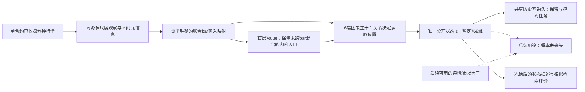

# Babel 路线图：从同源分钟行情学习可复用状态

更新：2026-11-26（路线与数学逐段审计版）。**唯一当前方案。目标、可用数据、架构、训练评测、应用与数学依据在本文闭环。** 目前只做方案；新模型、数据管线和训练未实现，CUDA授权为0，没有新模型成绩。

固定目录：`/Users/bardan/Documents/Codex/来自旧电脑-20261031/obson`；分支：`codex/babel-next`。每轮独立实验目录，源码/配置/训练说明发布后冻结，修复另开版本；见[实验规则](../../experiments/README.md)及[工作流程](BABEL_EXPERIMENT_WORKFLOW.md)。F编号只是需求方向索引，不是早前实验的重跑清单。旧实验和失败保留在[历史提交](https://github.com/BardanYu2025/obson/tree/e060ca98f660579f0784c9f72a2ead6f31f13502)，不作为新训练前置。

本次审计基线为`724ab66`的816行正文和对应JSON。第10节逐节覆盖原行号，列出修正与未验证项。**原8次主训练＋36次读头拟合方案撤出执行队列**，保留在该提交，不与本版并行。

## 0. 当前决定：先做可用状态，再解释必要的机制

### 0.1 目标与第一步

每个合格1分钟收盘时刻t产生`z_t=E(H_t)`：保存已发生的重要价量信息，并可读取当前行情描述。同一时刻闭合的粗bar可共用此状态；查询指定过去哪个区间。未来预测和外部因子融合是条件后续，不进入当前损失或晋升门槛。

第一步是**数据与样本资格包**，不是开训。顺序为快照/口径→时间分区及完整支持清除→仅训练统计→查询与遮挡依赖→可检查样本。具体交付：

| 交付 | 必须解决的问题 |
|---|---|
| 快照清单、口径与隔离范围 | 哪些文件与合约窗口真正可用；历史日历、单位、零成交/缺失怎么处理 |
| 分区端点及依赖清单 | 每个状态实际看见什么；输入/预热/标签/选择规则是否合格；未知未来不参与筛样本 |
| 训练统计、查询与mask合同 | 聚合算术、归一、有效项、抽样概率和隐藏字段依赖；最低可见覆盖事前确定 |
| 固定样本页及资格回执 | 正常、休市、缺段、静止、冷启动能否逐项解释；粗细bar的真实聚合关系是否成立 |

实物尚未生成。范围合格后冻结运行卡；局部缺证则所有方案共同隔离并限定范围；核心时间/口径无法确定则停止依赖工作，列明缺少什么依据。首次发现过的基本文件合法性不反复作为新的科学实验。

### 0.2 当前架构与训练默认

`1分钟256＋5分钟128＋15分钟64＋60分钟64 → 最多512个市场观察 → 共享768维输入 → 加1个状态位置 → 6层/12头因果Transformer → 一个768维z → 共享历史查询头`。

不是连续512根同周期K线。每个观察保留真实区间、周期、覆盖和可用时刻；mask按闭合时刻建立，同闭合时刻允许跨周期读取。行号仅用于存储，不承载时间意义。数值/维度见第2、3节。

历史头采用4个宽256的FiLM残差块，同一z回答不同查询，不为不同回看长度另设头。训练任务包括完整历史保留，以及候选的历史填空。**完整历史的主成绩、掩码成绩和当前描述分开。** 过去已发生的随机尖峰也属于可保留信息；不强迫填空恢复条件上不可识别的尖峰。

### 0.3 首批只比较两套完整配方

| 配方 | 编码结构 | 编码器与历史头的训练 | 能回答什么 |
|---|---|---|---|
| P0普通参照 | 普通因果Transformer | 仅clean历史保留 | 相同数据、尺寸和公开状态接口的起点 |
| P1完整候选 | 区间关系bias＋首层Value通路 | clean＋0.25mask，共同更新E和D | 这套结构与训练组合是否值得保留 |

两个编码器种子42/43，共**4次主训练**。两组共享clean端点/查询曝光、共同参数初始化规则、N次更新、优化器和评价机会；P1额外的mask前反向及关系计算成本必须报告，不能称等FLOPs。P0不再为了分离辅助编码梯度而让头训练mask；这是相对原A/D的明确协议修改，因此使用新配方ID。

本批不能分别归因于关系bias、Value或mask，也不证明多周期优于单周期。B/C式机制拆分只在结果能改变决定时重新立项，不自动补齐四组。未来损失恒0，无旧checkpoint依赖。

### 0.4 评测与工作量：不用读头网格先铺满

主历史成绩R用**各自原训练头D0**，架构/初始化规则/clean训练机会相同；结论是完整编码解码系统的保真，不是假装测出了纯信息量。近期、当前形态、量仓、各周期与尾部单列。

冻结4个编码器后，各拟合一个`768→128→18`描述MLP；PCA768和同信息原始输入各拟合一个对应MLP，共**6次用途头拟合**。主分数U读取已发生方向/路径效率/波动/回撤/成交/持仓，定义见5.3。描述头种子314、相同标签和预算；原始输入维数和参数更多如实披露。

**D256/D512成对重拟合是条件诊断，不是默认主评价。** 若事前规则指出原头拟合不足或内容/U判断冲突，再用开发数据按共同预算诊断4个冻结状态×两档头，最多8次拟合，不更新编码器。这不是纯粹的宽度定理：拟合难度也改变。触发线与预算须开训前锁；不能用最终留出触发后又在该留出调头。无明确触发就不做。

基础预算为4次主训练＋6次用途拟合，另计PCA、共同特征提取、完整评价及备份；条件诊断不暗含授权。有效batch64、主AdamW峰值2e-4、新头1e-3为默认，N/N_U/条件N_H、实际微批/精度、GPU小时/磁盘/时延尚未定，不猜时长。

### 0.5 判定、应用与结束

先满足事前规定的历史与当前描述可用质量，再判断P1是否值得替换P0。保留原数值提案：R至少改善5%；最近16交易分钟价格、当前实体和U整体最多退化5%；量仓、预定困难尾部、U各类最多退化10%。补上影/下影各自保护，暂定最多10%退化，不让实体或总分遮住影线丢失。相对阈值不等于交易可用，绝对误差、相关组置信规则和成本上限仍须事前锁定。

| 结果 | 下一步 |
|---|---|
| 候选通过质量、保护及独立确认 | 固化完整版本和能力范围，离机备份与干净恢复；进入限定应用 |
| P0合格，P1没有可靠收益 | 交付P0，结束本候选升级主张，不为找赢法自动追加消融 |
| 编码与读头限制无法区分，且影响决定 | 一次有界冻结读头诊断；仍不清楚则报告未确定 |
| 全部不合格 | 停止本配方，按已记录的数据/读取/优化证据选择一个可区分缺口 |
| 留出支持不足或已用于选择 | 仅研究级交付，独立验收开放；不把更多重叠窗口当新证据 |
| 实现错误 | 先界定影响；能重评则重评，训练污染才重训必要范围 |

首个应用是每分钟刷新的一份状态描述和历史回读：净变化、波动、路径效率、回撤、量仓及覆盖/失效标记。检索、后续分类和概率未来各自验收；不能由重建漂亮直接宣布开仓信号有效。

### 0.6 更值得深入的架构方向及当前边界

优先研究**同一历史在不同区间读出时能否遵守真实聚合关系**（3.11），再考虑有显式近似目标的记忆与学习残差（3.12）。前者现在进入数据资格和无新参数的评价合同；尚不自动增加训练loss。后者有数学吸引力，但有限基底、信息预算和非平稳行情必须正面对照，当前不另开模型。

这不是宣布P1最优，也不是继续收集attention名字。一次只保留一个完整候选；任何新结构替换必须在训练前登记其能回答的问题、代价和停止条件。全部实验独立版本，阶段完整资产导出到`/root/autodl-tmp/download`，确认离机SHA和干净恢复才算防丢交付。当前没有可运行训练命令。

## 1. 我们要做什么，为什么要重新设计

我们要让每根**已收盘**K线拥有一个状态向量，也就是embedding。它应当压缩截至这一刻的一段行情：价格怎样走到这里，近期形态如何，成交和持仓怎样变化。同一个状态以后可以交给不同任务使用，例如描述当前趋势与波动，或者逐步生成未来价格的可能路径。

成功不等于100%复制所有影线，也不等于只学会几条均线规则。**当前阶段以历史重要内容保留、当前行情描述和冻结后的复用为主线。** 概率未来是后续用途，纯K线预测改善不是编码器晋升或交付条件；历史重建成功也不能代替未来或交易检验。

原有研究已经证明某些状态能够回读有限历史，也暴露了近远内容失衡、读头兼容性、训练预算混杂和模型资产丢失等问题。现在有更细、更长、更多品种的数据，应该重新定义模型真正看见的世界，而不是先恢复旧训练链，再逐个改旧超参数。

本方案的核心选择是：**同一份分钟行情形成多个时间尺度；比较普通主干与关系/Value候选；以历史保留为基础，检验关系/Value与历史掩码组合是否改善内容组织与复用。** 未来预测头及外部因子融合暂不进入首批训练。第0节采用两套完整配方；原四臂机制研究条件保留，不能把组合胜出拆成单因素结论。

| 保持不变的目标 | 可以重新选择的实现 |
|---|---|
| 每根已收盘bar只使用当时可得信息 | 窗口长度、分辨率、层数、头数、状态维数 |
| 保存有用价格形态和成交/持仓信息 | 特征表达、归一化、编码与解码结构 |
| 同一状态支持多种后续用途 | 历史损失、概率监督、读头与优化方法 |
| 结果可靠、实验能够结束、模型能够恢复 | 同批对照的具体组织和资源配置 |

旧Macro权重已经丢失，旧报告仍在。新训练将建立新模型身份，不称找回原权重；旧13阶段恢复和旧输入四臂均不是当前前置任务。

### 1.1 用户澄清后的优先级与两层职责

相同127根K线不唯一决定下一根；这与有限观察、尚未提供的市场背景以及新到信息相容，不足以证明行情完全不可预测或差异全是不可约随机。相同OHLC也未必代表量仓、长历史与元信息相同。若冻结的确定性编码器收到的**全部声明输入**都相同，它应产生同一个z；不要求它凭空区分未输入的新闻或环境。

第一层`z_t=E(H_t)`负责忠实整理当时可见的行情内容。当前描述头可读方向、路径效率、波动、回撤和量仓变化，使用只依赖t前数据的定义；它们是行情描述，不是对“真实市场隐状态”的唯一识别，更不等于下一根方向或开仓结论。

第二层以后可估计`p(Y_future | z_t, M_t, F_t)`，F_t是当时可得的舆情、跨市场或其他因子，M_t是声明的价格/尺度元信息。先冻结基础状态，在独立用途版本中验证融合；是否回传编码器另立假设，不覆盖已交付表示。外部数据必须记录实际发布时间、到达延迟和版本，不能按事件发生日期回填后来才知道的内容；缺失因子也不能当真实零值。

**这有信息论理由。** 单独预测Y所需的信息，不一定等于未来与外部F共同使用时所需的信息。理想压缩代价变为`E KL(p(Y|H,M,F)||p(Y|Z,M,F)) = I(Y;H|Z,M,F)`。只优化不带F的预测，无法保证这个条件信息也保住。独立等概率二元H和F、Y=H异或F就是反例：单看H对Y没有信息，两者结合却能决定Y。常量Z单独预测并未变差，丢掉H后却失去组合能力。这是数学示例，不是市场规律或当前数据证据。[多来源信息与协同](https://arxiv.org/abs/1004.2515)

因此，首批先尽量保留多种可观察内容，不按纯K线未来分数筛掉信息。近似重建仍不能保证所有尚未知晓的外部组合都可用；未知用途没有万能充分状态。以后融合要比较`z单独`、`F单独`、`z+F`及同信息`原历史+F`，判断增益来自哪里。当前不新增因子数据采集或融合训练队列，F06/F07/F08/F09保留为条件后续。

## 2. 数据：这次究竟多了什么，怎样使用才成立

### 2.1 已经确认的事实与仍未确认的范围

数据目录是`/Users/bardan/private/tqdata_2015`，首轮主体使用`month_contracts/bars`中的真实单合约。11月24日完整盘点得到：44个品种、2382份文件、46,224,030条分钟记录，实际覆盖2016-01-04至2026-11-19。11月26日本次仅复核文件数量/大小，单合约仍2382份、1,552,055,292字节、44品种；main44份、index6份。没有重扫行内容或重算行情SHA，不声称同步已结束。[原始审计摘要](../../experiments/20261124_minute_audit_v1/reports/20261124/summary.json)

| 数据条件 | 为什么影响模型设计 | 当前处理 |
|---|---|---|
| 有同源1分钟数据 | 可以看到粗K线内部的先后变化，也能准确核对多周期汇总关系 | 近期保留分钟粒度，较远历史用同源粗视图 |
| 年份、品种增多 | 可以减少反复曝光少量旧窗口，检查不同市场阶段 | 按品种、合约、时间组抽样与评价，不把每分钟当独立样本 |
| 文件是单合约 | 能区分真实交易变化和换月拼接跳空 | 不跨合约构造同一段模型历史，完整合约生命周期进入主键 |
| 月份文件只覆盖主力窗口及换月附近 | 数据选择可能借用了事后主力身份，不等于完整交易宇宙 | 核查选择规则和当时可得性；结论限定于合格合约窗口 |
| 715,590条零成交、平价、持仓不变记录 | 可能是真实不活跃，也可能包含源端填充 | 保留质量标签，取得依据后分类；不自动删除或插值 |
| main有拼接且发现3条负成交；index只到齐6品种 | 直接混用会改变价格与成交含义 | 首轮不依赖main/index，不因此阻塞单合约主体 |

基础审计没有发现月份文件的OHLC几何、重复时间、倒序或负量仓问题，但**基础数值合法不等于可训练资格已经全部通过**。历史交易日历、夜盘归属、量仓口径变化、缺段与静止行情仍需要核对。[质量问题与限制](../../experiments/20261124_minute_audit_v1/reports/20261124/quality_notes.json)

### 2.2 为什么采用同源多周期，而不是各周期各看128根

128根1分钟与128根60分钟描述的是不同时间范围。新方案先问“需要看多近、多远”，再为不同范围分配观察精度。它类似看地图：当前位置看街道，远处看区域轮廓；远处被省略的街道不能宣称仍完整记住。

初始提案是：

| 已闭合视图 | 最多bar数 | 设计目的 |
|---|---:|---|
| 1分钟 | 256 | 保留最近逐根变化，不提前压成固定4根片段 |
| 5分钟 | 128 | 观察中短区间的形态与成交持仓变化 |
| 15分钟 | 64 | 观察更长的结构 |
| 60分钟 | 64 | 提供较远背景 |

共有最多512个市场观察，彼此有重叠，不是512个独立事件。最长视图是64个已闭合60分钟格子；实际交易时长、自然时间和预热范围由日历与缺段决定，不固定称“若干天”。30分钟可由同源数据生成，但首批不为列全周期再加一条高度重叠视图；F04跨分辨率方向仍保留。

同一物理区间的粗细视图共享内容，粗视图却丢掉内部顺序。例如“先涨后跌”和“先跌后涨”可能得到相似的粗K线。因此应对齐共同内容，允许细视图保留额外信息，**不要求两个完整embedding逐维相等**。首批通过同源数据、共享编码器和物理区间目标联系尺度，先显式检查共同内容聚合关系；额外一致性损失仍为条件候选，详见3.11。

### 2.3 聚合、时间与数据边界

每个观察都记录合约、区间起止、实际覆盖和最早可用时刻。源时间戳表示bar开始；该bar结束以后才能进入状态。高周期bar尚未收完时不能提前读取其最终高低收和成交。

聚合规则为：开盘取首值，最高取最大，最低取最小，收盘取末值，成交量求和，持仓取区间起点和终点，持仓不能求和。按历史交易时段定义嵌套格子，时段起点与尾段规则共同冻结；只有原分钟集合恰为不重叠完整并集才比较父子聚合，不是每5/15/60行机械切块；休市与缺失分别判断，不能用填平线补满。区间完整性的判据要随快照冻结，各方案使用相同的合格范围。

交易所、品种、完整合约生命周期和时间构成主键，尤其不能把不同年份重复的短合约代码拼起来。所有预热、滚动统计和以后缓存的真实依赖都进入数据分区检查。没有逐笔方向、盘口和可靠开平仓标识时，不把某个潜在维度命名为“主动买入”或“多头开仓”。

### 2.4 价格和量仓怎样标准化，为什么这样做

绝对价格、成交量在不同品种间跨度很大，直接比较会让模型把数值大小当成形态。另一方面，把每个窗口都强行缩成相同波动，又会丢掉“平静还是剧烈”的信息。建议把**相对变化和它的尺度一起保留**。

基础数值输入共9个通道，另有时间、分辨率和质量mask：

| 输入 | 建议表达 | 保留的意义 |
|---|---|---|
| 开盘相对上一收盘 | `log(O / C_prev)` | 真实跳空，不用连续主力去伪造平滑 |
| 实体 | `log(C / O)` | 当前bar内部方向与幅度 |
| 上影、下影 | `log(H / max(O,C))`、`log(min(O,C) / L)` | 非负形态量；已发生的信息，不要求未来可准确预测 |
| 成交量 | `log(1 + V)` | 缩小数值跨度而保留活跃变化 |
| 起末持仓 | `log(1 + OI_start)`、`log(1 + OI_end)` | 区分存量与变化，未知值不能当真实零 |
| 持仓净变化 | `asinh((OI_end − OI_start) / s_ΔOI)` | 保留增减方向，尺度仅由训练部分拟合 |
| 历史波动尺度 | `log σ_past` | 让模型知道被标准化前变化有多大 |

价格变化先除以因果波动尺度，再使用训练集固定的字段/周期尺度。波动尺度的初始提案是**当前bar之前、同周期64个连续合格收盘收益的RMS（需65个边界收盘）**，正常休市可按冻结日历衔接，未知缺口不跳过来凑64；带训练集确定的下限，不足时使用训练集fallback和冷启动标记，不向未来借数据。这个预热实际可能超出表里的512个观察，必须计入输入支持和成本。

历史目标不使用每个待重建窗口重新拟合的未来统计；相对价格以当前已知收盘为参考，损失字段尺度固定于训练部分。预测则把收益尺度固定在预测起点，不沿真实未来路径重新估计。

**旧经验的借鉴：** 保留单合约、尺度可追溯、预热显式、缺失不当零。**新数据下的重想：** 同源分钟视图、物理区间、原始价量核心通道成为主体；不默认继承旧28维、EMA组合或PCA教师。指标以后可以成为有明确信息理由的对照，不能先把模型目标缩成复刻指标。

### 2.5 数据怎样组织成每根bar的训练样本

采用四层组织，原始文件、加工结果和样本身份分开。下面是待实现的数据合同，不表示这些新缓存已经生成。

| 层次 | 保存什么 | 解决什么问题 |
|---|---|---|
| 原始快照 | 原分钟文件、说明、文件SHA与大小、合约和来源清单 | 同步中新文件不能悄悄改变正在训练的数据；新快照另给身份 |
| 合格分钟事实表 | 按完整合约身份及其实际已下载窗口排序的OHLCV、起末持仓、区间时间、交易日/时段与质量标记 | 区分真实零成交、休市、缺失和来源冲突；不把换月拼接当涨跌 |
| 同源多尺度表 | 由合格分钟生成的1/5/15/60分钟观察、原分钟索引、覆盖与可用时刻 | 粗细观察描述同一份市场记录；可追查每个值从哪些分钟而来 |
| 端点样本索引 | 合约+t、各尺度切片、预热依赖、分区与合法历史查询；未来用途另登记标签范围 | 每个t有自己的完整输入；首批不因缺少后续60分钟而丢弃合格历史样本 |

样本身份绑定数据快照和处理协议。大数据可以按哈希只读引用，实验自己的处理代码、尺度文件、抽样清单和依赖必须归本实验版本；不能调用外部数据目录里会变化的加载脚本。相同字节的重复记录可登记后去重；同主键异值先隔离核查，不按“最后下载的一份”静默覆盖。不混入旧`tqdata`、主连或指数来填补单合约缺口。

**一个样本围绕一个已收盘时刻t。** 例如截至10:07的状态，只能读截至10:07已经完成的分钟bar；若5分钟格子是10:05～10:10，就不能读取它10:10才确定的最终值。10:05之后已完成的分钟仍可由1分钟视图进入。所有多周期格子由同一份历史时段规则生成，跨休市、缺分钟和时段末不足整格的处理必须锁定，不能把不足60分钟的尾段假装完整60分钟。

源`datetime`是bar开始时刻；官方字段定义也区分区间成交量和起末持仓。[TqSdk字段说明](https://doc.shinnytech.com/tqsdk/latest/usage/mddatas.html)。离线可用时刻以闭合时刻建模，若没有真实到达时间，须注明这是理想闭合假设，不声称已验证实盘延迟与历史修订影响。

首批同一个t有干净历史与遮挡历史两种输入；未来路径标签不进入本轮数据资格或训练。以后做预测才另登记t之后的监督范围，并继续禁止未来进入编码输入。遮挡必须清理粗周期汇总、上一收盘、滚动统计及其他派生字段中的答案，不能只遮一列而从另一个周期读回去。精确遮挡依赖仍按4.5节锁定。

训练在合格端点中按品种、合约与时间组抽样，让单个长寿、活跃合约不凭样本多主导更新；具体配额和有效曝光在运行卡固定，不按未来涨幅或“形态好看”筛样本。P0/P1使用相同clean样本与查询序列。评价使用固定端点和近中远/尺度/字段清单，同时报告组间及尾部差异，不把大量重叠窗口当独立证据。

先按第5.1节分区，再仅用训练部分拟合尺度、下限、fallback及任何PCA/统计基线；完整输入、预热和标签范围都计入边界清除。训练区内打乱批次可以，重叠窗口随机分到训练和验证不可以。保留零成交与缺失的不同标记；无法确认口径的范围先标为未合格，不能靠标准化掩盖。

### 2.6 技术指标放在哪里：原始内容是主体，指标是可检验的帮助

**首轮不依赖EMA、MACD、RSI作为必需输入或主要学习答案。** 输入以原始价量的相对表达为主体，学习目标仍是保存行情内容并检验复用和概率未来。下列三类不能混为一谈：

| 类别 | 首轮职责 | 理由与边界 |
|---|---|---|
| 相对价格、历史波动尺度、log量仓等基础变换 | 必需的数据坐标与数值处理；波动大小另保留 | 缩小品种量级差异，同时保留形态、幅度和活跃信息；它们也有人工选择，不能称完全无人工特征 |
| EMA/RSI等技术指标 | 可作为直接计算的简单比较方法；首轮不增加指标输入支线 | 若模型只是复刻指标，直接算指标就能完成相应用途，不能算通用状态成功 |
| 指标输入、辅助监督或教师 | F12条件保留，当前不排队 | 仅在现有诊断能指出具体缺口时，做同原始信息、同预算的配对比较；不能凭常用就不断堆指标 |

若一个指标完全由相同历史H计算，`I=f(H)`，它不增加H以外的新观察，但可能让有限模型更容易学到某类关系。因此“不作为首轮依赖”不等于“指标无用”。若EMA的预热来自H以外，或指标借用了其他合约/市场，它确实扩大了信息范围，必须给对照相同可得历史并计入支持边界；不能把更多历史带来的收益全归因于公式。

历史波动标准化同样是人工统计，本方案明确保留其用途与依赖。固定字段尺度只从训练部分拟合；不能对每个完整合约寿命使用包含后来行情的均值/方差。跨品种留出的尺度规则要有训练来源的通用fallback，不在留出品种上重拟合。若以后加入任何指标，遮挡任务必须同步清理其依赖，否则容易从指标泄露被遮挡答案。

当前不先用均线平滑后删除原始起伏，也不把每次上下影变化自动认作噪声。哪些内容值得保留由历史分项误差和后续用途检验；损失里的合理取舍不等于在数据源头抹掉信息。已知时间与时段只是观察条件，不要求模型预测休市间隔。

### 2.7 进入实施前还差什么

本次复核原审计、交付说明和文件数量/大小；前次列结构抽查仍只是抽查，本次没有重扫全量。交付说明明确提示部分2020年前成交量可能有单双边口径差异；这是待核实的来源声明，尚不是确认的逐品种历史转换表，不能一律除以2。还需冻结快照、核对历史交易时段和可用范围、确定静止/缺失处置与历史口径，才能签发首批训练资格。

这些是同一批数据资格与运行卡的工作，不额外增加指标消融、模型worker或旧恢复步骤。相对于旧研究，本轮保留单合约、因果统计、完整上下文和同样本比较的经验；基于新数据新增的是分钟事实表、同源多尺度及其依赖追踪。行数/质量仍引用11月24日审计；本次只核文件数量/大小，不声称同步完成或字节内容相同。

## 3. 架构：模型怎样把多段历史整理成一个状态

### 3.1 状态是什么，数学上想达到什么

记`H_t`为截至时刻t真正可见的多尺度观察及预处理依赖，编码器计算`z_t = E(H_t)`。当前bar的状态也可以作为这段历史的序列表示；它不是“只有这一根K线的特征”。相邻时刻的状态通常共享大量历史，但新观察、窗口移出与尺度闭合都会改变它。

当前目标是在有限状态和可承受成本下保存重要历史，并让当前描述和新用途容易读取。以后预测再单独检查这种压缩是否损失有关信息。**不能由768维或一个loss证明状态已经充分、可逆或服从真实市场的Markov规律。** 历史中暂时不显示独立预测能力的内容仍可能值得保留，尤其以后可能与外部背景共同使用。

公开记录暂定包含`z_t`、当前参考价格`C_t`、声明的历史尺度元信息（未来用途才另锁预测尺度）、合约/时间/有效覆盖标记。768维FP32向量本身是3072字节，元信息、共享模型和运行缓存另计。当前价格本来已知，不能算作成功重建一个点；恢复绝对价格也不能宣称全部只来自这768个数。所有对照得到相同辅助信息。

**重建能力不自动确定相似度。** 若`D(E(H))`能重建，把编码改成`E′(H)=A E(H)`、解码改成`D′(z)=D(A⁻¹z)`，任何可逆A都保持相同输出，但非正交A通常改变余弦距离。比如(1,1)与(1,−1)原本正交，把第一维放大10倍后余弦约0.98，重建却可以完全不变。这是代数上的不可识别性，不是本项目已经测出的故障；有容量/正则约束的具体网络也未必能精确实现任意重参数化。

因此要区分**保存内容的z**与**用来比较某种内容的距离**。同样上涨但波动相差十倍，可以形态相似、风险不同；价格路径相似但成交持仓不同，也不应只有一个“总体相似”。我们的z更接近带上下文的token表示，而不是固定词表查表：同一根外形相似的K线，在不同历史里应允许状态不同。

首选可核验的内容距离：固定同一组合法物理查询Q、字段尺度及对角元素非负的权重矩阵W，令`f_Q(z)`为历史头读出的相对价格/形态或量仓内容，计算`d_Q² = (f_Q(z_i)−f_Q(z_j))ᵀ W (f_Q(z_i)−f_Q(z_j))`。它在编码/解码等价重参数化下不变；局部对应`G(z)=J_f(z)ᵀ W J_f(z)`，表示哪些状态变化会改变可读内容。G可能奇异，d只是查询相关的伪度量，不是已发现市场流形。查询、参考坐标和共同覆盖必须一致；忽略绝对价格时明说其不变性。

这也给出检索向量的路线：需要快速余弦检索时，再把该内容几何学习到一个小投影`u_k=g_k(z)`，按形态/风险/量仓用途分别验证。投影只读z；不强迫整个z丢掉投影不关心的信息。当前先评价已有解码内容距离与原始统计/PCA/原始z余弦，不默认新增对比损失或额外训练worker。由重建头定义距离不等于距离正确，必须用未参与拟合的真实区间内容检验。

以下是后续预测用途的数学边界，不是首批编码器训练目标：Z由H确定、M为双方同样可得的侧信息、Y为预定未来目标，在条件分布和期望良好定义时，压缩的理想对数评分代价为：

`Δ* = E[KL(p(Y|H,M) || p(Y|Z,M))] = I(Y;H|Z,M) ≥ 0`。

仅当相关条件熵有限时再写成`H(Y|Z,M)−H(Y|H,M)`，避免连续变量的无穷相减。`Δ*=0`表示对这个Y和分布，Z与M足以保存H的预测信息，不表示能预测确定未来，也不表示对任何用途充分。**压缩不能创造原历史没有的信息**；有限数据上更好，只能来自更合适的表达、正则与优化等，需要实验区分。

有限预测头还有额外误差。任意头q满足`E[-log q(Y|Z,M)] = E[-log p(Y|Z,M)] + E[KL(p(Y|Z,M)||q(Y|Z,M))]`，需各项良好定义。因此实测头之间的NLL差混合了表示损失、近似与优化误差，不能当成互信息测量。历史重建差也混合编码与解码误差；这也是出现读取疑点时，需要按共同预算做冻结读头诊断的理由；不意味着每轮默认铺满读头网格。

768维实数不是有限信息率约束；确定性连续编码的互信息可能无穷。实际FP32状态才有至多768×32=24576 bit的固定长度存储上限，侧信息和共享模型另计。当前没有随机编码、码率项或量化训练，故只借鉴“压缩与失真权衡”，不称已实现信息瓶颈最优解或达到率失真界。[Deep VIB](https://arxiv.org/abs/1612.00410)

内容距离也有条件：固定Q、W及侧信息/坐标约定时，**开平方后的d_Q**才是伪度量，平方距离不满足一般三角不等式；若每对样本随意更换共同可见查询，连伪度量也不能保证。局部`JᵀWJ`仅在固定侧信息与可微点成立；它不是自动可逆的市场几何。

对有限二阶矩的历史目标T，令m(Z,M)=E[T|Z,M]，任意读头g有`E||T−g(Z,M)||²=E||T−m(Z,M)||²+E||m(Z,M)−g(Z,M)||²`。第一项是对这些目标及条件的不可读风险，第二项混合读头近似/拟合限制；观测到一个头读差不能分离两项。若编码观察本就没有分钟顺序，第一项还混有输入分辨率损失，不可全归罪于编码器。对SmoothL1没有这条相同的勾股等式。

### 3.2 模块各自负责什么，连接为什么这样设计

此前草案的问题是：给出了层数、头数和时间常数，却没有充分区分“结构保证的信息通路”和“训练以后才可能出现的能力”。本轮建议保留一条因果主干，撤下前2层强制同尺度、后4层固定指数偏置的默认配置，改为**区间关系注意力＋底层Value内容通路**这一完整候选。旧配置只保留为未执行草案，不同时排另一组实验。

| 模块 | 能由结构明确的职责 | 如何检验，不能预先声称什么 |
|---|---|---|
| 联合bar映射 | 同一bar的OHLC几何、量仓、时间/质量字段同时可用；两种骨干使用相同映射 | 不把9个通道当可互换像素；不声称某维就是买盘/趋势 |
| 区间关系Q/K | 内容匹配同时知道两个观察的时间距离、持续长度、重叠与尺度关系 | 与收到同样元信息的普通注意力比较；关系权重大不等于经济因果作用 |
| 底层Value通路 | 每层可在当前因果mask内继续读取首层、尚未跨bar混合的内容 | 看近期内容、量仓、尾部及成本；通路存在不保证内容最终进了z |
| 单状态汇聚 | 所有历史输出和未来条件都经过同一个公开z | 禁止头读取原bar、全部token或KV；去掉/错配z检查旁路 |
| 共享历史头与后续用途头 | 首批用共享头读取干净/遮挡历史，冻结后新头读取当前描述；概率头条件后续 | 不把头更强误称状态更好；不以纯K线预测筛选本轮表示 |

主干仍暂定6层Pre-LN、宽768、12头、每头64维、FFN3072，所有层可按可用时刻跨尺度交流。数值是资源提案，不给某个头指定“趋势”“头肩顶”等未经识别的语义。多头允许不同匹配，不能保证自动分工；先不加入卷积、SSM、频域和独立长短编码器形成大拼盘。

最多512个市场观察加1个状态位置。市场观察按自身可用时刻读取历史；当前状态读截至t的观察和自身，市场观察不能反读末端状态。共同闭合时刻的跨尺度信息可以合法交流，但均不能读取尚未完成的bar。内部早期位置不是完整滚动bar状态，公开z仍须按每个t自己的H_t重算；无限流式更新与KV等价性没有被证明。

具体维度：9个数值＋9个字段可见标记＋9个人工依赖标记＋1个尺度fallback标记，经Linear(28,768)。时间8量为交易/自然结束年龄、交易/自然时长（四者log1p）、覆盖比例、有效预热比例、已知时段时刻sin/cos，经MLP(8,64,768)；加周期Embedding(4,768)，三者相加。未知值置零带标记，合约ID不作可学习查表。

市场`[B,512,768]`加末端状态成为`[B,513,768]`；6层Pre-LN、12头×64、FFN768→3072→768、GELU、dropout0、LN epsilon1e-5。市场按实际可用时刻读取市场，禁止反读状态；状态读全部截至t的合法观察及自身。最终LN取z`[B,768]`。每个t重算，不承诺滚动KV等价。

P1的关系φ共12量：交易/自然结束时间差、双方交易时长、时长比、交易区间IoU、两向包含、双方覆盖率、两端状态标记。合法边时间差非负后log1p；若在mask前对全矩阵计算，有符号差用sign(x)log1p(abs(x))，不能对负差直接log1p。MLP12→32→12逐层独立，输出2tanh、末投影零初始化；状态作为key时bias0。第2～6层逐头α=sigmoid(a)，a初值0，市场V=(1−α)V_l+αV_1；状态key用当前V。关系计算、mask和Value均随完整记录置换。只重排存储行应保持z，交换价格与时间配对则改变历史。

### 3.3 关系与内容怎样在一个注意力块中连接

候选以如下通路表达，最终数值与匹配成本仍须进入运行卡：

`A_l = softmax(Q_l K_lᵀ / sqrt(d) + b_l(φ_ij) + M_ij)`

`Ṽ_l,j = (1−α_l,h) V_l,j + α_l,h V_1,j`

`x′ = x + W_O concat_h(A_l,h Ṽ_l,h)`，随后接普通Pre-LN前馈残差。

φ只包含双方当时可得的区间关系；b是有界小函数，例如`c·tanh(MLP(φ))`，M禁止未来及无效连接。α是层/头标量的有界可学习混合，初始0.5为暂定设计；第一层本身不重复混合。首层V来自联合bar输入经逐token归一化后的投影，保留token身份，没有跨bar上下文。状态自身的键使用当前层V，内容残差只连接市场token。该通路受同一因果mask约束，不能绕过mask或遮挡任务的输入清理。

普通参照使用相同输入、同一主干尺寸与公共状态接口，但没有关系分数b与底层V通路。新增关系函数和混合标量的有效参数、运行缓存、FLOPs须如实报告，不虚称完全等参；主干共有参数按种子配对初始化。若收益小到可能仅由新增容量解释，结论限于整套配方，不靠死参数补齐制造公平假象。

这项候选的假设是：**关系负责“到哪里读”，Value负责“带回什么”，隐藏残差负责“保留已有表达”**。后层还可读初始内容，可能缓解反复混合后细节不易读取的问题，但这不是信息保留定理。[Value Residual Learning](https://aclanthology.org/2025.acl-long.1375/)

固定指数先验已撤下默认位置，因为具体时间常数与每尺度等质量尚无当前任务证据。其`softmax(score+log prior)`可解释为内容匹配与KL先验的权衡，这个数学解释仍成立，但不能据此把人工时间常数当市场定律。可学习关系同样只是归纳偏好，不消除粗细重复覆盖，不证明架构优越。

严格地说，在某一行合法键集合上、给定正先验π和分数s，`softmax(s+logπ)`恰好求解`argmax_p {Σ_j p_j s_j − KL(p||π)}`。这是读取权重的熵正则优化解释，**不是贝叶斯后验或经济因果模型的证明**。当前首批仍采用每个合法token等基础权重，即π均匀；b属于学习分数，两配方共享相同视图数与可用范围。

这也揭示多尺度重复的限制：某条等分数观察复制m次，其总softmax质量相当于增加`log m`分数；两个等分数观察原各占1/2，把其中一个复制为3份就占3/4。真实粗细bar不完全相同，此例证明的是该机制**不具有重复观察不变性**。关系bias不自动消除重复计数。当前不临时加覆盖权重分支，运行卡须声明token计数测度、检查重叠/尺度注意力质量，不能把“多视图”直接解释成更多独立证据。

Value凸混合只保证固定输入下`||Ṽ|| ≤ (1−α)||V_l|| + α||V_1||`。它增加了读取首层内容的通路，但注意力加权、输出投影和末端汇聚仍可丢信息；不同层V的坐标还要通过学习相容。该不等式不限制Q/K导数、残差深度或端到端Jacobian，不能据此声称全网稳定、可逆或永不遗忘。我们的有界凸混合是受论文启发的候选，不把它当原论文所有配置的等价复现。

### 3.4 历史解码器：同一状态回答同一套问题

历史解码器接收`z_t`和一个物理区间查询q，例如“结束于当前之前20个交易分钟、持续5分钟的那根已完成bar”。clean的q只从已登记观察范围的合法区间中选取；masked任务可查询被隐藏的过去标签，q自身不带真值，说明问哪里、跨度多大；不包含答案。它不再为回看5根、80根、128根分别训练不同的专用解码器。

提案是一个4层、宽256的共享残差MLP，状态通过各层的缩放/偏移调制查询表示，即FiLM条件化。这样可以明确区分“状态保存的内容”和“问题的位置”，也方便控制读头容量。不默认把768拆成4个192维槽；旧槽并非天然有物理意义，新读头也尚未证明更好。

每次输出7个量：相对收盘、实体、上下影、log成交、log起持仓和log末持仓。由这些量组合出合法OHLC；影线非负、价格为正，成交持仓非负。相邻收益和持仓变化必须由预测值推导，不借真实邻点帮助解码。几何合法只保证输出像一根K线，不保证数值正确。

例如输出`a=log(C_q/C_t)`、`b=log(C_q/O_q)`及`u,d≥0`，便有`C_q=C_t exp(a)`、`O_q=C_q exp(−b)`、`H_q=max(O_q,C_q)exp(u)`、`L_q=min(O_q,C_q)exp(−d)`。这能证明正价格与OHLC大小关系；不能证明最小tick合法或识别bar内部高低点先后。数值实现还须处理零量仓、指数溢出及精度，而非只检查符号公式。

读头不能另读原始历史、全部encoder token或运行缓存。clean主评只评价输入确实声明观察到的完整区间；远期只有60分钟观察时，不能要求或宣称记住其中全部1分钟顺序。当前已知收盘不计重建成绩，当前实体、影线、成交、持仓仍训练与评价。

当前4×256 FiLM头按纸面结构约2,107,399个参数，不是一次线性投影，也未证明足够。逐query读取使同一z/q不依赖其他同时查询的点；共享z/参数与差分损失仍联系不同位置。仅一个合法key的cross-attention读取权重softmax恒1（不表示整个含query残差的头与query无关），换名称并不自动增加按位置读取能力；查询间self-attention则需要固定查询集合或验证查询批次不影响答案。本轮主结果用D0；D256/D512仅作为有界条件诊断，见0.4，避免读头网格先于实际疑点。

查询8量为四个log1p时间量＋周期one-hot4，Linear(8,256)。每个FiLM块为`h←h+W2 GELU(W1[(1+γ(z))⊙LN(h)+β(z)])`；W1/W2为256→256，独立Linear(768,512)生成γ/β；4块后Linear(256,7)。条件投影非零随机初始化。输出不读取每个目标的真实σ，目标坐标按2.4固定；C_t只做绝对价格还原。结束于t的查询令相对收盘a=0作为已知边界而不评分，绝不能把真实邻收盘用于其他差分。指数/零量/零影线的稳定参数化与裁剪边界属于实现前数值检查，不能任意裁掉真值。

### 3.5 后续用途保留：未来解码器，不在首批训练

历史解码回答已经发生的事；未来解码估计尚未发生的条件分布。本节原候选保留为后续用途草案，首批不实例化、训练或评选概率头。候选是2层、隐藏宽256的GRU逐步输出收益分布，状态既初始化它，也在每一步提供条件；以后结合F_t时需另锁融合接口与对照。选择较小GRU是为了明确递推通路与受控成本，不是断言它更擅长金融预测。

保留的分布候选对标准化单步**对数收益**使用Student-t，输出位置μ、正尺度s和大于2的自由度ν；给定当前条件时方差为`s²ν/(ν−2)`，s不是标准差。ν>2保证该单步条件方差有限，不能单凭它推断整个自由路径的全部矩都有限。这是连续厚尾近似，并不保证拟合多峰、最小tick或涨跌停。原60个交易分钟生成范围保留为后续提案，未加入当前预算。

**此前已记录、继续保留的限制：** 无截断Student-t的正尾是多项式衰减，因而`E[exp(R)]`对非退化Student-t对数收益R发散。不能把价格路径采样均值称为有限理论平均价格，也不采用要求有限价格一阶矩的价格CRPS。当前保留收益Student-t候选，以单步/累计对数收益评分，价格展示用分位数和覆盖；样本不能为好看而静默截断。若以后需要价格均值或有界分布，必须另定概率族与归一化，不能只裁输出。[Student-t定义](https://www.itl.nist.gov/div898/handbook/eda/section3/eda3664.htm)

训练时用真实的前一步收益学习下一步条件分布；自由预测时用自己采样的收益继续生成。两者必须分别评价，不能在自由运行中偷偷用真实未来重置。编码器始终只读`H_t`。不预测的未来量仓不能用真值塞回encoder；GRU内部状态u也不自动等于真实未来行情重新编码所得的`E(H_(t+h))`。

**旧经验的借鉴：** 公开bar状态与内部位置分清、避免解码旁路、历史重建与未来递推分开。**新数据下的重想：** 同源多尺度输入、物理时间查询、关系与内容通路及概率路径成为完整设计的一部分。首批不再围绕旧query兼容性或旧确定性状态外推改小参数。

### 3.6 从视觉模型借鉴什么：观察结构，而不是模仿图片外观

视觉Transformer值得借鉴的是把空间局部性、相对位置和多尺度关系交给架构处理。ViT使用图像patch，Swin使用分层窗口及窗口之间交流；这不等于它们严格模拟人眼。[ViT](https://arxiv.org/abs/2010.11929)、[Swin](https://arxiv.org/abs/2103.14030)

行情的可观察输入是带单位和时间顺序的价格/成交/持仓序列，真实市场机制则只被部分观察；768维是我们选择的表示空间，不是已经知道几何规则的物理空间。因而不能因为“高维”就假定某个流形、距离或守恒定律，更不能把OHLCV各字段当成图像中可互换的相邻像素。

| 视觉中的结构 | 行情中可利用的对应关系 | 不应硬套的部分 |
|---|---|---|
| 像素局部邻近 | 时间相邻的变化、同一bar内部价格几何 | O/H/L/C/V不是同单位空间坐标；高低点在bar内的先后未知 |
| 图像的不同分辨率 | 同一真实分钟路径的5/15/60分钟汇总及区间包含关系 | 粗K线丢掉内部顺序；不能让粗细完整状态逐维相等 |
| 位置与尺度关系 | 交易时间距离、区间长度、重叠、尺度比、已知价格相对位置 | 时间反转、上涨下跌互换或任意时间拉伸并非默认等价 |
| 图像平移后物体仍相同 | 正价格共同乘常数后，log相对变化保持 | 真实tick、波动、成交与合约约束会影响实际意义，不能丢掉尺度元信息 |

我的设计推论是：继续用连续数值的bar/区间token，而不是先画K线图或离散成词表。OHLC几何应联合编码，成交与持仓可以使用类型明确的小输入映射再融合成同一个bar表示；分支只表达量纲/类型，不预先命名为买盘、卖盘或开平仓。是否采用分组映射仍须同信息、容量和成本核对，不默认增加整套独立主干。

PatchTST证明时间片段化是有用的研究方向，iTransformer则把注意力施加在变量上；两者提供不同的组织选择，没有证明我们的9个价格/量仓通道应照搬任何一种。尤其OHLC具有确定几何联系，不宜机械地完全拆成互不交流的单变量序列。[PatchTST](https://arxiv.org/abs/2211.14730)、[iTransformer](https://arxiv.org/abs/2310.06625)

### 3.7 attention可以怎样更贴近行情

一个值得优先考虑的结构是**关系感知的因果注意力**。内容匹配仍由Q/K完成，再提供可观测的关系描述：时间相隔多久、两个区间谁包含谁、重叠多少、分辨率相差多少。候选表达为：

`score_ij = q_i·k_j / sqrt(d) + b_h(φ_ij) + causal_mask_ij`

这里φ只用当时可得的区间/尺度关系，b可以是有界的可学习函数或预定核。固定指数先验是其中一种更强的人工约束；可学习关系允许数据决定某段过去是否重要，不能预先假定“越近一定越重要”。bias学到的权重也不具有市场因果解释。

价格关系是另一项有价值但尚未入首批的候选：例如`log(C_i/C_j)`相对查询时刻已知尺度归一、已知价格区间的重叠。它可能帮助比较不同时间的相似位置，但**相近价格不必更相关**，突破、跳空和流动性变化都可能使关系反转。不能手工强制同价吸引，也不能借未来极值定义支撑/阻力。若引入这类关系，各组必须获得相同的原始价格与归一信息，否则收益混入了新增输入信息。

多尺度之间的mask按实际可用时刻构造，不按把1分钟排在5分钟之前的任意数组顺序。相同收盘时刻、已完成的多个视图可以相互读取；未收完的粗bar不能进入。有限端点重算和连续KV缓存也不能混称：滚动丢弃旧bar、重新归一或间接感受野变化时，缓存结果未必等于重新编码窗口。

**区别于旧分尺度pool：** 旧实验是在同一128根历史隐藏状态上增加16/32/64/128范围的汇聚，有限配方没有稳定增量；这里讨论的是同源不同物理区间的输入组织及关系，不是给原模块改名。但这只是实质不同的新假设，不足以预先宣称有效。[旧汇聚结论](https://github.com/BardanYu2025/obson/blob/e060ca98f660579f0784c9f72a2ead6f31f13502/docs/BABEL_CAUSAL_POOL768_REVIEW.md)

### 3.8 decoder-only的取舍：真正需要决定的是信息通路

要分清三件事：①是否使用因果自注意力；②训练是否预测下一个事件；③生成时是否逐步反馈自己的输出。它们相关但不等同。TimesFM和Lag-Llama提供因果主干及时间序列预测的直接例子；Google于2026-08-31发布的TimesFM-3说明中，时间注意力与变量注意力交替，而未来可用掩码位置一次解出。因此不能从decoder-only名字推断必定逐根生成，更不能推断必须将价格离散成词。[TimesFM论文](https://arxiv.org/html/2310.10688v3)、[Lag-Llama](https://arxiv.org/html/2310.08278v3)、[TimesFM-3官方说明](https://research.google/blog/timesfm-3-a-zero-shot-foundation-model-for-multivariate-forecasting/)

我们早期代码已经有“因果自注意力→每个位置预测下一bar分布”的设计。虽然使用PyTorch的`TransformerEncoder`类名，其带三角mask的自注意力信息通路与这里讨论的decoder式主干相近；不等于完整复现LLaMA。另一个512维AR实验是冻结状态后重建已经发生的历史，两者不是同一问题。代码存在不证明该早期方案获得了合格预测收益；旧有限报告也不能判死整个decoder-only家族。[早期AR设计](https://github.com/BardanYu2025/obson/blob/e060ca98f660579f0784c9f72a2ead6f31f13502/docs/BABEL_AR.md)、[历史AR解码](https://github.com/BardanYu2025/obson/blob/e060ca98f660579f0784c9f72a2ead6f31f13502/docs/BABEL_AR_RECONSTRUCTION.md)、[既有工作范围](https://github.com/BardanYu2025/obson/blob/e060ca98f660579f0784c9f72a2ead6f31f13502/docs/BABEL_STATE_ROLLOUT768_PLAN.md)

**更关键的区别是状态瓶颈。** 普通decoder-only即使由最后一个隐藏向量输出下一步，继续生成时仍可读取各层的历史K/V，或重新计算历史；整段缓存才是运行记忆的一部分。最后向量不自动成为可独立恢复全部历史的状态。[KV缓存机制](https://huggingface.co/docs/transformers/en/cache_explanation)

| 选择 | 未来头能读取什么历史 | 能回答什么、有什么代价 |
|---|---|---|
| 全历史decoder-only预测器 | 全部历史内部token/KV | 是直接预测参照；预测好不自动证明一个z足够，缓存与成本必须计入 |
| 因果主干＋显式单状态瓶颈 | 仅z与声明的价格/尺度元信息；后续只反馈已生成收益 | 直接检验我们要交付的embedding；压缩可能付出预测与重建代价 |
| 递归状态或SSM混合 | 声明的固定/多尺度运行状态 | 适合在线更新研究，但要另验遗忘、重置、历史范围与真实状态总量 |

**本轮优先建议第二种的状态接口。** 当前先验证历史读取和当前描述；未来头可在后续独立用途版本中使用轻量因果Transformer或GRU，名称不改变信息约束。GRU只是受控成本草案，不是当前组件或已证实最佳。全历史直接预测器保留为后续同信息比较，不进入首批或新增大型预训练支线。

单状态未来分布的合同为`p(r_(t+1:t+H) | z_t, metadata) = Π_k p(r_(t+k) | z_t, metadata, r_(t+1:t+k−1))`。训练用真实此前收益作条件，自由运行只用自己的生成结果；两者都不向头提供原历史KV。若只由一个状态能做到的效果明显逊于同信息直接预测器，应报告压缩代价，而不是把缓存偷偷还给候选后宣布embedding成功。

下一步固定token合法区间、关系函数与Value通路、公开状态边界及第4节历史掩码依赖。第6节当前为普通参照与完整候选；未来联合、价格关系、换未来头和递归记忆均未进入首批。

### 3.9 “残差注意力”不是一种方法，选型必须对应缺口

| 方法 | 改了哪条通路 | 对本项目的判断 |
|---|---|---|
| 普通残差 | `x + F(x)`保留隐藏状态通路 | 两种骨干共同基础；不因此保证精确细节一直存在 |
| RealFormer（2021） | 跨层累加softmax之前的注意力分数 | 延续读取关系，不是专门保留Value内容；暂不与内容残差叠加 |
| Value Residual / ResFormer（2025） | 深层Value可再次使用首层Value | 与“细节经过多层混合仍可读取”的问题最直接，作为候选通路进入当前结构提案 |
| Gated Attention（2025） | 对注意力读回结果施加query相关sigmoid门 | 可调节写入强度；与α的跨层内容混合不同，先保留，避免同时改变两种门控 |
| Differential Transformer（2024/2025） | 两套softmax注意力图作差 | 可抵消共同关注成分，但不能把抵消项认定为金融噪声；可能也损失真实内容 |
| mHC（2025末/2026） | 约束多路残差流之间的混合 | 关注深网信号传播与稳定性，不是市场状态流形；当前6层没有优先引入的证据 |

[RealFormer](https://aclanthology.org/2021.findings-acl.81/)、[Value Residual](https://aclanthology.org/2025.acl-long.1375/)、[Gated Attention](https://arxiv.org/abs/2505.06708)、[Differential Transformer](https://arxiv.org/abs/2410.05258)、[mHC](https://arxiv.org/abs/2512.24880)。这些论文的证据来自各自任务，本项目尚未复现，不能把语言模型收益转换为交易收益。

旧实验的`long + gate·short`是在两个冻结编码结果末端融合；本轮是同一主干内部逐层Value内容路径，两者有实质区别，也不能据此声称旧门控没有研究过。[旧融合协议](https://github.com/BardanYu2025/obson/blob/e060ca98f660579f0784c9f72a2ead6f31f13502/docs/BABEL_RESIDUAL_FUSION.md)。若以后测试RealFormer，只能传有限未mask分数再按当层合法边应用mask，不能跨连接变化累计负无穷；重复注入时间先验也需单独处理。注意力热图、门值或有效秩仅是诊断，不能给某模块贴上已识别市场机制的标签。

### 3.10 本轮数学审查：成立条件、设计修订与优越性边界

结论是：**当前方案有可解释、可检验的数学基础，但没有“这套架构必然优于普通Transformer”的定理或本项目证据。** 真正需要补的是目标/采样/梯度/评分之间的严格对应，而不是再添一个复杂模块。

整体问题按当前优先级写成：在因果输入、公开状态容量和算力约束下，权衡`(历史内容失真D、当前描述/复用风险R_current、运行成本C)`，并要求近期/形态/量仓底线通过。未来风险R_future保留为后续用途，不参与首批选模。标量loss是一种任务偏好，不是自然法则，也不证明非凸问题的所有最优取舍。内容保护目前是验收约束，不是已经由拉格朗日乘子保证满足的训练约束。

价格坐标有一项可明确的对称性：所有正价格及参考价同乘k>0，log价格比不变，按收益计算的波动尺度不变；在其余输入与价格单位元信息一致变换时，解码绝对OHLC应同乘k。这可以作为单位变换检查。它不代表上下涨跌互换、时间反转或任意时间拉伸后市场机制相同，也不消除最小tick与交易约束。

| 审查对象 | 能成立的结论 | 不能推出的结论／本轮处理 |
|---|---|---|
| 因果状态 | 固定参数和统计后，输入及其依赖只来自t前，合法mask逐层保持可见性 | 不从注意力三角形单独断言无泄漏；样本选择、预热、侧信息、遮挡均须检查 |
| 压缩与预测 | 以条件KL定义理想预测信息损失，有限头误差另计 | 不称768维是充分状态或最优信息瓶颈；不用重建好推断未来好 |
| 多尺度注意力 | softmax是给定分数与基础测度下的熵正则读取 | 复制token可改变总权重；当前测度为每token均匀，不假称重复不变 |
| 底层Value通路 | 固定V下有凸混合范数界和明确短通路 | 不保证全网稳定、无损或层数越多越好；仍为整体结构候选 |
| 历史损失与抽样 | 路径/差分有明确误差频率偏好；按w/p抽样可估计同一目标 | SmoothL1不全局等于二次型；抽样、归一与梯度权重不能各说各话 |
| 联合优化 | P0仅clean；P1对E/D使用同一clean＋0.25mask标量求导 | 原截断辅助梯度的机制对照不再默认执行；不把整体配方比较解释成单因素因果 |
| 条件后续的概率未来 | 联合NLL遵守链式法则；边际与路径评分各有职责 | 保留Student-t矩、Jacobian与路径ES要求，但不进入当前晋升 |
| 相似度与架构优势 | 固定内容映射的开方距离是伪度量；收益需成对对照和内容/成本约束 | 不把原始z余弦、注意力热图或数学名词当通用语义与优越性证明 |

**端点因果性与内部三角mask不是同一要求。** 对只输出z_t的历史编码器，只要全部内容和依赖截至t可得，在H_t内部双向交流也不泄漏t之后。当前内部mask是顺序归纳偏好，非表示任务的必要定理；它也限制早位置利用较晚但已经发生的历史。若以后改双向，不得把内部早token当成它自身时刻的状态。相对t的时间坐标、当前锚点、缺失模式也使内部token不能跨t直接复用。

在固定端点t及其合法查询/时间条件下，因果mask可给出有条件的归纳证明：令`F_t`为t时刻可得的信息，固定训练所得参数/尺度。市场数值token j及其原始依赖须对`F_(a_j)`可测，端点t的已知时间坐标另作条件；某层只允许j读取`a_k≤a_j`的有效键，且不能读取末端状态，则在固定查询条件下，该层没有读取a_j后的市场数值；masked随机协议另计入条件。逐层成立后，末端状态只读`a_j≤t`，所以`z_t`对`F_t`可测。共同闭合的跨尺度读写在分层前向图中不构成时间泄漏。证明的前提包括特征、选择与侧信息本身合法；它不能替代真实数据依赖核查或推断经济因果。

历史掩码还需与这个证明分开：编码只依赖t前，仍可能从另一周期抄到被遮答案。遮挡模式按冻结随机协议产生，不依据隐藏真值挑选而不披露；派生依赖清理后才能称真正的缺失内容推断。干净保留与缺失推断的最优解也不同：在平方损失下后者趋向条件均值，不能要求它还原条件上不可辨别的尖峰。

此前数学审查记录的小型数值核对为：重复token质量1/2→3/4；128点`I+DᵀD`特征值范围约1～4.9994；w/p期望与目标同为5.9；两种路径分布的边际CRPS相同但ES不同；原分块任务加权的交叉导数不相等。只是公式与反例检查，**不是神经模型、真实数据或优势验证**；本次实际新算术检查另列第10节。路径signature的4维三阶85/30维计数也核对无误，条件保留方向不新增排队。

数学复审的条件继续有效：4.3明确P1共同任务权重，4.6保留采样风险；3.5/5.4概率公式移为后续用途要求。用户澄清后首批只含历史监督；本次缩为两套配方，六层/768维/12头、两种子和零授权CUDA不变，不重开旧修复队列。实施仍需明确授权。

### 3.11 第一优先的领域结构：区间测量与可组合读出

**K线更像一段交易路径的测量摘要，不是一个任意词元。** 对同一合约、同一口径、按时间顺序相邻且无未知缺口的片段，记摘要`B=(O,H,L,C,V,I_start,I_end)`。定义连接运算：

`B1 ⊕ B2 = (O1, max(H1,H2), min(L1,L2), C2, V1+V2, I1_start, I2_end)`。

在价格/单位和区间合法的定义域内，该运算结合：`(B1⊕B2)⊕B3=B1⊕(B2⊕B3)`，通常不交换。成交是可加量，价格高低是极值，开收和持仓是边界量；不能把所有字段都平均，也不能把持仓当累计流量。它是**观测的聚合代数，不是价格运动的守恒定律**。未知缺段、跨合约、口径变化时不适用。

因此可检验`D(z,I1∪I2)`与`D(z,I1)⊕D(z,I2)`是否相容。先将log/标准化输出还原到同一物理坐标再聚合；不能把log成交直接相加。只对输入确实观察到、原分钟集合恰好分割完整父区间的子区间使用；远期仅有60分钟观察时，不构造虚假的60个分钟真值。休市/尾段依冻结嵌套日历，单独标明不成立的关系。

**本版立即补入的内容是资格和评价，不是未经检验的新loss：** 原分钟→各视图的真值聚合一致性、各模型clean输出的一致性残差、直接粗读出与细读出后聚合的真实误差同时报告。全输出平线/零成交也能满足一致性，因此该指标永不代替对真值的保真。测试未来head时也不能拿一致性当预测准确。

若这些证据支持改造读出，优先两种有边界的方案：

| 方式 | 具体设计 | 能保证什么、代价是什么 |
|---|---|---|
| 软协调 | clean完整观察上加`L_agg=Σ d(D(z,parent),Agg(D(z,children)))`，与真值损失共同训练 | 不增加信息；可能减少自相矛盾，不能保证精确一致；额外查询/梯度、权重及极值梯度稀疏须控制 |
| 组合式解码 | 在预定、不随请求批次改变的合法叶区间上预测，同一聚合算子生成父区间 | 在支持的固定分割上结构性一致；父查询需要生成子节点，长区间成本与误差传播更大；跨分割边界与未观察细节不能编造 |

两者是替换候选的优先设计方向，当前不同时加入P1，也不新增训练队列。选择需在首批运行卡冻结前按数据可组合覆盖与资源决定；若无额外依据，P0/P1保持独立FiLM查询，只把一致性作为诊断。这明确承认现头的缺口，避免把它默认为满足约束。

**不能把此约束直接套到未知内容的条件均值。** 一般`E[max(X1,X2)|Z]≠max(E[X1|Z],E[X2|Z])`；log变换也不交换期望与相加。两种等概率历史高点(102,100)/(100,102)，整体期望高点102，而逐点期望的最大值101。因此masked点估计、未来点估计和有损z下的最优条件均值未必满足逐路径极值关系；clean硬协调也可能牺牲边际MSE。需把“输出一条自洽的代表路径”和“逐字段最佳均值”区分。未来若采用联合概率路径，应对每条样本聚合再评分分布，而非强行约束边际均值。

同理，粗观察`Y=A(X)`是多对一测量。分钟路径100→102→98→101与100→98→102→101有相同OHLC，却有不同顺序/回撤。粗细完整z相等会压掉细路径信息；可对齐的是双方共有的区间内容。已有[层级预测协调](https://otexts.com/fpp3/hierarchical-forecasting.html)主要提供加和一致性的参考，不能把其线性协调公式直接当OHLC非线性极值协调定理。这里的OHLC运算是依字段定义自行推导，未声称方法原创。

### 3.12 第二优先：有显式近似目标的记忆＋学习残差

只说“768维压缩”不足以解释保留什么。一个更可分析的候选是：先用固定预算保存可观测历史在已声明基底上的投影，再让网络保存它没有表达好的内容。设完整可观测路径坐标为y、W为固定正权、基底满足`ΦᵀWΦ=I`，令`c=ΦᵀWy`、`Π=ΦΦᵀW`、`e=(I−Π)y`。则c是在这个子空间内使加权平方失真最小的坐标。

若重建为`ŷ=Φĉ+(I−Π)g(z_res)`，有

`||y−ŷ||²_W = ||c−ĉ||² + ||e−(I−Π)g(z_res)||²_W`。

这是正交投影的勾股分解；若c精确保留，第一项为0（实际存储有量化误差）。它可使“基底能表示的内容”和“剩余内容”职责明确，但不等于前者是真趋势、后者是噪声，也不保证分类或预测更好。W/坐标/缺失条件改变时需重新证明，SmoothL1和max/min形态损失不能直接使用该二次分解。

[HiPPO](https://arxiv.org/abs/2008.07669)对指定测度和多项式空间推导在线历史投影更新，恰与“状态压缩过去”的问题相关。其最优性限于所选函数空间和测度，不是任意金融任务最优；有限维记不住全部路径。固定窗口移出、交易/自然时间、预热、数值离散与不规则缺失要单独处理，不能把一般Mamba/SSM都说成自动保持该投影最优。

落到本任务，未来可以让`z=[c,z_res]`的总数仍为768，c同样只由截至t的行情计算；原始历史/PCA/同维投影都获得相同信息和存储预算。不能把c免费放在768维以外，不能输出一个z却依赖另存的全部递归状态。先在资格数据的训练部分检查固定基底的近远/量仓失真，只有能定位当前结构的缺口才立项，不重演“更多头读旧状态”的循环。

[路径签名](https://arxiv.org/html/1603.03788v2)提供另一种可组合摘要：`Sig(X*Y)=Sig(X)⊗Sig(Y)`。它要求相同坐标/拼接点与插值协议，独立重新锚定/缩放的窗口不能直接拼。纯一维价格signature只由总增量决定，不能声称捕捉顺序；需时间或其他通道扩展。加时间后速度/顺序信息可进入，但原OHLC内未知的高低先后仍不可恢复。有限阶有损，完整signature的唯一性也有等价类条件。它可作为固定预算特征或结构参照，不凭数学名字晋升。

### 3.13 架构文献比较：哪些值得借鉴，哪些暂不替换

以下为2026-11-26查阅原论文/官方实现后的判断，不是对本项目的复现成绩；新近预印本的结论范围尤其有限。

| 方法 | 与本目标相关的经验 | 本项目处置 |
|---|---|---|
| [Kronos](https://arxiv.org/abs/2508.02739)、[官方实现](https://github.com/shiyu-coder/Kronos/blob/master/model/kronos.py) | K线tokenizer与AR分开，价格与成交联合建模；生成保留token上下文 | 借鉴任务/接口分开。其OHLCV/amount并非我们的OI；离散token序列与单768历史状态目标不同，不直接照搬权重、归一或词表 |
| [PatchTST](https://arxiv.org/abs/2211.14730)、[Moirai](https://arxiv.org/abs/2402.02592) | 时间片段、多频率与可变通道组织 | 技术选择不等于OHLC应独立编码；近期细节、真实bar聚合和多变量单位需要额外合同 |
| [TS2Vec](https://arxiv.org/abs/2106.10466)、[TimeMAE](https://arxiv.org/abs/2303.00320) | 时间位置/多尺度表示和遮挡造成的分布差异 | 借鉴覆盖与任务设计；不默认增强前后全部信息相等，不直接搬时间反转/随机缩放等不变性 |
| [PMT，2026-11-06版](https://arxiv.org/html/2609.31351v2) | 显式暴露局部/中段/整体表示和可写记忆，避免只用全局头间接塑造中段 | 有价值的状态组织替代方向；其公开多token接口不能当成单768公平比较。跨窗口记忆/全部输出计成本，不能立即证明我们需要更大状态 |
| [HiMAE，ICLR2026](https://proceedings.iclr.cc/paper_files/paper/2026/hash/6a3a5b1ad657c46ab99958b138bcd525-Abstract-Conference.html) | 不同用途可能依赖不同时间分辨率 | 支持分尺度评价的必要性；可穿戴数据结果不证明金融效果或本方案最佳 |
| [Value Residual](https://aclanthology.org/2025.acl-long.1375/)、[Gated Attention](https://arxiv.org/abs/2505.06708) | 提供明确内容路径或输出调节 | P1只保留前者启发的凸混合；后者不叠加。语言预训练收益不能迁移成K线优势证明 |
| [HARN，2026-11-01版](https://arxiv.org/html/2609.26822v2) | 按粗细bar实际闭合事件更新状态 | 时间语义值得参考；作者明确其对比混有输入/目标/训练差异，不能用其收益替代我们的公平比较 |
| [Neural Realized Measures，2026-11](https://arxiv.org/abs/2611.07287) | 保留统计原始量，再学习聚合权重；有清楚的经典特例 | 借鉴可嵌套参照与有意义结构；其未来波动监督不是当前通用表示目标，不加入首批 |
| [Perceiver IO](https://arxiv.org/abs/2107.14795)、[SIREN](https://arxiv.org/abs/2006.09661) | 查询读出与坐标函数表达 | 为解码组织提供参考；更多latent扩大信息预算，高频表达也可能拟合噪声；无证据先换整套头 |

选择顺序是：先保证输入/读出描述同一历史；首批普通与完整候选建立新参照；如存在明确读出或记忆缺口，优先区间组合或投影残差；最后才按实测成本考虑递归/更多状态。这里保留的是能改变决定的方向，不是必跑论文名单。

## 4. 训练：每一步究竟在教模型什么

### 4.1 每根bar与窗口内位置，分别怎样得到监督

这里有两层位置，必须分清：**状态端点t**决定模型此刻看到哪段历史；**历史查询q**决定从这个状态问过去哪个区间。

所有合格的已收盘端点都进入训练目标，通过品种、合约、时间组分层抽样；每个被选中的t都准备自己完整的多尺度历史与预热。再从它可回答的位置、尺度和字段中抽查询，不能拿长窗口开头的短前缀代替完整状态。

这意味着“每根bar都可以接受训练”，不等于每一步必须把所有端点与所有历史答案同时算一遍。查询概率与加权要对应预定的全位置目标，记录实际覆盖；各方案使用相同端点和查询序列。验证则在固定合格端点上检查所有声明的位置。显式每步全位置仍是保留的采样/计算假设，不把旧工作误说成只训练过最后一根。

### 4.2 历史损失为何包含这几项

初始提案为：

`L_history = 0.6 L_price + 0.2 L_shape + 0.2 L_activity`

| 项目 | 计算内容 | 为什么需要 |
|---|---|---|
| 价格内容 | 相对收盘路径与相邻变化各一半 | 只看路径可能保住大轮廓却抹掉局部变化；只看变化又可能累积漂移 |
| K线形态 | 实体、上影、下影的误差平均 | 保存已经发生的局部形态，允许有损，不因影线难预测就从历史需求删除 |
| 成交/持仓内容 | 成交、持仓水平、净变化的分组误差 | 保留价格之外的交易活跃与存量变化；不强加开平仓因果解释 |

本节默认：SmoothL1 beta=1，过去按有效视图等权，再以交易分钟年龄1～16/17～64/>64分配0.40/0.35/0.25，不存在的组重新归一。干净损失为0.9过去＋0.1当前，当前只计形态/量仓并各半。上式描述过去项，不再把当前已知收盘算进价格成绩；仍报告未标准化物理误差。默认数值尚须进入冻结运行卡，目前没有实现。

0.6/0.2/0.2表达当前优先级，不是实际梯度占比或已证明最优。过去的教训是：总loss降低可能掩盖最近内容退化，系数大小也不能直接说明某任务主导了更新。因此要记录真实分项梯度、更新方向和裁剪，而不是看到取舍就自动归罪于容量或某个权重。

过去视图等权；每视图按交易分钟年龄1–16/17–64/>64赋0.40/0.35/0.25，不存在的组重归一。每端点抽64个过去查询，按该w分布抽后普通平均，不重复乘w；当前恰闭合区间最多4个全部查询。相邻差分追加真正相邻的合法查询，用预测相减；资格/分母在抽样前固定。形态3项等权，量仓4项为log成交、log起持仓、log末持仓、从预测派生的asinh净变化。评价穷举合法查询。

端点ρ为品种等权→该品种合约等权→合约非空年月等权→组内端点均匀。需报告短窗口/不活跃合约的重复曝光与上限资格；它不是自然分钟分布。重叠周期与冗余字段赋权表达研究偏好，不是独立数据增加。自然频率成绩另报。

### 4.3 两套配方的梯度明确，机制拆分不先排满

P0：`L=L_clean`，编码器和头都只接受clean监督。P1：`L=L_clean+0.25 L_mask`，同一E/D处理两个输入版本，共同标量回传后更新一次。未来无分支、无标签、无梯度；不强迫两种z相等。0.25是默认偏好而非最优权重。

P0/P1共同clean端点/查询和共有张量初始化配对，模型初始化、查询、mask随机流分离。P1额外mask带来算力和监督差异，这一批只评价组合收益。原四臂中“头见mask而编码器detach”的归因控制不再执行，不能仍用原A/D名字声称同一协议。

编码器和头分别clip norm=1；分项梯度、裁剪和实际更新需记录。梯度累计以同一有效batch归一，每次只更新一次AdamW。联合损失系数不等于实际更新贡献；不同任务调度即使梯度期望一样，Adam与裁剪后的轨迹也不同。若分块使用不同损失系数，应明确是更新算法而不是假称同一普通标量梯度。本版P1采用共同标量，不加PCGrad/动态权重。

填空的条件平均可能平滑随机细节，clean保留须单独守住局部与量仓质量。只看到训练loss下降不能自动扩预算或证明表示更好。

### 4.4 优化、选模与资源

从头初始化全部新模型及优化器，不借旧权重续训。AdamW提案：峰值学习率2e-4，betas为(0.9,0.95)，weight decay为0.01，clip norm为1，前5%更新预热后余弦降到峰值10%；矩阵权重与学习embedding衰减，偏置/归一/α标量不衰减，scheduler按实际optimizer更新计数。统一数值预检通过才用BF16，关键坐标、概率计算和评价保留足够精度。

AdamW的依据是把参数衰减与自适应梯度步骤分开，不是保证本非凸模型收敛到全局最优。普通梯度夹角也不能完整代表Adam、裁剪和衰减后的冲突；同时记录各分项梯度与实际`Δθ`的内积，作为小步一阶变化诊断，有限步长仍有高阶余项，更不等于验证集必然改善。[AdamW原论文](https://arxiv.org/abs/1711.05101)

正式比较固定共同更新数N、有效batch、端点曝光与调参机会；主结果使用last-N，best只按事前固定验证规则作次要报告。不因为某组loss还在下降就单独延长。实际GPU时间、显存和吞吐分别报告，同更新不能称同算力。

有效batch默认64个端点；N、实际微批/精度、GPU小时、磁盘上限以及冻结用途读头预算仍待资源资格确定，因此当前不能启动。一次发布应包含数据资格检查、共同训练、评价、断点恢复和备份；预检不能偷偷成为某一组额外训练。

**旧经验的借鉴：** 完整上下文、逐位置职责、梯度实际通路、同起点同预算、固定选模与停止。**新数据下的重想：** 端点来自新合格分钟集合，监督按已观察物理内容组织；首批检验完整候选是否改善可复用状态，不能单独归因于掩码，不继承旧Q/训练轮数/活动权重，也不以概率未来筛掉历史信息。

### 4.5 BERT式完形填空怎样改成合法的行情任务

借鉴BERT的“遮掉部分内容再推断”，不照搬双向可见性或假定连续价格是词表。[BERT](https://arxiv.org/abs/1810.04805)。遮挡只能发生在t以前的历史：用第120根补第100根，对第128根的状态是合法历史推断；不能据此声称第100根自己的公开状态当时读过第120根。本版内部位置仍按原可用时刻限制市场数值读取；这是一种选择，不是端点因果性的唯一实现，历史头只读末端z与合法查询。

最关键的检查是**先在原始分钟依赖上遮挡，再产生派生视图**。遮住某分钟后，其5/15/60分钟汇总、邻bar的前收比值、滚动波动与其他派生字段都可能带出答案。需按字段依赖隐藏受影响值或由可见部分生成明确标记的另一种特征；不能拿不完整汇总冒充完整OHLC。训练固定统计可用，含被遮值的样本统计不可用。跨周期Value通路也只能接收清理后的输入。

首批遮挡目标限于过去且不含当前公开价格锚点；与目标有代数联系的侧信息/尺度也进入依赖检查，必要时改用可见历史fallback并显式标记。目标真值可以保存为损失标签，不能进入输入或恢复尺度。4.5节规定两段各8分钟、字段依赖闭包及16个目标等权的默认方案；最小可见覆盖须由样本资格包事前锁定，发布前验证真实依赖，不能先按输入矩阵随机置零就开跑。

不同时给相同完整状态施加“所有掩码视图都逐维相等”的损失。缺失不可预测的尖峰时，合理条件估计也不可能还原唯一真值；掩码误差与干净历史保真分开评分。VICReg等防塌缩约束也不能自动赋予共同内容语义，旧研究已有忽略查询仍满足辅助指标的反例，不能换个名称重做。[旧语义审查](https://github.com/BardanYu2025/obson/blob/e060ca98f660579f0784c9f72a2ead6f31f13502/docs/BABEL_SHARED_HISTORY_DESIGN_AUDIT.md)、[VICReg](https://arxiv.org/abs/2105.04906)

P1默认从最近256个1分钟观察中抽两段不重叠、各8个连续合格交易分钟，排除当前t，每段不跨异常缺段/交易段边界；对合法段对均匀抽取。16个目标等权，字段仍0.6/0.2/0.2；P0/P1共同训练清单须有同样资格，排除范围公开。当前C_t保持可见。

**闭包按可能依赖而非当前数值是否碰巧改变来决定。** 父bar只要包含隐藏分钟，其高/低就不可作为完整高/低保留，即使该分钟原本不是argmax/argmin；否则mask本身透露隐藏行情是否为极值。open/close和OI边界只依赖相应边界分钟，volume依赖全部组成分钟；前收比值、σ及质量派生亦追踪。隐藏收益影响σ时用train-fixed fallback重算仍可见字段并标记。

反事实检查修改隐藏值时，固定合法时间、可见值、样本/查询/mask身份；masked输入、标记及可读侧信息应不变。若改变隐藏值触发了重新选样、非极值mask保留或真值尺度，均不能冒称依赖闭包通过。最低剩余可见覆盖在资格阶段锁定；16/256不是全多周期有效遮挡率。

### 4.6 数学上怎样保证“抽着训练”仍然训练原题目

先固定端点分布ρ与每个端点的合法查询权重w。w包含视图、年龄、字段和有效覆盖的分配，和为1；当前价锚点等不计分项权重为0。完整风险为`L=E_(t~ρ)[Σ_q w_tq ℓ_tq]`。端点采用分组均衡后，目标就是该分布下的平均风险，不能再称所有原始分钟等权；两种汇总可分别评价，不能混用。

若从`p_tq>0`抽K个查询，估计量`(1/K)Σ_k (w_tqk/p_tqk)ℓ_tqk`对该查询和无偏；若直接按w抽样，普通平均即可，再乘一次w会重复加权。有效位置清单和权重分母须在抽样前确定，不能依随机抽到多少有效项临时重定义目标。有限计算允许抽样，**无偏并不保证一次覆盖全部位置，也不保证Adam训练轨迹等于全量计算**。

价格路径和相邻变化两项也有具体含义：在同一规则网格、二次误差及固定尺度下，令e为路径误差，D为真实相邻位置的一阶差分矩阵，则`L=a||e||²+b||De||²=eᵀ(aI+bDᵀD)e`，a,b>0。前者约束整体偏移，后者加强对交替起伏误差的惩罚；`aI+bDᵀD`的特征值位于[a,a+4b]。周期网格下频率权重为`a+4b sin²(ω/2)`。**这只是说明损失偏好，不证明真实行情应当平滑。** SmoothL1仅在局部二次区间有对应解释，尾部不是这份二次型。

固定字段尺度会改变有效a/b，纸面各半不等于梯度各半。相邻差分必须查询并预测同周期真正相邻的两个合法区间，不能把随机抽到的两个远位置当邻点，也不能借真实邻值构成预测差分。不同周期的离散差分不能冒称相同时间导数。价格、实体和量仓派生差分有冗余，是有意分配任务重要性，不是增加独立观测或相乘独立似然。

这些公式把位置采样、权重和目标定义连起来；4.2～4.6节已补w、ρ、age0、SmoothL1阈值和λ的具体默认值，仍须通过资格核对后冻结发布。主线不增加梯度手术、随机信息瓶颈或新教师来填补数学表述。

## 5. 评价：怎样知道它真的有用，怎样算这一阶段结束

### 5.1 数据先隔离，不能用shuffle掩盖泄漏

分区提案为训练2016～2023、验证2024、开发研究2025至旧时间边界；最终时间留出为2026-09-12 03:00之后的合格样本。此切分只是防复用的暂定边界，不是独立性证明。须检查旧研究是否已使用相关原分钟内容、聚合视图或源模型训练；改分辨率不能让旧行情重新独立。另需锁定时区、等号归属和跨品种名单的实际历史使用；未核实时只称候选留出。首批按完整输入、预热和历史答案检查分区，不要求后面另有60根标签；以后预测用途再按真实未来标签跨度另建合格清单。分界附近按对应任务的真实依赖清除跨界样本，不能只按端点日期切分。

训练集合内部可以shuffle，shuffle本身不是泄漏；把相邻重叠窗口随机分进训练和测试才会破坏隔离。最终留出不能参与统计拟合、无监督预训练、模型选择或阈值调整。真实在线允许使用更早的已知历史，可另报该场景结果，但不能混称严格隔离成绩。

另外预留IF、SA、lh、sn、OI作为跨品种提案，训练及统计拟合不使用，先按覆盖资格核对，不按模型分数换名单。品种之间仍有共同市场冲击，不能把它们当完全独立世界。原研究反复使用过的品种/时期只算开发证据。新增分钟多不代表独立样本多，区间估计需按时间块和合约组处理共同相关性。

### 5.2 历史保留：原系统主成绩与条件读取诊断分开

历史系统主读数固定为D0，不按每个候选最好头更换。D256/D512条件诊断另表，不回写原主排名。记每个合法过去查询的相对收盘误差为e_a、真正相邻收益误差为e_r，除以各自训练集固定字段/周期尺度后，`R=E_ρ Σ_q w_tq·(e_a²+e_r²)/2`；没有合法邻点时按预先登记的有效项归一，查询权重见4.2。R使用MSE而非训练SmoothL1；二者职责不同，不将训练loss直接作为唯一成绩。评价遍历全部合法查询，ρ/w既报告研究的均衡总体，也另报自然频率总体，不混成同一分数。

主表报告D0；若触发诊断再另表报告D256/D512；当前已知收盘不计重建，当前实体/上下影/量仓仍单列。报告基点误差、MAE/MSE、量仓物理误差，各视图近中远、最近16交易分钟、每端点误差的P95及低波动、跳空、不活跃等压力组。P95的对象固定为端点级相应误差，不能一会儿用单bar、一会儿用整个数据集误差。

必要参照为零变化、同信息下采样插值、仅训练部分拟合的PCA768，以及P0。PCA与原始输入基线采用事前固定槽位/字段/有效标记和可追溯坐标；没有观察到的远期分钟顺序不能额外提供给某个基线。缺失填充仅用训练统计，字段尺度、PCA基底、投影/几何修正和query到槽位的映射都在看模型分数前锁定。额外时间表/质量侧信息及存储也计入成本，768个系数不自动等于与z严格相同的全部字节预算。

图表使用资格阶段固定的普通和压力样例、完整误差分布及逐时回放；不按候选误差挑好看图片。误差下降20%不等于还原率80%。换头改善、更多观察改善与编码器改善分别解释。

### 5.3 当前描述：六类过去量、三个期限、同预算新读头

在共同合格的1分钟序列上，令`r_i=log(C_i/C_(i−1))`，期限h取16/64/256个交易分钟，包含必要边界前收；休市按日历跨越，异常缺分钟不靠拼接凑足h。边界前收、起始持仓等都计入真实支持。三期限各回答六项，共18个连续目标：

| 内容 | 确定的目标定义 | 能说明什么 |
|---|---|---|
| 净方向变化 | `Σ r_i` | 已发生的净涨跌，非下一根方向 |
| 路径效率 | `abs(Σr_i)/Σabs(r_i)`，分母0时取0 | 净移动相对来回起伏的比例，非唯一趋势标签 |
| 已实现波动 | `sqrt(Σr_i²)` | 该段过去变化幅度，不作年化或未来波动预测 |
| 最大回撤 | `max_(i≤j)(logC_i−logC_j)`，含段起点与i=j | 已发生的峰谷损失，非未来风险保证 |
| 成交总量 | `log1p(Σ V_i)` | 该段可比口径的成交活跃量 |
| 持仓净变化 | `asinh((OI_end(t)−OI_start(first))/s_h)`，s_h训练拟合 | 已发生存量净变化，不解释为具体多空开平仓 |

当前描述头只读取冻结z。目标标准化使用训练部分固定尺度，拟合损失为18项均衡SmoothL1(beta=1)，主分数U是128宽MLP的18项均衡MSE，同时报告自然单位误差与每类/每期限；线性头不在默认拟合队列。只用共同满足标签支持的端点，排除与主重建清单的差异公开。这一用途范围是近期256交易分钟，更长背景的保留由历史回读检查，不宣称已验证全部长期趋势。

4个神经状态各有一个`768→128→18`新头；共同PCA768及同信息原始输入各有一个128宽MLP，合计6次描述头拟合。原始输入头的输入维数/参数更多需披露，不称严格等参；所有组使用相同标签清单、标准化来源、种子314、N_U更新和选择机会。标签的直接计算与训练均值输出为非神经参照，不重复训练多份PCA或原始输入基线。

这些描述不是客观唯一的牛熊状态；直接计算标签就是定义本身，不能要求embedding击败零误差的真值计算。它检查压缩后换小头是否容易使用，不证明所有后续任务充分。历史头能力仅在0.4的条件诊断中进一步核查，不能由某个线性头或某个FiLM头读差就断言信息丢失。

### 5.4 后续预测用途的评价保留，当前不作晋升门槛

本节保留经过数学审查的后续评价要求，当前不安排这些头的拟合或用分数选择embedding。后续立项时，候选状态应获得相同容量、初始化与预算的概率AR/直接分位数头，与简单预测器及同信息直接历史模型比较；加入F_t时还需1.1节的融合对照。原1、5、15、60交易分钟范围待该用途版本锁定：

| 指标 | 通俗含义 |
|---|---|
| CRPS | 各预定期限的单步/累计对数收益分布质量；它是边际评分，不独自检验路径联动 |
| NLL | 连续收益密度的对数评分；真实前缀条件项之和恰是整条实现路径的联合NLL |
| 路径energy score | 对同一固定坐标的整条收益向量评分，补充边际CRPS；有限样本下仍须检查检验力 |
| 区间覆盖与宽度 | 说有某种把握的范围是否可信，是否只是把范围画得很宽 |
| 方向概率、累计收益/回撤分布 | 方向与完整路径风险的描述是否比简单参照更可靠 |
| 不同外推长度的skill | 相对简单参照的增益能保持到哪里，哪里开始无优势 |

自由运行不读真实未来、不重置隐状态、不重新锚定真实价格；另报每分钟收到真实新bar后的刷新预测。这两种使用方式不能混在一条成绩里。去掉z或在匹配条件内错配z，可以检查未来头是否几乎只靠前一步收益而忽略embedding；错配测试是诊断，不单独证明全部信息价值。

概率改善不直接等于交易收益。费用、滑点、换月、可成交性与时间向前交易检验属于后续用途阶段；首批不按模拟利润挑编码器。[概率评分原则](https://sites.stat.washington.edu/raftery/Research/PDF/Gneiting2007jasa.pdf)

评分约定补充：对实现路径y，`−log q(y_1:H|z,M)=−Σ_k log q(y_k|z,M,y_<k)`是链式分解。用真实前缀**计算这个联合评分**是合法的，不等于自由生成时获得未来输入；不能把随机生成的前缀代入后仍称同一实现路径的精确NLL。固定期限的边际密度需要积分，不能把某一个条件Student-t当成多步边际分布。

若收益标准化为`u=r/σ_t`且σ_t>0在预测起点固定，单步`NLL_r=NLL_u+logσ_t`，H步加H次；`CRPS_r=σ_t CRPS_u`。同样本共同尺度下NLL差可抵消常数，但绝对密度、跨样本加权和物理CRPS不能省略变换。未来价格只展示分位数/覆盖，收益或累计对数收益承担评分，见3.5节。

路径评分采用损失方向`ES=E||X−y||−(1/2)E||X−X′||`，X/X′为独立生成路径，欧氏坐标和正尺度固定于训练部分。需要有限一阶矩；蒙特卡洛样本数与误差须共同固定。它的严格适当性是总体分布性质，不保证有限测试足以识别所有时间依赖；保留回撤/波动等路径诊断。逐点边际相同而相关性相反的两种生成器，CRPS可以完全相同，这正是补这一项的原因。

### 5.5 预先决定怎样选、怎样停止，不用未来预测阻塞历史状态交付

首批有两层判据，必须同时呈现：**是否具有可用的历史/当前描述质量**，以及**完整候选是否值得替换共同P0**。前者不要求P0击败自身，后者需要增益。当前R由D0计算、U由128宽描述头计算；触发后的诊断与所有字段底线另报。预测NLL/CRPS、下一根准确率及利润不参与本次选择。

| 判据 | 目前明确的提案 | 开训前还必须固定的部分 |
|---|---|---|
| 可用质量 | 用物理价格误差、近期形态/量仓误差、六类当前描述误差与固定图例定义能力范围 | 按使用要求和无模型资格样例固定绝对容忍值，不能把5%相对增益当绝对可用；未签发则不启动正式比较 |
| 内容增益 | 候选R相对P0降低至少5%，两个编码器种子方向一致，并有相关组证据支持 | 分组汇总、区间构造及独立支持资格；分母近零时不用不稳定百分比凑通过 |
| 内容保护 | 最近16分钟价格和当前实体误差各不恶化超过5%；上下影各项、核心量仓和预定困难尾部各不超过10% | 每项的字段/端点/组统计与零分母处理；不能用总分收益抵消底线失败 |
| 用途保护 | U相对P0不恶化超过5%，六类描述各不超过10% | 同尺度目标误差、组支持和不确定性；不是要求拟合一个最容易的指标 |
| 工程接受 | 同一接口可保存/恢复，实际资源和全部状态大小在上限内 | 实际GPU/磁盘/延迟上限以及完整离机回执 |

这些数值是方案默认，非数学定理或用户已确认的交易容忍。数据资格阶段可以基于真实口径/可用范围修订并登记原因，必须在任何候选分数出现前冻结。数据或实盘要求尚未可定时如实保留阻塞条件，不用看分数后改门槛解决。

开发集只比较P1−P0的预定主问题，先查保护，再看R。没有可分辨增益时保留合格P0；不从机制分组挑最好的一对。用途收益与历史收益冲突则按事前取舍范围报告，不改主指标。编码器配方身份、使用哪一个种子作为部署实例的事前规则、头与所有接受线在最终留出解封前固定（默认部署42、43稳定性检查；若改为集成，另计容量/成本）；最后只确认已选候选、P0及固定简单基线的主问题，不继续用留出优化配方。

对同一时间段的跨品种行情共同重采样/分组，将完整输入/预热跨度作为相关块长度的下界依据，并检查超出窗口的共同市场依赖；仅按窗口长度并不能保证独立。按预定时间块，记录合约/时间组支持和必要的块长敏感性；不得对重叠分钟做iid bootstrap，也不能假定不同品种独立。具体块长、所需独立支持和置信规则在资格后锁定。两个编码器种子只作最低稳定性检查；读头一个种子也不足以估计初始化分布。开发比较不自动成为最终独立显著性结论。

阶段出口按0.5：满足预定质量与证据就交付限定范围的版本；复杂方案无益则关闭本配方，合格P0可以交付；全未达标则结束本次升级主张并定位一项可区分缺口。读头疑点只允许0.4中一次事前有上限且能改变决定的定位，不无限重训。独立支持不足可归档研究候选与失败边界，但V13仍开放，不宣布独立接受完成。原CRPS改善3%仅为后续用途草案。

### 5.6 应用方式与真正的增值，避免自我证明

| 用途 | 具体可交付的东西 | 必须过的检验 |
|---|---|---|
| 历史形态检索 | 找出路径形态相似且标明风险/量仓差异的已发生片段 | 排除重叠近邻捷径；对真实内容误差、原始统计/PCA检索与原始z余弦比较 |
| 当前状态描述 | 用小读头输出已发生的方向、波动、活跃变化 | 跨时间/品种固定预算，与直接计算规则比较，不声称唯一真实牛熊标签 |
| 状态变化/异常 | 提醒当前内容与近期分布发生多大变化 | 控制波动尺度、窗口移出、粗bar闭合及质量缺口，变化不等于转折信号 |
| 小样本复用 | 同一个冻结z适配事前留出的新用途 | 同信息简单表示和原始输入对照；测试标签不参与预训练目标设计 |
| 后续概率未来条件 | z与当时可得外部因子结合，给出可能走势与不确定性 | 当前不评价；以后比较z、因子、二者融合与同信息原历史，历史相似不等于未来相同 |

若只想知道已发生的净涨跌或波动，直接算原始统计既准确又便宜，模型不需要在这个定义题上“击败真值”。embedding的额外价值应是：固定容量保存更丰富历史、统一支持多个用途、减少新任务的样本/读出成本、或在同信息条件下提高后续泛化。首批18个描述只是必要的易读性证据，因其内容来自已重建历史，不能称强独立语义发现。

逐分钟应用需报告完整状态生成时延、原始输入/预热成本、冷启动与缺失、窗口移出和粗周期闭合引起的变化。内部因果mask不提供自动KV复用；误把重算当常数成本会影响多品种部署。趋势/震荡在界面可用描述量和事前明确规则呈现，必须标成操作性定义，不是客观唯一市场状态；信号价值另做独立后续检验。

检索不只展示好看的邻居。固定查询与检索库时间/合约边界，剔除重叠输入支持与近时间重复，锁定相似性的物理定义和权重；用真实内容距离衡量检索排序、覆盖和失败组。形态相似/波动相反等受控扰动只检查所声明的不变性，不充当真实留出。未来结果不得参与历史相似定义后又用来证明预测增益。

## 6. 实验决定：只在必要时拆分机制

首批现行配方仅P0/P1，各42/43两个种子，完整定义在0.3。主干尺寸与历史头固定，从随机权重开始，不恢复旧checkpoint链。P1同时修改关系/Value与mask监督，只能评价整套方案；不声称“架构有效”“损失有效”已被分别证明。组合对照有决策价值，但没有因子归因能力。

共同clean曝光、更新、优化、评价与用途头机会配对，P1额外计算如实计成本。P0历史头也不见mask，避免为一个尚不存在的归因问题增加训练。原2×2和8＋36工作量保留在724ab66，状态为未执行且退出默认队列，不改写为已失败。

主结果last-N，best按同一事前验证规则补充。若两组在共同预算下都明显未学会训练题目，只能说预算内结果，不能推出结构能力上限；后续是否修改训练预算须整体新决策，不单独延长输家。

成功交付、P0可用而P1无增益、全部未达标、证据不足、实现错误各按0.5结束。机制拆分或解码器定位仅在能改变下一决定且有预先上限时做一次，不自动补全所有组合。4次主训练＋6次用途头属于提案，授权执行仍为0。

## 7. 借鉴与保留：旧经验怎么进入，新数学方法何时进入

### 7.1 真正继承的经验，不是照搬旧配置

| 已有教训及证据入口 | 本方案具体怎样吸收 | 不据此下的结论 |
|---|---|---|
| [上下文/目标同时改变导致归因越界](https://github.com/BardanYu2025/obson/blob/e060ca98f660579f0784c9f72a2ead6f31f13502/docs/BABEL_RECOVERY_CONTEXT_REVIEW.json) | 各方案统一输入依赖、评价目标和归一，训练目标按矩阵显式改变，整套变更只作整套解释 | 不宣布只要扩历史就有效或无效 |
| [全位置覆盖结果受其他监督影响](https://github.com/BardanYu2025/obson/blob/e060ca98f660579f0784c9f72a2ead6f31f13502/docs/BABEL_STATE_COVERAGE768_REVIEW.json) | 所有合格端点有完整上下文，查询抽样职责明确 | 不把组合收益全归给全位置，不谎称过去只训练末端 |
| [多尺度损失改善远段却伤最近内容](https://github.com/BardanYu2025/obson/blob/e060ca98f660579f0784c9f72a2ead6f31f13502/docs/babel/archive/BABEL_ROADMAP_BEFORE_REWRITE_20261125.md#20-f01f03继续学习embedding先检验主目标的尺度分配2026-10-12) | 物理误差、最近16分钟与字段底线单列 | 不把小波/频域变换视为免费新信息 |
| [反馈保护仍未守住内容](https://github.com/BardanYu2025/obson/blob/e060ca98f660579f0784c9f72a2ead6f31f13502/docs/BABEL_CONTENT_GUARD768_REVIEW.json) | 记录真实梯度、裁剪和内容保护 | 不认定换动态权重就能保证不退化 |
| [patch4与local4均有近端损害](https://github.com/BardanYu2025/obson/blob/e060ca98f660579f0784c9f72a2ead6f31f13502/docs/BABEL_INPUT_PATCH768_REVIEW.json) | 近期分钟逐根保留，普通同容量对照同期训练 | 不判死所有片段化或将问题唯一归于token少 |
| [固定读头差不等于状态信息丢失](https://github.com/BardanYu2025/obson/blob/e060ca98f660579f0784c9f72a2ead6f31f13502/docs/BABEL_RECOVERY_INTERFACE_REVIEW.json) | 统一共享解码器，另给冻结用途相同重新拟合机会 | 不把读头兼容或线性分数当全部信息量 |
| [深度与预算需要分开解释](https://github.com/BardanYu2025/obson/blob/e060ca98f660579f0784c9f72a2ead6f31f13502/docs/BABEL_DEPTH768_REVIEW.md) | 固定本轮尺寸、共同更新，另报真实成本 | 不称4层最优，也不因6层更多就保证有效 |
| 完整权重没有离机备份，旧AutoDL清理后丢失 | 每阶段导出完整资产并验证恢复、离机哈希回执 | 不把Git和轻量报告当模型备份 |

原V01～V12/V14纠错已按当时范围结案，V13独立验收仍开放；新科学负结果不会自动重开这些修复。详细处置与全部固定ID在归档中保留，不用新结论覆盖旧失败。

### 7.2 保留而不自动排队的研究方向

| 方向与原编号 | 什么时候值得进入 | 为什么首批不一起加 |
|---|---|---|
| 重叠共同历史与状态增量，F03 | 新系统出现同一已观察内容随时间保留不稳，且现有输出支持定位 | 已有一致性配方有取舍，不再只压两个向量距离 |
| 跨分辨率共同内容监督，F04 | 能声明共同物理内容和细尺度额外信息，辅助目标不抹掉后者 | 首批先检验同源多尺度组织，先做无新增参数的聚合审查，额外监督条件保留 |
| 路径signature/logsignature，F04/F05/F10 | 粗视图丢掉的分钟顺序对声明任务确有价值 | 要与获得同样分钟路径的学习汇聚比较，不能给它额外信息再归功于数学变换 |
| 递归状态空间或Neural CDE，F02/F07 | 有限窗口重算成本或记忆更新缺口成为实际约束 | 需核对插值因果性、缓存总量、遗忘和冷启动；不预设真实市场动力学 |
| 预测真实未来embedding，F07/F08 | 有新证据说明状态距离与新增价格信息有关，定义完整未来真值 | 当前概率头u不是未来真实z；旧确定性外推无优势的结论保留 |
| 外部因子融合与未来监督，F06/F08/F09 | 已有合格行情状态，取得当时可得的因子数据且有明确用途问题 | 先比较z、因子、融合及同信息原历史；初始冻结编码器，是否联合微调另定；当前未排队 |
| EMA/PCA教师、渐进监督、影线配方，F12 | 新数据上存在明确内容缺口，教师提供可区分作用 | 旧有限实验不证明这些目标应默认进入新损失 |
| PCGrad/GradNorm或新优化器，F01 | 实际更新诊断支持可辨别的冲突/尺度问题 | 不将多种优化变化与新架构一起混入主比较 |
| 原输入结构×初始化适配四臂，F05 | 新模型确实出现该适配歧义，旧因子能改变决定 | 保留未完成假设，但它不是新数据设计的前置任务 |

路径签名的数学吸引力在于：在相同坐标和插值下，路径片段摘要可以通过Chen关系组合；低阶项包含变化顺序。4维路径的三阶signature有85个含常数坐标，logsignature有30个独立Lie坐标。有限截断有损，粗OHLC也丢失分钟路径，不能因此声称跨分辨率完全等价、可逆加密或识别开平仓。[路径签名入门](https://arxiv.org/html/1603.03788v1)、[Deep Signature Transforms](https://arxiv.org/html/1905.08494v2)

状态空间/CDE提供“新观察驱动状态更新”的数学语言，但没有从我们的OHLCV推出守恒定律。不能为了数学外观强加Hamiltonian或确定性低维动力学。[Deep Kalman Filters](https://arxiv.org/abs/1511.05121)、[Neural CDE](https://arxiv.org/abs/2005.08926)

Perceiver提供输入压缩和查询读出的结构参考，旧研究已经讨论过；本方案不是它的复现，大latent数组也不等于一个768维公开状态。[Perceiver IO](https://arxiv.org/abs/2107.14795)。这些是参考机制与条件备选，尚无Babel效果或原创性声明。

## 8. 从现在到阶段成果

| 顺序 | 实物与目的 | 结束条件 |
|---|---|---|
| 1 数据资格 | 快照、区间依赖、合法样本、遮挡闭包和粗细聚合样例 | 可用范围可核对；缺证范围隔离，统计仅训练拟合 |
| 2 共同运行卡 | P0/P1、4次主训练＋6次用途头、条件诊断触发、绝对质量/资源/留出规则 | 在看候选成绩前锁定；来源与数值合同无未决关键项 |
| 3 授权后实现/预检 | 独立版本的模型/数据/训练/评价/恢复/导出一次准备 | 因果、梯度、真实CUDA前反向和干净恢复通过；预检不混入初始化 |
| 4 一批正式比较 | D0完整历史、冻结U、聚合一致性和成本 | 按预定出口做一次决定，不无限扩预算 |
| 5 限定交付与应用 | 当前状态描述、历史回读及失效范围 | 独立确认范围明确；完整资产离机SHA与恢复回执 |

下一项仍是0.1的数据与样本资格，不让方法搜索无限拖延。聚合约束先验算真值与支持，投影/递归记忆仅作有条件替代方案，不因论文出现自动增加worker。当前尚无真实资格包、运行入口或GPU预算。

每阶段完整备份包括真实权重、优化器/scheduler/RNG/采样进度、架构与输入统计、源码/环境/Git身份、数据清单及恢复样例。成功/失败均导出`/root/autodl-tmp/download`；同一实例内的文件不算离机备份，Git与轻量报告不替代模型资产。

## 9. 执行原则、任务索引与本次复查

一批实验必须改变一个明确决定。先写成功、失败、取舍、证据不足的分叉，再开训；每个核心假设默认一批比较，只有能改变决定的新证据才安排一次有界定位。错误按依赖影响修复，评价错误优先重评，污染训练才重训；修好不以新分数胜旧模型为条件。成功按预定确认交付，不无限续训到所有分项完美。完整规则见[实验工作流程](BABEL_EXPERIMENT_WORKFLOW.md)。

向用户汇报固定说明：**为什么做、实际做了什么、结果与证据、影响原来什么判断、下一步及是否需要操作**。先解释普通含义，再附编号；首次说明“活动”就是成交/持仓变化。没有运行就没有新模型成绩，不凭实验数或文档数报进度百分比。

| 编号 | 在当前方案中的职责 | 处置 |
|---|---|---|
| F01 | 训练目标、完整历史和位置覆盖 | 进入设计，未开训 |
| F02/F04 | 历史跨度、多分辨率观察及共同内容 | 组织设计进入；递归记忆/额外一致性条件保留 |
| F03 | 重叠历史与状态增量 | 旧配方收束，方向保留，不在首批 |
| F05 | 编码组织、尺寸与公平控制 | 普通与完整候选的整体比较；尺寸暂固定；旧输入四臂不排队 |
| F06/F07/F09 | 后续真实更新、自由概率路径与外部条件 | 设计保留，当前不执行或作为状态验收门槛 |
| F08 | 未来目标是否改善编码器 | 条件保留，不在首批；当前组合比较不含未来监督，不能回答F08 |
| F10 | 价量/持仓联合表示 | 进入输入与内容目标；具体订单行为需更细数据 |
| F11/V13 | 复用、阶段退出、资产与独立确认 | 进入验收与交付设计，尚未通过 |
| F12 | 指标、教师与渐进监督 | 保留，不在首批 |
| V01～V12/V14 | 原历史错误与结论修复 | 按已归档范围关闭，不恢复旧修复队列 |

需求N01～N09保持：因果状态、信息压缩、bar/序列关系、数据可追溯、用途复用、未来外推、可证伪研究、可恢复交付、逐轮复查。详细机器记录见JSON，完整历史处置见[归档JSON](https://github.com/BardanYu2025/obson/blob/e060ca98f660579f0784c9f72a2ead6f31f13502/docs/babel/archive/BABEL_ROADMAP_BEFORE_REWRITE_20261125.json)。

本次是路线与数学审计，不是旧实验重跑。按目标、架构、训练、验证、数据和工程逐项检查：论述与方案更正已完成；数据资格、真实模型效果、CUDA及恢复仍未验收。具体覆盖和发现见第10节，机器记录与进度流同步。

## 10. 本次逐行覆盖审计与当前结论

审计对象是提交`724ab66`的816行正文与其JSON；按原始行号逐节检查全部论述、公式、配置和交叉引用，下面区间连续覆盖1–816。**覆盖不等于每句话已被实证证明。** 本次核对文本逻辑/代数/计划一致性，重查所列主要原论文及官方源码；没有重放旧权重、全量重扫分钟内容或验证新模型效果。旧实验出处保留，不以本次文字审查推翻旧数值结论。未重新逐一验证的旧经验只作已归档范围的背景。

| 审计项 | 类型/原位置 | 发现与处置 |
|---|---|---|
| A01 路线/预算 | 明确不一致；724ab66:7–190,705–731,770–816 | 聊天已建议简化，正文仍8主训练＋36头；并把选方案和机制归因混排。 **处置：**改为P0/P1各2种子，4主训练＋6用途头；条件诊断≤8拟合；旧方案退出默认队列。 |
| A02 数学/解码 | 设计缺口；724ab66:255,416–428 | 共享头只保证共享参数，不保证同段粗细结果满足OHLCV/OI聚合。 **处置：**新增3.11的非交换结合聚合、共同支持与clean一致性诊断；软/硬协调不未经验证自动入loss。 |
| A03 数据/因果 | 论证范围须收窄；724ab66:527,589–597 | 端点无未来与内部三角mask混写；相对t坐标、遮挡模式不保证内部token可跨端点复用。 **处置：**明确端点因果的充分条件、内部mask只是选择；保留目前mask，不声称双向历史必泄漏。 |
| A04 遮挡 | 实现合同缺口；724ab66:82–90,589–595 | 未明确极值依赖须按潜在支持隐藏，若按argmax是否变化决定mask会透露隐藏内容。 **处置：**隐藏值反事实含可见标记/选择；高低依全部支持，不按当前argmax有无影响保留。 |
| A05 数据/归一 | 边界需补齐；724ab66:281–283 | 64个有效收益若跳过异常缺口或漏算边界，会改变支持；头侧信息范围易扩张。 **处置：**64连续合格收益需要65个边界收盘；未知缺口fallback；禁止每query真实尺度作为旁路。 |
| A06 评价 | 独立性未证；724ab66:162,615–619,689 | 旧日期与新分辨率不自动产生独立数据；窗口长度也不保证相关块独立。 **处置：**最终留出须核查原始内容暴露及源模型使用、时区/边界；块长考虑超出窗口的共同依赖。 |
| A07 应用 | 价值界限需补齐；724ab66:631–648,693–703 | 当前描述是已有历史的函数，单靠拟合这些量不证明模型比直接计算有用。 **处置：**区分压缩/复用证据与实际应用增值；完整成本/失效界面；新任务另验。 |
| A08 数学/结构 | 未证明而非错误；724ab66:340–414,508–533 | 768维、Value凸混合、信息论与距离公式均有条件，不能证明充分性或结构优越。 **处置：**保留条件式证明，补MSE误差分解；α路径存在不保证信息保存，z余弦不自动语义化。 |
| A09 训练/评分 | 保护缺口；724ab66:164,681–682 | 有当前实体保护，但上下影只列分项，没有明确不可补偿退化线。 **处置：**补上下影各自10%默认保护，仍需事前锁绝对容忍；不把难预测当历史可删。 |
| A10 创新 | 需给出可证伪数学对象；724ab66:750–768 | SSM/签名等只列方向，未说能保证什么、怎样接入总容量。 **处置：**新增投影残差正交误差分解及HiPPO适用范围；signature一维/时间/拼接限制；全部有条件。 |
| A11 架构数值 | 实现合同缺口；724ab66:60,418–428 | 全矩阵有符号时间差直接log1p可能非法；known当前close不评分但未规定读出边界。 **处置：**合法边非负差或signed-log1p；查询结束t时a=0已知边界；不使用真邻价算差分。 |
| A12 研究证据 | 边界须显式；724ab66:227–238,475–506,733–768 | 文件计数不是逐行质量或asof资格；新论文成绩不等于本数据优势；旧报告不可重放。 **处置：**本次元数据核对独立标记；官方来源比较有范围；旧结论不重写，未训练不报突破。 |

原文覆盖表（行号固定对应724ab66；新正文重排后不沿用旧行号定位）：

| 原文行号 | 原章节 | 审查处置 |
|---|---|---|
| 1–8 | 入口与状态 | 改写当前顺序/预算与职责；A01/A09 |
| 9–24 | 0. 首批完整方案：多周期编码、混合训练、解码器对照与阶段交付 | 改写当前顺序/预算与职责；A01/A09 |
| 25–61 | 0.1 一张连接图与模块清单 | 改写当前顺序/预算与职责；A01/A09 |
| 62–78 | 0.2 多任务确实混着做：两种训练题目，共用一套模型 | 改写当前顺序/预算与职责；A01/A09 |
| 79–88 | 0.3 掩码具体怎么做，如何避免从另一周期偷看答案 | 改写当前顺序/预算与职责；A01/A09 |
| 89–98 | 0.4 一次参数更新到底发生什么 | 改写当前顺序/预算与职责；A01/A09 |
| 99–115 | 0.5 第一步：把“哪些行情能进入训练”做成可核对的合同 | 改写当前顺序/预算与职责；A01/A09 |
| 116–130 | 0.6 一批四组编码器，分别回答什么 | 改写当前顺序/预算与职责；A01/A09 |
| 131–150 | 0.7 编码器冻结以后：解码器对照与当前描述 | 改写当前顺序/预算与职责；A01/A09 |
| 151–176 | 0.8 评价、选择和结束：同一张成绩表 | 改写当前顺序/预算与职责；A01/A09 |
| 177–191 | 0.9 哪些已经定，哪些在开训前必须补齐 | 改写当前顺序/预算与职责；A01/A09 |
| 192–210 | 1. 我们要做什么，为什么要重新设计 | 保留条件并去除重复/过强解释；A08/A12 |
| 211–222 | 1.1 用户澄清后的优先级与两层职责 | 保留条件并去除重复/过强解释；A08/A12 |
| 223–224 | 2. 数据：这次究竟多了什么，怎样使用才成立 | 核对来源；可用资格仍开放；A05/A06/A12 |
| 225–239 | 2.1 已经确认的事实与仍未确认的范围 | 核对来源；可用资格仍开放；A05/A06/A12 |
| 240–256 | 2.2 为什么采用同源多周期，而不是各周期各看128根 | 核对来源；可用资格仍开放；A05/A06/A12 |
| 257–264 | 2.3 聚合、时间与数据边界 | 核对来源；可用资格仍开放；A05/A06/A12 |
| 265–286 | 2.4 价格和量仓怎样标准化，为什么这样做 | 核对来源；可用资格仍开放；A05/A06/A12 |
| 287–309 | 2.5 数据怎样组织成每根bar的训练样本 | 核对来源；可用资格仍开放；A05/A06/A12 |
| 310–325 | 2.6 技术指标放在哪里：原始内容是主体，指标是可检验的帮助 | 核对来源；可用资格仍开放；A05/A06/A12 |
| 326–331 | 2.7 进入实施前还差什么 | 核对来源；可用资格仍开放；A05/A06/A12 |
| 332–333 | 3. 架构：模型怎样把多段历史整理成一个状态 | 保留条件并去除重复/过强解释；A08/A12 |
| 334–361 | 3.1 状态是什么，数学上想达到什么 | 保留条件并去除重复/过强解释；A08/A12 |
| 362–391 | 3.2 模块各自负责什么，连接为什么这样设计 | 保留条件并去除重复/过强解释；A08/A12 |
| 392–415 | 3.3 关系与内容怎样在一个注意力块中连接 | 保留条件并去除重复/过强解释；A08/A12 |
| 416–429 | 3.4 历史解码器：同一状态回答同一套问题 | 补聚合缺口与接口边界；A02/A11 |
| 430–441 | 3.5 后续用途保留：未来解码器，不在首批训练 | 保留条件并去除重复/过强解释；A08/A12 |
| 442–458 | 3.6 从视觉模型借鉴什么：观察结构，而不是模仿图片外观 | 保留条件并去除重复/过强解释；A08/A12 |
| 459–472 | 3.7 attention可以怎样更贴近行情 | 保留条件并去除重复/过强解释；A08/A12 |
| 473–492 | 3.8 decoder-only的取舍：真正需要决定的是信息通路 | 保留条件并去除重复/过强解释；A08/A12 |
| 493–507 | 3.9 “残差注意力”不是一种方法，选型必须对应缺口 | 保留条件并去除重复/过强解释；A08/A12 |
| 508–534 | 3.10 本轮数学审查：成立条件、设计修订与优越性边界 | 复核条件式公式；补因果与不可识别边界；A03/A08/A10 |
| 535–536 | 4. 训练：每一步究竟在教模型什么 | 保留loss默认；改配方/补mask与支持；A01/A04/A05 |
| 537–544 | 4.1 每根bar与窗口内位置，分别怎样得到监督 | 保留loss默认；改配方/补mask与支持；A01/A04/A05 |
| 545–560 | 4.2 历史损失为何包含这几项 | 保留loss默认；改配方/补mask与支持；A01/A04/A05 |
| 561–576 | 4.3 首批混合历史任务，未来训练条件保留 | 保留loss默认；改配方/补mask与支持；A01/A04/A05 |
| 577–588 | 4.4 优化、选模与资源 | 保留loss默认；改配方/补mask与支持；A01/A04/A05 |
| 589–598 | 4.5 BERT式完形填空怎样改成合法的行情任务 | 保留loss默认；改配方/补mask与支持；A01/A04/A05 |
| 599–610 | 4.6 数学上怎样保证“抽着训练”仍然训练原题目 | 保留loss默认；改配方/补mask与支持；A01/A04/A05 |
| 611–612 | 5. 评价：怎样知道它真的有用，怎样算这一阶段结束 | 修改主读数/保护/独立性与用途说明；A06/A07/A09 |
| 613–620 | 5.1 数据先隔离，不能用shuffle掩盖泄漏 | 修改主读数/保护/独立性与用途说明；A06/A07/A09 |
| 621–630 | 5.2 历史保留：同一组位置，三个读头结果分别报告 | 修改主读数/保护/独立性与用途说明；A06/A07/A09 |
| 631–649 | 5.3 当前描述：六类过去量、三个期限、同预算新读头 | 修改主读数/保护/独立性与用途说明；A06/A07/A09 |
| 650–672 | 5.4 后续预测用途的评价保留，当前不作晋升门槛 | 修改主读数/保护/独立性与用途说明；A06/A07/A09 |
| 673–692 | 5.5 预先决定怎样选、怎样停止，不用未来预测阻塞历史状态交付 | 修改主读数/保护/独立性与用途说明；A06/A07/A09 |
| 693–704 | 5.6 embedding除了重建还能做什么，如何避免自我证明 | 修改主读数/保护/独立性与用途说明；A06/A07/A09 |
| 705–732 | 6. 第一批实验：一次回答两个核心决定 | 改写当前顺序/预算与职责；A01/A09 |
| 733–734 | 7. 借鉴与保留：旧经验怎么进入，新数学方法何时进入 | 保留条件并去除重复/过强解释；A08/A12 |
| 735–749 | 7.1 真正继承的经验，不是照搬旧配置 | 保留条件并去除重复/过强解释；A08/A12 |
| 750–769 | 7.2 保留而不自动排队的研究方向 | 保留条件并去除重复/过强解释；A08/A12 |
| 770–783 | 8. 从现在到阶段成果：当前顺序与交付物 | 改写当前顺序/预算与职责；A01/A09 |
| 784–816 | 9. 执行原则、任务索引与本次复查 | 改写当前顺序/预算与职责；A01/A09 |

本次小型合成算术核对：1000组合法OHLCV/OI片段验证聚合结合律；相同OHLC的两条价格路径最大log回撤分别0.0400053和0.0202027；E[max]示例102而max(E)为101；4×256 FiLM纸面参数2,107,399；100组正权投影/残差勾股恒等式核对，最大浮点绝对差约3.55e-15。它们支持公式/反例，不是模型测试或数据能力证据。

| 六方面复查 | 本次结论 | 未完成 |
|---|---|---|
| 目的 | pass_for_scope：历史保留/当前描述优先，未来条件保留 | 没有新能力验收 |
| 架构 | pass_for_scope：逐模块信息路径、维度、mask/单z/查询与聚合缺口明确 | CUDA、容量与真实优势未证 |
| 训练 | pass_for_scope：缩为完整配方比较，监督/曝光/计算差别明示 | N/预算、mask覆盖、梯度和数值检查待实施 |
| 验证 | pass_for_scope：D0主系统、U复用、聚合诊断、保护与一次留出 | 绝对可用线、独立支持和条件诊断触发未冻结 |
| 数据 | open：本次只核文件元信息并复核来源说明 | 日期/口径/asof、缺段/静止、全部支持尚未资格通过 |
| 工程 | pass_for_scope：仅改当前文档与记录，独立版本/完整离机恢复要求保留 | 无新训练代码/权重/运行；文档通过不等于工程或科学通过 |

**最终审计判断：目标没有偏向纯预测；需要纠正的是实验规模先膨胀、领域聚合结构未被明确检验，以及把若干条件式数学解释误当成架构优越的潜在风险。当前不能宣布突破或最优架构。最优先推进同源区间的一致表示；数据资格→两配方有界比较→一次确认交付，保留有依据的结构替代而不同时开队列。**
