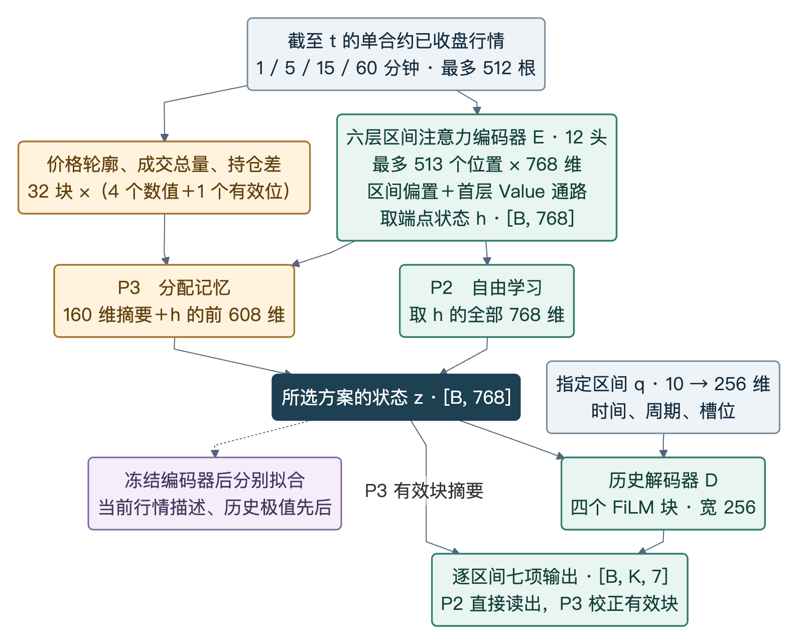
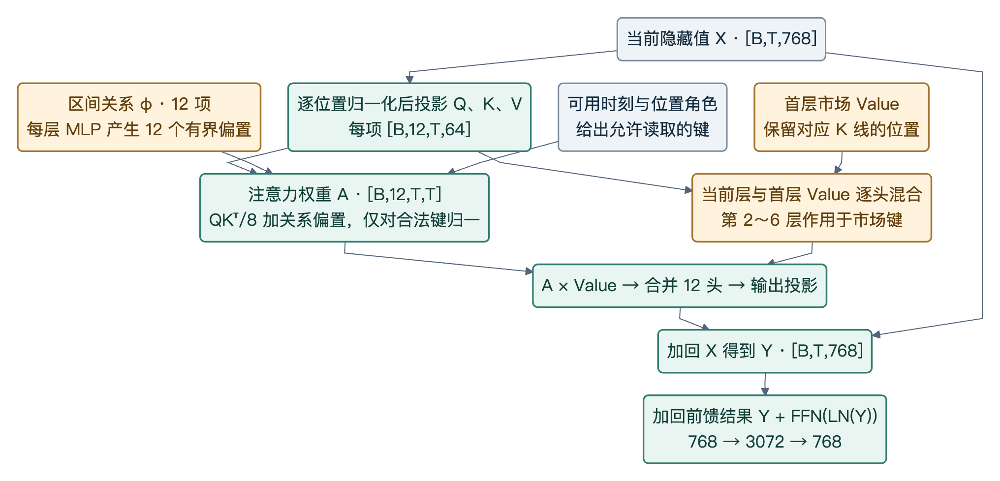
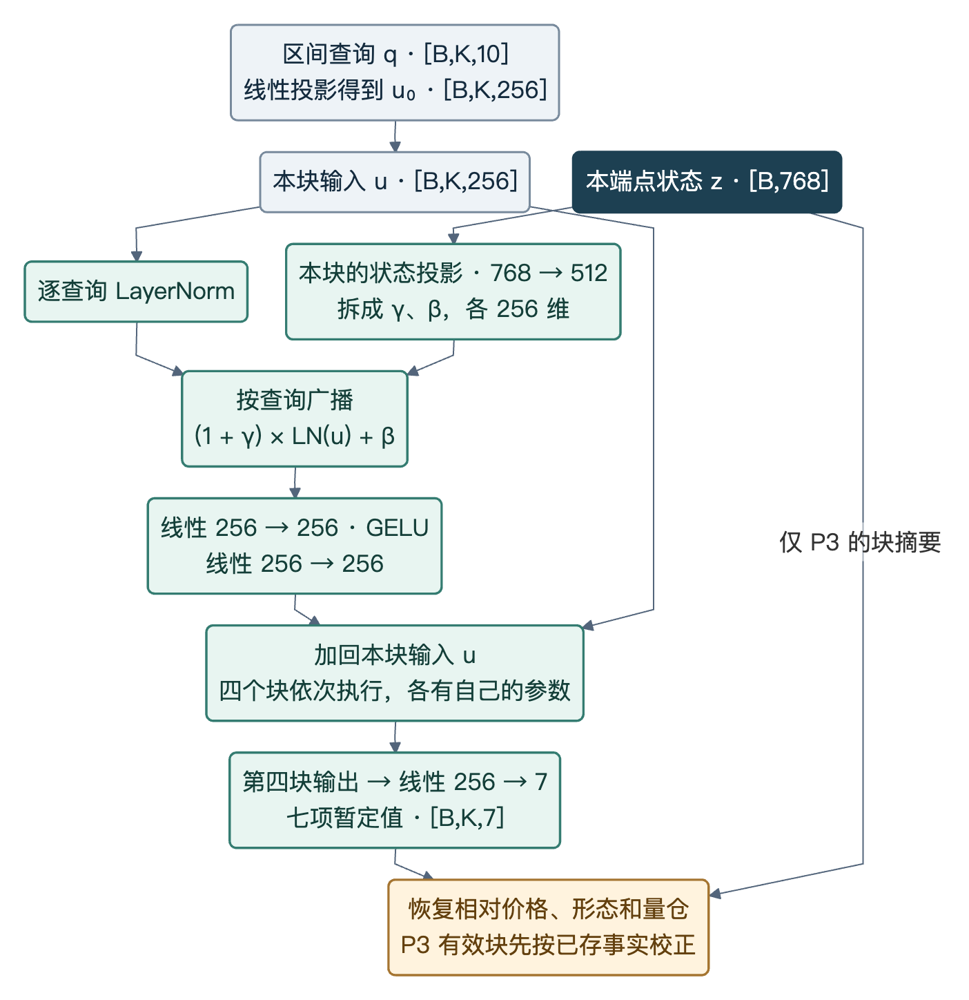
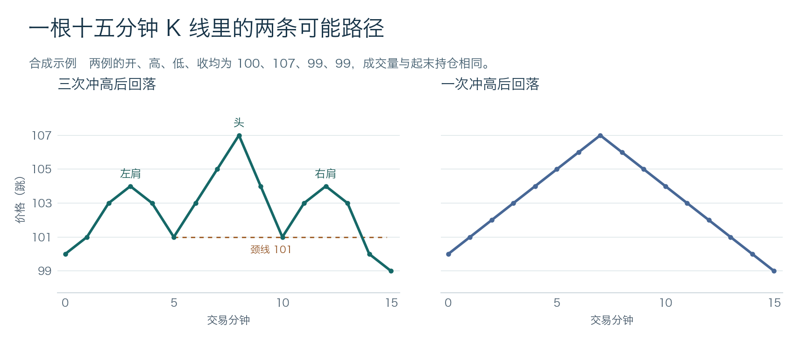

# Babel 路线图：同样大小的状态能记住哪些行情

更新于 2026-11-27。本版用于研究设计。新模型、数据管线、CUDA 运行和权重尚未产生。当前机器方案是 [BABEL_ROADMAP.json](BABEL_ROADMAP.json) 中的 `current_plan`。工作目录为 `/Users/bardan/Documents/Codex/来自旧电脑-20261031/obson`，分支为 `codex/babel-next`。

[当前结论与下一步](#current-review) · [样本资格](#sample-qualification) · [价格能还原到哪里](#reconstruction-evidence) · [模型架构图](#model-architecture) · [改造的 Attention](#interval-attention) · [FiLM 历史解码器](#film-history-decoder) · [怎样验证结构](#architecture-checks) · [历版设计取舍](#architecture-decisions) · [多任务训练总表](#training-tasks) · [完整回读与遮挡填空怎样一起训练](#masked-multitask)

## 0. 当前决定与交付

**同样给每个收盘时刻 768 个数，明示保存几项跨时间的价量事实以后，还能否更可靠地读回未写入的行情细节？** 第一项交付是回读已发生的历史，第二项是冻结同一状态后描述当下。未来预测与舆情等外部信息融合保留为后续用途。

<a name="model-architecture"></a>

### 0.1 模型架构图



沿实线读一次前向。每组各自训练一份编码器 E 和历史解码器 D，图中的 P2、P3 是二选一的状态构造。虚线从状态直接通向冻结后的用途读头。B 是一批收盘时刻的个数，K 是每个时刻所问的区间数。七个输出依次为相对收盘、实体、上影、下影、成交、起持仓和末持仓。图中两个可学习模块的内部接线分别见[区间注意力](#interval-attention)和[历史解码器](#film-history-decoder)。[总图图源](figures/babel_state_architecture.mmd)

| 首批方案 | 状态如何分配 | 如何回读 |
|---|---|---|
| P2 自由学习参照 | 全部 768 维由同一编码器学习 | 同一解码器分别回答各个区间 |
| P3 分配记忆候选 | 160 维存已观察内容的固定摘要及有效标记，608 维由编码器学习 | 用状态内的摘要校正块内的价格轮廓、成交总量和起末持仓差，逐根形态由网络读取 |

两组共享多周期数据、区间关系注意力、首层内容通路、区间查询坐标和完整历史训练。只比较整套记忆分配与校正读出。每组两个种子，训练预算、判定标准和比较范围见第 4～6 节。旧 P0/P1 连同遮挡填空是未执行的方案，已从首批移出。替换原因是上版同时改变主干和训练任务，回答不了有限记忆应留给什么。本版更换配方编号，共用旧候选中有物理依据的区间主干。旧矩阵、公式、文献和逐行审计按提交完整保留。[上一版路线](https://github.com/BardanYu2025/obson/blob/76b6ad2f758346caa5d2437f3b269106badf6713/docs/babel/BABEL_ROADMAP.md)

<a name="training-tasks"></a>

### 0.2 多任务训练总表

| 训练时机 | 模型做什么 | 哪些参数接收这份监督 |
|---|---|---|
| 首批预训练，两组相同 | 一份完整可见的历史，同时回答过去区间的价格、形态、量仓，以及当前刚闭合区间的形态和量仓 | 两类误差合成一次更新，共同训练本组的 E 和 D |
| 条件后续，完整回读＋遮挡填空 | 同一收盘时刻做两次前向。一次读完整历史，一次遮住过去片段、用余下观察补读 | 两次共用 E、D，完整回读损失加 0.25 倍填空损失后更新一次。首批两组的填空权重均为零 |
| 预训练结束，描述当前行情 | 从同一冻结状态读取净涨跌、路径效率、波动、回撤、成交和持仓变化，覆盖三个回看时长 | 只训练新的描述网络，六类量共 18 个输出 |
| 预训练结束，辨别历史顺序 | 从冻结状态判断最近 37 个分钟收盘中，最高与最低哪一个先出现 | 只拟合顺序判别读头，用训练期标签做岭回归 |
| 后续独立用途，预测未来 | 用行情状态和当时可得的外部信息估计未来路径的分布 | 首批未来损失权重为零，后续融合先冻结编码器 |

例如在 10:07 收盘，预训练同时问“10:02～10:03 的收盘相对现在是多少”和“刚闭合这一根的实体、影线和成交量是多少”。冻结后才问“最近 64 个交易分钟的最大回撤是多少”。第一行是一份输入上的多项监督，第二行是完整历史与遮挡历史两种输入任务。两者的损失、梯度和适用条件分别写在[首批的一次更新](#joint-update)和[双任务训练方案](#masked-multitask)。

<a name="current-review"></a>

### 0.3 现有证据与下一步

**下载期间的文档复核（11 月 27 日）。** 首批仍比较 P2 与 P3 对已发生行情的保留和当前描述。两组各自训练同结构的编码器和历史解码器。第 2.1 节标清已盘点批次，第 2.8 节区分摘要预留位置与可用块，第 4.1 节补齐缺标签的损失分母，第 5.2 节区分有价格依据的回读与跨缺口估计。遮挡填空、技术形态和概率未来各自的启动条件见第 0.2、5.3.1、5.4 节。

**已有证据。** 在三个 2022 年合约的日盘分钟样例上，两项价格系数保留了块内去均值对数收盘平方和的 60.6%。保留每段全部涨跌、只打乱发生顺序，相应期望平方和的比值为 61.9%。这说明只靠价格轮廓的覆盖率，难以辨别模型是否记住行情的真实顺序。另构造出一对 K 线历史，所有固定摘要逐字节相同，最高与最低收盘出现的先后恰好相反。取样、对照和复算见第 2.8、3.4、5.3 节。

**下一份实物是数据与样本资格包（F02/F04/F10）。** 本次下载仍在进行。待交付范围稳定，先核对该批次的清单、文件和版本，再冻结快照、时段、品种口径、按当时信息选样、端点与预热边界。逐品种/时期/周期列出可用块、缺口、未覆盖查询和留出支持，并独立复算摘要。资格不足的范围明示隔离，二者共用同一范围。正常、跨休市、缺分钟、真实零成交和冷启动均需可回查的样例。其后锁绝对误差与成本上限。首次实施需明确授权，所有真实权重仅在 AutoDL CUDA 执行。[实验隔离与交付](../../experiments/README.md)

## 1. 我们要做什么，为什么要重新设计

我们要让每根**已收盘**K线拥有一个状态向量，也就是embedding。它应当压缩截至这一刻的一段行情：价格怎样走到这里，近期形态如何，成交和持仓怎样变化。同一个状态以后可以交给不同任务使用，例如描述当前趋势与波动，或者逐步生成未来价格的可能路径。

成功不等于100%复制所有影线，也不等于只学会几条均线规则。**当前阶段以历史重要内容保留、当前行情描述和冻结后的复用为主线。** 概率未来是后续用途，纯K线预测改善不是编码器晋升或交付条件；历史重建成功也不能代替未来或交易检验。

原有研究已经证明某些状态能够回读有限历史，也暴露了近远内容失衡、读头兼容性、训练预算混杂和模型资产丢失等问题。现在有更细、更长、更多品种的数据，应该重新定义模型真正看见的世界，而不是先恢复旧训练链，再逐个改旧超参数。

本版在同一多周期主干和同一干净历史任务上比较两种等字数状态，见第 0 节。学到的内容能否超出人工预存的摘要，是本轮重点。

| 保持不变的目标 | 可以重新选择的实现 |
|---|---|
| 每根已收盘bar只使用当时可得信息 | 窗口长度、分辨率、层数、头数、状态维数 |
| 保存有用价格形态和成交/持仓信息 | 特征表达、归一化、编码与解码结构 |
| 同一状态支持多种后续用途 | 历史损失、概率监督、读头与优化方法 |
| 结果可靠、实验能够结束、模型能够恢复 | 同批对照的具体组织和资源配置 |

旧Macro权重已经丢失，旧报告仍在。新训练将建立新模型身份，不称找回原权重；旧13阶段恢复和旧输入四臂均不是当前前置任务。

### 1.1 用户澄清后的优先级与两层职责

相同127根K线不唯一决定下一根；这与有限观察、尚未提供的市场背景以及新到信息相容，不足以证明行情完全不可预测或差异全是不可约随机。相同OHLC也未必代表量仓、长历史与元信息相同。若冻结的确定性编码器收到的**全部声明输入**都相同，它应产生同一个z；不要求它凭空区分未输入的新闻或环境。

第一层`z_t=E(H_t)`负责忠实整理当时可见的行情内容。当前描述头可读方向、路径效率、波动、回撤和量仓变化，使用只依赖t前数据的定义；它们是行情描述，不是对“真实市场隐状态”的唯一识别，更不等于下一根方向或开仓结论。

第二层以后可估计`p(Y_future | z_t, M_t, F_t)`，F_t是当时可得的舆情、跨市场或其他因子，M_t是声明的价格/尺度元信息。先冻结基础状态，在独立用途版本中验证融合；是否回传编码器另立假设，不覆盖已交付表示。外部数据必须记录实际发布时间、到达延迟和版本，不能按事件发生日期回填后来才知道的内容；缺失因子也不能当真实零值。

**这有信息论理由。** 单独预测Y所需的信息，不一定等于未来与外部F共同使用时所需的信息。理想压缩代价变为`E KL(p(Y|H,M,F)||p(Y|Z,M,F)) = I(Y;H|Z,M,F)`。只优化不带F的预测，无法保证这个条件信息也保住。独立等概率二元H和F、Y=H异或F就是反例：单看H对Y没有信息，两者结合却能决定Y。常量Z单独预测并未变差，丢掉H后却失去组合能力。这是数学示例，不是市场规律或当前数据证据。[多来源信息与协同](https://arxiv.org/abs/1004.2515)

因此，首批先尽量保留多种可观察内容，不按纯K线未来分数筛掉信息。近似重建仍不能保证所有尚未知晓的外部组合都可用；未知用途没有万能充分状态。以后融合要比较`z单独`、`F单独`、`z+F`及同信息`原历史+F`，判断增益来自哪里。当前不新增因子数据采集或融合训练队列，F06/F07/F08/F09保留为条件后续。

## 2. 数据：这次究竟多了什么，怎样使用才成立

### 2.1 已经确认的事实与仍未确认的范围

数据目录是 `/Users/bardan/private/tqdata_2015`，首批拟用 `month_contracts/bars` 里的真实单合约。**11 月 24 日已审计批次**含 44 个品种、2,382 份单合约文件、46,224,030 条分钟记录。最早和最晚的分钟起点分别是 2016-01-04 09:00 和 2026-11-19 14:59（上海时间），各合约仅覆盖各自窗口。2,382 份文件逐一匹配当批月份合约交付清单。11 月 26 日复核过文件数与大小，并抽核三个 2022 年合约的 SHA 和第 2.8 节的算术。11 月 27 日本次复核从封存的逐文件清单重算历史总数。当前下载的完成比例、增量和最终训练范围仍未知。[逐文件盘点摘要](../../experiments/20261124_minute_audit_v1/reports/20261124/summary.json) · [当批交付清单核验](../../experiments/20261124_minute_audit_v1/reports/20261124/delivery_hash_check.json)

| 数据条件 | 为什么影响模型设计 | 当前处理 |
|---|---|---|
| 有同源1分钟数据 | 可以看到粗K线内部的先后变化，也能准确核对多周期汇总关系 | 近期保留分钟粒度，较远历史用同源粗视图 |
| 年份、品种增多 | 可以减少反复曝光少量旧窗口，检查不同市场阶段 | 按品种、合约、时间组抽样与评价，不把每分钟当独立样本 |
| 文件是单合约 | 能区分真实交易变化和换月拼接跳空 | 按能唯一辨认交割年月的合约身份分段，避免同名短码跨年串接 |
| 月份文件只覆盖主力窗口及换月附近 | 数据选择可能借用了事后主力身份，不等于完整交易宇宙 | 核查选择规则和当时可得性；结论限定于合格合约窗口 |
| 715,590条零成交、平价、持仓不变记录 | 可能是真实不活跃，也可能包含源端填充 | 保留质量标签，取得依据后分类；不自动删除或插值 |
| 当批主连有拼接，3 行触发成交量、起持仓、末持仓任一为负的联合检查。指数当批盘到 6 个品种 | 直接混用会改变价格与成交含义 | 首轮不依赖main/index，不因此阻塞单合约主体 |

基础审计没有发现月份文件的OHLC几何、重复时间、倒序或负量仓问题，但**基础数值合法不等于可训练资格已经全部通过**。历史交易日历、夜盘归属、量仓口径变化、缺段与静止行情仍需要核对。[质量问题与限制](../../experiments/20261124_minute_audit_v1/reports/20261124/quality_notes.json)

### 2.2 为什么采用同源多周期，而不是各周期各看128根

128根1分钟与128根60分钟描述的是不同时间范围。新方案先问“需要看多近、多远”，再为不同范围分配观察精度。它类似看地图：当前位置看街道，远处看区域轮廓；远处被省略的街道不能宣称仍完整记住。

初始提案是：

| 已闭合视图 | 最多bar数 | 设计目的 |
|---|---:|---|
| 1分钟 | 256 | 保留最近逐根变化，不提前压成固定4根片段 |
| 5分钟 | 128 | 观察中短区间的形态与成交持仓变化 |
| 15分钟 | 64 | 观察更长的结构 |
| 60分钟 | 64 | 提供较远背景 |

共有最多512个市场观察，彼此有重叠，不是512个独立事件。最长视图是64个已闭合60分钟格子；实际交易时长、自然时间和预热范围由日历与缺段决定，不固定称“若干天”。30分钟可由同源数据生成，但首批不为列全周期再加一条高度重叠视图；F04跨分辨率方向仍保留。

同一物理区间的粗细视图共享内容，粗视图却丢掉内部顺序。例如“先涨后跌”和“先跌后涨”可能得到相似的粗K线。因此应对齐共同内容，允许细视图保留额外信息，**不要求两个完整embedding逐维相等**。首批通过同源数据、共享编码器和物理区间目标联系尺度，先显式检查共同内容聚合关系；额外一致性损失仍为条件候选，详见3.3。

### 2.3 聚合、时间与数据边界

每个观察都记录合约、区间起止、实际覆盖和最早可用时刻。源时间戳表示bar开始；该bar结束以后才能进入状态。高周期bar尚未收完时不能提前读取其最终高低收和成交。

聚合规则为：开盘取首值，最高取最大，最低取最小，收盘取末值，成交量求和，持仓取区间起点和终点，持仓不能求和。按历史交易时段定义嵌套格子，时段起点与尾段规则共同冻结；只有原分钟集合恰为不重叠完整并集才比较父子聚合，不是每5/15/60行机械切块；休市与缺失分别判断，不能用填平线补满。区间完整性的判据要随快照冻结，各方案使用相同的合格范围。 正常跳空、缺失分钟和历史价位的处理见[历史价格锚点](#historical-price-anchors)。

同一条行情按交易所、品种、含完整交割年月的合约身份、周期和区间起止（统一时区）识别。来源路径、文件 SHA、版本和可用时刻另记。这样，即使同一根 K 线在另一个文件里被修订，仍能按行情主键发现冲突。合约存续身份可用于去重，事后才知道的末次成交或文件截止日期不得参与当时选样。所有预热、滚动统计和以后缓存的真实依赖都进入数据分区检查。没有逐笔方向、盘口和可靠开平仓标识时，不把某个潜在维度命名为“主动买入”或“多头开仓”。

### 2.4 价格和量仓怎样标准化，为什么这样做

绝对价格、成交量在不同品种间跨度很大，直接比较会让模型把数值大小当成形态。另一方面，把每个窗口都强行缩成相同波动，又会丢掉“平静还是剧烈”的信息。建议把**相对变化和它的尺度一起保留**。

基础数值输入共9个通道，另有时间、分辨率和质量mask：

| 输入 | 建议表达 | 保留的意义 |
|---|---|---|
| 开盘相对上一收盘 | `log(O / C_prev)` | 真实跳空，不用连续主力去伪造平滑 |
| 实体 | `log(C / O)` | 当前bar内部方向与幅度 |
| 上影、下影 | `log(H / max(O,C))`、`log(min(O,C) / L)` | 非负形态量；已发生的信息，不要求未来可准确预测 |
| 成交量 | `log(1 + V)` | 缩小数值跨度而保留活跃变化 |
| 起末持仓 | `log(1 + OI_start)`、`log(1 + OI_end)` | 区分存量与变化，未知值不能当真实零 |
| 持仓净变化 | `asinh((OI_end − OI_start) / s_ΔOI)` | 保留增减方向，尺度仅由训练部分拟合 |
| 历史波动尺度 | `log σ_past` | 让模型知道被标准化前变化有多大 |

价格变化先除以因果波动尺度，再使用训练集固定的字段/周期尺度。波动尺度的初始提案是**当前bar之前、同周期64个连续合格收盘收益的RMS（需65个边界收盘）**，正常休市可按冻结日历衔接，未知缺口不跳过来凑64；带训练集确定的下限，不足时使用训练集fallback和冷启动标记，不向未来借数据。这个预热实际可能超出表里的512个观察，必须计入输入支持和成本。

历史目标不使用每个待重建窗口重新拟合的未来统计；相对价格以当前已知收盘为参考，损失字段尺度固定于训练部分。预测则把收益尺度固定在预测起点，不沿真实未来路径重新估计。

**旧经验的借鉴：** 保留单合约、尺度可追溯、预热显式、缺失不当零。**新数据下的重想：** 同源分钟视图、物理区间、原始价量核心通道成为主体；不默认继承旧28维、EMA组合或PCA教师。指标以后可以成为有明确信息理由的对照，不能先把模型目标缩成复刻指标。

### 2.5 数据怎样组织成每根bar的训练样本

采用四层组织，原始文件、加工结果和样本身份分开。下面是待实现的数据合同，不表示这些新缓存已经生成。

| 层次 | 保存什么 | 解决什么问题 |
|---|---|---|
| 原始快照 | 原分钟文件、说明、文件SHA与大小、合约和来源清单 | 同步中新文件不能悄悄改变正在训练的数据；新快照另给身份 |
| 合格分钟事实表 | 按完整合约身份及其实际已下载窗口排序的OHLCV、起末持仓、区间时间、交易日/时段与质量标记 | 区分真实零成交、休市、缺失和来源冲突；不把换月拼接当涨跌 |
| 同源多尺度表 | 由合格分钟生成的1/5/15/60分钟观察、原分钟索引、覆盖与可用时刻 | 粗细观察描述同一份市场记录；可追查每个值从哪些分钟而来 |
| 端点样本索引 | 合约+t、各尺度切片、预热依赖、分区与合法历史查询；未来用途另登记标签范围 | 每个t有自己的完整输入；首批不因缺少后续60分钟而丢弃合格历史样本 |

样本身份绑定数据快照和处理协议。大数据可以按哈希只读引用，实验自己的处理代码、尺度文件、抽样清单和依赖必须归本实验版本；不能调用外部数据目录里会变化的加载脚本。同主键且物理字段、单位、质量语义相同的记录只计一次，保留全部来源。即使重打包使文件 SHA 改变，也按同一条行情核对。同主键异值保留两个版本并核查生效时点，无法判明时隔离相关字段或区间。不混入旧`tqdata`、主连或指数来填补单合约缺口。

**一个样本围绕一个已收盘时刻t。** 例如截至10:07的状态，只能读截至10:07已经完成的分钟bar；若5分钟格子是10:05～10:10，就不能读取它10:10才确定的最终值。10:05之后已完成的分钟仍可由1分钟视图进入。所有多周期格子由同一份历史时段规则生成，跨休市、缺分钟和时段末不足整格的处理必须锁定，不能把不足60分钟的尾段假装完整60分钟。

源`datetime`是bar开始时刻；官方字段定义也区分区间成交量和起末持仓。[TqSdk字段说明](https://doc.shinnytech.com/tqsdk/latest/usage/mddatas.html)。离线可用时刻以闭合时刻建模，若没有真实到达时间，须注明这是理想闭合假设，不声称已验证实盘延迟与历史修订影响。

首批只从完整可见的 H_t 构造状态。未来标签不进入筛样、尺度或训练。原遮挡闭包规约随上一版保存，后续如再立项须额外清理所有固定摘要中的隐藏依赖。

训练在合格端点中按品种、合约与时间组抽样，让单个长寿、活跃合约不凭样本多主导更新；具体配额和有效曝光在运行卡固定，不按未来涨幅或“形态好看”筛样本。P2/P3使用相同clean样本与查询序列。评价使用固定端点和近中远/尺度/字段清单，同时报告组间及尾部差异，不把大量重叠窗口当独立证据。

先按第5.1节分区，再仅用训练部分拟合尺度、下限、fallback及任何PCA/统计基线；完整输入、预热和标签范围都计入边界清除。训练区内打乱批次可以，重叠窗口随机分到训练和验证不可以。保留零成交与缺失的不同标记；无法确认口径的范围先标为未合格，不能靠标准化掩盖。

### 2.6 技术指标放在哪里：原始内容是主体，指标是可检验的帮助

**首批用原始价量的相对表达学习历史内容，冻结后验证当前描述。** EMA、MACD、RSI 可以提供简单对照。后续的指标输入、辅助监督和概率预测各按已登记的条件立项。

| 类别 | 首轮职责 | 理由与边界 |
|---|---|---|
| 相对价格、历史波动尺度、log量仓等基础变换 | 必需的数据坐标与数值处理；波动大小另保留 | 缩小品种量级差异，同时保留形态、幅度和活跃信息；它们也有人工选择，不能称完全无人工特征 |
| EMA/RSI等技术指标 | 可作为直接计算的简单比较方法；首轮不增加指标输入支线 | 若模型只是复刻指标，直接算指标就能完成相应用途，不能算通用状态成功 |
| 指标输入、辅助监督或教师 | F12条件保留，当前不排队 | 仅在现有诊断能指出具体缺口时，做同原始信息、同预算的配对比较；不能凭常用就不断堆指标 |

若一个指标完全由相同历史H计算，`I=f(H)`，它不增加H以外的新观察，但可能让有限模型更容易学到某类关系。因此“不作为首轮依赖”不等于“指标无用”。若EMA的预热来自H以外，或指标借用了其他合约/市场，它确实扩大了信息范围，必须给对照相同可得历史并计入支持边界；不能把更多历史带来的收益全归因于公式。

历史波动标准化同样是人工统计，本方案明确保留其用途与依赖。固定字段尺度只从训练部分拟合；不能对每个完整合约寿命使用包含后来行情的均值/方差。跨品种留出的尺度规则要有训练来源的通用fallback，不在留出品种上重拟合。若以后加入任何指标，遮挡任务必须同步清理其依赖，否则容易从指标泄露被遮挡答案。

当前不先用均线平滑后删除原始起伏，也不把每次上下影变化自动认作噪声。哪些内容值得保留由历史分项误差和后续用途检验；损失里的合理取舍不等于在数据源头抹掉信息。已知时间与时段只是观察条件，不要求模型预测休市间隔。

以 EMA 为例，可以先在同一份合格收盘记录上直接计算收盘相对均线的偏离，作为冻结状态的一个候选读出问题。记录周期、初值、预热跨度和缺口处理。如果某个尺度的偏离确实难读，再由 F12 比较两组相同历史、相同预算的输入，一组额外给出该指标，同时看近端价量和形态读出是否得益。衡量当前行情与技术形态的办法见[第 5.3.1 节](#technical-patterns)。

<a name="sample-qualification"></a>

### 2.7 进入实施前还差什么

交付说明提示，部分 2020 年前的成交量可能有单双边口径差异。成交量和持仓量的计数口径分别按品种、合约与生效日期核实，转换时登记来源和系数。缺乏依据的区间保留待核标记。还需冻结快照、核对历史交易时段和可用范围、确定静止/缺失处置与历史口径，才能签发首批训练资格。

下载结束后，按交付批次核对预期文件、大小和 SHA，与已审计批次列出新增、未到、源端有据为空、重复、同名变更；仍在写入的文件不进入快照。对已稳定的范围再签资格。旧批次按主力日与换月邻近日期取窗，事后回看能选中换月前的合约，不代表当时已经能选中。优先用当时可得的记录重放选样；缺少依据的窗口只支持对这批已选历史的描述。

资格报告按品种、时期和周期列出正常休市、可确认的真实零成交、行情源缺口、原因未明的静止段，并附可回查的原分钟样例。

### 2.8 每个摘要能从哪些观察算出

比较时两组将使用同一份已签发的合约分钟快照和端点清单。按数据源的 bar 起始时间确定闭合时间，先分区、清除跨界依赖，再拟合尺度和基线。历史波动预热、前收、读头标签和主力窗口选取都有真实依赖。原始分钟仅用于聚合、资格与真值核验，候选的固定摘要只能从两组都看得见的数值、可见标记和已知日历得出。

分别在 1/5/15/60 分钟视图按锁定交易日历枚举 **严格结束于 t 之前** 的最近 256/128/64/64 个名义槽，从近到远每 16 个成一块，共 16+8+4+4=32 块。一个块内部从早到晚编号 0～15。两个模型的实际输入也按名义槽截断，窗口上限含恰好结束于 t 的槽。缺失保留在原位，最远的严格历史槽如果在输入窗外就标为无效。当前闭合区间走独立查询，已知当前收盘只作价格锚点。名义序号由端点、周期和当时生效的公开日历推导，不按行数或可见行情向前补足。正常休市可依日历衔接，固定尾段保留真实跨度。两项价格对比量按槽等权，长短不一的尾段按一个观察计。

块有效要求同合约、同量仓单位、16 个槽全在原声明输入中，相关字段可逆回物理值，内部 15 个同周期的前收连接都能核验。允许有凭据的真实零成交，未知缺失、单位冲突和跨换月不能拼接。无效块的四个摘要置零，有效标记为零，其余合资格的单根和端点照常训练、评价。全零行情的有效标记可以为一。资格按数据来源与支持决定，禁用未来标签和模型误差筛选。报告所有端点的有效块数、按既定查询权重的有效比例及无效原因。覆盖过薄时只报告对应适用范围，预先锁定各层支持量与可分辨误差。

**32 是预留块位数。** 设周期 s 的输入上限为 Cₛ，若该周期在 t 有名义收盘则 Iₛ=1，否则为 0。即使历史充足且无缺口，严格过去的完整块也至多有 `Σₛ floor((Cₛ−Iₛ)/16) = 32−Σₛ Iₛ` 个。只有一分钟栏在 t 闭合时上限为 31，四个周期同时闭合时为 28。冷启动、缺口或单位未核实还能进一步减少有效块。资格表同时给出该时刻按日历可达的上限、实有块数和缺失原因，状态始终分配 160 个数。

**实行情算术抽查。** 固定取 2022 年玉米 c2209、螺纹钢 rb2210、铜 cu2209 三份源文件，每个自然日从 09:00、13:30 起按偏移 0、16、32 分钟各取一个不重叠的 16 分钟段。保留时间完整、有限正价且量仓非负的段，不按振幅、成交活跃或结果挑段。这是日盘分钟算例，尚未建立全历史时段、其他周期或全品种资格。

| 合约 | 完整分钟段 | 两项价格对比量占该文件块内去均值平方和 |
|---|---:|---:|
| c2209 | 588 | 57.2% |
| rb2210 | 690 | 60.6% |
| cu2209 | 198 | 65.6% |

令每块的 `y=log C−mean(log C)`，按 3.3 的固定矩阵 U 复算。总体比值 `Σ‖Uᵀy‖² / Σ‖y‖²` 为 0.606063，在 1,476 段上按各块去均值平方和加权。分母消去了块均价，单靠这两个数无法恢复绝对价位、影线或逐根路径。文件 SHA 与旧审计逐一吻合，分文件平方和与取样规则在 JSON 的 `bounded_checks`。

**打乱每段的涨跌次序。** 对同一批块，将 15 次相邻对数涨跌在块内等概率重排，保留每一次涨跌和首末净位移。各块投影平方和的期望加总，再除以去均值平方和的期望总和，得 **61.9%**。另取零均值、独立同方差增量的理想随机游走，该比值为 **63.5%**。这些计算说明即使丢掉原有先后顺序，这组坐标也容易保住大轮廓。原样本与重排比值的差距只作描述，三个日盘合约不足以判定总体差异。

计算可直接复核。若 `i,j=0,…,15`，`x_i` 是从块首累计 i 次涨跌，`μ,v` 是 15 次涨跌的均值及分母取 15 的方差，则 `E[x_i x_j]=ij μ² + v(15 min(i,j)−ij)/14`。设 `J=I−11ᵀ/16`，以 `tr(UUᵀ E[xxᵀ])` 和 `tr(J E[xxᵀ])` 求分子分母。独立零均值增量情形取 `E[x_i x_j]=σ² min(i,j)`。另用五个不同增量的全部排列核过同一公式。

## 3. 状态架构、张量和数学边界

### 3.1 端点与共同主干

状态 `z_t=E(H_t)` 在每个合格收盘时刻单独产生。公开元信息只含同等提供的当前收盘、合约、端点、日历版本及声明的覆盖/尺度信息，用于寻址、资格和绝对价格还原。训练前计其字节和成本。任何逐块数值、有效位和解码所需的持久缓存都不能免费附在状态外。描述小网络和顺序测试只读 z。没有资格的数据不作为已观察历史交付。

#### 3.1.1 多周期 K 线怎样进入同一个序列

设 B 是批内端点数，L 是排入的市场位置数（最多 512），T=L+1。先按第 2 节从同一合约产生 1/5/15/60 分钟的已闭合区间，再把各区间作为独立位置送入同一主干。近期逐分钟的形态和同时闭合的粗周期背景从第一层就可交互。进入网络前，每个区间保留自己的时间、周期和可见标记。

| 送入每个市场位置的内容 | 映射与输出形状 | 用意 |
|---|---|---|
| 9 个价量数值、9 个字段可见位、9 个人工遮挡依赖位、1 个波动尺度后备标记 | `[B,L,28] → Linear(28,768)` | 零成交、未知成交和人工遮住的成交有各自的表示。首批完整输入的人工遮挡位均为零 |
| 距端点的交易及自然分钟、区间交易及自然时长、覆盖率、预热覆盖率、时段时刻的正弦和余弦 | 前四项取 log1p，`[B,L,8] → 64 → 768` | 同样相距几个交易分钟，在午休、隔夜和连续交易中具有不同的自然时间跨度 |
| 1、5、15、60 分钟的周期身份 | `Embedding(4,768)`，按位置取行 | 同一周期跨合约共用参数。合约身份用于样本索引 |

三路相加得到 `[B,L,768]`，末尾追加一个可学习的状态位置。六层都保留 `[B,T,768]`，直到最后才对端点位置做最终 LayerNorm，取出 `h[B,768]`。层内使用 Pre-LN、12 头、每头 64 维，前馈层为 `768→3072→768` 和 GELU，dropout 为 0，主干 LayerNorm 的 ε 为 10⁻⁵。时间由记录自身提供，未引入按拼接行号学习的绝对位置。把四个视图先拼在一起只决定存放位置，可用时刻决定读取顺序。[原有行序约定](https://github.com/BardanYu2025/obson/blob/724ab66dd1726fdf76dfc4dca7cd7769d5a7bc14/docs/babel/BABEL_ROADMAP.md#L52-L56)

<a name="interval-attention"></a>

#### 3.1.2 改造的 Attention 怎样选择区间、带回内容



以 10:05 为例，一分钟栏 10:04～10:05 和五分钟栏 10:00～10:05 此时都已闭合，可以互读。两者结束时刻之差为零，交易分钟的交并比为 1/5，而且五分钟栏包含一分钟栏。10:04 的市场位置只能读当时已可用的键。这就是为什么注意力既需要描述**区间关系**，也需要一张独立的**可用性掩码**。[注意力图源](figures/babel_interval_attention.mmd)

**选择区间。** 在第 ℓ 层，对 `X[B,T,768]` 逐位置做 LayerNorm，分别投影 Q、K、V 并拆成 `[B,12,T,64]`。每对查询位置 i、键位置 j 有一个关系向量 φ，展开为 `[B,T,T,12]`。下面 12 项的方向均从 i 看 j。分钟数、覆盖及区间关系按冻结日历计算。

| φ 的内容 | 项数 | 实际计算 |
|---|---:|---|
| 结束时刻的交易时间差、自然时间差 | 2 | i 的结束时刻减 j 的结束时刻。当前理想闭合假设下合法边用 log1p。若先算整个矩阵，使用 `sign(Δ)×log1p(abs(Δ))`，避免对负时间差取非法对数 |
| 双方交易时长、时长比 | 3 | `log1p(dᵢ)`、`log1p(dⱼ)`、`log((1+dᵢ)/(1+dⱼ))`，d 以交易分钟计 |
| 区间交并比、两个方向的包含标记 | 3 | 在交易时间支持上算交集时长除以并集时长，再登记 i 包含 j、j 包含 i |
| 双方的覆盖率、双方是否为状态位置 | 4 | 区分观测不全和虚拟端点。状态查询的时间锚是 t，保留真实市场键的时长及覆盖 |

每层有一个独立的 `12→32→12` 小网络，末层的 12 个输出各给一个头。关系偏置 `b=2 tanh(MLP(φ))`，末次线性投影的权重和偏置从零起步。市场查询只能读可用时刻不晚于自己的有效市场键，同一可用时刻可双向读。市场查询无法读末端状态。状态查询读截至 t 的全部合格市场键和自身，状态作为键时 b 固定为零，自身的内容分数照算。填充键被屏蔽，填充查询跳过或置零。预热、源字段和选样的依赖也必须满足各自的时间边界。

```text
Aᵢⱼ = softmaxⱼ(Qᵢ·Kⱼ / 8 + bᵢⱼ + Mᵢⱼ)
Mᵢⱼ = 0（允许读）或 −∞（禁止读）       A 的形状为 [B,12,T,T]
```

**带回内容。** 第一层从尚未跨 K 线混合的输入投影出 `V₁=Linearᵥ₁(LN(X₀))`。这是逐根学出的内容表示。第二至六层的每个头有自己的标量 `α = sigmoid(a)`，a 初值为 0，因此 α 从 0.5 起步。对**市场键 j** 使用 `Ṽⱼ=(1−α)Vℓ,ⱼ+αV₁,ⱼ`，对**状态自身的键**使用本层 V。第一个注意力块直接用自己的 V₁。这样，深层可以依据已经形成的上下文选中一根 K 线，同时沿较短路径读回这根线的底层价量特征。同一张合法键掩码管两条内容路径。训练时这条支路的梯度可到达首层 Value 投影，遮挡训练时首层也必须从遮挡后输入产生。[Value Residual Learning 原文](https://aclanthology.org/2025.acl-long.1375/)

```text
每头读出 = A × Ṽ                              [B,12,T,64]
Y = X + 输出投影(合并各头读出)                  [B,T,768]
本层输出 = Y + Linear₂(GELU(Linear₁(LN(Y))))   [B,T,768]
```

两次残差相加保留前一子层的隐藏值。对固定的 Q、K，两个合法键的权重比被区间偏置乘以 exp(bⱼ−bₖ)，该因子介于 exp(−4) 与 exp(4) 之间。初始化时因子为 1。由于关系网络的末层权重为零，第一次反传可以更新末层，它前面的隐藏层要等该权重发生变化才收到这一路梯度。Value 混合从第一步就参与读出，能否把底层细节一直带到最终的 z，取决于后续投影和端点汇聚。

粗细周期仍会重复覆盖同一行情。例如两个等分数键原各占一半，把其中一个复制为三份，三份合计权重变成四分之三。因此还要对照各周期的合法键数、分配到的权重总和及真实回读误差。P2、P3 都采用这两项改造，首批比较只归因到记忆分配与读出方案整体。

**本次补明的纸面约定。** 原稿给了时间映射和关系映射的层宽，本版给两处隐藏层都指定 GELU。虚拟状态的自身时长与覆盖填 0，涉及它的时长比、交并比与包含量填 0，由状态标记辨别。真实市场键本身的字段仍取真实值。两组共同采用这些约定。按两层线性映射均带偏置计，每层关系网络有 812 个参数，六层加 60 个混合标量共 4,932 个。完整端点每层各头共有 `12×513²=3,158,028` 个逻辑分数，运行时要计入关系计算、首层 V 的临时缓存和真实显存，稠密中间张量能否省去取决于实现。

### 3.2 同一状态与共同查询

| 接口 | P2 | P3 |
|---|---|---|
| 数值状态 | `z=h`，768 个学习坐标 | `z=[32×(四个数+一个有效位), h[:608]]`，共 768 个 FP32 数 |
| 读取指定区间 | 四块 FiLM 历史解码器，各查询共享头参数 | 另训同结构的头。块有效时再做 3.3 的确定性校正 |
| 当前描述 | 冻结 z 后读 `768→128→18` | 相同 |
| 部署实例 | 事前指定编码器种子 42，43 检查稳定性 | 相同 |

P3 从同样的最终主干 h 取前 608 维，固定事实只取自声明的可见输入。状态内直接存第 3.3 节定义的变换值和有效位。FiLM 的输入副本按训练期各周期有效块的均值和标准差缩放这四项（标准差下限 10⁻⁶，训练期无有效块的周期关闭显式校正，保留合格单根），无效项复置零，有效位保留。确定性校正读取状态内的原坐标。打包后的整个 z 不再做破坏事实坐标的逐样本 LayerNorm。两组的公开向量本体都是 3,072 字节。训练拟合的固定尺度可以还原，逐目标的真尺度、数值真值、原 bar、市场 KV 和预先保存的整条解码路径都不得传给独立读头。按需生成的临时查询块只计计算与临时内存。[等容量状态与十维地址的原始约定](https://github.com/BardanYu2025/obson/blob/c204de744dbcec79fdbd1e980e7800b5aacb050e/docs/babel/BABEL_ROADMAP.md#L192-L203)

<a name="film-history-decoder"></a>

#### 3.2.1 历史解码器怎样按问题读取同一个状态



区间查询 q 只给出“问哪根”。前四维是结束时刻距 t 的交易及自然分钟、区间交易及自然时长，各取 log1p。接着四维指明周期。末两维为日历块内槽位 j 的 `sin(2πj/16), cos(2πj/16)`，块内 j 从早到晚取 0～15，恰好结束于 t 的查询专用 (0,0)。远处相邻区间的 log 年龄越来越接近，而相邻槽位的相位距离恒为 `2 sin(π/16)≈0.390`。相隔整块的位置仍由时间坐标区别。正常休市、缺失和重排行均按同一份日历寻址。[解码器图源](figures/babel_film_decoder.mmd)

例如 t=10:10，询问连续交易中的 10:00～10:05 五分钟栏。它刚好是严格早于 t 的最近一根五分钟栏。四个时间坐标均为 log(6)，周期标记为 (0,1,0,0)，在最近块内 j=15。查询明确给出了位置，价格和成交量由状态读出。

**四次读取同一个 z。** 对 B 个端点、每端点 K 个查询，先做 `u₀ = Linear(10,256)(q)`，得到 `[B,K,256]`。每个块 r 有独立的参数，但同一块在所有查询与四个周期上共享。每组独立训练一套头。令 z′ 为送入学习头的状态（P2 的 h 或 P3 上述固定缩放后的输入副本），每一块的前向如下。[FiLM 原文](https://arxiv.org/abs/1709.07871)

```text
(γᵣ, βᵣ) = split(Linearᵣ(768,512)(z′))           各 [B,1,256]
sᵣ = (1 + γᵣ) ⊙ LNᵣ(uᵣ) + βᵣ                     [B,K,256]
uᵣ₊₁ = uᵣ + W₂ᵣ(GELU(W₁ᵣ(sᵣ)))                    [B,K,256]
暂定输出 = Linear(256,7)(u₄)                        [B,K,7]
```

两个 W 都是带偏置的 `256→256` 仿射层。每个端点的每层 FiLM 只需计算一对 γ、β，沿 K 个查询广播。LayerNorm 沿每个查询的最后 256 维，保留 u 的直接残差。状态条件投影采用非零随机权重，使损失从第一步起便有路径到学习状态。P3 的 608 个学习坐标能从未受校正保护的内容收到多少梯度，须按项检查。问题地址在每个块内被 z 重新调节，所以同一个 z 可以回答不同时间的问题。若改成只对单个 z 键做交叉注意力，softmax 权重恒为 1，聚合出的 Value 单项不会随问题变化，整个网络仍可能通过查询残差响应问题。

**按当前尺寸核算。** 输入投影有 2,816 个参数，每个块有 525,824 个（状态投影 393,728，两个内容仿射层合计 131,584，仿射 LayerNorm 512），七项输出层有 1,799 个。每组的历史头共 `2,816 + 4×525,824 + 1,799 = 2,107,911` 个可学习参数。旧稿的 2,107,399 对应八维查询，新加的两项槽位相位使第一层增加 512 个权重。这个数字说明读头的实际规模，其能读回多少行情仍由留出比较回答。[旧查询及算术](https://github.com/BardanYu2025/obson/blob/eb0eeb1f88f78db0ef9e37b5222080e18e7ff80c/docs/babel/BABEL_ROADMAP.md#L129-L138)

#### 3.2.2 七个输出如何还原为 K 线

| 学习的坐标 | 从暂定值到物理量 |
|---|---|
| 相对收盘 a 与实体 b | `a=log(C/C_t)`、`b=log(C/O)`。用已知锚点还原 `C=C_t exp(a)`、`O=C exp(−b)`。恰在 t 闭合时令 a=0，当前收盘从评分中剔除 |
| 上影 u 与下影 d | 反变换后两者非负。`H=max(O,C) exp(u)`，`L=min(O,C) exp(−d)`，在正价格、有限数值下满足 OHLC 大小关系 |
| 成交量、起持仓、末持仓 | 在非负的 log1p 坐标读出，expm1 回到手数。持仓净变化由预测的两个持仓相减，相邻收盘变化也由两份预测相减 |

P2 对每个合法查询直接出结果。P3 在有效过去块上，以 t 和日历重建所属块的固定 16 个查询，同一 D 给出 `[有效块数,16,7]` 的暂定值，再从 z 本体取该块事实作第 3.3 节的校正。先校正对数收盘，再用校正后的收盘与预测实体、影线恢复 OHLC。成交和持仓在物理单位中校正。最后只取回原请求的位置。无效块和当前闭合查询走直接读出。由此，同一根线单查、乱序查、重复查，答案都有同一组依据。块内临时多算的查询计入时延，训练分母仍只计原先抽取的标签。

真实的目标波动尺度、相邻收盘、整段市场 token 和历史 K/V 都不作为解码输入。正价格和合法影线可由几何公式保证，最小跳价、零影线/零成交的数值行为、指数溢出和 FP32 量化误差需在实现预检中核对。直接头的非负数值变换与溢出界仍待运行卡锁定。例如普通 softplus 在有限输入上严格为正，而历史里可以出现真正的零成交和零影线。运行卡应给出零的编码、还原及其误差。

### 3.3 明示保存的四项事实和读出保证

每个有效块含 16 个同周期 bar。设 `a_j=log(C_j/C_t)`。矩阵 `U=[u₁,u₂]`，`u₁=(−1×8,+1×8)/4`，`u₂=(−1×4,+1×8,−1×4)/4`，其中“×n”表示重复 n 项。两列正交、单位范数且和为零。第一项比较后半和前半的平均对数价格，第二项比较中间和两端的平均对数价格。它们对统一报价单位和共同价格锚点平移不敏感，不能表示块内所有涨跌顺序。

四个数为 `c=Uᵀa` 的两个坐标、`log1p(S)` 和 `asinh(ΔI/s)`，其中 `S=ΣV_j`，`ΔI=OI_end,15−OI_start,0`，s 取训练期同周期有效块的非零 |ΔI| 中位数与 1 手的较大值，若全为零则取 1 手。计算 c 时把第一根收盘的对数取为局部零，累加后 15 根已观察的“开盘对前收＋实体”对数收益即可。因为 `Uᵀ1=0`，结果与直接使用 a 相同。反变换只能用模型已得的字段、可见波动尺度和训练常数。资格阶段用原始物理值独立验算，从而防止给 P3 多一段原始历史。数值有效位、变换顺序和量化误差均计入状态协议。

1. **价格。** 同一块的 16 个暂定相对收盘为 p，读出 `â=p+U(c−Uᵀp)`。于是 `Uᵀâ=c`。在精确系数和相同暂定 p 下，`‖p−a‖²−‖â−a‖²=‖Uᵀ(p−a)‖²`。其中 `I−UUᵀ` 保留其余 14 个独立方向，在下游专门计分。这只覆盖本块等权对数收盘的平方误差。两个独立训练的模型、加权主分、影线和用途误差还要实测。
2. **成交。** 先把网络的成交输出还原成手数 v，再投影到 `x≥0, Σx=S` 的单纯形。`x_j=max(v_j−τ,0)`，由总量唯一确定投影，S=0 时直接给全零。输出允许部分分钟真实零成交。损失需要 log 量时再变回去。在真实总量已准确存入的条件下，物理单位平方误差的投影性质成立。
3. **持仓。** 令 p₀、p₁ 为网络给出的首根起持仓及末根末持仓。投影后的起值 `x=max(0,−ΔI,(p₀+p₁−ΔI)/2)`，末值 `x+ΔI`。这是该非负边界直线上的最小二乘解。块内其余开、末持仓按原头输出，两根 bar 的持仓边界只在数据依据充分时视作连续。

价格投影对相邻涨跌的影响可以反向。取同一块真值全部为零，暂定误差按任意相同的小单位依次为 `0,1,…,15`。两项价格系数都精确时，校正把逐根误差平方和从 1,240 降到 984，15 个相邻差分的误差平方和却从 15 增到 63（均以该单位的平方计）。因此主分把两项分开算，不能用投影恒等式预报主分。若实际存入 `c=Uᵀa+ε`，其余运算取精确值，校正后平方误差为 `‖(I−UUᵀ)(p−a)‖²+‖ε‖²`。运行时还需实测后续运算的舍入误差。

上述保证针对本周期有效块与编码进状态的值。影线极值、真实逐根成交和跨周期父子 OHLCV/OI 仍需与真值比较。只在分钟集合确为有序完整并集的区间检验父子关系，成交在物理单位相加，高低取极值，开收和起末持仓取边界。平盘全零也可以自洽。每项同时报告直接粗读误差、细读后聚合误差与两条读法的差异。所有分块以端点固定，单个查询、乱序和批量查询应得到同一答案。

已观察到的父子区间还有一项可核对的代数。对于同口径、时间相邻且分钟支持完整的两段，按顺序合并为 `B₁⊕B₂=(O₁,max(H₁,H₂),min(L₁,L₂),C₂,V₁+V₂,OI起₁,OI末₂)`。它满足结合律，交换先后通常改变结果。实际评测把子区间先还原到同一物理单位再合并，和直接粗读一起对真实父栏评分。

### 3.4 反例与已做算术

设块内大部分相对对数收盘为零，仅同一五分钟格内相邻的第 5、6 号槽分别为 +0.01 和 −0.01，再交换其顺序。前后留有相同的零边界，成交和持仓相同，开盘取前收，高低取开收极值。两条路有相同的两项价格系数、整块 OHLC 和量仓摘要，一条先高后低、另一条先低后高，最大对数回撤分别是 0.02 和 0.01。把反例放回四个视图还可以核对整份摘要。在连续时段的合成日历里，设当前分钟 t=4802，其他收盘均为 10000 跳，t−11 与 t−10 的收盘为 10001 跳和 9999 跳，然后交换。两处属于相同五分钟栏和价格系数等权区，开盘取前收、逐分钟量仓保持相同。三种粗周期的全部 OHLCV 和起末持仓逐项相等，完整的 160 个 FP32 坐标（含有效位）逐字节一致，最近 37 分钟的最高、最低收盘顺序却翻转。因而任何只读这些摘要的函数，哪怕任意非线性，都无法同时分辨这对路径。

本地只做数据算术。在 2,048 组 FP64 合成块中，`UᵀU=I`、列和为零；价格校正最大系数残差约 5.7×10⁻¹⁷，平方误差恒等式残差约 2.3×10⁻¹⁷，成交总量与持仓差残差分别不超过 3.7×10⁻¹² 和 9.1×10⁻¹³。真实状态序列化为 FP32，必须重测写入、读出、零量、稀疏边界、极值、溢出和物理容差。精度阈值在看候选分数前锁定。

### 3.5 新资料怎样改变这个设计

| 原始资料 | 本路线采用的具体判断 |
|---|---|
| 分段近似可以用很少的系数描述时间序列的部分形状。 | 保留块内平均对比作为可检查的事实，也设置相同坐标的简单压缩对照。原研究讨论相似检索，本方案的四项选择和期货效果仍是独立假设。[Keogh 等，分段近似](https://www.cs.ucr.edu/~eamonn/kais_2000.pdf) |
| 固定码率的科学压缩中，保护某个可观测量与整体失真存在取舍。 | 分开报告被写入的量、正交剩余误差与新用途。该文研究熵模型与科学数据，这里的约束是相同 FP32 字数。[Ugalde 与 Armour，ICML 2026](https://proceedings.mlr.press/v306/ugalde26a.html) |
| 单纯形欧氏投影可产生精确零坐标，在分段光滑区可求导。 | 将单位单纯形方法用于给定成交总量的投影，保留零成交，并在预检中覆盖活动集合切换。[Martins 与 Astudillo，ICML 2016](https://proceedings.mlr.press/v48/martins16.pdf) |
| 周期坐标映射可以改变低维坐标网络读取高频内容的能力。 | 两边共用物理槽位相位，排除读取地址机会差异。这里选用的节距尚待本数据验证。[Tancik 等，NeurIPS 2020](https://proceedings.neurips.cc/paper/2020/hash/55053683268957697aa39fba6f231c68-Abstract.html) |
| Kronos 对金融 K 线使用层级离散表示，KiT 研究带几何结构的连续表示和扩散预测。 | 借鉴把行情几何落实到接口；本轮对象是单个冻结历史状态，用已发生事实验收。预测成绩不能代替本轮对照。[Kronos，AAAI 2026 作者全文](https://arxiv.org/abs/2508.02739) · [KiT，2026 年 9 月预印本](https://arxiv.org/abs/2609.34507) |

可检验的新组合是同容量的价格轮廓、非负成交与持仓边界校正，加上独立的剩余内容/顺序测量。单个数学算子均有既有来源，没有据此主张领域首创。更一般的投影记忆、路径签名、时间递归与解码替代有[上一版的适用条件和来源](https://github.com/BardanYu2025/obson/blob/76b6ad2f758346caa5d2437f3b269106badf6713/docs/babel/BABEL_ROADMAP.md)，仅在出现能区分原因的新证据时进入后续。

<a name="architecture-checks"></a>

### 3.6 怎样验证这些结构真的按设计工作

| 要验证的机制 | 可以区分对错的检查 |
|---|---|
| 日历、行序和因果边 | 固定 t，将市场记录连同时间、覆盖、Value 和关系矩阵行列一起重排，市场输出应相应置换，端点状态及按日历打包的摘要在容差内相同。改变 t 以后的行情和未闭合粗栏时，端点输出应保持一致。相同闭合时刻的合法边保留。填充行始终有限 |
| 注意力的两处改造 | 用已知嵌套区间查 φ、双向包含及状态键零偏置。分别核对零起步的 b、初始 α、只混合市场 Value 的边界。正常输入和遮挡输入各核对自己的 V₁ 来源。运行时记录各周期获得的权重总和、α 与真实近端/量仓误差 |
| 学习状态是否进入历史头 | 在同一合法查询上检查初始条件投影与回传梯度。P3 单独检查受训的 608 维到未受固定事实保护的输出路径。固定摘要、变换学习坐标或错配同条件状态是敏感性诊断，实际复用仍由第 5.3 节的自然样本和等摘要配对裁定 |
| 地址、坐标与整块校正 | 固定 z、t 和日历，将同一查询单独、打乱和重复读出。对 P3 有效/无效块、当前锚点分别核对结果。以同一比例变换价格单位及锚点，检查相对价格和影线坐标；用物理量核零成交、净持仓和完整父子区间 |
| 读头能力与系统成绩 | 以各自正式头评价可交付系统。开发集两种子均达到价格改善线且交付种子 42 的当前描述整体或某类越过保护线时，才用第 4.2 节预定的共同直接头定位。改善说明同一状态存在更可读的部分，结论与模型首批成绩分开 |

本次仅做算术。用同一组合成分数和 Value 核对较早一分钟、同刻闭合的一分钟和五分钟、填充、端点状态，合法键数依次为 1、3、3、0、4。固定状态位置后穷举其余四个位置的 24 种排列，按原位置对齐后的最大绝对差约为 2.2×10⁻¹⁶（FP64）。另核对逐查询调制广播、固定整块后单查与重复查的取值一致。这里核对的是张量公式，真实参数、前反向、滚动端点和数值后端仍须在实施时验证。

<a name="architecture-decisions"></a>

### 3.7 之前讨论过的架构设计及其去向

这张表是架构的版本索引。后续调整某个机制时，同一行登记原用途、当前取舍和固定版本，使正文精简后仍能找回设计依据。

| 机制与出处 | 当前处置及理由 |
|---|---|
| 物理区间偏置、首层 Value 直达深层 | **现行，P2、P3 共用。** 原候选给读取位置和读取内容设了不同通路，现行逐层公式在 3.1.2。早期“前两层只看同尺度、后四层固定指数时间衰减”已被按可用时刻跨尺度、学习区间偏置的方案取代。[原设计取舍](https://github.com/BardanYu2025/obson/blob/76b6ad2f758346caa5d2437f3b269106badf6713/docs/babel/BABEL_ROADMAP.md#L248-L250) |
| 物理查询、逐层条件调制、保护固定摘要后学习剩余内容 | **现行。** 八维物理地址扩为十维，保留四块 FiLM。P3 把过去的“投影系数＋学习残差”具体化为 32 块摘要和受约束读出。P2 保留全学习参照。[查询的来源](https://github.com/BardanYu2025/obson/blob/eb0eeb1f88f78db0ef9e37b5222080e18e7ff80c/docs/babel/BABEL_ROADMAP.md#L129-L138) · [投影记忆的来源](https://github.com/BardanYu2025/obson/blob/76b6ad2f758346caa5d2437f3b269106badf6713/docs/babel/BABEL_ROADMAP.md#L456-L470) |
| 旧版四槽历史解码器 | **已训练过的读法。** 先将已压缩的状态经全维线性映射展开为 4×192，由相对距离的正弦编码通过两层、每层四头的交叉注意力选择四个键。不同查询独立。旧联合训练改善了中途位置的回读，末端近期和跨窗口一致性有代价。现行 FiLM 继承独立寻址，改用逐层调制。两种读头尚无同数据的优劣结论。[四槽结构](https://github.com/BardanYu2025/obson/blob/e060ca98f660579f0784c9f72a2ead6f31f13502/docs/BABEL_HISTORY_QUERY768.md#L17-L25) · [当次结果](https://github.com/BardanYu2025/obson/blob/e060ca98f660579f0784c9f72a2ead6f31f13502/docs/BABEL_HISTORY_QUERY768_REVIEW.md#L5-L11) |
| 旧版按回看距离汇聚、分两次写入记忆 | **已做过的两个编码端实验。** 一项让四路分别直接读取最近 16、32、64、128 根隐藏值，和同参数的全范围读取比较，限定范围未取得稳定增益。另一项让四个内部槽先读第二层、再读第四层。相对于两次都读第四层，综合价格均方误差增大。相对于原结构同期续训，远端量仓改善而近端退化。这些结果保留为选择近远对照的依据。[按距离汇聚的对照与结果](https://github.com/BardanYu2025/obson/blob/e060ca98f660579f0784c9f72a2ead6f31f13502/docs/BABEL_CAUSAL_POOL768_REVIEW.md#L23-L37) · [两次写入的代码](https://github.com/BardanYu2025/obson/blob/e060ca98f660579f0784c9f72a2ead6f31f13502/src/obson/babel/state_organization.py#L29-L87) · [两次写入的结果](https://github.com/BardanYu2025/obson/blob/e060ca98f660579f0784c9f72a2ead6f31f13502/docs/BABEL_STATE_ORGANIZATION768_REVIEW.json#L1024-L1029) |
| 多内容状态、分周期汇聚 | **保留替代方案。** 多个状态在压缩前分别向历史取数，再展平成固定总容量，例如 8×96。对已有 z 改形状只改变坐标的排布。现行主干允许各周期先相互读。若实测单个端点位置组织不同内容有瓶颈，再比较相同字数、同一历史头与真实计算成本。[编码阶段多状态](https://github.com/BardanYu2025/obson/blob/1c442f0b63504cb706528e9ad495baa5b1d7e12d/docs/babel/BABEL_ROADMAP.md#L104-L114) |
| 价格区间关系 | **保留。** 除时间关系，曾考虑用截至当时的相对对数价格和价格区间重叠参与匹配。若用它解释增益，参照也要得到相同价格和尺度。当前 φ 的 12 项只用时间、覆盖及身份。[价格关系草案](https://github.com/BardanYu2025/obson/blob/76b6ad2f758346caa5d2437f3b269106badf6713/docs/babel/BABEL_ROADMAP.md#L353-L365) |
| 其他残差与门控 | **保留比较依据。** RealFormer 跨层累加注意力分数，查询相关输出门调节读回后的写入量。差分注意力对两张注意力图作差，mHC 混合多条残差流。旧的长短状态门融合发生在两个编码器的输出端。它们各改不同位置，本轮选择首层市场 Value 混合。[残差方法与既有融合记录](https://github.com/BardanYu2025/obson/blob/76b6ad2f758346caa5d2437f3b269106badf6713/docs/babel/BABEL_ROADMAP.md#L387-L400) |
| 粗细周期协调与组合式解码 | **当前先测，替代结构保留。** 在同一完整分钟分割上，同时衡量直接读父栏的误差、读子栏再聚合的误差及两条读法的差异。若出现有实际影响的矛盾，候选为增加一致性损失，或固定叶区间后按 OHLCV/持仓规则生成父栏。P3 现行校正仅作用于同周期完整块。[两种协调方式](https://github.com/BardanYu2025/obson/blob/76b6ad2f758346caa5d2437f3b269106badf6713/docs/babel/BABEL_ROADMAP.md#L431-L454) |
| 读头容量和查询之间的交互 | **保留诊断。** 旧稿比较过宽 256/512 的读头设计。现行只在第 4.2 节的触发条件下另拟合直接的宽 256 共同头。日后若试查询间自注意力，须给出固定查询集合并检查单独调用与批量调用的一致性。[读头设计记录](https://github.com/BardanYu2025/obson/blob/eb0eeb1f88f78db0ef9e37b5222080e18e7ff80c/docs/babel/BABEL_ROADMAP.md#L129-L143) |
| 状态几何、路径顺序与递归未来解码 | **按用途保留。** 第 5.6 节以同一批查询读出的内容定义距离。路径签名与在线递归记忆的条件在第 7.2 节。两层 GRU 的概率解码草案在第 5.4 节。完整回读＋历史遮挡仍是第 4.3 节的独立训练问题。[冻结状态的几何](https://github.com/BardanYu2025/obson/blob/76b6ad2f758346caa5d2437f3b269106badf6713/docs/babel/BABEL_ROADMAP.md#L218-L246) · [概率解码草案](https://github.com/BardanYu2025/obson/blob/76b6ad2f758346caa5d2437f3b269106badf6713/docs/babel/BABEL_ROADMAP.md#L324-L332) |

## 4. 训练方法与预算

<a name="joint-update"></a>

### 4.1 首批的一次联合更新

P2 与 P3 均从头初始化，共有张量按 42、43 成对初始化。两组只做完整历史回读，编码器和 FiLM 同时更新。未来预测梯度为零。首批端点只按完整回读所需的支持筛选。第 4.3 节保存了另一种输入任务的完整方案。

先按品种、再按合约、非空年月、组内合格端点抽样。过去有效视图等权，交易分钟年龄 1～16、17～64、更远按 0.40/0.35/0.25 分配，在每个视图中将权重按比例分给非空年龄组，同组内有至少一项合格标签的名义位置等概率。每端点以该权重抽 64 个过去查询，当前结束于 t 的合法区间全部读取。每项过去差分归到较晚的查询位置，追加窗内同周期的前一个日历槽。两者须有合法收盘且相邻关系可核实，不能越过未知缺口凑成一对。两组使用同一端点、目标、查询序列和合法项分母，将均衡总体与自然分钟总体分开汇报。

每个端点只编码一次完整历史，两类查询共用这个 z 和同一份 D。`L_clean = 0.90 L_past + 0.10 L_current`。下表把各内容组乘进总损失后的名义份额展开，假定各组都有合法标签。

| 一起学习的内容 | 严格早于 t 的区间 | 恰好结束于 t 的区间 |
|---|---:|---:|
| 相对收盘路径、相邻收盘变化 | 54%，两项各半 | 当前收盘已知，只作锚点 |
| 实体、上影、下影 | 18%，三项均分 | 5%，三项均分 |
| 成交、起持仓、末持仓、持仓净变化 | 18%，四项均分 | 5%，四项均分 |

各字段在训练固定尺度上计算 SmoothL1（β=1）。成交和起末持仓用 log1p，净变化由预测的起末持仓派生后作 asinh 变换。价格差分也用相邻的两份预测相减。P3 在有效块先作物理校正，再取回原先登记的监督项。

**缺标签时怎样保持原来的训练目标。** 对同一端点，令 `wᵢ` 为第 i 个过去查询的抽样概率，`mᵢf` 表示字段或差分 f 是否有合格标签。抽样前从完整查询表计算 `Z_f=Σᵢ wᵢ mᵢf`。有支持时，稠密目标是 `Σᵢ wᵢ mᵢf ℓᵢf / Z_f`。两组共用从 w 有放回抽出的 64 个查询，每次命中有效项计 `ℓᵢf/Z_f`，无效项贡献零，最后除以 64。抽中的重复位置保留次数，解码计算可复用。这样期望正好等于稠密目标。例如两个等概率位置中只有一个有成交标签，误差为 4，按全体位置直接平均会得到期望 2，按有效支持归一则为 4。

`Z_f=0` 时摘除该端点的这一项。字段、内容组以及过去/当前两部分的名义权重，在各自同层有支持的项目间按比例归一，所有支持均为空的端点仅记覆盖。当前闭合查询按有效项逐类等权遍历。分母和支持只取决于共同的数据清单，不能按本批恰好抽到多少标签、P3 有多少有效块或模型成绩重算。资格表同时给出一次抽样完全错过该字段的概率 `(1−Z_f)^64`，两组均按字段记录覆盖和有效曝光。

一次有效批次内，将这些误差加权求和，向本组的 E、D 共同反传，梯度累积完成后分别裁剪，每个参数组执行一次 AdamW 更新。表中份额决定各损失在求和时的系数，实际梯度还取决于该项的误差、尺度和解码路径。

摘要从可见输入确定，作为固定量，不向原始行情求训练梯度。价格路径梯度经过 `I−UUᵀ`，成交经过当前活动集合的单纯形投影，持仓经过非负约束。显式保存的方向在有效块上无需让网络再次拟合。每个涉及的有效块要读全 16 个暂定值，批内同块可合并。额外展开的兄弟位置只参加校正，只有原先抽中的项及登记差分计入损失。这样保持相同的监督曝光，也保留了真实的额外计算成本。无效块、当前查询走普通逐区间损失，均单独报告。

### 4.2 比较机会和退出

共同有效 batch 64、AdamW 峰值 2e−4、β=(0.9,0.95)、权重衰减 0.01、5% 预热后余弦降至峰值 10%，编码器/解码器分别裁剪范数 1。各组更新数 N 和样本曝光固定。主结果用 last-N，best 只作预登记的补充。记录投影前后各项误差、实际梯度、裁剪、有效块数、query 展开倍数、显存、吞吐、每分钟刷新时延。数值边界、真 CUDA 前反向、恢复和离机备份纳入同一次预检。这里的相同更新数并不保证相同算力。

计划 4 次主训练，7 个当前描述小网络，6 次顺序任务闭式岭回归。另外计入 2 次 PCA、2 组按槽有效样本拟合的线性历史读出、特征提取和备份。上一版为 4+6，新增一个同摘要对照的小网络和轻量线性测量。只有在开发集两种子均达到第 5.5 节的价格改善线、且预定交付种子 42 的 U 整体或任一类别退化超过其保护线时，才给 4 个冻结状态各拟合一次相同的直接历史头（宽 256、无校正），定位共同读法能否保住价格优势。其他结果不触发此拟合。条件预算最多 4 次，单表解释，不回填主表。旧两档宽度网格退出。当前 N、描述头 N_U、条件头 N_H、微批/精度、GPU 小时和磁盘/时延上限仍待资格与资源卡锁定。CUDA 授权为 0。

<a name="masked-multitask"></a>

### 4.3 多任务训练方案（完整回读＋历史遮挡填空）

这一节补回原方案的两种训练题，并说明它们怎样适配 P2/P3 的状态接口。两个架构也可以共同采用双任务来比较记忆分配。本版先选完整回读，因为遮挡会改变可见历史，也增加一次编码成本。若开发集显示某些局部内容难以读回，且数据资格表明遮挡后仍有足够上下文，再固定一种状态结构，单独检验混合训练能否改善**完整输入下**的历史保留。[上版双任务设计](https://github.com/BardanYu2025/obson/blob/76b6ad2f758346caa5d2437f3b269106badf6713/docs/babel/BABEL_ROADMAP.md#L515-L528)

1. **从同一端点出两道题。** 第一份保留完整的多周期历史，照第 4.1 节算 `L_clean`。第二份在最近 256 个一分钟观察里，均匀抽一对互不重叠、各含 8 个连续有效交易分钟的片段，每段限于同一合格交易段且严格早于 t。遮挡版只查询这 16 个过去的分钟，按预定的有效支持等权。价格、形态、量仓在 `L_mask` 中分别占 0.6、0.2、0.2。完整真值只用来计损失。
2. **先遮原分钟，再生成能看见的输入。** 按字段追踪跨周期汇总、前收、滚动尺度及质量标记的依赖。高低等汇总按可能依赖的分钟屏蔽，其他字段追到各自的边界或组成分钟。依赖隐藏收益的波动尺度用训练期固定后备值重算并作标记，当前价格锚点保持可见。P3 在遮挡输入上重算全部摘要。不能由可见字段完整推出的块，四项摘要和有效位都置零，按普通解码路径读。验算时固定可见记录、端点、查询和遮挡位置，改变被遮的价量，遮挡视图、摘要、标记和解码侧信息都应保持一致。
3. **同一套参数，两次前向，一次更新。** 用同一 E、D 分别产生完整状态和遮挡状态，历史解码器各读各的状态。联合目标为 `L_joint = L_clean + 0.25 L_mask`，两项都回传到 E 和 D。先加两份梯度，再裁剪、更新一次。冻结后的描述头、顺序标签和未来预测均不参与这次更新。
4. **在相同结构上验证收益。** 单独立项时，两组使用相同的可遮挡端点、初始化、完整查询、更新数及选择机会，对照组只用 `L_clean`，双任务组用 `L_joint`。另报第二次前向与依赖清理的成本。以完整输入下的历史回读改善为主，检查最近形态、量仓和冻结后的当前描述是否守住既定底线，并单列顺序测试与填空误差。预算和绝对可用线在该版本运行前锁定，本轮比较次数见第 4.2 节。

## 5. 验证历史保留和冻结后的用途

### 5.1 数据先隔离，不能用shuffle掩盖泄漏

分区提案为训练2016～2023、验证2024、开发研究2025至旧时间边界；最终时间留出为2026-09-12 03:00之后的合格样本。此切分只是防复用的暂定边界，不是独立性证明。须检查旧研究是否已使用相关原分钟内容、聚合视图或源模型训练；改分辨率不能让旧行情重新独立。另需锁定时区、等号归属和跨品种名单的实际历史使用；未核实时只称候选留出。首批按完整输入、预热和历史答案检查分区，不要求后面另有60根标签；以后预测用途再按真实未来标签跨度另建合格清单。分界附近按对应任务的真实依赖清除跨界样本，不能只按端点日期切分。

训练集合内部可以shuffle，shuffle本身不是泄漏；把相邻重叠窗口随机分进训练和测试才会破坏隔离。最终留出不能参与统计拟合、无监督预训练、模型选择或阈值调整。真实在线允许使用更早的已知历史，可另报该场景结果，但不能混称严格隔离成绩。

另外预留IF、SA、lh、sn、OI作为跨品种提案，训练及统计拟合不使用，先按覆盖资格核对，不按模型分数换名单。品种之间仍有共同市场冲击，不能把它们当完全独立世界。资格表将“已见品种的后来日期”“留出品种的开发日期”“留出品种的后来日期”分别列出日期、品种、合约和有效时间块覆盖。两种留出的交集只计一次，开发时不借用留出品种的成绩选模。原研究反复使用过的品种/时期只算开发证据。新增分钟多不代表独立样本多，区间估计需按时间块和合约组处理共同相关性。

<a name="reconstruction-evidence"></a>

### 5.2 历史、剩余内容与同容量参照

主分 `R` 使用各自正式读出，是真实历史相对收盘与相邻变化、按训练尺度标准化后各半的 MSE。遍历同一批端点的全部合法查询，按 4.1 的端点/视图/年龄权重汇总。分别报告两种价格误差的基点或经当时 tick 核定的跳数，当前实体和两条影线、成交和持仓的原单位误差，以及端点误差 P95、低波动、跳空和不活跃组。主表包含有效与无效块，披露两类覆盖与成绩。

R 的收盘和相邻变化两项各自按原端点权重在有支持的端点上归一，报告各自覆盖后各占一半。若整份评测中某一项完全无支持，R 记为不可评。总分保留同一批原定合法目标。

**有历史真值，也要查输入能否确定过去的价位。** 首批输入保留价格比值，绝对价位只给当前收盘。对每个历史收盘，用共同可见的实体、对前收的跳空以及同源粗细栏可证明相同的价格边界，检查是否存在到当前收盘的已知价格比路径。粗周期可以补足细周期的断处，不能只按缺了几行判断。如果所有可见价比及预热都不跨断处，把较早整段开高低收同时乘二，输入可完全相同，旧收盘相对当前的对数价格却相差 `log 2`。那一段的实体、影线比和段内涨跌仍可保留。

资格表预先标记“到当前价的关系已核实／未能核实”。有来源真值的合格查询仍进入两组共同总分，另列两组覆盖、收盘基点或跳数误差。只有前一组可以直接检验已给价位信息的保留；后一组的好成绩还可能来自对断处的估计。一个块内部可算出两项价格摘要，也不能代替到当前价格的连接。

对“能重建到什么地步”，交付按观察精度回答。最近有细粒度输入时，可逐根查询分钟线的开高低收与量仓。较远位置若只观察到小时线，那里能核验的是小时线。一根线内的最高和最低谁先出现，需要更细的有序记录。每档回看距离分别报告价格差几跳、影线偏几跳以及较差样本的误差。已知当前收盘仅用于换回报价。P3 在有效块中可按存入精度保护两项收盘轮廓、总成交与首末持仓差，逐根价格精度仍待测量。[七项读出及块校正](#film-history-decoder)

**单列 `R⊥`，检查没有写入的价格内容。** 对共同有效块，取各自最终预测与真值的对数收盘误差 e，计算 `‖(I−UUᵀ)e‖²/(14 s²)`，s 为训练固定的该周期价格路径尺度。先端点内各有效周期等权、周期内有效块等权，再用有有效块的原端点权重归一。无有效块的端点列入覆盖表与主分 R。另列去均值后的局部残差以区分整体偏移。P3 的校正本身不会降低同一暂定 p 的这个正交残差。把四项存入量回读正确列为接口验收，和剩余内容的能力分开记分。

| 参照 | 输入、容量与读取机会 |
|---|---|
| 零变化、同信息下采样插值 | 相同观察范围与锚点，缺失按相同协议 |
| 全学习 P2、分配记忆 P3 | 同一信息和状态字数，各两个种子 |
| PCA768 | 仅训练集拟合，768 个主成分。输入按同一日历槽排布，含数值、可见标记和时间，缺失只用训练统计处理 |
| 同摘要＋PCA608 | 相同的 160 个摘要坐标，另外 608 个主成分来自同一可见输入。固定特征、合计 768 维，和 P3 完全相同的块校正。其历史分比较整套状态和读出。对学习坐标的额外证据见相同读头协议的顺序任务 |

两种 PCA 各用训练样本拟合一组有截距的线性岭读出，以本身的状态预测固定槽位的七个历史目标，按每项有效样本和训练尺度处理，再按相同物理变换恢复合法 OHLC 与非负量仓。目标含当前槽并锁定已知收盘。标准化来源仅 train，各子问题的有效样本权重和归一到 1，截距免罚，统一 λ=0.01，无调参；报告实际求解次数/内存。匹配摘要对照再作与 P3 相同的校正。训练标签只用于这些读出，生成固定状态时只能接触共同输入。相同的作用域、侧信息和存储审计同样适用于原始输入对照。

<a name="historical-price-anchors"></a>

#### 5.2.1 午休、隔夜跳空与缺失行情的价格锚点

这里检查的是从过去某根线到当前收盘，输入中有没有一条已知的价格比路径。市场上说的“跳空”指价格发生了跳变。两件事可以分别核实。

| 截至 t 实际知道什么 | 怎样处理 |
|---|---|
| 同一合约正常午休、隔夜或节假日休市，两端记录有效 | 按当时生效的交易日历认定相邻交易栏。上个交易段收 100、下段开 105，就记录 `log(105/100)`。保留实际时长和跳幅，前收取该合约上一合格收盘，不能以结算价代替 |
| 应有交易的分钟记录欠缺，两侧价格均已观察 | 先检查合法粗周期能否用共同价格边界连接两侧。若另行把“两端净变化”作为共同输入，可用最后已见收盘到恢复报价时首个已见开盘的比值，标明跨缺失段和实际跨度。它只能定位两端，缺段内的高低、顺序和逐分钟收益仍未知。这条桥不进一分钟相邻差分或连续收益预热 |
| 已观察的较早区间仍无可核实的价格联系 | 在现行输入下按第 5.2 节分层。若两端属于不同合约，或报价口径变化尚未核实，按各自来源分开处理 |

**一个锚点能补什么。** 对数价格之间若只给差值，在任一连通分量上给所有价格加同一个常数，差值全部相同。在这个差值系统里，若共有 k 个分量，给定当前收盘后还剩 k−1 个独立的价位差。每个其余分量只需一个可定位的已知价格，便能给段内精确的相对形态定价。档案中有原始 OHLC 的场景具备提供这个价格的条件。锚价取自截至 t 同一合约、共同观察范围内的已闭合栏，对数方案要求价格为正且报价单位已核实。若该段只观察到小时栏，就从已见小时栏取价。

**候选做法。** 在合格价比能相连的一段内，取最后一根已观察收盘 `C_s` 为锚。端点 t 的状态保存 `a_s=log(C_s/C_t)` 及这段的地址。这个比值在 t 计算，早于 t 的市场位置仍使用各自当时可得的字段。令 `p_i,p_s` 为历史头在同一份 z 上对被查询收盘和锚点收盘给出的暂定对数价位，均采用该组通常的读出与块校正。段内统一返回 `Ĉ_i=C_t exp(a_s+p_i−p_s)`。在锚点处可按存储精度恢复 `C_s`。其余位置的误差取决于 `p_i−p_s` 还原得多准。实体和两条影线按第 3.2.2 节恢复 O/H/L。整段移动同一个对数价差，保留段内相邻变化和完全位于段内的 P3 两项零和价格对比量。

例如当前收盘 110，缺失段之前最后已见收盘 100，更早一根的段内价格比是 98/100。用这两个比值相乘，`110 × (100/110) × (98/100) = 98`。这笔算术以段内价格比准确为前提。公开接口目前允许用 `z + 当前收盘` 换回报价。若希望单凭 z 就取得绝对价位，可以把当前收盘也存入 z 并计费，或直接存各段的绝对锚价。需要逐跳精确时，可在已核实的共同报价网格上保存可无损表示的整数跳差，由准确的当前报价直接还原锚价并与原始报价逐跳核对。

**容量和验收。** 一种可核算的格式是按周期给日历位置固定编号，为同周期一个连续、内部可连的已观察区间存三个 FP32 数（首槽、末槽、末槽收盘锚值），空槽用无效地址标明。每条占 12 字节，缺失位置不属于该区间。跨周期或不连续覆盖同一分量时，寻址可能需要多条记录。显式存 M 条时，从该配方原有学习坐标中扣 3M 个。全学习结构余 768−3M 个学习坐标，保留 P3 原 160 个摘要坐标时余 608−3M 个。当前收盘若随 z 存储再单独计费。M 根据非最终留出的资格样例定。超额时按离 t 最近的段优先，同刻取较细周期，再按固定槽序；未被覆盖的段沿用原读出并单报。解码只用 z 和声明的公共时刻、日历及报价基准，不能回查原行情来找地址。

这个办法登记为候选。F02/F04/F10 资格包先分别统计正常跨休市、分钟缺失但已有价格连接、仍需锚点的端点和区间覆盖。若最后一类值得纳入交付，再固定一种基础架构，给双方的端点编码器相同的锚值和地址，在相同总字节下比较网络自行记忆与显式写入、校正。解析及 PCA 对照也取得相同报价信息。分别报锚点误差、其余已见 OHLC 的跳数误差及 P95、覆盖率和额外解码成本。锚点本身的回读列作接口核验。若结合遮挡任务，锚点和地址按可见输入重算。若要从顺序配对归因到学习坐标，新增的锚值、地址及空位也必须相同。首批比较及其预算见第 4.2 节。

### 5.3 冻结后能做什么

**当前描述 U。** 在包含必要前收/起始持仓的 16、64、256 个交易分钟窗口内，读取净对数涨跌、路径效率、已实现波动、最大对数回撤、log1p 成交总量、标准化 asinh 净持仓变化。全平时路径效率取零，回撤含段起始收盘。训练固定目标尺度，18 项等权 SmoothL1 拟合、等权 MSE 计 U，并分别报各期限/类别原单位误差。四个神经状态、PCA768、同摘要＋PCA608、同信息原始输入各拟合一个宽 128 的小网络，共 7 个。共同种子 314、更新数 N_U 和训练/选模机会。原始输入第一层参数更多，要披露。按定义直接计算的数值是真值参照。目的在相同输入压缩后的易读性。

**不进入预训练的路径顺序问题。** 在最近 37 个具有完整支持的分钟收盘上，标签为“最高收盘第一次出现早于最低收盘第一次出现”或相反。时间相同只可能整窗全平，此时标为不可判并单报覆盖。允许极值重复，统一取第一次；只读取分钟收盘，无需推测同一分钟内成交先后。37 分钟和标签定义事前固定，未进入编码器的损失、摘要或选 checkpoint 的目标。冻结后仅用训练期标签拟合探针，在开发集判断，封存后的最终时间/品种样本确认泛化。

四份学习状态、同摘要＋PCA608、仅 160 个摘要（其余坐标置零）各用同一闭式岭回归，标签 ±1，train 特征居中缩放，常数列置零。两类等质量，类内按原端点权重归一，总权重 1，截距免罚、λ=0.01。以零为判别阈值，平分默认预测高点先到。主读数为两类召回的平均值（平衡准确率 BA），报告类数、平盘率、净涨跌与波动分层。另设只看首末净涨跌的规则，涨判低先、跌判高先、零变按训练多数类且平票判高先。原样本直接算顺序是满信息真值。若较长走势只凭净方向已能答对，分层和规则对照会把这一点显露出来。

**全摘要相同的成对检验。** 在预先抽取的合格端点和日历上构造合法跳价的两份历史。从最近 37 分钟内最早的槽起，依次考虑相邻两槽。两槽须位于同一价格系数等权区，且与下一分钟同处所有粗周期栏内，三分钟时间连续、已确认有成交。用其余 35 个收盘最高价上方一跳与最低价下方一跳作两种顺序的收盘，按前收、开收极值重建这三分钟的开高低。两例的其余行情和全部量仓共用。若价位或当时限制无法核验就跳过，选第一组合格位置，每个端点最多一对。从两份改动后的原分钟各自重算开高低收、前收、波动预热、各视图及摘要。只纳入两种顺序标签确实相反、实际打包的 160 个 FP32 坐标逐字节相同、粗周期 OHLCV/持仓相同且两例均通过数据合法性检查的对，公开覆盖与排除原因。固定同一个已拟合的顺序读头，对高点先到的样本打分更高记 1，相等记 0.5，反序记 0。任何只依赖这份摘要的读头都恰好得 0.5。P3 若能稳定超过它，差异只能从剩余的学习坐标读出。配对样例用于归因，真实未改动行情上的平衡准确率负责衡量泛化。两者均使用原有读头，无新增拟合。

**固定压力样例。** 合法最小跳上调一根未触及父高的分钟上影，叶高与父高的预期物理变化为一跳与零跳。调换同摘要局部路径，检查读回与真实分钟顺序。平移一个端点，核对共同历史在相同坐标下的误差与块边界跳变。按训练来源事先分层抽样，同时展示正常和失败例。控制扰动只检验指定性质，不能代替自然留出。

<a name="technical-patterns"></a>

#### 5.3.1 用同一个冻结状态描述和解释技术形态

先让当前描述有时间尺度。近 16、64、256 个交易分钟的净涨跌、路径效率、已实现波动、最大回撤、成交总量和净持仓变化给出六组连续事实。路径效率衡量净位移占来回走过路程的比例。例如长窗向上、短窗回落且短窗成交高于同品种同时段参考，可以描述为“较长上行中的短时放量回撤”。类别若需划分，用训练期数据确定参照和阈值，分别给方向、波动和活跃程度赋标签，保留临界值和证据不足的样本。每根已收盘 K 线的状态都可有这样的描述。

下表登记两个 F11 冻结用途候选。共同假设是单个状态保留了截至该收盘时刻足以定位形态的有序细节。每条标记带观察周期、拐点所属时刻、首次能够确认的时刻、关键价位和适用规则。形态材料、额外读头及其预算待该用途另行立项。

| 形态 | 在当时怎样解释和核对 |
|---|---|
| 头肩顶 | 先约定上升背景、用收盘还是高低寻找峰谷、两肩容差、峰谷间距和颈线确认方式。按时间定位左肩、第一谷、头、第二谷、右肩，两谷确定颈线。可选“收盘跌破颈线”作为确认条件。此时之前可以记录候选和已出现的拐点，越过失效条件时记录撤销。成交量是否作必要条件随规则版本登记。[Lo 等的五个极值定义](https://www.nber.org/system/files/working_papers/w7613/w7613.pdf) · [ChartSchool 的颈线定义](https://chartschool.stockcharts.com/table-of-contents/chart-analysis/chart-patterns/head-and-shoulders-top) |
| 缠论 | 固定包含关系的处理方向、同价及成笔条件、线段划分和递归级别。先核顶底分型及笔端点，再核线段和指定级别的中枢上下沿。按处理后的三根 K 线识别顶分型时，峰位在中间那根，最早确认要等右侧的有效 K 线可用。高一级中枢按至少三个连续次级别走势类型的重叠来核对，最低级别的单位另定。逐根回放，保存当时的候选、延伸和确认记录。[缠中说禅第 62 课](https://blog.sina.com.cn/s/blog_486e105c01000bf2.html) · [第 17 课](https://blog.sina.com.cn/s/blog_486e105c010007p1.html) |



**同一张粗线可以来自两种形状。** 在同一段先行上涨后，构造两条分钟路径，15 分钟的开高低收均为 100、107、99、99，成交和起末持仓也相同。按分钟收盘取峰谷，一条依次走过 104、101、107、101、104，另一条只走出一个峰。第一条的右肩在第 12 分钟，第 13 分钟收盘后才有右侧下降的证据，第 14 分钟才首次收在颈线 101 下方。若只给这根粗线，两条路径无法区分。若这段分钟历史确实进入了状态，才可测它能否读回区别。这个例子使用“看到一根右邻才确认局部拐点”的示意规则，分钟序列见 JSON 的 `bounded_checks`。

精度要联系到判断本身。若三个峰的位置固定，头比两肩中较高者高 δ 跳，三个峰各自的读回误差均不超过 ε 跳，则读回的头至少还高 δ−2ε 跳。δ>2ε 才能由这个误差界保证头仍然最高。这个界只负责三个已定位峰的高低关系，峰时、颈线和突破时点需要各自核验。所需起点或分辨率落在状态的可见历史之外时，给出“覆盖不足”。

**如何分清状态记住了什么。** 在同一批截断到当时的行情上，对照三份结果。第一份在原始行情上执行固定规则，生成当时的参照。第二份从冻结状态重建已观察的 K 线，再执行同一规则。第三份仅让小网络读取冻结状态，给出形态阶段、关键点的相对位置和相对价位。用未参与拟合的时期与品种，分别看误报与漏报、峰谷定位差几根、关键价位差几跳、相对规则首次确认的时间差，并保留相似但失效的反例。拟合形态读头时，以相同信息的简单统计或主成分表示作同预算对照。若重建后套规则失败，直接从状态却能读出形态，说明状态保留了至少一部分可用线索。若两种读法均失败，仅能报告这两种读法的失败，读头能力和标注分歧仍可能影响结果。把证据标回原图供核查，原图只用于参照和呈现。若对象是特定交易者，需要他在只看到当时行情时给出的标注，涵盖认定、否定和放弃的图例，并记录采用的其他信息。多人解释同一流派时，同时看他们独立标注同一张截断图的一致程度。规则复现、个人标注的一致程度和交易收益各有不同的评价依据。

### 5.4 后续预测用途的评价保留，当前不作晋升门槛

此前保留的具体解码草案为两层、隐藏宽度 256 的 GRU。z 用于初始化递归状态并在每一步提供条件，输出标准化单步对数收益的 Student-t 参数（位置、正尺度、自由度大于 2）。训练时用真实前缀计算条件项，自由生成只反馈自己的采样收益。在以单一 z 检验未来用途的版本里，历史 K/V 不另行传入。GRU 的运行状态是该生成器的内部记忆。舆情等当时信息的接口随独立用途版本确定。[原解码草案](https://github.com/BardanYu2025/obson/blob/76b6ad2f758346caa5d2437f3b269106badf6713/docs/babel/BABEL_ROADMAP.md#L324-L332)

本节保留经过数学审查的后续评价要求，当前不安排这些头的拟合或用分数选择embedding。后续立项时，候选状态应获得相同容量、初始化与预算的概率AR/直接分位数头，与简单预测器及同信息直接历史模型比较；加入F_t时还需1.1节的融合对照。原1、5、15、60交易分钟范围待该用途版本锁定：

| 指标 | 通俗含义 |
|---|---|
| CRPS | 各预定期限的单步/累计对数收益分布质量；它是边际评分，不独自检验路径联动 |
| NLL | 连续收益密度的对数评分；真实前缀条件项之和恰是整条实现路径的联合NLL |
| 路径energy score | 对同一固定坐标的整条收益向量评分，补充边际CRPS；有限样本下仍须检查检验力 |
| 区间覆盖与宽度 | 说有某种把握的范围是否可信，是否只是把范围画得很宽 |
| 方向概率、累计收益/回撤分布 | 方向与完整路径风险的描述是否比简单参照更可靠 |
| 不同外推长度的skill | 相对简单参照的增益能保持到哪里，哪里开始无优势 |

自由运行不读真实未来、不重置隐状态、不重新锚定真实价格；另报每分钟收到真实新bar后的刷新预测。这两种使用方式不能混在一条成绩里。去掉z或在匹配条件内错配z，可以检查未来头是否几乎只靠前一步收益而忽略embedding；错配测试是诊断，不单独证明全部信息价值。

概率改善不直接等于交易收益。费用、滑点、换月、可成交性与时间向前交易检验属于后续用途阶段；首批不按模拟利润挑编码器。[概率评分原则](https://sites.stat.washington.edu/raftery/Research/PDF/Gneiting2007jasa.pdf)

评分约定补充：对实现路径y，`−log q(y_1:H|z,M)=−Σ_k log q(y_k|z,M,y_<k)`是链式分解。用真实前缀**计算这个联合评分**是合法的，不等于自由生成时获得未来输入；不能把随机生成的前缀代入后仍称同一实现路径的精确NLL。固定期限的边际密度需要积分，不能把某一个条件Student-t当成多步边际分布。

若收益标准化为`u=r/σ_t`且σ_t>0在预测起点固定，单步`NLL_r=NLL_u+logσ_t`，H步加H次；`CRPS_r=σ_t CRPS_u`。同样本共同尺度下NLL差可抵消常数，但绝对密度、跨样本加权和物理CRPS不能省略变换。未来价格只展示分位数/覆盖，收益或累计对数收益承担评分，推导和矩条件见已固定的解码器设计。[上一版第 3.5 节](https://github.com/BardanYu2025/obson/blob/76b6ad2f758346caa5d2437f3b269106badf6713/docs/babel/BABEL_ROADMAP.md#L324-L335)

路径评分采用损失方向`ES=E||X−y||−(1/2)E||X−X′||`，X/X′为独立生成路径，欧氏坐标和正尺度固定于训练部分。需要有限一阶矩；蒙特卡洛样本数与误差须共同固定。它的严格适当性是总体分布性质，不保证有限测试足以识别所有时间依赖；保留回撤/波动等路径诊断。逐点边际相同而相关性相反的两种生成器，CRPS可以完全相同，这正是补这一项的原因。

### 5.5 判断能交付什么

先在候选成绩出现前写下两张绝对质量表。一张按物理价格误差、最近形态、量仓和尾部界定可用历史；另一张按六类当前描述的原单位误差界定使用范围。再锁实际部署的刷新时延、资源、覆盖与独立组支持量。物理尺度或样本支持不足时只签发研究级范围。数值上限根据实际用途和独立留出以外的资格样例确定，先于候选成绩冻结。当前仍开放。

| 结论层次 | 事前方案 |
|---|---|
| 系统可用 | 在独立确认范围内同时满足历史、当前描述的绝对线及成本。P2 或 P3 都可以成为交付版本 |
| P3 值得替换 P2 | R 相对 P2 下降至少 5%，两成对种子方向一致且有相关组支持。最近 16 分钟价格、当前实体、U 整体各至多退化 5%，上下影各项、量仓、困难尾部、U 各类各至多退化 10%。新增共同有效块的 R⊥ 至多退化 5%，不许硬写入量的收益抵销。分母接近零时用事前锁定的绝对线 |
| 学习的剩余记忆有额外复用证据 | 在上项成立的基础上，R⊥ 优于同摘要＋PCA608，冻结后的顺序 BA 优于 P2、同摘要＋PCA608、仅摘要和净方向规则，全摘要相同的配对顺序分高于 0.5。两种子方向一致，配对市场时间块的不确定区间支持正向差异。R⊥ 比较包含各自读出器的影响，顺序证据使用相同的读头协议。只凭固定事实的精确回读，结论限于有明确约束的系统 |
| 收束 | P2 达标而 P3 未可靠获益则交付 P2。仅 P3 达到绝对使用线时可按合格用途交付，比较优势仍按前两行单独判断。P3 只在明示事实上改善，就报告机械收益与其他字段代价。双方均未达绝对线则结束这份配方。独立支持薄弱则 V13 保持开放 |

统计单位是共同市场时间块。每次抽整块同期品种和合约，各方法与配对种子共用抽样，种子不当独立行情。按真实最长输入/预热及训练或开发区的更长市场依赖预定块长，同报双倍块长敏感性。报告 95% 配对区间及实际时间块数。复用强主张用预设比较的联合下界（块自助重做所有差异，max-t 同时界，退化约束用相应上界），统计量标准误无法估计则结论未确定。交付种子 42 的价格收益点估计须达到 5%，联合下界大于零，各保护项的联合上界在退化限内。种子 43 用于复核方向。最终留出只作一次确认。绝对线、分母下限、置信实现细节、所需块数与资源必须先登记，不能按最终分数调整。

### 5.6 应用方式与真正的增值，避免自我证明

| 用途 | 具体可交付的东西 | 必须过的检验 |
|---|---|---|
| 历史形态检索 | 找出路径形态相似且标明风险/量仓差异的已发生片段 | 排除重叠近邻捷径；对真实内容误差、原始统计/PCA检索与原始z余弦比较 |
| 当前状态描述 | 用小读头输出已发生的方向、波动、活跃变化 | 跨时间/品种固定预算，与直接计算规则比较，不声称唯一真实牛熊标签 |
| 状态变化/异常 | 提醒当前内容与近期分布发生多大变化 | 控制波动尺度、窗口移出、粗bar闭合及质量缺口，变化不等于转折信号 |
| 小样本复用 | 同一个冻结z适配事前留出的新用途 | 同信息简单表示和原始输入对照；测试标签不参与预训练目标设计 |
| 后续概率未来条件 | z与当时可得外部因子结合，给出可能走势与不确定性 | 当前不评价；以后比较z、因子、二者融合与同信息原历史，历史相似不等于未来相同 |

若只想知道已发生的净涨跌或波动，直接算原始统计既准确又便宜，模型不需要在这个定义题上“击败真值”。embedding的额外价值应是：固定容量保存更丰富历史、统一支持多个用途、减少新任务的样本/读出成本、或在同信息条件下提高后续泛化。首批18个描述只是必要的易读性证据，因其内容来自已重建历史，不能称强独立语义发现。

逐分钟应用需报告完整状态生成时延、原始输入/预热成本、冷启动与缺失、窗口移出和粗周期闭合引起的变化。内部因果mask不提供自动KV复用；误把重算当常数成本会影响多品种部署。趋势/震荡在界面可用描述量和事前明确规则呈现，必须标成操作性定义，不是客观唯一市场状态；信号价值另做独立后续检验。

若把状态坐标作可逆变换并让解码器作相应逆变换，同一历史的回读可以完全相同，而状态之间的余弦距离可能改变。因此检索需要事先指定想找的相似性，例如同样的价格路径、相近的回撤或量仓变化。固定查询与检索库时间/合约边界，剔除重叠输入支持与近时间重复，锁定相似性的物理定义和权重；用真实内容距离衡量检索排序、覆盖和失败组。形态相似/波动相反等受控扰动只检查所声明的不变性，不充当真实留出。未来结果不得参与历史相似定义后又用来证明预测增益。

检索可直接使用历史头定义一项可核对的距离。固定共同可见的查询集 Q、参考坐标、字段尺度和非负对角权重 W，令 f_Q(z) 是这些查询的物理坐标读出，则 `d_Q(i,j)=‖W^(1/2)(f_Q(zᵢ)−f_Q(zⱼ))‖₂`。它在等价的编码/解码重参数化下保持不变，能区分到什么程度取决于所选查询。不同状态在所选字段上可能给出相同答案，距离可以为零，因此它是伪度量。若每对状态临时更换 Q，三角不等式就失去保证。在固定条件的可微点，其局部二次型为 `JᵀWJ`，可奇异。按形态、风险或量仓选择各自的 Q 和 W，再用真实历史内容检验检索质量。

快速检索也保留了原有设计。若逐次解码的时延过高，可固定编码器，让每项用途用自己的小投影 `uₖ=gₖ(z)` 近似相应的内容距离。它只读取 z，验证时同时比较真实内容排序、精确解码距离和检索时延。这项拟合属于后续检索用途。[原检索投影](https://github.com/BardanYu2025/obson/blob/76b6ad2f758346caa5d2437f3b269106badf6713/docs/babel/BABEL_ROADMAP.md#L228-L236)

## 6. 一批比较回答一个决定

P2 与 P3 使用相同的六层区间关系/首层内容主干结构、FiLM 结构、查询相位、完整端点和损失，各自训练一份编码器与解码器。变化的整体是“全部由网络学习的 768 维”与“160 维已知事实＋608 维学习内容并作对应读出校正”。显式路径会替网络承担一部分监督，也会减少学习容量。这里不能把差异单独归给某一个系数、相位或投影。P0/P1、旧四臂、遮挡方案和独立读头网格保留各自的固定 Git 身份。这些配方在本轮新数据上尚未执行。

先在资格样例上验证块地址、摘要可由共同可见输入独立计算、反例能区分顺序、未来扰动无影响，再锁预算和使用底线。分辨力不足则标记未确定，不靠放宽门槛或追加相同窗口取胜。只有实施得到授权才生成独立实验目录和发布冻结版本。

## 7. 借鉴与保留：旧经验怎么进入，新数学方法何时进入

### 7.1 真正继承的经验，不是照搬旧配置

| 已有教训及证据入口 | 本方案具体怎样吸收 | 不据此下的结论 |
|---|---|---|
| [上下文/目标同时改变导致归因越界](https://github.com/BardanYu2025/obson/blob/e060ca98f660579f0784c9f72a2ead6f31f13502/docs/BABEL_RECOVERY_CONTEXT_REVIEW.json) | 各组统一输入依赖、真值和曝光，区分固定摘要、学习残差和用途证据 | 不宣布只要扩历史就有效或无效 |
| [全位置覆盖结果受其他监督影响](https://github.com/BardanYu2025/obson/blob/e060ca98f660579f0784c9f72a2ead6f31f13502/docs/BABEL_STATE_COVERAGE768_REVIEW.json) | 所有合格端点有完整上下文，查询抽样职责明确 | 不把组合收益全归给全位置，不谎称过去只训练末端 |
| [多尺度损失改善远段却伤最近内容](https://github.com/BardanYu2025/obson/blob/e060ca98f660579f0784c9f72a2ead6f31f13502/docs/babel/archive/BABEL_ROADMAP_BEFORE_REWRITE_20261125.md#20-f01f03继续学习embedding先检验主目标的尺度分配2026-10-12) | 物理误差、最近16分钟与字段底线单列 | 不把小波/频域变换视为免费新信息 |
| [反馈保护仍未守住内容](https://github.com/BardanYu2025/obson/blob/e060ca98f660579f0784c9f72a2ead6f31f13502/docs/BABEL_CONTENT_GUARD768_REVIEW.json) | 记录真实梯度、裁剪和内容保护 | 不认定换动态权重就能保证不退化 |
| [patch4与local4均有近端损害](https://github.com/BardanYu2025/obson/blob/e060ca98f660579f0784c9f72a2ead6f31f13502/docs/BABEL_INPUT_PATCH768_REVIEW.json) | 近期分钟逐根保留，普通同容量对照同期训练 | 不判死所有片段化或将问题唯一归于token少 |
| [固定读头差不等于状态信息丢失](https://github.com/BardanYu2025/obson/blob/e060ca98f660579f0784c9f72a2ead6f31f13502/docs/BABEL_RECOVERY_INTERFACE_REVIEW.json) | 两组的历史解码器结构相同、权重各自训练，冻结后的用途读头有相同拟合机会 | 不把读头兼容或线性分数当全部信息量 |
| [深度与预算需要分开解释](https://github.com/BardanYu2025/obson/blob/e060ca98f660579f0784c9f72a2ead6f31f13502/docs/BABEL_DEPTH768_REVIEW.md) | 固定本轮尺寸、共同更新，另报真实成本 | 不称4层最优，也不因6层更多就保证有效 |
| 完整权重没有离机备份，旧AutoDL清理后丢失 | 每阶段导出完整资产并验证恢复、离机哈希回执 | 不把Git和轻量报告当模型备份 |

原V01～V12/V14纠错已按当时范围结案，V13独立验收仍开放；新科学负结果不会自动重开这些修复。详细处置与全部固定ID在归档中保留，不用新结论覆盖旧失败。

### 7.2 保留而不自动排队的研究方向

| 方向与原编号 | 什么时候值得进入 | 为什么首批不一起加 |
|---|---|---|
| 重叠共同历史与状态增量，F03 | 新系统出现同一已观察内容随时间保留不稳，且现有输出支持定位 | 已有一致性配方有取舍，不再只压两个向量距离 |
| 跨分辨率共同内容监督，F04 | 能声明共同物理内容和细尺度额外信息，辅助目标不抹掉后者 | 首批先检验同源多尺度组织，先做无新增参数的聚合审查，额外监督条件保留 |
| 路径signature/logsignature，F04/F05/F10 | 粗视图丢掉的分钟顺序对声明任务确有价值 | 要与获得同样分钟路径的学习汇聚比较，不能给它额外信息再归功于数学变换 |
| 递归状态空间或Neural CDE，F02/F07 | 有限窗口重算成本或记忆更新缺口成为实际约束 | 需核对插值因果性、缓存总量、遗忘和冷启动；不预设真实市场动力学 |
| 预测真实未来embedding，F07/F08 | 有新证据说明状态距离与新增价格信息有关，定义完整未来真值 | 候选概率生成器的内部状态与下一时刻由真实行情算出的状态各有定义。旧确定性外推无优势的结论保留 |
| 外部因子融合与未来监督，F06/F08/F09 | 已有合格行情状态，取得当时可得的因子数据且有明确用途问题 | 先比较z、因子、融合及同信息原历史；初始冻结编码器，是否联合微调另定；当前未排队 |
| EMA/PCA教师、渐进监督、影线配方，F12 | 新数据上存在明确内容缺口，教师提供可区分作用 | 本轮的 PCA 是冻结表示对照。用 PCA 输出监督编码器另属 F12 |
| PCGrad/GradNorm或新优化器，F01 | 实际更新诊断支持可辨别的冲突/尺度问题 | 不将多种优化变化与新架构一起混入主比较 |
| 原输入结构×初始化适配四臂，F05 | 新模型确实出现该适配歧义，旧因子能改变决定 | 保留未完成假设，但它不是新数据设计的前置任务 |

路径签名的数学吸引力在于：在相同坐标和插值下，路径片段摘要可以通过Chen关系组合；低阶项包含变化顺序。4维路径的三阶signature有85个含常数坐标，logsignature有30个独立Lie坐标。有限截断有损，粗OHLC也丢失分钟路径，不能因此声称跨分辨率完全等价、可逆加密或识别开平仓。[路径签名入门](https://arxiv.org/html/1603.03788v1)、[Deep Signature Transforms](https://arxiv.org/html/1905.08494v2)

状态空间/CDE提供“新观察驱动状态更新”的数学语言，但没有从我们的OHLCV推出守恒定律。不能为了数学外观强加Hamiltonian或确定性低维动力学。[Deep Kalman Filters](https://arxiv.org/abs/1511.05121)、[Neural CDE](https://arxiv.org/abs/2005.08926)

Perceiver提供输入压缩和查询读出的结构参考，旧研究已经讨论过；本方案不是它的复现，大latent数组也不等于一个768维公开状态。[Perceiver IO](https://arxiv.org/abs/2107.14795)。这些是参考机制与条件备选，尚无Babel效果或原创性声明。

## 8. 从现在到交付

| 顺序 | 实物与结束条件 |
|---|---|
| 1 数据与样本资格 | 分批对账与快照、历史时段/单位、当时可选范围、训练独占统计、原分钟到槽位的来源、有效/无效块和新标签各自的覆盖、跨界清除、可核查样例 |
| 2 冻结共同运行卡 | 先定物理绝对误差、独立时间块/功效、N/N_U/条件 N_H、预检及正式计算/磁盘/时延，核对投影精度与 PCA/岭回归开销 |
| 3 获准后实施 | 各预处理、训练、评价、恢复与打包在同一个新版本。原始数据与代码 SHA、FP32 语义、梯度、GPU 前反向、断点恢复及失败导出有回执 |
| 4 同批比较 | 两配方共四次主训练，冻结后分别读当前描述与历史顺序。对第 5.5 节的系统、替换及额外复用证据分别作结论 |
| 5 限定能力交付 | 公布覆盖和失效范围，正反结果都归档。成功版本的权重、优化器、运行状态、源码、统计、环境和固定样例完整离机保存并验 SHA |

当前第一项只有合同与有限算例。训练资格包和执行授权仍待完成。跨市场/舆情融合和概率未来由后续独立用途版本验收。

## 9. 任务和本轮复查

11 月 27 日另补 F02/F04/F05/F10/F11 的[价格锚点说明](#historical-price-anchors)。交易日历上的休市、真实价格跳空与可见价比断开分开处理。段锚仅登记设计和算术，不据此认定真实数据有多少断处。

11 月 27 日下载期间复核（F01/F02/F04/F05/F10/F11）。按封存清单复算了旧批次总数，把数据批次、行情主键与来源版本分别写清。核对了两组参数归属、摘要块数上限、价位可辨性、抽样损失与评测范围。新增结果均为文档核验和算术，不涉及运行中的下载或神经训练。

同日较早的 F11/F12 设计讨论补充了技术指标的比较方式、按分辨率交付重建精度的含义，以及头肩顶与缠论在冻结状态上的候选读法。第 5.3.1 节的例子仅核对输入可辨性与确认时间。

11 月 26 日的 F05/F04/F11 补全区间注意力与历史解码器的逐层结构、执行边界、两张内部图和历版设计去向。第 3.6 节给出本地算术及真实实现待验项。此前 F05/F01 补入了总图、各项训练信号去向与原双任务的适用条件。

本轮 F01 管训练覆盖与损失，F02/F04 管多尺度的物理支持与共同区间，F05 管固定容量的结构比较，F10 管价量仓，F11/V13 管用途、独立确认与可恢复交付。N01～N09 的身份保留。F03、F06/F07/F08/F09、F12 按既有条件保留。旧 V01～V12/V14 的历史处置不重新排队。

| 维度 | 本轮证据与剩余工作 |
|---|---|
| 目的 | pass_for_scope。首批交付历史和当前描述，顺序任务检查摘要以外的复用。真实能力待测 |
| 架构 | pass_for_scope。公开字数、有效位、可见数据、地址、按收盘时刻变化的有效块上限、读出公式和无效块退回路径已列明。待验实际数值、滚动稳定性和成本 |
| 训练 | pass_for_scope。两组按相同查询和完整支持分母训练，缺标签估计已用枚举核对。额外块内查询计成本。N 及真实梯度待定 |
| 验证 | pass_for_scope。价位连通分层和已给信息的边界已有反例，投影改善与差分误差也已分项复算。冻结用途仍按共同对照和分组区间判断。绝对容忍、统计支持及 V13 尚未签发 |
| 数据 | open。旧批次逐文件清单与封存摘要吻合，三个 2022 年合约的有限算术有原证据。历史日历/单位/as-of、全部周期及独立留出仍未完成资格 |
| 工程 | pass_for_scope。只有方案与记录变更，合成算术已复核。运行、恢复和离机验收仍开放 |

## 10. 之前的逐行审计（固定于 76b6ad2）

以下保留 11 月 26 日较早一次审计对 724ab66 的逐项处置，表内“本版／首批”指当时的 P0/P1。本轮当前决定在第 0～9 节。

审计对象是提交`724ab66`的816行正文与其JSON；按原始行号逐节检查全部论述、公式、配置和交叉引用，下面区间连续覆盖1–816。**覆盖不等于每句话已被实证证明。** 本次核对文本逻辑/代数/计划一致性，重查所列主要原论文及官方源码；没有重放旧权重、全量重扫分钟内容或验证新模型效果。旧实验出处保留，不以本次文字审查推翻旧数值结论。未重新逐一验证的旧经验只作已归档范围的背景。

| 审计项 | 类型/原位置 | 发现与处置 |
|---|---|---|
| A01 路线/预算 | 明确不一致；724ab66:7–190,705–731,770–816 | 聊天已建议简化，正文仍8主训练＋36头；并把选方案和机制归因混排。 **处置：**改为P0/P1各2种子，4主训练＋6用途头；条件诊断≤8拟合；旧方案退出默认队列。 |
| A02 数学/解码 | 设计缺口；724ab66:255,416–428 | 共享头只保证共享参数，不保证同段粗细结果满足OHLCV/OI聚合。 **处置：**新增3.11的非交换结合聚合、共同支持与clean一致性诊断；软/硬协调不未经验证自动入loss。 |
| A03 数据/因果 | 论证范围须收窄；724ab66:527,589–597 | 端点无未来与内部三角mask混写；相对t坐标、遮挡模式不保证内部token可跨端点复用。 **处置：**明确端点因果的充分条件、内部mask只是选择；保留目前mask，不声称双向历史必泄漏。 |
| A04 遮挡 | 实现合同缺口；724ab66:82–90,589–595 | 未明确极值依赖须按潜在支持隐藏，若按argmax是否变化决定mask会透露隐藏内容。 **处置：**隐藏值反事实含可见标记/选择；高低依全部支持，不按当前argmax有无影响保留。 |
| A05 数据/归一 | 边界需补齐；724ab66:281–283 | 64个有效收益若跳过异常缺口或漏算边界，会改变支持；头侧信息范围易扩张。 **处置：**64连续合格收益需要65个边界收盘；未知缺口fallback；禁止每query真实尺度作为旁路。 |
| A06 评价 | 独立性未证；724ab66:162,615–619,689 | 旧日期与新分辨率不自动产生独立数据；窗口长度也不保证相关块独立。 **处置：**最终留出须核查原始内容暴露及源模型使用、时区/边界；块长考虑超出窗口的共同依赖。 |
| A07 应用 | 价值界限需补齐；724ab66:631–648,693–703 | 当前描述是已有历史的函数，单靠拟合这些量不证明模型比直接计算有用。 **处置：**区分压缩/复用证据与实际应用增值；完整成本/失效界面；新任务另验。 |
| A08 数学/结构 | 未证明而非错误；724ab66:340–414,508–533 | 768维、Value凸混合、信息论与距离公式均有条件，不能证明充分性或结构优越。 **处置：**保留条件式证明，补MSE误差分解；α路径存在不保证信息保存，z余弦不自动语义化。 |
| A09 训练/评分 | 保护缺口；724ab66:164,681–682 | 有当前实体保护，但上下影只列分项，没有明确不可补偿退化线。 **处置：**补上下影各自10%默认保护，仍需事前锁绝对容忍；不把难预测当历史可删。 |
| A10 创新 | 需给出可证伪数学对象；724ab66:750–768 | SSM/签名等只列方向，未说能保证什么、怎样接入总容量。 **处置：**新增投影残差正交误差分解及HiPPO适用范围；signature一维/时间/拼接限制；全部有条件。 |
| A11 架构数值 | 实现合同缺口；724ab66:60,418–428 | 全矩阵有符号时间差直接log1p可能非法；known当前close不评分但未规定读出边界。 **处置：**合法边非负差或signed-log1p；查询结束t时a=0已知边界；不使用真邻价算差分。 |
| A12 研究证据 | 边界须显式；724ab66:227–238,475–506,733–768 | 文件计数不是逐行质量或asof资格；新论文成绩不等于本数据优势；旧报告不可重放。 **处置：**本次元数据核对独立标记；官方来源比较有范围；旧结论不重写，未训练不报突破。 |

原文覆盖表（行号固定对应724ab66；新正文重排后不沿用旧行号定位）：

| 原文行号 | 原章节 | 审查处置 |
|---|---|---|
| 1–8 | 入口与状态 | 改写当前顺序/预算与职责；A01/A09 |
| 9–24 | 0. 首批完整方案：多周期编码、混合训练、解码器对照与阶段交付 | 改写当前顺序/预算与职责；A01/A09 |
| 25–61 | 0.1 一张连接图与模块清单 | 改写当前顺序/预算与职责；A01/A09 |
| 62–78 | 0.2 多任务确实混着做：两种训练题目，共用一套模型 | 改写当前顺序/预算与职责；A01/A09 |
| 79–88 | 0.3 掩码具体怎么做，如何避免从另一周期偷看答案 | 改写当前顺序/预算与职责；A01/A09 |
| 89–98 | 0.4 一次参数更新到底发生什么 | 改写当前顺序/预算与职责；A01/A09 |
| 99–115 | 0.5 第一步：把“哪些行情能进入训练”做成可核对的合同 | 改写当前顺序/预算与职责；A01/A09 |
| 116–130 | 0.6 一批四组编码器，分别回答什么 | 改写当前顺序/预算与职责；A01/A09 |
| 131–150 | 0.7 编码器冻结以后：解码器对照与当前描述 | 改写当前顺序/预算与职责；A01/A09 |
| 151–176 | 0.8 评价、选择和结束：同一张成绩表 | 改写当前顺序/预算与职责；A01/A09 |
| 177–191 | 0.9 哪些已经定，哪些在开训前必须补齐 | 改写当前顺序/预算与职责；A01/A09 |
| 192–210 | 1. 我们要做什么，为什么要重新设计 | 保留条件并去除重复/过强解释；A08/A12 |
| 211–222 | 1.1 用户澄清后的优先级与两层职责 | 保留条件并去除重复/过强解释；A08/A12 |
| 223–224 | 2. 数据：这次究竟多了什么，怎样使用才成立 | 核对来源；可用资格仍开放；A05/A06/A12 |
| 225–239 | 2.1 已经确认的事实与仍未确认的范围 | 核对来源；可用资格仍开放；A05/A06/A12 |
| 240–256 | 2.2 为什么采用同源多周期，而不是各周期各看128根 | 核对来源；可用资格仍开放；A05/A06/A12 |
| 257–264 | 2.3 聚合、时间与数据边界 | 核对来源；可用资格仍开放；A05/A06/A12 |
| 265–286 | 2.4 价格和量仓怎样标准化，为什么这样做 | 核对来源；可用资格仍开放；A05/A06/A12 |
| 287–309 | 2.5 数据怎样组织成每根bar的训练样本 | 核对来源；可用资格仍开放；A05/A06/A12 |
| 310–325 | 2.6 技术指标放在哪里：原始内容是主体，指标是可检验的帮助 | 核对来源；可用资格仍开放；A05/A06/A12 |
| 326–331 | 2.7 进入实施前还差什么 | 核对来源；可用资格仍开放；A05/A06/A12 |
| 332–333 | 3. 架构：模型怎样把多段历史整理成一个状态 | 保留条件并去除重复/过强解释；A08/A12 |
| 334–361 | 3.1 状态是什么，数学上想达到什么 | 保留条件并去除重复/过强解释；A08/A12 |
| 362–391 | 3.2 模块各自负责什么，连接为什么这样设计 | 保留条件并去除重复/过强解释；A08/A12 |
| 392–415 | 3.3 关系与内容怎样在一个注意力块中连接 | 保留条件并去除重复/过强解释；A08/A12 |
| 416–429 | 3.4 历史解码器：同一状态回答同一套问题 | 补聚合缺口与接口边界；A02/A11 |
| 430–441 | 3.5 后续用途保留：未来解码器，不在首批训练 | 保留条件并去除重复/过强解释；A08/A12 |
| 442–458 | 3.6 从视觉模型借鉴什么：观察结构，而不是模仿图片外观 | 保留条件并去除重复/过强解释；A08/A12 |
| 459–472 | 3.7 attention可以怎样更贴近行情 | 保留条件并去除重复/过强解释；A08/A12 |
| 473–492 | 3.8 decoder-only的取舍：真正需要决定的是信息通路 | 保留条件并去除重复/过强解释；A08/A12 |
| 493–507 | 3.9 “残差注意力”不是一种方法，选型必须对应缺口 | 保留条件并去除重复/过强解释；A08/A12 |
| 508–534 | 3.10 本轮数学审查：成立条件、设计修订与优越性边界 | 复核条件式公式；补因果与不可识别边界；A03/A08/A10 |
| 535–536 | 4. 训练：每一步究竟在教模型什么 | 保留loss默认；改配方/补mask与支持；A01/A04/A05 |
| 537–544 | 4.1 每根bar与窗口内位置，分别怎样得到监督 | 保留loss默认；改配方/补mask与支持；A01/A04/A05 |
| 545–560 | 4.2 历史损失为何包含这几项 | 保留loss默认；改配方/补mask与支持；A01/A04/A05 |
| 561–576 | 4.3 首批混合历史任务，未来训练条件保留 | 保留loss默认；改配方/补mask与支持；A01/A04/A05 |
| 577–588 | 4.4 优化、选模与资源 | 保留loss默认；改配方/补mask与支持；A01/A04/A05 |
| 589–598 | 4.5 BERT式完形填空怎样改成合法的行情任务 | 保留loss默认；改配方/补mask与支持；A01/A04/A05 |
| 599–610 | 4.6 数学上怎样保证“抽着训练”仍然训练原题目 | 保留loss默认；改配方/补mask与支持；A01/A04/A05 |
| 611–612 | 5. 评价：怎样知道它真的有用，怎样算这一阶段结束 | 修改主读数/保护/独立性与用途说明；A06/A07/A09 |
| 613–620 | 5.1 数据先隔离，不能用shuffle掩盖泄漏 | 修改主读数/保护/独立性与用途说明；A06/A07/A09 |
| 621–630 | 5.2 历史保留：同一组位置，三个读头结果分别报告 | 修改主读数/保护/独立性与用途说明；A06/A07/A09 |
| 631–649 | 5.3 当前描述：六类过去量、三个期限、同预算新读头 | 修改主读数/保护/独立性与用途说明；A06/A07/A09 |
| 650–672 | 5.4 后续预测用途的评价保留，当前不作晋升门槛 | 修改主读数/保护/独立性与用途说明；A06/A07/A09 |
| 673–692 | 5.5 预先决定怎样选、怎样停止，不用未来预测阻塞历史状态交付 | 修改主读数/保护/独立性与用途说明；A06/A07/A09 |
| 693–704 | 5.6 embedding除了重建还能做什么，如何避免自我证明 | 修改主读数/保护/独立性与用途说明；A06/A07/A09 |
| 705–732 | 6. 第一批实验：一次回答两个核心决定 | 改写当前顺序/预算与职责；A01/A09 |
| 733–734 | 7. 借鉴与保留：旧经验怎么进入，新数学方法何时进入 | 保留条件并去除重复/过强解释；A08/A12 |
| 735–749 | 7.1 真正继承的经验，不是照搬旧配置 | 保留条件并去除重复/过强解释；A08/A12 |
| 750–769 | 7.2 保留而不自动排队的研究方向 | 保留条件并去除重复/过强解释；A08/A12 |
| 770–783 | 8. 从现在到阶段成果：当前顺序与交付物 | 改写当前顺序/预算与职责；A01/A09 |
| 784–816 | 9. 执行原则、任务索引与本次复查 | 改写当前顺序/预算与职责；A01/A09 |

本次小型合成算术核对：1000组合法OHLCV/OI片段验证聚合结合律；相同OHLC的两条价格路径最大log回撤分别0.0400053和0.0202027；E[max]示例102而max(E)为101；4×256 FiLM纸面参数2,107,399；100组正权投影/残差勾股恒等式核对，最大浮点绝对差约3.55e-15。它们支持公式/反例，不是模型测试或数据能力证据。

| 六方面复查 | 本次结论 | 未完成 |
|---|---|---|
| 目的 | pass_for_scope：历史保留/当前描述优先，未来条件保留 | 没有新能力验收 |
| 架构 | pass_for_scope：逐模块信息路径、维度、mask/单z/查询与聚合缺口明确 | CUDA、容量与真实优势未证 |
| 训练 | pass_for_scope：缩为完整配方比较，监督/曝光/计算差别明示 | N/预算、mask覆盖、梯度和数值检查待实施 |
| 验证 | pass_for_scope：D0主系统、U复用、聚合诊断、保护与一次留出 | 绝对可用线、独立支持和条件诊断触发未冻结 |
| 数据 | open：本次只核文件元信息并复核来源说明 | 日期/口径/asof、缺段/静止、全部支持尚未资格通过 |
| 工程 | pass_for_scope：仅改当前文档与记录，独立版本/完整离机恢复要求保留 | 无新训练代码/权重/运行；文档通过不等于工程或科学通过 |

**最终审计判断：目标没有偏向纯预测；需要纠正的是实验规模先膨胀、领域聚合结构未被明确检验，以及把若干条件式数学解释误当成架构优越的潜在风险。当前不能宣布突破或最优架构。最优先推进同源区间的一致表示；数据资格→两配方有界比较→一次确认交付，保留有依据的结构替代而不同时开队列。**
